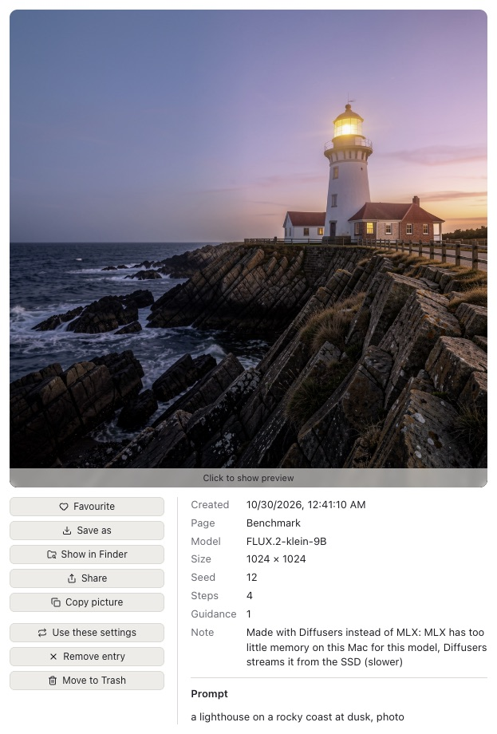
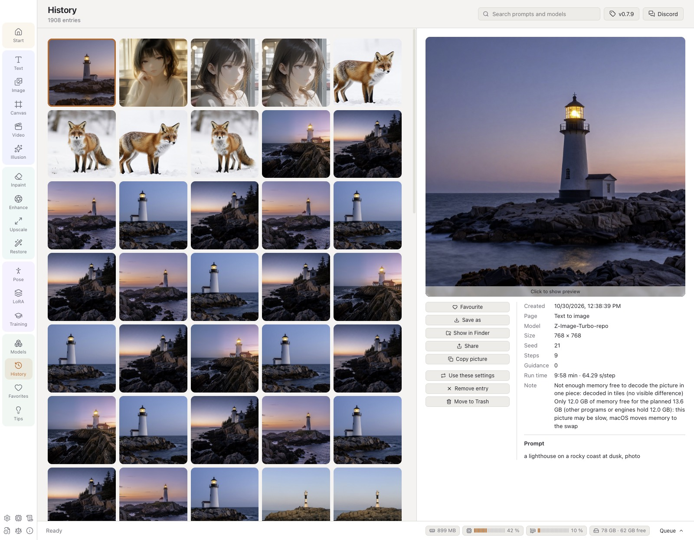
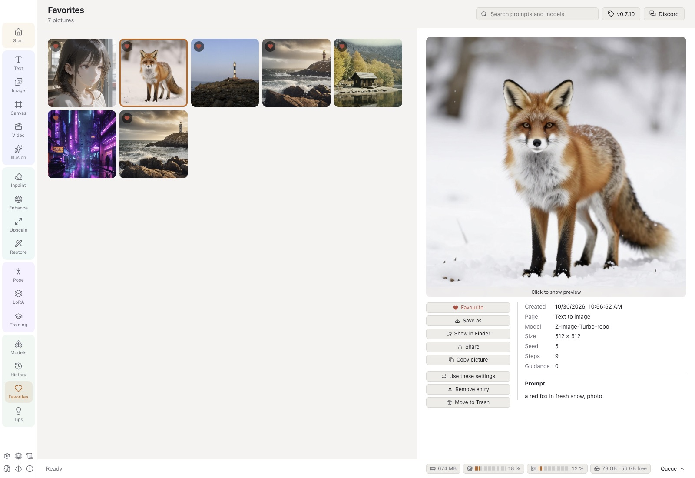
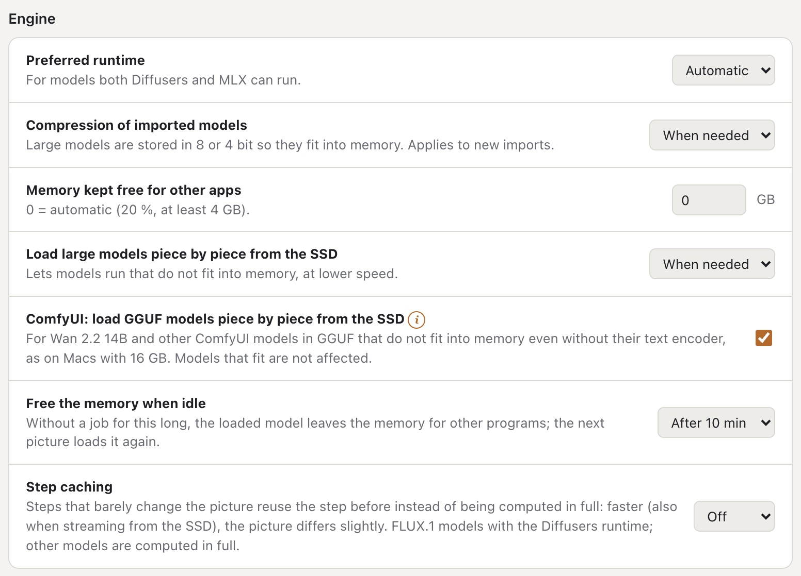

# VulKara user guide

**English** · [Deutsch](de/USER_GUIDE.md) · [Español](es/USER_GUIDE.md) · [Português (Brasil)](pt-BR/USER_GUIDE.md) · [Português (Portugal)](pt-PT/USER_GUIDE.md)

VulKara, *your local AI image generator with high privacy*, makes pictures and short videos and restores old photos on a
Mac with Apple silicon. Everything is computed on the Mac itself; the network is only used to download runtimes,
models and the descriptions of LoRAs, and to look for updates. This guide describes every page of the app, what each
setting does, and where the app keeps its data.

## Contents

1. [Getting started](#1-getting-started)
2. [The window](#2-the-window)
3. [Text to image](#3-text-to-image)
4. [Styles](#4-styles)
5. [Image to image](#5-image-to-image)
6. [Inpainting](#6-inpainting)
7. [AI Canvas](#7-ai-canvas)
8. [Image to video](#8-image-to-video)
9. [Upscale](#9-upscale), [Enhance: photo tools](#enhance-photo-tools)
10. [Restore](#10-restore)
11. [Pose editor](#11-pose-editor)
12. [Illusion](#12-illusion)
13. [LoRAs](#13-loras)
14. [Training](#14-training)
15. [Models](#15-models)
16. [History](#16-history)
17. [Tips & tricks](#17-tips--tricks)
18. [The large view](#18-the-large-view)
19. [Settings](#19-settings)
20. [Hardware, Logs, Changelog, Licenses, About](#20-hardware-logs-changelog-licenses-about), [Reporting a problem](#reporting-a-problem)
21. [Content rules](#21-content-rules)
22. [Where the data is](#22-where-the-data-is)
23. [Troubleshooting](#23-troubleshooting)

---

## 1. Getting started

### Installing

VulKara comes as a DMG. Open it and drag VulKara into *Applications*. The app and the DMG are signed with a Developer
ID and notarized by Apple, so macOS only asks once whether to open an app downloaded from the internet. A build that
was signed but not notarized is stopped by Gatekeeper at the first start on another Mac: open **System Settings →
Privacy & Security**, scroll to the message about VulKara and click **Open Anyway** (or Control-click the app in the
Finder and choose **Open**). This is needed only once.

With [Homebrew](https://brew.sh) VulKara can also be installed from the terminal: `brew install --cask revil-O/tap/vulkara`. Later versions then come
with `brew upgrade --cask vulkara`.

### The splash

At start a window with the forge picture appears: the rune hammer strikes the anvil, the sparks turn into glowing
pixels, and the valkyrie is forged from them. The name joins the two: Vulcan, the Roman god of the forge, and Kára, a
valkyrie of Norse legend. Below the name are the tagline, the version and the copyright; the picture is marked
with the EU icon *AI GENERATED* in its lower right corner. The app loads behind the
picture meanwhile (*Getting ready …*); once it is ready and the splash has been shown for five seconds, the
splash closes by itself and the app opens. A click (or ↩ or Space) closes it earlier, as soon as the app is
ready. The splash is a small window of its own: even with *Prefer tabs: Always* in the macOS settings it does not open
as a tab of the main window.

### The Start page

The Start page shows three steps. Each step gets a check mark once it is done:

1. **Install a runtime** (Settings → Runtimes). A runtime is the software that runs the models. Start with
   **Diffusers (Apple GPU)**: it runs most models, and it also runs the importer, the pose detection and the content
   filter. **MLX** is faster for FLUX and Z-Image models and the only runtime for Krea 2, Ideogram 4 and FLUX 3 Image Klein. **ComfyUI** is optional
   and needed for video, upscaling and Anima, Lumina 2 and Pony V7 models.
2. **Get a model** (Models → Recommended). For a first try, use *SDXL 1.0* or *DreamShaper XL v2 Turbo* on a Mac with
   16 GB of memory, or *Stable Diffusion 1.5* on one with 8 GB.
3. **Create your first picture** (Text). Describe the picture and press **Generate** or ⌘↩. The step is ticked when
   the first picture is finished (or when the history already holds one), and it stays ticked even after the history
   is emptied.

Below the steps, the page counts the installed runtimes, models and LoRAs.

The menu at the top right sets the language of the app (*System*, English, Deutsch, Español, Português (Brasil),
Português (Portugal)), the same
choice as **Settings → Appearance → Language**.

**System requirements:** macOS 14 (Sonoma) or newer on Apple silicon (M1 or newer), at least 8 GB of memory (16 GB or more for SDXL,
32 GB or more for the large FLUX models), and free space on the SSD for the runtimes (about 1–1.5 GB each) and for
the models (2–35 GB each).

## 2. The window

| Part | What it does |
| --- | --- |
| **Navigation rail** (left) | Groups the pages, each group in a tint of its own: *Start*; *Create* (new pictures): Text, Image, Canvas, Video, Illusion; *Edit* (a picture you have): Inpaint, Enhance, Upscale, Restore; *Tools*: Pose, LoRA, Training; *Library*: Models, History, Favorites, Tips. In a window too low for them, the rail gets wider and shows the groups in two columns. The icons at the bottom open Settings, Logs, Changelog, Licenses and About. |
| **Work area** (middle) | The input of the page (prompt, picture, canvas) and, below it, the results of this page. A result whose file was deleted or moved shows as *File missing*;  removes it from the list. |
| **Settings panel** (right) | Model, style, size and everything else that shapes the result. |
| **ⓘ** and **!** | Small orange badges whose text opens when the pointer is on them: **ⓘ** (a ring) is plain information, **!** (filled) tells that the app does something differently from the standard, e.g. values that differ from the model's suggestion or a model that runs streamed from the SSD. |
| **Job bar** (bottom) | The running job: progress, time left, seconds per step, and **Cancel**. Four chips show what the Mac is doing: the memory VulKara and its engines hold, the CPU and the GPU as level meters, and the SSD streaming caches with the room left on their disk (orange below 20 GB). A click on them opens **Hardware**. **Queue** opens the list of all jobs. |

Pages stay alive when you switch between them. A half-written prompt is still there when you come back, and so is a
canvas or a pose. Each generate page also remembers its settings after a restart.

### The queue

- Jobs run **one at a time**, in the order they were added. You can add more jobs while one is running.
- **Pictures** > 1 adds one job per picture. The seeds count up from the chosen seed, or from a random one, so every
  picture of a series can be made again.
- In the queue panel, **Cancel** stops the running job and **Remove** takes a waiting or finished job out of the list.
  **Clear finished** empties the list of finished jobs.
- When the last waiting job is done, the Mac plays a short sound. You can switch this off in Settings → Content →
  *Play a sound when the queue is finished*.
- No job starts while a LoRA is training.

## 3. Text to image

Describe the picture in the prompt field and press **Generate** (or ⌘↩). Results appear below the prompt as tiles. A
running job shows its progress on its tile, and a waiting job shows its place in line. Click a tile to open it in the
[large view](#18-the-large-view).

- **×** in the corner of a tile takes it out of the list (the picture stays in the history); on a running job it
  cancels it. Cancelled and failed jobs are removed the same way.
- A job tile shows the essentials. The pointer on its **ⓘ** opens all details: the full prompt, size, steps and seed,
  a note on how it was made, and the whole error of a failed job.
- An **ⓘ** on a picture opens its note the same way, for example when it was made with Diffusers instead of MLX.
- **Prompt upsampler** (FLUX 3 Image Klein, Text to image, next to Generate): FLUX 3 is trained on full scene
  descriptions; the upsampler, Black Forest Labs' own (4 bit, MLX), first writes one from your prompt – subject,
  setting, light, camera, colours. A prompt that already is a full description goes as written, and so does the
  prompt of an edit with a picture. It is downloaded once (5.7 GB) with the button next to the option or on the
  Models page (Helper models); it is loaded only for the prompt (about 30 s) and freed again, and the description it
  wrote becomes the picture's note.

  

- **EU AI label** (next to Generate): puts the European Commission's icon for AI content into the lower right corner
  of each picture, visibly. *AI GENERATED* for pictures made from a prompt (Text, Illusion), *AI MODIFIED* where a
  picture of yours is changed (Image, Inpaint), or the round *AI*. **Auto tone** takes the black icon on a light corner
  and the white one on a dark corner; *Dark* and *Light* fix it. Sizes small, medium and large; **Subtle** is the
  icon at 50 % transparency. A preview shows the chosen icon. It is put in once the content filter passed the picture;
  every picture carries the note in its file anyway. Not for videos.
- A labelled picture keeps a copy without the label (in the hidden folder `.unlabelled` next to it). Used as the input
  of Image, Inpaint, Enhance, Upscale or Restore, that copy is taken, so the new picture gets one label instead of the
  old one showing through. Moving a history entry with its files to the Trash moves the copy too.

  

  

| Setting | Range | What it does |
| --- | --- | --- |
| **Model** | installed image models | The model decides most of the look. See [Switching the model](#switching-the-model) for what changes with it. |
| **Style** | 20 styles in 4 groups | Wraps the prompt in a style template, see [Styles](#4-styles). |
| **Size** | 1:1, 4:3, 3:2, 16:9, 3:4, 2:3, 9:16 | Each tile shows its proportions. The size is chosen to match the number of pixels the model was trained for. Width and height can also be chosen directly. |
| **Steps** | 1–80 | More steps give more detail, up to a point. 20–30 suits most models; turbo models need 4–8, and more only take longer. |
| **Guidance** | 0–20, in steps of 0.1 | How closely the picture follows the prompt. The ruler above the slider marks 0, 5, 10, 15 and 20. SDXL works best at 5–7, SD 1.5 at 7–9, FLUX at 3–4. |
| **Control** | None, Pose, Depth, Edges, Line art, Scribble, Tile | Guides the composition with a control picture, see below. Only shown when the model supports it. |
| **Sampler** | depends on the family | The method that removes noise step by step. *Default* is the model's own. The second list sets the noise schedule (Karras, Exponential, Beta); it is off while the sampler is *Default*. |
| **Seed** | number or empty | The same seed with the same settings gives the same picture. Empty means random; the dice button sets it back to random. |
| **Pictures** | 1–20 | How many pictures are made, each with its own seed. |
| **LoRAs** | up to 3 | Add-ons that teach the model a style, person or object, each with its own weight (−2 to 2; the − and + next to it step it by a tenth, also on a phone). Only LoRAs of the model's family are offered. |
| **Not in the picture** | text | The negative prompt: what should not appear. Only shown when the model supports one. |

### Switching the model

The first model of a page brings its own steps, guidance and size. After that, choosing another model keeps the
settings, so that models can be compared with the same ones:

- **Steps, guidance, seed and size** stay as they are. When they differ from what the new model suggests, an orange
  **!** appears above the sliders next to **Model defaults**: the pointer on it shows the suggestion (*This model
  suggests 4 steps and guidance 0, 1024×1024*), and the button sets it.
- **Where the suggestion comes from**: when a model's card names them, the steps, guidance, sampler, sigma schedule
  and negative prompt of its maker are read on import and become the model's own defaults; the hint then names the
  sampler too (*Its maker recommends the sampler DPM++ SDE Karras.*), and **Model defaults** sets it with the rest. A
  model whose card says nothing keeps the values VulKara holds for its family.
- **Values the model is not made for** get an orange **!** next to *Steps* or *Guidance*, with a button that sets
  the model's own value: steps more than twice what a distilled model is made for (*Made for 4 steps: more take
  longer without a better picture.*), guidance on a model that has none (FLUX.1 [schnell], a distilled FLUX.2
  [klein]), and guidance above 1 on a model made without it (SDXL Turbo, Z-Image-Turbo, Chroma1-Flash), where every
  step runs twice. On the Canvas the **!** shows next to *Steps*.
- Only a **size** the new model can not compute changes, to the nearest one it can in the same proportions (SD 1.5 goes
  up to 768 px). Back on a model that can, the size chosen before returns, unless you changed it in between.
- **Sampler**: the chosen sampler stays chosen. A model that does not have it runs with its default; an orange **!**
  next to *Sampler* says so when the pointer is on it. Switching back brings it back.
- **Only the maker's samplers**: when a model's card names the samplers its maker runs it with, the list shows only
  those, with *Default* (the recommended one) first; an (i) next to *Sampler* says so. A card that names none keeps the
  full list.
- What the new model can not take goes: LoRAs of another family and a control type it does not have. A model's own
  negative prompt is filled in only when the field is empty.
- A model the app recognised but can not run yet says so on the page before anything is sent.

### Control pictures (ControlNet)

**Control** keeps the composition of a control picture:

| Kind | Control picture | SD 1.5 | SDXL | SD 3.5 M | SD 3.5 L | FLUX.1 |
| --- | --- | :-: | :-: | :-: | :-: | :-: |
| Pose | a skeleton from the [Pose editor](#11-pose-editor), or a photo whose pose is detected |  |  | | |  |
| Depth | a depth map, or a photo whose depth is estimated |  |  |  |  |  |
| Edges (Canny) | white edges on black, or a photo whose edges are traced |  |  |  |  |  |
| Line art | a line drawing, or a photo turned into one |  |  | | |  |
| Scribble | a rough sketch, or a photo reduced to one |  |  | | |  |
| Tile | a picture whose content is kept while details are repainted | |  | |  | |

- Leave **It is a photo: prepare it first** on when the control picture is a normal photo. Switch it off when the
  control picture is already a skeleton, depth map or edge picture.
- **Weight** (0–2) sets how strictly the result follows the control picture.
- The control model is downloaded the first time it is used.

## 4. Styles

A style surrounds the prompt with words that set the look. For some styles it also adds words to *Not in the
picture*. The picker shows a preview picture for every style. The orange-framed headers group the styles:

| Group | Styles |
| --- | --- |
| **Photo** | Enhance, Photographic, Cinematic, Analog Film, Black & White, Romantic |
| **Illustration** | Anime, Digital Art, Comic Book, Fantasy Art, Science Fiction, Line Art |
| **Stylized** | Neon Punk, Isometric, Pixel Art, Tile Texture |
| **3D & Craft** | 3D Model, Low Poly, Origami, Modeling Compound |

*No style* uses the prompt as written. The style is saved with every job, so *Use these settings* brings it back
later.

<table>
<tr>
<td> <b>Cinematic</b>: a lighthouse on a rocky coast at golden hour</td>
<td> <b>Analog Film</b>: a small wooden cabin by a mountain lake</td>
</tr>
<tr>
<td> <b>Digital Art</b>: a red fox sitting in a snowy forest</td>
<td> <b>Fantasy Art</b>: an astronaut tending a greenhouse on the moon</td>
</tr>
</table>

All made with Juggernaut XL v7, 25 steps, guidance 6.

## 5. Image to image

Turns an existing picture into a new one: another season, another style, a sketch turned into a painting.

- **Choose a picture**: click the field, or drop a picture file onto it (PNG, JPEG, WebP or BMP). The click opens
  the picture picker: your results from the history, newest first, with a search (prompt, model, page) and a
  *Favourites* filter; one click takes a picture. **From disk …** opens the file dialog instead.
- **Zoom into the picture** (here and on Inpaint, Enhance, Upscale and Restore, also while painting a mask or
  selecting objects): ⌘-scroll or pinch zooms towards the pointer, up to 800 %; scrolling then moves the picture,
  and so do Space-drag or the middle mouse button. The small controls in the lower right corner (they show when the
  pointer is over the picture) zoom out, zoom in and fit it again. Painting and clicking keep working while zoomed.
- **Change** (0.05–1): how far the result moves away from the picture. At 0.3 the colours and details change; at
  0.6 the motif changes while the composition stays; above 0.8 little of the picture remains. FLUX.2 and Qwen-Image
  2.1 models do not use this slider; they take the picture as a reference.
- The result has the proportions of the picture. For a different size, tick **Own size instead of the picture's
  proportions**.
- All other settings work as in [Text to image](#3-text-to-image).

<table>
<tr>
<td> Text to image</td>
<td> Image to image, change 0.6: <i>the same lighthouse in a snow storm</i></td>
</tr>
</table>

## 6. Inpainting

Repaints one part of a picture and keeps the rest.

1. Choose the picture.
2. **Paint** over the part that is to change. **Erase** takes paint away. **Size** sets the brush (1–30 % of the
   shorter side of the picture). The arrow button undoes the last stroke, and the bin removes all paint.
3. Describe what should appear in the painted part, or leave the prompt empty to just remove something.
4. **Change** (default 100 %): lower values keep more of what is there.

Models that can inpaint are SD 1.x, SD 2.x, SDXL, SD 3.5, FLUX.1, Chroma, Qwen-Image and Z-Image. Special inpainting models such as *SD 1.5
Inpainting* give the cleanest borders.

## 7. AI Canvas

An endless surface on which pictures are painted, extended and repainted. The orange **frame** marks where the next
picture appears. What **Generate** does depends on what is inside the frame:

| In the frame | Result |
| --- | --- |
| nothing | a new picture |
| partly a picture | the empty part is filled so that it continues the picture (outpainting) |
| a picture with mask strokes | the masked part is repainted |
| a picture without mask strokes | a variation (with **Change** 0.1–0.9) |

The panel always explains which of these will happen.

**Tools and keys:**

| | |
| --- | --- |
| **Move** (V) | Drag a picture to move it. Drag a corner of the selected picture to resize it: the opposite corner stays and the proportions are kept (hold ⇧ for free proportions); its size shows below it. Drag the frame's border, or an empty part of it, to move the frame (it snaps to 8 px). Drag empty space to move the view. |
| **Fit into the frame** | Makes the selected picture as large as fits into the frame, centred, proportions kept. |
| **Frame corners** | The round handles at the frame's corners resize it freely: the opposite corner stays, the sides snap to 64 px, from 256 to 2048 px and at most twice the model's pixels (SDXL: about 2 megapixels), so a 16 GB Mac keeps up. The frame then reads *free*; a ratio button sizes it anew. |
| **Mask brush** (B) | Paint the part to repaint inside the frame. The brush size is 8–200. |
| Scroll / pinch, ⌘-scroll | Scrolling moves the view; pinching or ⌘-scrolling zooms (5 %–400 %). |
| ⌫ | Removes the selected picture. |
| ⌘Z | Undo (up to 50 steps). |
| **Show everything** | Fits the view to all pictures. |

- **Add a picture** places a picture at the frame, chosen in the picture picker (from the history or from disk).
- Below the surface, a row shows this page's queue and recent results, like the other pages: a waiting or running
  job with its progress, a finished picture to open in the large view. A finished picture also appears on the surface
  where the frame was.
- **Export PNG** saves all pictures as one PNG file.
- **Frame** sets the proportions: 1:1, 3:4, 4:3, 16:9 or 9:16, or drag the frame's corners for any size.
- Extending needs an SDXL, SD 3.5, FLUX.1, Chroma or Z-Image model, or an inpainting model. Other models are marked *(new pictures
  only)*.
- The canvas, including its pictures, view, prompt and model, is kept after a restart.

## 8. Image to video

Turns a picture into a short video. It needs the ComfyUI runtime and a Wan 2.2 model (Models → Recommended).

- **Start picture**: the first frame. The video gets its proportions.
- **Prompt**: what happens, such as movement, camera and mood: *the astronaut slowly waters the plants, gentle
  camera push in*.
- **Length**: 1–5 seconds.
- **Resolution**: 480p or 720p.

Video takes much longer than pictures. A one-second clip at 480p took about 8 minutes on an M2 with 24 GB, and longer
clips need much more memory.

## 9. Upscale

Enlarges a picture 2× or 4× and adds detail, using Real-ESRGAN x4plus (64 MB, BSD-3, downloaded on first use)
through the ComfyUI runtime.

- **Enlarge**: preset tiles ×1.5, ×2, ×2.2, ×2.5, ×3, ×3.5 and ×4, and a slider in steps of 0.1 for anything between.
  The model always works at 4×; a smaller factor scales its result down afterwards (cleaner than enlarging normally).
- A picture over 2048 px on the longer side is made smaller to 2048 first; the result is still the factor chosen
  times your picture, up to four times the smaller one (the result's note says so).
- The large view of any picture has an **Upscale** button that sends the picture here.

### Enhance: photo tools

**Enhance** (under Edit) works on a photo with small models on this Mac: no prompt, no diffusion model, and every
result goes through the queue, the content filter and the history like any other. The list on the right shows each
tool with a few words and where it runs: **GPU** (the original PyTorch weights through spandrel) or **CPU** (an ONNX
model), on a violet or teal tag. Its (i) badge has the rest: the model, what it does in full, size limits and
download size, and below a line the licence, its note and the source.

| Tool | What it does | Runs on | Size · licence |
| --- | --- | --- | --- |
| **Sharpen (NAFNet)** | removes blur from shaken or slightly out-of-focus photos | CPU | 92 MB · MIT |
| **Denoise (SCUNet)** | removes the noise of real photos (high ISO, low light) | GPU | 72 MB · Apache-2.0 |
| **Upscale ×4 (SwinIR)** | enlarges real photos four times and recreates fine detail; a picture over 2048 px on the longer side is made smaller to 2048 first (the result's note says so), so results reach at most 8192 px | GPU | 67 MB · Apache-2.0 |
| **JPEG cleanup (FBCNN)** | removes the blocks and halos of strong JPEG compression; finds the quality itself | GPU | 288 MB · Apache-2.0 |
| **Remove background (BiRefNet)** | the main subject on a transparent background, or its mask | CPU | 115 MB · MIT |
| **Select objects (SAM 2.1)** | click on what to select (⌥-click on what does not belong to it) | CPU | 155 MB · Apache-2.0 |

- **Download** fetches a tool once from its publisher at a fixed, checked version (a Hugging Face commit or a GitHub
  release file with its checksum); all six are free to use, also commercially. The trash icon moves an installed
  tool to the Trash. The GPU tools need the Diffusers runtime with spandrel: an older runtime offers the update in
  Settings → Runtimes.
- **Strength** mixes the result of Sharpen, Denoise or Upscale with the original (100 % = only the tool's result).
- **JPEG quality** (JPEG cleanup): *Auto* lets the tool estimate how strongly the picture was compressed. Tiles 10–90
  and a slider set it by hand: a lower quality cleans more strongly (blocks, halos, but also fine detail), a higher
  one more gently.
- **Character** (Denoise): *Natural* keeps the photo faithful; *Sharp* uses SCUNet's GAN weights, crisper, with fine
  texture made up where the noise was. Sharp is downloaded once (72 MB) when first used.
- **Enlarge** (tools that enlarge, such as Upscale ×4): the same preset tiles and slider as on the Upscale page; the
  result is that many times the size of your picture.
- **Remove background**: *Transparent* gives a PNG with a transparent background, *Mask* the mask in black and white.
- **Select objects**: every click refines the selection, which shows over the picture (everything else dimmed).
  **Cut out** and **Save mask** make a picture of it; **Paint in Inpaint** opens the Inpaint page with the picture
  and the selection already painted as the mask, ready to be painted anew.
- **Import a model file**: other photo models, if their licence allows it. PyTorch weights (.pth, .safetensors) run
  on the GPU when spandrel knows the architecture (ESRGAN, SwinIR, HAT, DAT, NAFNet, SCUNet, FBCNN, SPAN, OmniSR and
  others; colour picture in and out, enlarging 1, 2, 3, 4 or 8 times); .pth files are read without running any code
  they might carry. ONNX models run on the CPU and are checked first: one picture in (1 × 3 × height × width), one
  picture out (the same size or 2, 3, 4 or 8 times larger) or a mask, values 0–1 or 0–255; models with operators of
  their own are refused. Large pictures are worked on in tiles.
- Rough times on an M2 for a 768 × 768 photo: JPEG cleanup 2 s, Denoise 4 s, Remove background 8 s,
  Sharpen 15 s, Upscale ×4 35 s; a click when selecting a few hundredths of a second.

## 10. Restore

Restores old photos: colour casts, faded colours, soft and blurred pictures and faces, scratches, creases, spots, holes,
and black and white. Choose the photo (or drop it onto the field) and press **Restore** or ⌘↩. A black-and-white or
toned photo is recognised and gets *Colour a black-and-white photo* switched on.

A photo with a colour profile (Display P3, Adobe RGB, or HDR such as *Rec. 2020 PQ*, which some upscaling apps and
iPhones write) is converted to sRGB first; read without its profile it would come out flat and grey. This applies to
every page that takes a picture.

**Steps** (any combination):

| Step | How |
| --- | --- |
| **Correct colour cast and contrast** | Without a model: white balance (a red or yellow cast is neutralised; a toned black-and-white photo becomes neutral grey), levels, and local contrast on the brightness only. Light tones are compressed instead of clipped, so a white dress keeps its folds. **Strength** 20–100 % (default 80 %). |
| **Repair damage (AI)** | A FLUX.2 model edits the photo (Models → Recommended: FLUX.2 [klein]). **Steps of the model** 2–12. Without paint it repaints the whole photo: soft clothing, leaves and backgrounds get real detail, but faces may become other people's; the faces are therefore taken from the photo before the repair when *Restore faces* is on. |
| **Remove dust and scratches** | Without a model of yours: small specks and thin scratches that stand out from calm surroundings are found and filled from what is around them (LaMa). Leaves and fabric are left alone, as are the eyes and the mouth. **Sensitivity** 0–100 % (default 50 %); a higher one finds fainter specks, now and then a small detail of the photo too (the preview shows it). |
| **Rebuild soft details (AI)** | Real-ESRGAN (the Upscale helper, 64 MB) rebuilds edges and textures of the whole photo: it is made as much smaller as it is soft (**Softness of the photo** × 1.25–3, default × 2) and four times larger again. **Strength** 20–100 %. It sharpens what the photo still shows; texture that is lost entirely (fabric, leaves) only *Repair damage (AI)* makes up. |
| **Restore faces (AI)** | CodeFormer (0.4 GB, downloaded once) restores blurred faces, taken from the photo before the AI steps. **Faithful to the photo** 50–100 % (default 90 %): lower values make up more detail. **Strength** 20–100 % (default 60 %). Faces smaller than about 14 pixels are left alone. CodeFormer's licence allows non-commercial use only. |
| **Colour a black-and-white photo** | DDColor (0.9 GB, downloaded once) adds colour to the brightness of the photo, so no shape or detail can change. **Colour strength** 50–150 %. |
| **Less grain, sharper details** | Without a model: the brightness is denoised and its edges sharpened, the colour only smoothed a little. **Strength** 10–100 %. |

**The faces** CodeFormer will restore are shown as rounded frames over the photo, numbered. Drag a frame onto the face
where the detection is off, or leave a face out with its **×**; **Find again** puts the frames back. The faces are found
by YuNet (a small face detector, downloaded once).

**Size of the result**: *As the photo* or *Twice the size*.

**Preview** restores only a part of the photo, quickly: what you have zoomed in on (⌘-scroll), else the largest face (or
the middle), at most 768 pixels. It is not kept in the history. Above the note field, the **compare slider** shows the
newest preview or result of the photo over the original: left of the line the change, right of it the original; drag
the line (or move it with ← → when it is focused), ⌘-scroll zooms both.

**On a Mac with 16 GB** the AI repair works too: it paints at about one megapixel in the photo's proportions and its
result is brought back to the photo's size, so a large scan needs no more memory than an ordinary FLUX.2 [klein]
picture (a 768 × 1024 photo with 12 GB kept free: 5 minutes on an M2).

**Paint the damage**: with the brush (as in Inpainting) paint over scratches, creases, spots and holes. There the AI
repairs; everywhere else the photo stays as it is. Before the AI sees the photo, the painted places are filled from
their surroundings by LaMa (a small fill model, Apache 2.0, downloaded once; without it a simpler filling is used), so
the model only has to refine them. Without paint the AI may touch the whole photo, within the allowed change.

**Guard rails** for the AI step:

- **Keep the original outside the painted damage**: the result is put together from the original and the repaired
  places.
- **Refuse results whose faces changed**: the faces of the result are compared with those of the photo.
- **Allowed change** (1–30 %, default 6 %): how much the structure of the photo may change.
- **Rules for the AI**: fixed rules that are always sent (only remove damage; keep composition, every person, face,
  expression, pose and hair, clothing, objects and writing; add, remove or invent nothing), and your **own rules**,
  e.g. *Keep the house number*. Own rules are kept for all restorations.

A repair that breaks a guard rail is refused with the reason.

**Templates** set steps, guard rails and the note for the usual kinds of old photos: *Black and white, damaged*,
*Black and white to colour*, *Colour cast (red or yellow)*, *Faded colour photo*, *Only colour it* and *Heavy damage
(creases, holes)*. Under the note field, **Save as template** keeps the current steps, guard rails and note under a
name of your own; own templates appear after the built-in ones and are deleted with their **×**.

The **note** is a three-line text field (it can be made taller at its lower right corner) for what the photo shows,
e.g. *a wedding photo from the 1950s*; it helps the AI.

## 11. Pose editor

Builds pose skeletons (OpenPose: body, hands and face) for the *Pose* control in Text to image.

- **Drag** a point to move it. **⇧-drag** moves the whole person, or only the hand or face that was grabbed. Moving
  a wrist moves its hand; moving the nose moves the face.
- **Double-click** a point to hide it, for example for a hand behind the back. Hidden points are shown dashed, and
  another double-click shows them again.
- **People**: Person 1…n. **Template** offers full-body poses (Standing, T-pose, Arms up, Walking, Running, Sitting,
  Model, Runway, Turning, Bending, Thinking, Kneeling, All fours, Lying, Reclining) and portraits (smiling, hand on
  chin, hands at face, waving, peace sign …). **Add** adds a person with the template, **Apply** gives the selected
  person the template, **Mirror** flips it, **Remove** deletes it.
- **Hands**: Open, Relaxed, Fist, Pointing, Peace, Thumbs up, OK, Flat closed, Index on cheek, Loosely curled.
- **Face**: Neutral, Smile, Open mouth, Surprised, Sad, Eyes closed.
- **Turn and size**: ±15° and ×1.1 / ÷1.1, for the person or the selected part.
- **From a photo**: detects the people in a photo. This needs the Diffusers runtime. *Show the photo* lays the photo
  under the skeletons.
- **Use in Text to image** sends the skeleton as a pose control picture, together with its size. **Save PNG** saves
  it as a file.

Poses work with SD 1.5 (body only), SDXL and FLUX.1. Remove the face of a person whose face will be covered.

## 12. Illusion

Hides a pattern or a word in a picture, which shows up when you squint or look from a distance.

- **Hidden pattern**: Spiral, Rings, Checkerboard, Stripes, Text (up to 24 letters) or Own picture (a black-and-white
  picture, QR code or logo). Light parts of the pattern become bright in the picture, and dark parts dark.
  **Density** (2–24), **Blur** (0–12) and **Invert** shape the pattern.
- **Pattern strength** (0.5–2): about 0.8 is subtle, 1.2 clear and 1.6 dominant.
- Needs an SDXL or SD 1.5 model. The pattern model (5 GB for SDXL) is downloaded on first use.

## 13. LoRAs

A LoRA is a small add-on (usually 20–400 MB) that teaches a model a style, a character or an object. The LoRA page
shows all installed LoRAs, sorted by family (SD 1.x, SDXL, SD 3.5, FLUX.1, Chroma, FLUX.2, FLUX 3, Krea 2 …). You can filter them by
family and search their names, trigger words and categories.

**The panel of a LoRA:**

- **Name**: the pencil gives the LoRA a name of its own in the app, see [Names in the app](#names-in-the-app).
- **Trigger words**: words that switch the LoRA on in the prompt. The panel shows where they come from (*from
  Civitai*, *from the training data*, *edited by you*). Click a word to copy it, **×** removes it and **+ add** adds
  one.
- **Category**: your own grouping, used by the search.
- **From its page**: what the LoRA's makers wrote on Civitai or Hugging Face: description, tags, version notes,
  licence and commercial use. It is read once, cached, and can be refreshed with the arrow button.
- **Recommended settings**: strength, steps, guidance, sampler and clip skip, as given by the makers or worked out
  from their example pictures.
- **Prompts of its makers**: example prompts. **Try it** opens them in the strength comparison.
- **How to use it**: a short guide to getting good results with this LoRA.
- **Training data**: what the LoRA was trained on (resolution, pictures, epochs, steps, learning rate) and the tags
  used most often. Click a tag to add it as a trigger word.

### Compare strengths

**Compare strengths** (the tab at the top, or the button in the panel of a LoRA) makes the same picture with the same
seed at several LoRA strengths, for example `0, 0.5, 1` (0 = without the LoRA, up to 8 values between −2 and 3). A
**second LoRA** of the same family can be compared at the same time. **Model** offers the installed models the LoRA
fits; steps, guidance and size are the model's own. **Put them into the prompt** adds the trigger words, and an empty
seed means one random seed for the whole comparison. This shows quickly how strong a LoRA should be.

To use a LoRA, add it in the **LoRAs** section of a generate page and put its trigger word into the prompt.

### Which model a LoRA belongs to

A LoRA only works with the kind of model it was trained for. VulKara works this out when a LoRA is imported:

1. from its **structure**, the names and sizes of its layers;
2. where the layers leave a choice, or tell nothing, from its **metadata** (what the training tool wrote into the
   file);
3. then from its **source**: the base model Civitai names, or the `base_model` of a Hugging Face repository.

A LoRA that none of these tells is refused with a message; it is never filed as SDXL just in case. Where a family has
models of different sizes, the sub-base is kept as well: FLUX.2 [klein] 4B, [klein] 9B and FLUX.2 [dev] LoRAs are
kept apart (their layers have other sizes), and so are Wan 5B and 14B. The generate pages offer only LoRAs that fit the
chosen model.

When a LoRA is loaded, the engine also counts how many of its layers found their place in the model. Below 90 % the
job stops with a clear message (*The LoRA … does not fit this … model: only 62 % of its layers (…) found their place*)
instead of making a picture with a half-applied LoRA.

**Which LoRA files load**: LoRA, LoCon and DoRA files in the formats of the common trainers: kohya / OneTrainer,
ai-toolkit, diffusers / SimpleTuner and files saved by ComfyUI. Files in names the runtime does not read itself are
converted when they are loaded: FLUX.1 and Chroma LoRAs in ComfyUI's original block names, peft dumps, SDXL LoRAs of
ai-toolkit (`lora_transformer_`), files with mixed name styles, Qwen-Image 2.1 LoRAs of ai-toolkit (their fused MLP
layer is split in two) and Z-Image LoRAs in ComfyUI's or kohya's names (their fused attention layer is split in three;
with the MLX runtime as well, which also refuses a Z-Image LoRA below 90 %). LyCORIS **LoKr** and **LoHa** files are not supported yet with the Diffusers runtime: such a
LoRA stops the job with *LoKr/LoHa LoRAs are not supported yet*.

LoRAs of families the app can not run yet (for example HiDream, Lumina 2, HunyuanVideo) are shown on this page
and on the Models page under their family, but no generate page offers them.

Once, at the first start of a version with a better detection, VulKara checks all installed LoRAs and models again
(this needs the Diffusers runtime and waits for it otherwise). A LoRA filed under the wrong family or without its
sub-base, a Chroma checkpoint that was filed as FLUX.1, or a Z-Image LoRA whose label still says that no model can use
it, is corrected; each changed manifest is kept next to it as
`lora.json.bak` or `model.json.bak`. The changes are listed in the log.

### Bake LoRAs into a new model

**Bake into a new model …** (on the LoRA page, in the overview of a LoRA and next to *Compare strengths*, and on the
Training page when a LoRA is ready) makes a model of its own out of a base model and one or more LoRAs with their
strength. The new model needs no LoRA any more, works like any other model, and appears under Models with the LoRAs'
trigger words; when it is used, these words are put into the prompt as the LoRAs would have done it. Its card names
the base and the LoRAs it was made of. The base stays as it is.

- The new model is as large as its base (SD 1.5 about 2 GB, SDXL about 7 GB). Unchanged parts of a diffusers base
  (the text encoders, when no LoRA changes them) are linked instead of copied where the disk allows it.
- Baking needs about the base's size in free memory; the loaded model is unloaded for it, and the queue has to be
  empty. On a Mac with 16 GB SD 1.5 and SDXL fit; FLUX.2 [klein] 4B (about 10 GB) only with little else open. A
  model that does not fit is refused before anything is loaded, with the memory it needs.
- Compressed models (GGUF, FP8, NF4, Q4/Q8 files) can not take a LoRA baked in, nor can ComfyUI models: the list
  shows them greyed out with the reason. Import the base unquantized first.
- On an M2, baking a LoRA into SD 1.5 took 12 s; the baked model gives the same pictures as the base with the LoRA
  (mean difference 3.5 of 255, rounding at 16 bit).

**Export as one file**: the file icon on the card of a baked model (and of any SD 1.x or SDXL model in folder layout)
writes it as one `.safetensors` checkpoint in the original layout, where you choose. Other apps (ComfyUI, Automatic1111,
Forge) load it like any downloaded checkpoint. The queue has to be empty; an SDXL model needs about 7 GB of memory
and disk for it.

## 14. Training

Teaches a model a person, an object or a style from your own pictures, and produces a new LoRA.

1. **Name** the LoRA. A **trigger word** is made from the name (for example `paper_cranes_zqx`); you can change it.
2. **Model to train on**: SDXL (Diffusers runtime), FLUX.2 [klein] or Krea 2 (MLX runtime).
3. **Pictures**: 10–30 good pictures are enough. Use **Add pictures** or **Add a folder**. With a folder, `.txt`
   files with the same name as a picture are used as its caption. Every caption starts with the trigger word.
   Describe in the captions what is *not* meant to be learned, such as background or clothing.
4. **Preset**: *Quick test* (100 steps), *Standard* (500), *Thorough* (1200). You can also set steps (10–5000),
   resolution (512/768/1024), rank (8/16/32) and learning rate.
5. **Start the training**. First every picture passes the content filter, as results do (*Checking the pictures*,
   with Allow nudity off no nudity at all); your pictures are only looked at, never changed or removed. If one does
   not pass, the training does not start and the panel names the pictures to take out. The captions and the trigger
   word are checked like a prompt. Then the panel shows the phase, step, loss curve and time left. The Mac stays
   awake, and generating is paused during the training.

When it is done, **Compare strengths** opens the new LoRA in the comparison. Rough times on an M2: SDXL about 2.5 s
per step at 768 px, FLUX.2 [klein] 4B about 15 s, 9B about 30 s, Krea 2 about 45 s.

## 15. Models

**Recommended** starts with the Mac it runs on (for example *MacBook Pro (13-inch, M2, 2022) · 24 GB*); a model that
fits only streamed from the SSD shows *SSD streaming* with a **!**.

The Models page has three tabs: **Installed**, **Recommended** and **Add**. Downloads and imports run one after the
other and are shown at the top of the page with their progress. Models and LoRAs are only installed while the models
disk has at least 50 GB free; with less, the import is refused and says how much is free (the finders mark such cards
and do not install them).

### Installed

#### Helper models

**Helpers** (or *All*, below the models and LoRAs) shows the small models the app's tools use, in a tint of their own,
each with a picture of what it does: the **content filter** (nudity and age estimate), **Restore** (LaMa fills
damage, DDColor colours), **pose and depth detection** (DWPose, Depth Anything), the **ControlNets** of every model
family, **Real-ESRGAN** for Upscale and the **photo tools** of Enhance. The count says how many of them are on this Mac.

- Each is downloaded when it is first needed anyway; **Download** fetches it ahead (useful before going offline).
- **Move to Trash** frees its space; it comes back the next time it is needed. The content filter is *Required*: it
  checks every result and can not be removed.
- Every helper is fetched at a fixed, checked version (commit and SHA-256), never a newer one unseen; one that was
  downloaded before is checked once.

**Installed** lists everything on this Mac, grouped by kind: **Image models**, **Video models** and **LoRAs**, each
group with its own tint and its count. *All / Models / LoRAs* and the search narrow the list. A model card shows its
architecture and the memory it needs, a LoRA card the family (and sub-base) it is for and its trigger words, and a
*ComfyUI* or *Video* tag where it applies. The buttons on a card:

- **LoRAs** (models only): LoRAs for this model on Civitai or Hugging Face, see [LoRAs for a model](#loras-for-a-model).
- the arrow opens its source page on Hugging Face or Civitai;
- the pencil gives it a name of its own in the app, see [Names in the app](#names-in-the-app);
- **Show in Finder** shows its folder, and **Move to Trash** removes it (it can be put back from the Trash). A model
  that was added as a folder in place is only unlinked; its files stay where they are.

### Models copied from another Mac

An import decides for the Mac it runs on: the memory plan, whether an FP8 file is stored as 8 bit GGUF, the
compressed copies kept for later. A model folder copied from another Mac (for example imported on a Mac with 24 GB
and copied to one with 16 GB) was not imported here, so it does not run here: its card says *Imported on another
Mac* with a **!** that tells which Mac (by its memory), and a job, a bake or a training with it is refused with the
same advice. Two buttons on its card:

- **Import again** moves the copy to the Trash and imports the model again on this Mac from where it came from, under
  the same name: the file on this Mac (when it is still at the same place), the Hugging Face repository or the Civitai
  page. It is checked first; a model that can not be imported here (too large for this Mac) is left as it is.
- **Remove** moves it to the Trash.

Without its original file (a file that is not on this Mac, a baked model) there is only **Remove**: remove it and
import the model from its file under **Add**. Each import notes the Mac it was made on in `model.json`
(`imported_on`: an id made from the Mac, not its serial number or UUID, and its memory); older imports are told by
the memory their plan was made for.

### Model families

| Family | Runtime | Notes | Model / pictures commercially |
| --- | --- | --- | --- |
| Stable Diffusion 1.5, 2.x | Diffusers | also inpainting checkpoints | yes / yes (Open RAIL, use restrictions) |
| SDXL, incl. Turbo, Pony, Illustrious, NoobAI | Diffusers | LoRAs of Pony, Illustrious and NoobAI are told apart from plain SDXL ones | yes / yes (Open RAIL++) |
| Stable Diffusion 3.5 Medium / Large | Diffusers | | with conditions (below USD 1 million revenue) |
| FLUX.1 [schnell] / [dev] | Diffusers or MLX | also GGUF files | schnell yes / yes; dev no / yes |
| Chroma (Chroma1-HD, -Base, -Flash, fine-tunes) | Diffusers | true guidance with a negative prompt (two passes per step, so slower than FLUX.1; Chroma1-Flash needs 12 steps and no guidance – about 7 minutes per picture at 1024 px on an M2 with 24 GB instead of about 52); computed in float16 on M1/M2, about 40 % faster than bfloat16; safetensors and GGUF; single files take FLUX.1's T5 and VAE | yes / yes (Apache 2.0) |
| FLUX.2 [klein] 4B / 9B, FLUX.2 [dev] | Diffusers; [klein] also MLX | image to image takes the picture as a reference; LoRAs kept apart by size | 4B yes / yes; 9B and [dev] no / yes |
| Qwen-Image (and its 2512 update) | Diffusers | GGUF files or the repository; true guidance | yes / yes (Apache 2.0) |
| Qwen-Image 2.1 | Diffusers (diffusers 0.41, Settings → Runtimes → Update) | GGUF files or the repository; generates and edits | no / no (Qwen Research License) |
| Z-Image (Z-Image-Turbo, Z-Image Base, fine-tunes) | Diffusers; the repository also MLX (text to image) | Turbo: 9 steps without guidance; Base: about 30 steps with guidance 3–5 and a negative prompt (the name or Civitai's base model tells which; guidance up to 1 is off); safetensors (also FP8) and GGUF, single files get the Qwen3 text encoder and VAE from the Turbo or Base repository; image to image and inpainting with Diffusers. Tested on an M2 with 24 GB: Turbo about 5½ minutes per picture at 1024 px with MLX (8 bit), 6½ with Diffusers; Base about 33 minutes at 30 steps with guidance (MLX); LoRAs in kohya and ComfyUI names in both runtimes | yes / yes (Apache 2.0) |
| Krea 2 | MLX | | with conditions (below USD 1 million revenue, content filter required) |
| FLUX 3 Image Klein (distilled, Base) | MLX (flux3-mlx) | Black Forest Labs' repository (18.9 GB download, about 19 GB RAM) or VisualInference's MLX repositories in 6 bit (8.4 GB, runs on 16 GB Macs) and 8 bit (9.6 GB); distilled: 16 steps without guidance, Base: 50 steps with guidance 3.5; image to image takes the picture as a reference; LoRAs in Black Forest Labs', diffusers and kohya names; about 6 minutes per picture at 1024 px on an M2 with 24 GB | no / with conditions (below USD 5 million revenue, content filter and AI disclosure) |
| Ideogram 4 | MLX | refuses nudity by itself | no / no |
| Anima | ComfyUI | | no / yes |
| Lumina 2 (NetaYume, Neta Lumina) | ComfyUI | the system prompt the model expects goes before the prompt by itself (the anime fine-tunes use their own); about 30 s per step at 1024 px on an M2 with 24 GB | yes / yes (Apache 2.0) |
| ERNIE-Image (Turbo, SFT) | MLX | strong on text in pictures, posters and comics; Turbo 8 steps without guidance, about 6 minutes per picture at 1024 px (4 bit) on an M2 with 24 GB; the repository's prompt enhancer (7 GB) is not downloaded; text to image | yes / yes (Apache 2.0) |
| AuraFlow, Pony V7 | ComfyUI; the repository Diffusers | on ComfyUI the transformer as GGUF (Pony's Q8_0 / Q4_0); prompts padded to 768 tokens as in Pony's workflow; about 50 s per step at 1024 px on an M2 with 24 GB; the repositories (fal/AuraFlow-v0.3, purplesmartai/pony-v7-base) on Diffusers, there 8 bit on 16 GB; LoRAs for ComfyUI work on both | with conditions (Pony License) |
| Wan 2.2 5B / 14B (video) | ComfyUI | Image to video | yes / yes (Apache 2.0) |

The Licenses page has the full terms. *Preferred runtime* in Settings decides between Diffusers and MLX where both can
run a model.

### Names in the app

The pencil on a card (and in the LoRA panel) gives a model or LoRA a name of its own, for example
*Juggernaut XL – photos* for `JuggernautXL_v7_f8_SDXL`. Only the app uses this name, in the model lists, the job bar,
the history and the large view. The folder and its files keep their names, so jobs, the history and *Use these
settings* still find the model. The card shows the folder's name below the new one, and the search finds both
names. Leave the field empty and save to bring back the folder's name. The name is kept as `display_name` in the
model's `model.json` (`lora.json` for LoRAs), so it is not lost when the app is installed again.

### LoRAs for a model

**LoRAs** on a model's card lists LoRAs made for that model on Civitai or Hugging Face, the most downloaded first.
**Find LoRAs** above the cards does the same without picking a model first. The list follows the model's base: a
Pony or Illustrious checkpoint gets Pony or Illustrious LoRAs (taken from what Civitai says about the checkpoint, or
from its name), a FLUX.1 [dev] model gets FLUX.1 [dev] LoRAs, a FLUX.2 [klein] 9B model gets [klein] 9B LoRAs. The menu
next to the source switch picks another base, and the search field (Return) narrows the list.

Each card shows a preview, the makers, the base, downloads, likes, trigger words, the size and a line on the licence.
**Install** puts the LoRA into the downloads at the top of the page; it then appears under LoRAs and on the LoRA page.
For a Hugging Face repository with several files, the menu on the card picks the file. Some LoRAs need an access token
or a licence accepted on their page; the card says so. The arrow opens the LoRA's page in the browser.

While nudity is not allowed (Settings → Content), LoRAs and pictures for adults are left out: those Civitai marks as
adult or tags or names so, and Hugging Face repositories tagged *not-for-all-audiences*. With nudity allowed, previews
marked as adult are blurred until clicked. The lists are read from the public pages of both sites without a token and
kept for ten minutes; a search sends nothing but the base and the search words.

### Finding models

**Find models** above the cards searches Civitai or Hugging Face for whole models made from a base model: checkpoints
on Civitai, fine-tunes on Hugging Face (a repository in diffusers' layout is taken whole, else the checkpoint file at
its top; the menu on the card picks another file). The menu next to the source switch picks the base, sorted into the
main model groups (Stable Diffusion, SDXL, FLUX, Qwen-Image, Z-Image, Krea · Ideogram · ERNIE, Anima · Lumina · Pony V7, Wan); the LoRA list
uses the same groups. *Any base model*, the first entry and where *Find models* starts, searches all of Civitai or Hugging Face without a base; the search words narrow it. ControlNets, IP-Adapters, upscalers and LoRAs that Hugging Face also lists as fine-tunes are
left out. *File formats* above the cards explains what bf16, fp8, GGUF, fp32, NF4 and the like mean on a Mac, and how
the import handles each.

The cards are the same as for LoRAs: preview, makers, base, downloads, likes, size and licence. The import's check runs for
each card and adds the memory the model needs; a model too large for this Mac's memory is marked *SSD streaming*
(the orange **!** explains it): it runs streamed from the SSD, slower, at full quality. **Install** puts the model into
the downloads at the top. Adult content is handled as for LoRAs.

### Recommended

**Recommended** lists tested models, with the memory they need compared to this Mac's memory and their download
size. A model that needs more memory than the Mac has is marked so:

| Group | Models |
| --- | --- |
| **Base models** | Stable Diffusion 1.5 (+ Inpainting), SD 2.1, SDXL 1.0, SDXL Turbo, SD 3.5 Medium / Large, FLUX.1 schnell (4/8 bit), FLUX.1 dev (16/4 bit), Chroma1-HD, Chroma1-Flash (fast), Z-Image-Turbo, ERNIE-Image-Turbo, FLUX.2 [klein] 4B / 9B, Wan 2.2 TI2V 5B / I2V 14B (video) |
| **Community models** | GonzaLomo Chroma, DreamShaper 8, Realistic Vision 5.1, Counterfeit, DreamShaper XL Turbo, Juggernaut XL v7, epiCRealism XL, JANKU Illustrious XL, Anima Turbo, NetaYume Lumina v4 … |
| **Explicit models** | only listed when nudity is allowed in Settings |

Some models need an access token (Settings → Access tokens) or a licence accepted on their Hugging Face page. The
row says so and links to the page. Accepting the licence is up to you; the app never does it for you.

### Add

**Add** imports a model or LoRA that is not on the list:

| Source | Input |
| --- | --- |
| **Hugging Face** | repository, e.g. `stabilityai/sdxl-turbo`, optionally one file in it (`.safetensors`, `.gguf`) |
| **Civitai** | the model's page URL (with `modelVersionId` for a specific version); `.safetensors` and `.gguf` files |
| **File** | a `.safetensors`, `.gguf` or `.ckpt` file on the Mac |
| **Folder** | a model folder in diffusers layout, or a model folder of this app. It is used in place and not copied. |

**Check** shows, before anything is downloaded, what the model is (model or LoRA, architecture), the download size, how
much memory it needs, whether it will be compressed, whether its licence has to be accepted first, and the trigger
words of a LoRA. A Hugging Face repository without a complete model (no diffusers layout, only single files such as
GGUF quantizations) answers with the list of its model files and their sizes; a click on a file checks that one.
**Download** (Hugging Face, Civitai) or **Import** (file, folder) then starts it; the name field and the compression
menu next to it are optional.

What happens on import:

- **Names**: without a name of your own, a file import is named after the file, which often tells the variant
  (`flux1-schnell-Q4_K_S`). A file with a generic name (`model.safetensors`, `pytorch_lora_weights.safetensors`,
  `adapter_model.safetensors` …) is named after its Hugging Face repository instead.
- **Files already there**: text encoders, VAEs and other parts that another installed model already has (the same
  file, the same size) are linked or copied from there instead of being downloaded again. A single-file Chroma
  checkpoint, for example, takes FLUX.1's T5 text encoder and VAE.
- **Memory planning**: the importer works out how much memory the model needs at most (*GB RAM* on its card) and
  compares it with this Mac's memory minus the reserve (Settings → *Memory kept free*). When it does not fit,
  **Compression** stores large parts in 8 or 4 bit; when even that is not enough and the model allows it, the model is
  marked for SSD streaming (see below). A model that still does not fit is marked *Needs more memory than this Mac
  has*, and **Import anyway** imports it all the same.
- **In stages**: before streaming, a model that does not fit beside its text encoder runs in stages: a new prompt is
  encoded with the text encoder alone (the model is not in memory meanwhile), then the model is loaded in 8 bit and
  makes the picture. A prompt from the prompt cache needs neither step. Qwen-Image 2.1 on a 16 GB Mac runs like this:
  about as fast as streamed in 16 bit (1 830 s instead of 1 700–1 860 s at 1024 px with 40 steps), with less memory
  and without reading about 380 GB from the SSD per picture. *Always* under Settings → Engine → *Load large models
  piece by piece from the SSD* streams in 16 bit instead.
- **SSD streaming**: a 16 bit model that does not fit into memory can run anyway: its denoiser is written once, block
  by block, into the *SSD streaming cache* (about twice the model's size, in the model's folder or in the folder set in
  Settings), and while a picture is made each block is loaded right before it runs. It is slow, as every step reads the
  whole denoiser from the SSD, but it runs where nothing else fits. A fast internal SSD is much quicker than an external
  disk. When the text encoder alone leaves no room (Qwen-Image 2.1 on a 16 GB Mac), it is compressed to 4 bit once and
  cached; the first picture takes several minutes longer for that. What the text encoder makes of a prompt is kept on disk (`prompt_cache` in VulKara's data folder, up to 2 GB, the least used go first): the same prompt again, also after a restart, needs no text encoder. GGUF files (and FP8 files, which become GGUF on
  import) stream too: the first time, the file is unpacked into the streaming cache, which takes a few minutes and
  as much disk space as the 16 bit model.
- **MLX hands over to Diffusers**: the MLX runtime can not stream. When it has too little memory for a FLUX.1,
  FLUX.2 [klein] or Z-Image model (e.g. FLUX.1 [dev] on a 16 GB Mac), the job goes on with Diffusers, which streams it
  from the SSD; later jobs on that model go there directly. The job tile says so while it runs, its pictures carry an
  **ⓘ** that shows it when the pointer is on it, and the large view and the history show it as *Note*. Krea 2, which only MLX runs, frees its text encoder
  after reading the prompt on a small Mac: it fits 16 GB, and a new prompt loads the model again. That takes about
  12 seconds, as the 4 bit model is saved once next to it (`mlx_q4` in the model's folder, about 9 GB) on the first
  start, when the disk has room.

  

## 16. History

Every finished job, newest first, with all its settings.

- **Search** finds words in prompts, model names and labels.
- **Select**: click selects one entry, ⌘-click adds or removes one, ⇧-click selects a range, ⌘A selects all and
  Esc clears the selection.
- **Open**: double-click, ↩ or Space opens the large view.
- **⌫** moves the selected entries **to the Trash**, files included, after a confirmation.

The panel of a single entry shows the picture large (up to half the window wide; a portrait picture only as high as a square one), and below it, in the left third, all its
buttons one under the other: **Favourite**, **Save as**, **Show in Finder**, **Share** and **Copy picture** for each picture, then
the three buttons of the entry. Beside them, behind a line, are the settings, then the prompt and the negative prompt under headings of their own. They stay
there while the large view is open. **Run time** tells how long the job ran, loading included, and its seconds per step
(entries from 0.7.10 on): a picture much slower than the ones before stands out.

- **Use these settings** puts prompt, model, style, size, seed, LoRAs and all other settings back into the page the
  job came from. The model is found again even when its folder has moved.
- **Remove entry** takes the entry out of the history; the files stay.
- **Move to Trash** removes the entry and moves its files to the macOS Trash.

**Share** opens macOS's share menu: Mail, Messages, AirDrop and every app that offers itself there, such as WhatsApp
or Telegram. **Copy picture** puts the picture on the clipboard, to paste it into any app, also Signal or Threema.

The history is kept in its own folder, which can be changed in Settings.

### Favorites

Every picture has a small **heart** in its upper left corner, in the results of the pages and in the history. It
shows when the pointer is over the picture; a click marks the picture as a favourite and the heart stays, filled.
Another click takes the mark away. When a job made several pictures, each one is marked on its own; in the panel of
the history every picture has its own **Favourite** button.

The **Favorites** page, an entry of its own in the *Library* of the navigation rail, shows only the marked pictures, newest first, and works like the history:
search, selection, the large view and the panel are the same. A picture whose heart is cleared leaves the page.
The marks are kept with the history, so a removed entry takes its favourites with it.

## 17. Tips & tricks

**Tips** in the navigation collects prompt help and guidelines: how a prompt is built, believable anatomy (hands,
faces, eyes, poses), details and materials, lighting, working with LoRAs, popular helpers, and what each model type
wants (prompt style, steps, guidance, negative prompt yes or no, sizes) from SD 1.5 to Wan 2.2 video.

- **For your model** comes first: the tips for the model chosen on the Text page.
- **Search** finds tips that contain all the words typed.
- Example prompts have a **copy** button. Small pictures show what a tip does, each row with one prompt and seed: a
  short against a detailed prompt (hands, eye, hair, a teapot, a street at night, skin), a LoRA at the weights 0, 0.5,
  1 and 1.5 (from no effect to a picture that falls apart), and a pose picture with the result without the pose and
  with it at the weights 0.5 and 1. Under *General*, one prompt on five model types, and one model at five guidance
  values, four seeds and four step counts. The **ⓘ** next to a picture shows its prompt, the button next to it copies it.
- The example pictures carry the EU icon *AI GENERATED*, small, in their lower right corner.
- A click on a picture opens it large; ← and → step through the pictures of the same tip, Esc or a click beside it
  closes it.
- **Sources** at the end of the list collects the public sources on the internet the tips come from (written in our
  own words, no claim to completeness); the tips themselves do not name them.

## 18. The large view

Clicking a result opens it in a **window of its own**; a see-through band along the bottom of every such picture says
so ("Click to show preview"; in the remote web UI "Click for the large view"). Several large views can be open at a time; going back to the
main window closes them all. When the app is in full screen, the large view opens as a window over it in the same space (instead of a full-screen space of
its own without a title bar), so it never hides the app out of reach.

- **←/→** (or the arrows at the sides) go to the previous or next picture of the same page.
- The **×** in the upper right corner, or **Esc**, closes the window; it has its own close button because a window
  over a full-screen app has no title bar.
- The side panel holds only buttons; prompt and settings are in the history.
- **Save as**, **Show in Finder**, **Share** (macOS's share menu) and **Copy picture** (onto the clipboard).
- **Use these settings**: prompt, settings and seed back into the form.
- **Image to image**, **Inpaint**, **Image to video**, **Upscale** send the picture to that page of the main window.

## 19. Settings

### Runtimes

| Runtime | Size | Runs |
| --- | --- | --- |
| **Diffusers (Apple GPU)** | ~0.9 GB | SD 1.x/2.x, SDXL, SD 3.5, FLUX.1, Chroma, FLUX.2, Qwen-Image and Qwen-Image 2.1, Z-Image, GGUF and FP8 files, LoRAs, ControlNet; also the importer, pose detection, photo restoration and the content filter. Qwen-Image 2.1 needs diffusers 0.41: a runtime installed before that says so and gets it with **Update** |
| **MLX** | ~1 GB | FLUX models and Z-Image (as a repository, text to image), usually faster and leaner; Krea 2, Ideogram 4 and FLUX 3 Image Klein |
| **ComfyUI** | ~1.5 GB | optional: Anima, Lumina 2, Pony V7, Wan video, upscaling |

Each runtime is a separate Python environment in the runtimes folder. **Update** installs it again with the packages
this VulKara version was tested with — every package at a fixed version, so a new release of one of them can not
break it; this also mends a runtime that got a broken package. After an app update, VulKara does this by itself at
the first start when the new version brings another set. **Remove** deletes the runtime; the models stay where they
are.

#### Update check

Once a day (Settings → Privacy, on by default), a few seconds after the start and never while something is generated or installed, VulKara asks
pypi.org and GitHub for newer versions of each installed runtime's key part: diffusers for Diffusers, mflux for
MLX, ComfyUI itself for ComfyUI. **Check now** asks at once; the last result is kept and shown when the page opens.

- *Update available: diffusers 0.41.0 → 0.42.1*: **Update** installs that version. A small dot on the Settings
  icon says that there is one.
- *Up to date (…)*: nothing to do.
- An update only goes as far as the versions this VulKara version was tested with. A newer release is mentioned (*…
  is released; this VulKara version uses …*) and comes with an app update, once it has been tested.
- *could not check*: no connection or the server did not answer; nothing is wrong with the runtime.

No token is sent and nothing about your files; only the public version lists are read.

#### App updates

With the same daily check (and **Check for update** on the Changelog page) VulKara asks GitHub for its newest
release. When there is a newer one, a card in the corner says so: **Update and restart** downloads it, checks it
(the SHA-256 checksum GitHub lists for the file, the version inside, the Developer ID signature of the VulKara releases
and Gatekeeper) and puts it in place of the app once VulKara has quit; then the new version starts. **What's new** opens
the release notes, **Later** hides the card until the next version. The title row of every page shows the version
(*v0.7.9*, a click opens the Changelog) or, with a newer one, *Update to version … available!*: a click brings the
card back. It updates only while nothing is being made or
installed, and only an app in a folder it may write to (in Applications, not started from the disk image). Installed
with Homebrew? It works the same; `brew upgrade --cask vulkara` does too.

### Folders

| Folder | Default | Note |
| --- | --- | --- |
| Models | `~/VulKara/models` | |
| LoRAs | `~/VulKara/loras` | |
| Pictures and videos | `~/VulKara/images` | New results go here; earlier ones stay where they are. |
| History | app data folder | A new folder gets a copy of the current history. |
| Helper models | `~/VulKara` | ControlNets, pose and depth detection, content filter; downloaded when first needed. |
| Runtimes | app data folder | After a change, the runtimes are installed again in the new folder. |
| SSD streaming cache | in each model's folder | The blocks of models loaded piece by piece from the SSD (about twice the model's size). One folder per model is made here. On a fast internal SSD streaming is quicker than on an external disk. |

All folders can be on an external drive. **Choose** opens the macOS folder dialog, the only way to set a folder;
**Default** returns to the standard folder.

### Engine

- **Preferred runtime**: for models that both Diffusers and MLX can run. The choices are Automatic, Diffusers and
  MLX.
- **Compression of imported models**: When needed, Never, 8 bit or 4 bit. This applies to new imports.
- **Memory kept free for other apps**: 0 means automatic (20 %, at least 4 GB).
- **Load large models piece by piece from the SSD**: *When needed* (default), *Always* or *Never*. Lets models run
  that do not fit into memory, at lower speed; see [SSD streaming](#add). Where the blocks go is set under Folders →
  *SSD streaming cache*.
- **ComfyUI: load GGUF models piece by piece from the SSD**: on (default). ComfyUI drops a model's text encoder
  once the prompt is encoded when less memory is left than Settings keep free. A ComfyUI model in GGUF (Wan 2.2 14B)
  that does not fit into memory even so keeps only part of itself in memory and reads the rest from its file for each
  step. Pony V7 (Q8_0, 1024 px) now fits on 16 GB without its text encoder and loads whole: 47 s per step instead of
  65 s piece by piece; on 24 GB 44 s (piece by piece it would take 50 s). Models that fit are not affected;
  safetensors are always read whole.
- **Free the memory when idle**: *After 10 min* (default), 5, 30 or 60 min, or *Never*. Without a job for that
  long, the engines free their loaded model, so the memory goes back to other programs; the next picture loads it again.
  Measured with Z-Image Turbo (MLX): the engines held 7.5 GB after a picture and 1.1 GB once freed.
- **Step caching**: *Off* (default), *Light* or *Strong*. Steps that barely change the picture reuse the step before
  instead of being computed in full; a streamed model does not even read those blocks from the SSD. FLUX.1 [dev]
  with 28 steps: *Light* reuses about 5 steps (about 1.2× faster, the picture practically the same), *Strong* about
  15 (about 2× faster, the same picture with slightly fewer fine details). It works for FLUX.1 models with the
  Diffusers runtime; diffusers' cache does not know the blocks of FLUX.2, Qwen-Image 2.1 and Z-Image, and SD 1.x, SDXL
  and Chroma are computed in full anyway, so for them the setting changes nothing (the log says so). A result made with reused
  steps says so in its note (how many of how many).

Changed folders and engine settings reach the engines before the next job: they are started again then, so the next
model is loaded anew.

### Appearance

**Light or dark**: *System* (the default) follows the setting of macOS and switches with it; *Light* and *Dark* keep
the app in that mode. The large-view windows switch along. The splash stays dark in both. The screenshots in this
guide show the light mode.

**Language**: *System* (the default) takes the first of English, German, Spanish and Portuguese (Brazil, Portugal) in macOS's list of
languages (System Settings → General → Language & Region), else English; or choose one of them. The app changes at
once, in every window, without a restart. Model, LoRA and sampler names, prompts, the logs, the problem report and
the engines' error messages stay English. Numbers take the language's decimal mark; with *System*, dates follow
macOS's region.

### Content

- **Allow nudity in results**: off by default. Off, results showing nudity are not displayed, and LoRAs and preview
  pictures for adults are left out of the lists. Independent of this switch, sexual content involving minors is
  always refused. See [Content rules](#21-content-rules).
- **Play a sound when the queue is finished**: on by default. It plays once the whole queue is done, not after each
  job.

### Remote access

Open VulKara in a browser on another device in your home network or connected over a VPN — a phone, a tablet, a
second computer — to see the current status of your pictures, to type in and start new ideas while you are out, or to
look through and download finished pictures in the history. Only this Mac does the computing; nothing goes out to the
internet.

- **Allow remote access**: off by default. On, the Mac serves the pages and the line below reads *Serving*.
- **Port**: 8787 by default. If it is taken, the next free one is used; the address shows the port it really got.
- **Encrypted (HTTPS)**: on by default. VulKara makes a small certificate authority of this Mac's own and with it the
  certificate the web UI runs with; the links then begin with https://. Needed for **Share** and **Copy picture** in
  the browser, and the token no longer crosses the network in the clear. Off: plain HTTP.
- **Reachable at**: one link per network the Mac is on, with the access token already in it. Open it on the other
  device; the token is kept there, so it is entered only once. The copy icon on the right of a link copies it (*Copy
  link* while the pointer is on it), and the **QR code** opens the same link when scanned with a phone or tablet
  camera.
- **Certificate for your devices**: open this link once on each device and install the certificate; from then on the
  browser opens the web UI without a warning. On an iPhone or iPad switch it on afterwards under Settings → General →
  About → Certificate Trust Settings; on Android install it under Settings → Security → Encryption & credentials →
  Install a certificate → CA certificate. Until then the browser warns once that the page is not trusted. When the
  Mac gets another address, VulKara makes a new certificate from the same authority, so nothing has to be installed
  again. The certificate is only good for addresses in your local network, never for other websites.
- **Access token**: a random key made the first time remote access is turned on. **Renew token** makes a new one at
  once — the old links stop working and the other devices need the new link.

A browser shows only the pages for generating and watching — Text, Image, Video, Illusion, Inpaint, Pose, LoRA,
Models, History (view, favourite, delete), Favorites, Tips, Changelog. On **Models** it chooses, finds (*Find models*,
*Find LoRAs*) and installs models and LoRAs from *Recommended*, Hugging Face and Civitai; adding files of the Mac,
renaming, exporting and removing stay on the Mac, as do helper models. The other pages that belong on the Mac stay
there (Settings, Training, Enhance, Upscale, Restore, Canvas, Hardware, Logs, Licenses, About): a browser cannot change
settings, install runtimes, or reach any file on the Mac other than the pictures it is shown. Each device
keeps its own language, chosen in the browser; the Mac's own language is untouched. In the browser, **Share** opens
the phone's share sheet (WhatsApp, Signal, Telegram, Threema, Mail …) and **Copy picture** is there as well, both
only over HTTPS; with HTTPS switched off the buttons are not shown.

With HTTPS switched off the connection is plain HTTP; then use it only on a network you trust. If the URL can not be
opened on the remote device, allow incoming connections for VulKara in macOS (System Settings → Network → Firewall).

### Privacy

Prompts, pictures and paths never leave the Mac, and the usage reports of the libraries (Hugging Face, diffusers,
transformers) are switched off.

The app's pages only see pictures in VulKara's own folders (pictures, models, LoRAs), the pictures of the history
and the ones you gave it yourself, chosen in a dialog or dropped onto a field. Other pictures on the Mac stay out of
reach, also for code that might be smuggled into a page. A picture used before stays available; one that was never
chosen shows the message *was not given to the app: choose it again*.

- **Look up files on Civitai by their checksum**: off by default. On, models and LoRAs without a known origin
  (imported from disk) are looked up on Civitai by their SHA-256: their trigger words, a preview picture and the
  licence on the Licenses page. Only the checksum is sent, but it tells Civitai which files are on this Mac. Off,
  enter the page of such a file on the Licenses page yourself.
- **Look for app and runtime updates once a day**: on by default; see [Update check](#update-check) and [App updates](#app-updates). Off, **Check now**
  still asks when you want.
- **Prompt cache**: prompts encoded before are kept on this Mac (at most 2 GB, the least recently used go first), so
  a prompt used again needs no text encoder, also after a restart (Diffusers, and MLX models that load their text
  encoder only for new prompts on small Macs). The row shows its size; **Clear** removes it.

### Access tokens

Tokens for **Hugging Face** (models with a licence to accept, such as FLUX.1 dev and SD 3.5) and **Civitai**
(downloads that need an account). They are stored encrypted with the macOS keychain. A stored token is never shown
again; it can only be replaced or removed. A Civitai download link copied with `?token=…` in it is fine to paste:
VulKara takes the token out before the link is used, shown or kept.

All settings are kept across restarts.

## 20. Hardware, Logs, Changelog, Licenses, About

- **Hardware**: this Mac as the engines see it. The chip with its performance and efficiency cores, the unified
  memory and the share of it Metal lets one process use (the GPU budget, about three quarters), the GPU cores, a
  **resource monitor** (the memory VulKara and its engines hold, what the system uses, the CPU and the GPU as its driver reports it, the swap on the SSD, every two seconds),
  the SSD streaming caches with the room left on their disk, and the **guard rails** from Settings → Engine: memory
  kept free, SSD streaming, step caching, preferred runtime. **Copy info** puts all of it on the clipboard, for a bug
  report.
  **Benchmark** measures one model on this Mac: choose it, a size (its own, 512, 768 or 1024 px) and one to three
  pictures, then **Measure**. The pictures run through the queue with the model's own steps, guidance and sampler and
  the same prompt and seed for every model; the first one also loads the model. The table shows the seconds per step, the
  whole picture (the first one with loading), the most memory VulKara with its engines (as macOS counts it, with what
  the GPU holds) and the system used, and the swap the picture
  added (marked from 0.5 GB: memory ran short and every step is slower), and in a column of its own the
  phases the engine went through (handing over to Diffusers, preparing SSD streaming, quantizing, loading, generating),
  each with its time; a percentage that counts up stays one line. *Bit size* shows what each part of the model ran in
  (transformer 8 bit, text encoder 4 bit, a GGUF type such as Q8_0, streamed from the SSD). The (i) badges tell the
  limits: MLX counts most of its loading in *Generating*, Diffusers lists only the parts its memory plan counts. What
  had to be read again while the picture was made shows too: under *Memory* how much the Mac read from its disks and
  back from the swap, and among the phases the time the steps waited for blocks of a model streamed from the SSD.
  *Engine at most* is the engine's own peak for the picture (as macOS counts it for the engine's processes) beside what its memory plan expected (*planned*); more than 0.5 GB over the plan is marked. Before each picture the engines hold their plan against the memory free at that moment: MLX decodes the picture in tiles when it would not fit in one piece (no visible difference), and a picture still short of memory says in its job how much was free.
  Each run is a block of its own with size and bit size, time, memory and phases side by side. **Stop** (or Cancel in
  the job bar) stops all pictures of the benchmark; stopped runs leave the list, as they measured nothing whole. **Copy as table** puts the runs on the clipboard as a Markdown table with the chip and its
  memory. Each run notes the app version and the code state it was built from (commit, + for uncommitted changes, build
  time), so runs of different versions stay apart. The pictures are kept in the history.

- **Logs**: what the engines and installers report, each line with date and time. Finished downloads show their size
  and speed. **Copy all** copies the lines of this session as they are. Every start of VulKara writes a log file
  of its own (`~/Library/Application Support/VulKara/logs/session-2026-10-11_14-02-37.log`, the date and time of the
  start); the last 10 are kept, older ones are deleted at the next start. A session's file stops at 5 MB with a
  note; the page still shows all lines. The single `vulkara.log` of earlier versions is split into session files
  once.
- **Changelog**: what changed from version to version, newest first; the installed version is marked. The small icons
  at the bottom of the navigation are, in two rows, Settings, Logs, Changelog, Licenses and About.

  

<table>
<tr>
<td></td>
<td></td>
</tr>
</table>

- **Licenses**: for every known model, its licence and whether the model and its pictures may be used commercially
  (*Yes*, *With conditions*, *No*), the software in the app and the runtimes, and the VulKara licence.
  **Installed** lists the models and LoRAs on this Mac. Models of the list get its entry. For all others the app reads
  the licence where they came from: the permissions of the makers on Civitai, or the licence in the Hugging Face model
  card. A file without a known origin is looked up on Civitai by its checksum, or by a folder named like its Hugging
  Face repository (`owner_repo_SD1`). If that finds nothing, **Name its page** takes a Civitai or Hugging Face link.
  The licence of the base model (for example CreativeML Open RAIL-M for SD 1.5) is added, and *Model* and *Pictures*
  show the stricter of the two. What was read is kept as `licence.json` in the model's folder: it goes to the Trash
  with the model and comes back with it. **Check again** reads all of them anew.
- **About**: version, this Mac by its name (for example *Mac mini (2024) · Apple M4 · 16 GB*) and macOS, what runs where, the licence requirements of the models, and the content measures described
  below.

### Reporting a problem

**Report a problem** on the Logs page (also linked under *Licence and support* on the About page) prepares a log
for a GitHub issue. Nothing leaves the Mac unless you post it yourself.

<table>
<tr>
<td width="50%"></td>
<td width="50%"></td>
</tr>
</table>

1. **Choose the session** in which the problem happened. The list shows the last 10 with the day, the time from
   start to the last line, the number of lines, how many lines tell of an error (*error*, *failed*, *Traceback*),
   and which one is *This session*. The newest earlier session with errors is chosen to begin with.
2. **Read the log.** **Show log** shows it with personal data replaced by `****`, and a summary of what was hidden
   (for example *Hidden: 41 paths, 2 tokens, 3 prompts and texts*). Hidden are: your user name and home folder
   (shown as `~`), the Mac's name, the names of your disks and of your own folders, picture and video file names,
   prompts, negative prompts, captions, notes, titles and descriptions, access tokens and keys, the queries of links,
   e-mail, IP and MAC addresses and IDs. Model and LoRA names, the app's own folders (`models`, `loras`, `runtimes`,
   …), checksums and error messages stay, because they show what went wrong. Read it anyway before you post it: an
   issue is public.
3. **Copy** puts the log on the clipboard with a short header (VulKara version, macOS version, the Mac's model with
   chip and memory). **Open GitHub issue** copies the same and opens a new issue of VulKara in the browser, with a
   title and a short text to fill in; paste the log below it (⌘V). A GitHub issue takes about 65,000 characters: for
   a longer log, the newest lines are copied for the issue and the dialog says how many earlier lines were left
   out. **Other session** goes back to the list, **Close** ends.

## 21. Content rules

The model licences forbid, among other things, sexual content involving minors and intimate pictures of real people
without their consent. VulKara enforces this:

1. **Prompt check**: a prompt that combines sexual terms with terms for minors (English and German, including ages
   below 18) is refused before anything is computed.
2. **Consent question**: a sexual prompt combined with an input picture asks whether the people shown have
   consented: **Yes, continue** sends the job, **No, cancel** drops it.
3. **Result check**: every result is checked before it is shown, and the check fails closed: a result that cannot
   be checked is not shown. Nudity together with a likely minor is always blocked. While *Allow nudity* is off, any
   nudity is blocked. A blocked result is deleted, and the job says why. For videos, frames are sampled.
4. **AI marking**: pictures carry XMP metadata (`trainedAlgorithmicMedia`, creator tool *VulKara*, model), and
   videos carry a comment.

The filter models (about 330 MB each) are downloaded the first time they are needed.

## 22. Where the data is

| What | Where |
| --- | --- |
| Settings (including the own Restore rules and templates), window position, inputs, training work folders | `~/Library/Application Support/VulKara` |
| Access tokens (encrypted) | `…/VulKara/tokens.json` |
| Logs | `…/VulKara/logs/session-<date>_<time>.log`, one per start, the last 10 kept (5 MB each at most) |
| History | `…/VulKara/history/entries.jsonl`, or the folder set in Settings |
| Runtimes | `…/VulKara/runtimes`, or the folder set in Settings |
| Models, LoRAs, helper models, results | `~/VulKara/…`, or the folders set in Settings |
| A model's or LoRA's manifest, name in the app, licence, source page text | `model.json` / `lora.json`, `licence.json`, `info.json` in its folder; `*.json.bak` after the one-time check at start changed it |
| SSD streaming cache | `stream_cache` in the model's folder, or a folder per model in the folder set in Settings |

The history is a text file with one line per job; favourites are kept in it. Pictures are normal PNG files and videos
MP4 files, marked as AI-generated in their metadata.

## 23. Troubleshooting

| Problem | What helps |
| --- | --- |
| *No runtime installed yet* | Settings → Runtimes → install Diffusers. |
| A runtime install fails | Look at Logs. Check the network, then use **Update** to install again. Installs run one after the other; wait for a running install to finish. |
| Something else goes wrong | Logs → **Report a problem**: choose the session, read the log (personal data replaced by `****`) and open a GitHub issue with it. |
| *No model for this page is installed yet* | Each page needs a suitable model: Image to image needs one with img2img, Video a Wan model, Illusion SDXL or SD 1.5. |
| A download needs a token / licence | Settings → Access tokens; accept the licence on the model's Hugging Face page. |
| Very slow, or the Mac is swapping | Use a smaller or compressed model (4 bit), close other apps, set *Memory kept free*, or switch on SSD streaming. |
| A result is not shown | The content check blocked it; the job says why. Without *Allow nudity*, any nudity is blocked. |
| The first job of a kind takes long | The model is loaded into memory, and helper models (ControlNet, filter, pose) are downloaded the first time. |
| Video or Upscale missing | They need the ComfyUI runtime. |
| The LoRA description is missing | The LoRA has no known source page, or Civitai needs a token for it. |
| *The LoRA … does not fit this … model* | It was made for another model or sub-base (e.g. FLUX.2 [klein] 9B instead of 4B). Choose a model of its family; the Models page shows which one it is for. |
| *Could not tell which model this LoRA was trained for* | Its file names no known model type. Import it from its Civitai or Hugging Face page, where the source tells the base model. |
| *… needs diffusers 0.41 or newer* (Qwen-Image 2.1) | Settings → Runtimes → **Update** for the Diffusers runtime. |
| *Only … GB are free on the models disk* | Models and LoRAs are installed with at least 50 GB free: free space on that disk, or choose another models folder in Settings. |
| *… does not fit into this Mac's memory; streaming it from the SSD needs … GB free disk space* | Free space on that disk, or choose another *SSD streaming cache* folder in Settings. |
| The Restore AI step is refused | A guard rail stopped it (the job says which): paint the damage more precisely, raise *Allowed change* a little, or switch off the face check for a photo without faces. |
| macOS will not open the app the first time | System Settings → Privacy & Security → **Open Anyway** (only for builds that were not notarized). |
