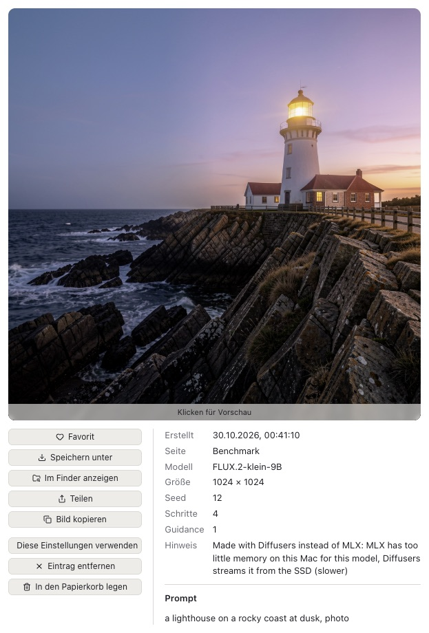
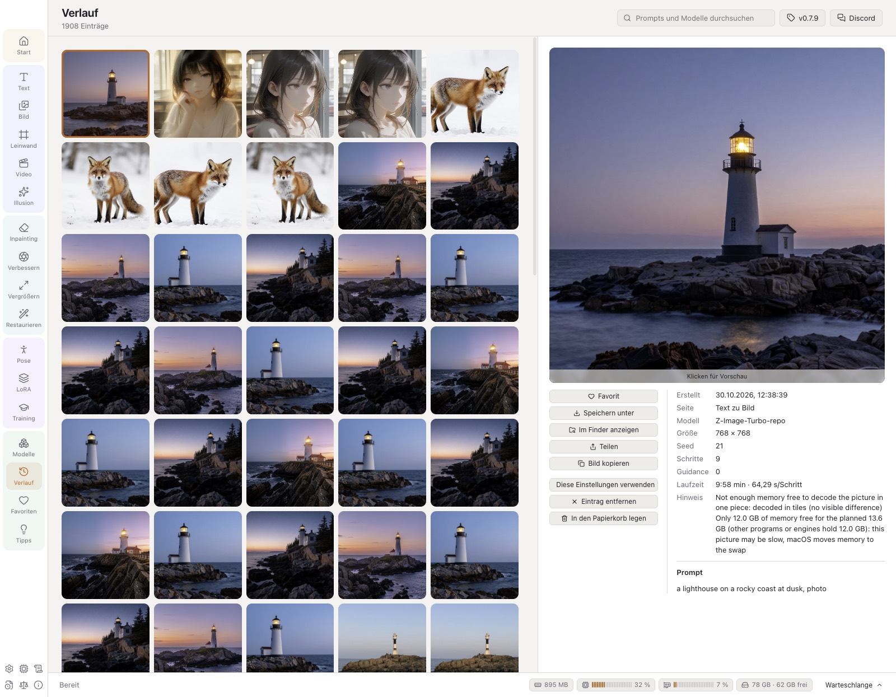
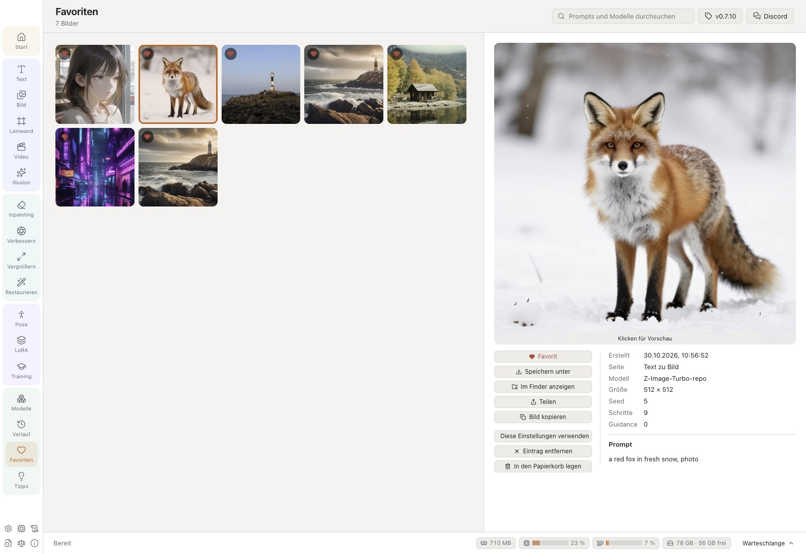
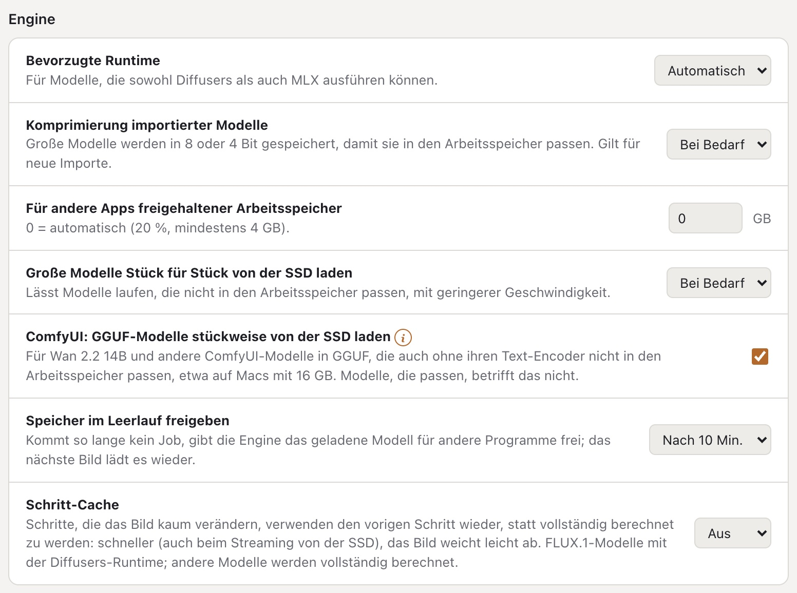

# VulKara-Benutzerhandbuch

[English](../USER_GUIDE.md) · **Deutsch** · [Español](../es/USER_GUIDE.md) · [Português (Brasil)](../pt-BR/USER_GUIDE.md) · [Português (Portugal)](../pt-PT/USER_GUIDE.md)

VulKara, *dein lokaler KI-Bildgenerator mit hohem Datenschutz*, erstellt Bilder und kurze Videos und restauriert alte
Fotos auf einem Mac mit Apple-Chip. Alles wird auf dem Mac selbst berechnet; das Netzwerk dient nur zum Herunterladen
von Runtimes, Modellen und den Beschreibungen von LoRAs und zur Suche nach Updates. Dieses Handbuch beschreibt jede Seite der App, was jede
Einstellung bewirkt und wo die App ihre Daten ablegt.

## Inhalt

1. [Erste Schritte](#1-erste-schritte)
2. [Das Fenster](#2-das-fenster)
3. [Text zu Bild](#3-text-zu-bild)
4. [Stile](#4-stile)
5. [Bild zu Bild](#5-bild-zu-bild)
6. [Inpainting](#6-inpainting)
7. [KI-Leinwand](#7-ki-leinwand)
8. [Bild zu Video](#8-bild-zu-video)
9. [Vergrößern](#9-vergrößern), [Verbessern: Fotowerkzeuge](#verbessern-fotowerkzeuge)
10. [Restaurieren](#10-restaurieren)
11. [Pose-Editor](#11-pose-editor)
12. [Illusion](#12-illusion)
13. [LoRAs](#13-loras)
14. [Training](#14-training)
15. [Modelle](#15-modelle)
16. [Verlauf](#16-verlauf)
17. [Tipps & Tricks](#17-tipps--tricks)
18. [Die große Ansicht](#18-die-große-ansicht)
19. [Einstellungen](#19-einstellungen)
20. [Hardware, Protokolle, Änderungen, Lizenzen, Über](#20-hardware-protokolle-änderungen-lizenzen-über), [Ein Problem melden](#ein-problem-melden)
21. [Inhaltsregeln](#21-inhaltsregeln)
22. [Wo die Daten liegen](#22-wo-die-daten-liegen)
23. [Fehlerbehebung](#23-fehlerbehebung)

---

## 1. Erste Schritte

### Installieren

VulKara wird als DMG geliefert. Öffne es und zieh VulKara in den Ordner *Programme*. App und DMG sind mit einer
Developer ID signiert und von Apple notariell beglaubigt, daher fragt macOS nur einmal, ob eine aus dem Internet
geladene App geöffnet werden soll. Eine Version, die signiert, aber nicht beglaubigt ist, wird beim ersten Start auf
einem anderen Mac von Gatekeeper blockiert: Öffne **Systemeinstellungen → Datenschutz & Sicherheit**, scrolle zur
Meldung über VulKara und klicke auf **Dennoch öffnen** (oder klicke im Finder bei gedrückter Control-Taste auf die App
und wähle **Öffnen**). Das ist nur einmal nötig.

Mit [Homebrew](https://brew.sh) lässt sich VulKara auch im Terminal installieren: `brew install --cask revil-O/tap/vulkara`. Neue Versionen holst du dann
mit `brew upgrade --cask vulkara`.

### Der Startbildschirm

Beim Start erscheint ein Fenster mit dem Schmiedebild: Der Runenhammer schlägt auf den Amboss, die Funken werden zu
leuchtenden Pixeln, und aus ihnen wird die Walküre geschmiedet. Der Name verbindet beide: Vulcanus, der römische Gott
der Schmiede, und Kára, eine Walküre der nordischen Sage. Unter dem Namen stehen der Slogan, die Version und das
Copyright; das Bild trägt unten rechts das EU-Symbol *AI GENERATED*. Hinter dem Bild lädt währenddessen die App
(*Wird vorbereitet …*); sobald sie bereit ist und der Startbildschirm fünf Sekunden lang zu sehen war, schließt er sich
von selbst und die App öffnet sich. Ein Klick (oder ↩ oder die Leertaste) schließt ihn früher, sobald die App bereit
ist. Der Startbildschirm ist ein eigenes kleines Fenster: Auch mit *Tabs bevorzugen: Immer* in den macOS-Einstellungen
öffnet er sich nicht als Tab des Hauptfensters.

### Die Seite „Start“

Die Seite „Start“ zeigt drei Schritte. Jeder Schritt bekommt ein Häkchen, sobald er erledigt ist:

1. **Runtime installieren** (Einstellungen → Runtimes). Eine Runtime ist die Software, die die Modelle ausführt.
   Beginne mit **Diffusers (Apple GPU)**: Sie führt die meisten Modelle aus und außerdem den Import, die
   Pose-Erkennung und den Inhaltsfilter. **MLX** ist schneller für FLUX- und Z-Image-Modelle und die einzige Runtime
   für Krea 2, Ideogram 4 und FLUX 3 Image Klein. **ComfyUI** ist optional und wird für Video, Vergrößern sowie Anima-, Lumina-2- und Pony-V7-Modelle gebraucht.
2. **Modell besorgen** (Modelle → Empfohlen). Für einen ersten Versuch nimm *SDXL 1.0* oder *DreamShaper XL v2 Turbo*
   auf einem Mac mit 16 GB Arbeitsspeicher, oder *Stable Diffusion 1.5* auf einem mit 8 GB.
3. **Dein erstes Bild erstellen** (Text). Beschreibe das Bild und drücke **Erstellen** oder ⌘↩. Der Schritt wird
   abgehakt, wenn das erste Bild fertig ist (oder wenn der Verlauf schon eines enthält), und bleibt abgehakt, auch
   wenn der Verlauf geleert wird.

Unter den Schritten zählt die Seite die installierten Runtimes, Modelle und LoRAs.

Das Menü oben rechts stellt die Sprache der App ein (*System*, English, Deutsch, Español, Português (Brasil),
Português (Portugal)), dieselbe
Wahl wie **Einstellungen → Darstellung → Sprache**.

**Systemvoraussetzungen:** macOS 14 (Sonoma) oder neuer auf Apple-Chip (M1 oder neuer), mindestens 8 GB Arbeitsspeicher (16 GB oder mehr für
SDXL, 32 GB oder mehr für die großen FLUX-Modelle) und freier Platz auf der SSD für die Runtimes (je etwa 1–1,5 GB)
und für die Modelle (je 2–35 GB).

## 2. Das Fenster

| Bereich | Was er tut |
| --- | --- |
| **Navigationsleiste** (links) | Gruppiert die Seiten, jede Gruppe in einem eigenen Farbton: *Start*; *Erstellen* (neue Bilder): Text, Bild, Leinwand, Video, Illusion; *Bearbeiten* (ein vorhandenes Bild): Inpainting, Verbessern, Vergrößern, Restaurieren; *Werkzeuge*: Pose, LoRA, Training; *Bibliothek*: Modelle, Verlauf, Favoriten, Tipps. In einem Fenster, das dafür zu niedrig ist, wird die Leiste breiter und zeigt die Gruppen in zwei Spalten. Die Symbole unten öffnen Einstellungen, Protokolle, Änderungen, Lizenzen und Über. |
| **Arbeitsbereich** (Mitte) | Die Eingabe der Seite (Prompt, Bild, Leinwand) und darunter die Ergebnisse dieser Seite. Ein Ergebnis, dessen Datei gelöscht oder verschoben wurde, erscheint als *Datei fehlt*;  entfernt es aus der Liste. |
| **Einstellungsbereich** (rechts) | Modell, Stil, Größe und alles andere, was das Ergebnis prägt. |
| **ⓘ** und **!** | Kleine orange Plaketten, deren Text sich öffnet, wenn der Zeiger darauf steht: **ⓘ** (ein Ring) ist reine Information, **!** (gefüllt) zeigt an, dass die App etwas anders als üblich macht, z. B. Werte, die vom Vorschlag des Modells abweichen, oder ein Modell, das per Streaming von der SSD läuft. |
| **Auftragsleiste** (unten) | Der laufende Auftrag: Fortschritt, Restzeit, Sekunden pro Schritt und **Abbrechen**. Vier Chips zeigen, was der Mac gerade tut: den Arbeitsspeicher, den VulKara und seine Engines belegen, CPU und GPU als Pegelanzeigen sowie die Caches für SSD-Streaming mit dem freien Platz auf ihrem Datenträger (orange unter 20 GB). Ein Klick darauf öffnet **Hardware**. **Warteschlange** öffnet die Liste aller Aufträge. |

Seiten bleiben erhalten, wenn du zwischen ihnen wechselst. Ein halb geschriebener Prompt ist noch da, wenn du
zurückkommst, ebenso eine Leinwand oder eine Pose. Jede Seite zum Erstellen merkt sich ihre Einstellungen auch über
einen Neustart hinweg.

### Die Warteschlange

- Aufträge laufen **einer nach dem anderen**, in der Reihenfolge, in der sie hinzugefügt wurden. Du kannst weitere
  Aufträge hinzufügen, während einer läuft.
- **Bilder** > 1 fügt pro Bild einen Auftrag hinzu. Die Seeds zählen vom gewählten Seed aus hoch, oder von einem
  zufälligen, sodass sich jedes Bild einer Serie erneut erstellen lässt.
- In der Warteschlange stoppt **Abbrechen** den laufenden Auftrag, und **Entfernen** nimmt einen wartenden oder
  fertigen Auftrag aus der Liste. **Erledigte entfernen** leert die Liste der fertigen Aufträge.
- Wenn der letzte wartende Auftrag fertig ist, spielt der Mac einen kurzen Ton. Das lässt sich unter Einstellungen →
  Inhalte → *Signalton abspielen, wenn die Warteschlange abgearbeitet wurde* ausschalten.
- Während ein LoRA trainiert wird, startet kein Auftrag.

## 3. Text zu Bild

Beschreibe das Bild im Prompt-Feld und drücke **Erstellen** (oder ⌘↩). Die Ergebnisse erscheinen unter dem Prompt als
Kacheln. Ein laufender Auftrag zeigt seinen Fortschritt auf seiner Kachel, ein wartender seinen Platz in der Reihe.
Klicke auf eine Kachel, um sie in der [großen Ansicht](#18-die-große-ansicht) zu öffnen.

- **×** in der Ecke einer Kachel nimmt sie aus der Liste (das Bild bleibt im Verlauf); bei einem laufenden Auftrag
  bricht es ihn ab. Abgebrochene und fehlgeschlagene Aufträge werden genauso entfernt.
- Eine Auftragskachel zeigt das Wesentliche. Der Zeiger auf ihrem **ⓘ** öffnet alle Details: den vollständigen Prompt,
  Größe, Schritte und Seed, einen Hinweis, wie das Bild entstanden ist, und bei einem fehlgeschlagenen Auftrag den
  ganzen Fehler.
- Ein **ⓘ** auf einem Bild öffnet dessen Hinweis auf dieselbe Weise, etwa wenn es mit Diffusers statt mit MLX erstellt
  wurde.
- **Prompt-Upsampler** (FLUX 3 Image Klein, Text zu Bild, neben „Erstellen“): FLUX 3 ist auf ausführliche
  Szenenbeschreibungen trainiert; der Upsampler von Black Forest Labs (4 Bit, MLX) schreibt aus deinem Prompt zuerst
  eine solche – Motiv, Umgebung, Licht, Kamera, Farben. Ein Prompt, der schon alles beschreibt, geht unverändert,
  ebenso der Prompt einer Bearbeitung mit Bild. Er wird einmal geladen (5,7 GB), mit dem Button neben der Option oder
  auf der Seite Modelle (Helfermodelle); er belegt den Speicher nur für den Prompt (etwa 30 s) und wird danach
  freigegeben, und die Beschreibung, die er geschrieben hat, wird zur Notiz des Bildes.

  

- **EU-KI-Kennzeichnung** (neben „Erstellen“): setzt das Symbol der Europäischen Kommission für KI-Inhalte sichtbar in
  die rechte untere Ecke jedes Bildes. *AI GENERATED* für Bilder aus einem Prompt (Text, Illusion), *AI MODIFIED*, wo
  ein Bild von dir verändert wird (Bild, Inpainting), oder das runde *AI*. **Automatisch** nimmt das schwarze Symbol
  auf einer hellen Ecke und das weiße auf einer dunklen; *Dunkel* und *Hell* legen es fest. Größen klein, mittel und
  groß; **Dezent** ist das Symbol mit 50 % Transparenz. Eine Vorschau zeigt das gewählte Symbol. Es wird eingesetzt,
  sobald der Inhaltsfilter das Bild durchgelassen hat; den Hinweis trägt jedes Bild ohnehin in seiner Datei. Nicht
  für Videos.
- Ein gekennzeichnetes Bild behält eine Kopie ohne Kennzeichnung (im versteckten Ordner `.unlabelled` daneben). Dient
  es als Eingabe für Bild, Inpainting, Verbessern, Vergrößern oder Restaurieren, wird diese Kopie genommen, sodass das
  neue Bild eine einzige Kennzeichnung bekommt, statt dass die alte durchscheint. Wird ein Verlaufseintrag mit seinen
  Dateien in den Papierkorb gelegt, wandert die Kopie mit.

  

  

| Einstellung | Bereich | Was sie bewirkt |
| --- | --- | --- |
| **Modell** | installierte Bildmodelle | Das Modell bestimmt den Großteil des Aussehens. Unter [Modell wechseln](#modell-wechseln) steht, was sich damit ändert. |
| **Stil** | 20 Stile in 4 Gruppen | Bettet den Prompt in eine Stilvorlage ein, siehe [Stile](#4-stile). |
| **Größe** | 1:1, 4:3, 3:2, 16:9, 3:4, 2:3, 9:16 | Jede Kachel zeigt ihre Proportionen. Die Größe wird passend zur Pixelzahl gewählt, auf die das Modell trainiert wurde. Breite und Höhe lassen sich auch direkt wählen. |
| **Schritte** | 1–80 | Mehr Schritte bringen mehr Details, bis zu einem gewissen Punkt. 20–30 passt für die meisten Modelle; Turbo-Modelle brauchen 4–8, mehr dauert nur länger. |
| **Guidance** | 0–20, in Schritten von 0,1 | Wie genau das Bild dem Prompt folgt. Das Lineal über dem Regler markiert 0, 5, 10, 15 und 20. SDXL arbeitet am besten mit 5–7, SD 1.5 mit 7–9, FLUX mit 3–4. |
| **Steuerung** | Keine, Pose, Tiefe, Kanten, Strichzeichnung, Skizze, Kachel | Lenkt den Bildaufbau mit einem Steuerbild, siehe unten. Nur sichtbar, wenn das Modell es unterstützt. |
| **Sampler** | je nach Familie | Das Verfahren, das Schritt für Schritt das Rauschen entfernt. *Standard* ist der eigene des Modells. Die zweite Liste legt den Rauschverlauf fest (Karras, Exponential, Beta); sie ist aus, solange der Sampler auf *Standard* steht. |
| **Seed** | Zahl oder leer | Derselbe Seed mit denselben Einstellungen ergibt dasselbe Bild. Leer heißt zufällig; der Würfel-Button stellt wieder auf zufällig. |
| **Bilder** | 1–20 | Wie viele Bilder erstellt werden, jedes mit eigenem Seed. |
| **LoRAs** | bis zu 3 | Erweiterungen, die dem Modell einen Stil, eine Person oder ein Objekt beibringen, jede mit eigener Gewichtung (−2 bis 2; − und + daneben ändern sie in Zehntelschritten, auch am Handy). Angeboten werden nur LoRAs der Familie des Modells. |
| **Nicht im Bild** | Text | Der Negativ-Prompt: was nicht erscheinen soll. Nur sichtbar, wenn das Modell einen unterstützt. |

### Modell wechseln

Das erste Modell einer Seite bringt seine eigenen Schritte, seine Guidance und Größe mit. Danach behält die Wahl eines
anderen Modells die Einstellungen bei, damit sich Modelle mit denselben Werten vergleichen lassen:

- **Schritte, Guidance, Seed und Größe** bleiben, wie sie sind. Weichen sie vom Vorschlag des neuen Modells ab,
  erscheint über den Reglern neben **Modellvorgaben** ein oranges **!**: Der Zeiger darauf zeigt den Vorschlag
  (*Dieses Modell empfiehlt 4 Schritte und Guidance 0, 1024×1024*), und der Button stellt ihn ein.
- **Woher der Vorschlag kommt**: Nennt die Modellkarte sie, werden die Schritte, die Guidance, der Sampler, der
  Sigma-Verlauf und der Negativ-Prompt des Herstellers beim Import gelesen und zu den eigenen Vorgaben des Modells;
  der Hinweis nennt dann auch den Sampler (*Der Hersteller empfiehlt den Sampler DPM++ SDE Karras.*), und
  **Modellvorgaben** stellt ihn mit ein. Sagt die Karte nichts, bleiben die Werte, die VulKara für die Familie des
  Modells vorsieht.
- **Werte, für die das Modell nicht gemacht ist**, bekommen ein oranges **!** neben *Schritte* oder *Guidance*, mit
  einem Button, der den eigenen Wert des Modells einstellt: mehr als doppelt so viele Schritte, wie ein destilliertes
  Modell vorsieht (*Gemacht für 4 Schritte: Mehr dauern länger, ohne das Bild zu verbessern.*), Guidance bei einem
  Modell, das keine hat (FLUX.1 [schnell], ein destilliertes FLUX.2 [klein]), und Guidance über 1 bei einem Modell,
  das ohne sie gemacht wurde (SDXL Turbo, Z-Image-Turbo, Chroma1-Flash), wo jeder Schritt doppelt läuft. Auf der
  Leinwand steht das **!** neben *Schritte*.
- Nur eine **Größe**, die das neue Modell nicht berechnen kann, ändert sich, und zwar auf die nächstliegende, die es
  in denselben Proportionen kann (SD 1.5 geht bis 768 px). Zurück bei einem Modell, das sie kann, kehrt die zuvor
  gewählte Größe zurück, sofern du sie zwischendurch nicht geändert hast.
- **Sampler**: Der gewählte Sampler bleibt gewählt. Ein Modell, das ihn nicht hat, läuft mit seinem Standard; ein
  oranges **!** neben *Sampler* sagt das, wenn der Zeiger darauf steht. Beim Zurückwechseln kommt er wieder.
- **Nur die Sampler des Herstellers**: Nennt die Modellkarte die Sampler, mit denen der Hersteller das Modell nutzt,
  zeigt die Liste nur diese, mit *Standard* (dem empfohlenen) zuerst; ein (i) neben *Sampler* sagt das. Nennt die Karte
  keinen, bleibt die volle Liste.
- Was das neue Modell nicht annehmen kann, entfällt: LoRAs einer anderen Familie und eine Steuerungsart, die es nicht
  hat. Der eigene Negativ-Prompt eines Modells wird nur eingetragen, wenn das Feld leer ist.
- Ein Modell, das die App erkannt hat, aber noch nicht ausführen kann, meldet das auf der Seite, bevor etwas gesendet
  wird.

### Steuerbilder (ControlNet)

**Steuerung** behält den Bildaufbau eines Steuerbildes bei:

| Art | Steuerbild | SD 1.5 | SDXL | SD 3.5 M | SD 3.5 L | FLUX.1 |
| --- | --- | :-: | :-: | :-: | :-: | :-: |
| Pose | ein Skelett aus dem [Pose-Editor](#11-pose-editor) oder ein Foto, dessen Pose erkannt wird |  |  | | |  |
| Tiefe | eine Tiefenkarte oder ein Foto, dessen Tiefe geschätzt wird |  |  |  |  |  |
| Kanten (Canny) | weiße Kanten auf Schwarz oder ein Foto, dessen Kanten nachgezogen werden |  |  |  |  |  |
| Strichzeichnung | eine Strichzeichnung oder ein Foto, das zu einer wird |  |  | | |  |
| Skizze | eine grobe Skizze oder ein Foto, das auf eine reduziert wird |  |  | | |  |
| Kachel | ein Bild, dessen Inhalt erhalten bleibt, während Details neu gemalt werden | |  | |  | |

- Lass **Es ist ein Foto: zuerst aufbereiten** eingeschaltet, wenn das Steuerbild ein normales Foto ist. Schalte es
  aus, wenn das Steuerbild schon ein Skelett, eine Tiefenkarte oder ein Kantenbild ist.
- **Gewichtung** (0–2) legt fest, wie streng das Ergebnis dem Steuerbild folgt.
- Das Steuerungsmodell wird beim ersten Einsatz heruntergeladen.

## 4. Stile

Ein Stil umgibt den Prompt mit Wörtern, die das Aussehen bestimmen. Bei manchen Stilen ergänzt er auch Wörter in
*Nicht im Bild*. Die Auswahl zeigt für jeden Stil ein Vorschaubild. Die orange umrahmten Überschriften gruppieren die
Stile:

| Gruppe | Stile |
| --- | --- |
| **Foto** | Veredelt, Fotografisch, Filmisch, Analogfilm, Schwarzweiß, Romantisch |
| **Illustration** | Anime, Digitale Kunst, Comic, Fantasy-Kunst, Science-Fiction, Strichzeichnung |
| **Stilisiert** | Neon-Punk, Isometrisch, Pixel-Art, Kacheltextur |
| **3D & Handwerk** | 3D-Modell, Low Poly, Origami, Knetmasse |

*Kein Stil* verwendet den Prompt so, wie er geschrieben ist. Der Stil wird mit jedem Auftrag gespeichert, sodass
*Diese Einstellungen verwenden* ihn später zurückholt.

<table>
<tr>
<td> <b>Filmisch</b>: a lighthouse on a rocky coast at golden hour</td>
<td> <b>Analogfilm</b>: a small wooden cabin by a mountain lake</td>
</tr>
<tr>
<td> <b>Digitale Kunst</b>: a red fox sitting in a snowy forest</td>
<td> <b>Fantasy-Kunst</b>: an astronaut tending a greenhouse on the moon</td>
</tr>
</table>

Alle erstellt mit Juggernaut XL v7, 25 Schritte, Guidance 6.

## 5. Bild zu Bild

Macht aus einem vorhandenen Bild ein neues: eine andere Jahreszeit, ein anderer Stil, eine Skizze, die zum Gemälde
wird.

- **Bild auswählen**: Klicke auf das Feld oder zieh eine Bilddatei darauf (PNG, JPEG, WebP oder BMP). Der Klick öffnet
  die Bildauswahl: deine Ergebnisse aus dem Verlauf, die neuesten zuerst, mit einer Suche (Prompt, Modell, Seite) und
  einem Filter *Favoriten*; ein Klick übernimmt ein Bild. **Vom Datenträger …** öffnet stattdessen den Dateidialog.
- **In das Bild zoomen** (hier und bei Inpainting, Verbessern, Vergrößern und Restaurieren, auch beim Malen einer
  Maske oder beim Auswählen von Objekten): ⌘-Scrollen oder Zusammenziehen/Aufziehen zoomt zum Zeiger hin, bis 800 %;
  Scrollen verschiebt dann das Bild, ebenso Ziehen mit gedrückter Leertaste oder die mittlere Maustaste. Die kleinen
  Bedienelemente unten rechts (sie erscheinen, wenn der Zeiger über dem Bild steht) zoomen heraus, hinein und passen
  das Bild wieder ein. Malen und Klicken funktionieren auch im Zoom.
- **Veränderung** (0,05–1): wie weit sich das Ergebnis vom Bild entfernt. Bei 0,3 ändern sich Farben und Details; bei
  0,6 ändert sich das Motiv, während der Bildaufbau bleibt; über 0,8 bleibt wenig vom Bild übrig. FLUX.2- und
  Qwen-Image-2.1-Modelle nutzen diesen Regler nicht; sie nehmen das Bild als Referenz.
- Das Ergebnis hat die Proportionen des Bildes. Für eine andere Größe aktiviere **Eigene Größe statt der Proportionen
  des Bildes**.
- Alle anderen Einstellungen funktionieren wie bei [Text zu Bild](#3-text-zu-bild).

<table>
<tr>
<td> Text zu Bild</td>
<td> Bild zu Bild, Veränderung 0,6: <i>the same lighthouse in a snow storm</i></td>
</tr>
</table>

## 6. Inpainting

Malt einen Teil eines Bildes neu und behält den Rest.

1. Wähle das Bild.
2. **Malen** über den Teil, der sich ändern soll. **Radieren** nimmt Farbe weg. **Größe** stellt den Pinsel ein (1–30 %
   der kürzeren Bildseite). Der Pfeil-Button widerruft den letzten Strich, der Papierkorb entfernt alle Farbe.
3. Beschreibe, was im bemalten Teil erscheinen soll, oder lass den Prompt leer, um nur etwas zu entfernen.
4. **Veränderung** (Standard 100 %): Niedrigere Werte behalten mehr vom Vorhandenen.

Inpainting können SD 1.x, SD 2.x, SDXL, SD 3.5, FLUX.1, Chroma, Qwen-Image und Z-Image. Spezielle Inpainting-Modelle
wie *SD 1.5 Inpainting* ergeben die saubersten Ränder.

## 7. KI-Leinwand

Eine endlose Fläche, auf der Bilder gemalt, erweitert und übermalt werden. Der orange **Rahmen** markiert, wo das
nächste Bild erscheint. Was **Erstellen** tut, hängt davon ab, was im Rahmen liegt:

| Im Rahmen | Ergebnis |
| --- | --- |
| nichts | ein neues Bild |
| teilweise ein Bild | der leere Teil wird so gefüllt, dass er das Bild fortsetzt (Outpainting) |
| ein Bild mit Maskenstrichen | der maskierte Teil wird neu gemalt |
| ein Bild ohne Maskenstriche | eine Variation (mit **Veränderung** 0,1–0,9) |

Der Bereich rechts erklärt immer, welcher dieser Fälle eintritt.

**Werkzeuge und Tasten:**

| | |
| --- | --- |
| **Verschieben** (V) | Ziehe ein Bild, um es zu verschieben. Ziehe eine Ecke des ausgewählten Bildes, um seine Größe zu ändern: Die gegenüberliegende Ecke bleibt, und die Proportionen bleiben erhalten (⇧ gedrückt halten für freie Proportionen); die Größe steht darunter. Ziehe den Rand des Rahmens oder eine leere Stelle darin, um den Rahmen zu verschieben (er rastet auf 8 px ein). Ziehe auf einer leeren Fläche, um die Ansicht zu verschieben. |
| **In den Rahmen einpassen** | Macht das ausgewählte Bild so groß, wie es in den Rahmen passt, zentriert, mit erhaltenen Proportionen. |
| **Rahmenecken** | Die runden Griffe an den Ecken des Rahmens ändern seine Größe frei: Die gegenüberliegende Ecke bleibt, die Seiten rasten auf 64 px ein, von 256 bis 2048 px und höchstens doppelt so viele Pixel wie beim Modell (SDXL: etwa 2 Megapixel), damit ein Mac mit 16 GB mithält. Der Rahmen zeigt dann *frei*; ein Seitenverhältnis-Button setzt die Größe neu. |
| **Maskenpinsel** (B) | Male im Rahmen den Teil, der neu gemalt werden soll. Die Pinselgröße ist 8–200. |
| Scrollen / Zusammenziehen, ⌘-Scrollen | Scrollen verschiebt die Ansicht; Zusammenziehen/Aufziehen oder ⌘-Scrollen zoomt (5 %–400 %). |
| ⌫ | Entfernt das ausgewählte Bild. |
| ⌘Z | Widerrufen (bis zu 50 Schritte). |
| **Alles zeigen** | Passt die Ansicht an alle Bilder an. |

- **Bild hinzufügen** legt ein Bild an den Rahmen, ausgewählt in der Bildauswahl (aus dem Verlauf oder vom
  Datenträger).
- Unter der Fläche zeigt eine Reihe die Warteschlange und die letzten Ergebnisse dieser Seite, wie auf den anderen
  Seiten: einen wartenden oder laufenden Auftrag mit Fortschritt, ein fertiges Bild zum Öffnen in der großen Ansicht.
  Ein fertiges Bild erscheint außerdem auf der Fläche, dort wo der Rahmen war.
- **PNG exportieren** speichert alle Bilder als eine PNG-Datei.
- **Rahmen** legt die Proportionen fest: 1:1, 3:4, 4:3, 16:9 oder 9:16, oder ziehe an den Ecken des Rahmens für jede
  beliebige Größe.
- Zum Erweitern braucht es ein SDXL-, SD 3.5-, FLUX.1-, Chroma- oder Z-Image-Modell oder ein Inpainting-Modell. Andere
  Modelle sind mit *(nur neue Bilder)* markiert.
- Die Leinwand samt ihren Bildern, Ansicht, Prompt und Modell bleibt über einen Neustart hinweg erhalten.

## 8. Bild zu Video

Macht aus einem Bild ein kurzes Video. Dafür braucht es die ComfyUI-Runtime und ein Wan-2.2-Modell (Modelle →
Empfohlen).

- **Startbild**: das erste Einzelbild. Das Video übernimmt seine Proportionen.
- **Prompt**: was passiert, etwa Bewegung, Kamera und Stimmung: *the astronaut slowly waters the plants, gentle
  camera push in*.
- **Länge**: 1–5 Sekunden.
- **Auflösung**: 480p oder 720p.

Video dauert viel länger als Bilder. Ein Clip von einer Sekunde in 480p brauchte auf einem M2 mit 24 GB etwa
8 Minuten, und längere Clips brauchen deutlich mehr Arbeitsspeicher.

## 9. Vergrößern

Vergrößert ein Bild auf das 2- oder 4-Fache und fügt Details hinzu, mit Real-ESRGAN x4plus (64 MB, BSD-3, beim ersten
Einsatz heruntergeladen) über die ComfyUI-Runtime.

- **Vergrößern**: vorgegebene Kacheln ×1,5, ×2, ×2,2, ×2,5, ×3, ×3,5 und ×4 sowie ein Regler in Schritten von 0,1 für
  alles dazwischen. Das Modell arbeitet immer mit 4×; ein kleinerer Faktor verkleinert sein Ergebnis danach (sauberer
  als normales Vergrößern).
- Ein Bild mit mehr als 2048 px an der längeren Seite wird zuerst auf 2048 verkleinert; das Ergebnis ist trotzdem der
  gewählte Faktor mal dein Bild, bis zum Vierfachen des verkleinerten (der Hinweis zum Ergebnis sagt das).
- Die große Ansicht jedes Bildes hat einen Button **Vergrößern**, der das Bild hierher schickt.

### Verbessern: Fotowerkzeuge

**Verbessern** (unter Bearbeiten) bearbeitet ein Foto mit kleinen Modellen auf diesem Mac: kein Prompt, kein
Diffusionsmodell, und jedes Ergebnis durchläuft wie jedes andere die Warteschlange, den Inhaltsfilter und den
Verlauf. Die Liste rechts zeigt jedes Werkzeug mit ein paar Worten und wo es läuft: **GPU** (die originalen
PyTorch-Gewichte über spandrel) oder **CPU** (ein ONNX-Modell), auf einem violetten oder petrolfarbenen Etikett. Seine
(i)-Plakette enthält den Rest: das Modell, was es im Einzelnen tut, Größengrenzen und Downloadgröße und unter einer
Linie die Lizenz, ihren Hinweis und die Quelle.

| Werkzeug | Was es tut | Läuft auf | Größe · Lizenz |
| --- | --- | --- | --- |
| **Schärfen (NAFNet)** | entfernt Unschärfe aus verwackelten oder leicht unscharfen Fotos | CPU | 92 MB · MIT |
| **Entrauschen (SCUNet)** | entfernt das Rauschen echter Fotos (hohe ISO, wenig Licht) | GPU | 72 MB · Apache-2.0 |
| **Vergrößern ×4 (SwinIR)** | vergrößert echte Fotos auf das Vierfache und stellt feine Details neu her; ein Bild mit mehr als 2048 px an der längeren Seite wird zuerst auf 2048 verkleinert (der Hinweis zum Ergebnis sagt das), sodass Ergebnisse höchstens 8192 px erreichen | GPU | 67 MB · Apache-2.0 |
| **JPEG-Bereinigung (FBCNN)** | entfernt die Blöcke und Säume starker JPEG-Kompression; ermittelt die Qualität selbst | GPU | 288 MB · Apache-2.0 |
| **Hintergrund entfernen (BiRefNet)** | das Hauptmotiv auf transparentem Hintergrund oder seine Maske | CPU | 115 MB · MIT |
| **Objekte auswählen (SAM 2.1)** | auf das klicken, was ausgewählt werden soll (⌥-Klick auf das, was nicht dazugehört) | CPU | 155 MB · Apache-2.0 |

- **Herunterladen** holt ein Werkzeug einmalig von seinem Herausgeber in einer festen, geprüften Version (ein Hugging-Face-Commit
  oder eine GitHub-Release-Datei mit ihrer Prüfsumme); alle sechs sind frei nutzbar, auch kommerziell. Das
  Papierkorb-Symbol legt ein installiertes Werkzeug in den Papierkorb. Die GPU-Werkzeuge brauchen die
  Diffusers-Runtime mit spandrel: Bei einer älteren Runtime wird das Update unter Einstellungen → Runtimes angeboten.
- **Stärke** mischt das Ergebnis von Schärfen, Entrauschen oder Vergrößern mit dem Original (100 % = nur das Ergebnis
  des Werkzeugs).
- **JPEG-Qualität** (JPEG-Bereinigung): *Automatisch* lässt das Werkzeug schätzen, wie stark das Bild komprimiert
  wurde. Kacheln 10–90 und ein Regler stellen sie von Hand ein: Eine niedrigere Qualität bereinigt kräftiger (Blöcke,
  Säume, aber auch feine Details), eine höhere sanfter.
- **Charakter** (Entrauschen): *Natürlich* bleibt nah am Foto; *Scharf* nutzt die GAN-Gewichte von SCUNet, knackiger,
  mit feiner Struktur, die dort erfunden wird, wo das Rauschen war. Scharf wird beim ersten Einsatz einmalig
  heruntergeladen (72 MB).
- **Vergrößern** (Werkzeuge, die vergrößern, etwa Vergrößern ×4): dieselben vorgegebenen Kacheln und derselbe Regler
  wie auf der Seite „Vergrößern“; das Ergebnis ist so viel Mal so groß wie dein Bild.
- **Hintergrund entfernen**: *Transparent* ergibt ein PNG mit transparentem Hintergrund, *Maske* die Maske in Schwarz
  und Weiß.
- **Objekte auswählen**: Jeder Klick verfeinert die Auswahl, die über dem Bild erscheint (alles andere abgedunkelt).
  **Freistellen** und **Maske speichern** machen daraus ein Bild; **Im Inpainting bemalen** öffnet die Seite
  „Inpainting“ mit dem Bild und der Auswahl bereits als Maske gemalt, bereit zum Neumalen.
- **Modelldatei importieren**: andere Fotomodelle, sofern ihre Lizenz es erlaubt. PyTorch-Gewichte (.pth,
  .safetensors) laufen auf der GPU, wenn spandrel die Architektur kennt (ESRGAN, SwinIR, HAT, DAT, NAFNet, SCUNet,
  FBCNN, SPAN, OmniSR und andere; Farbbild hinein und heraus, Vergrößerung auf das 1-, 2-, 3-, 4- oder 8-Fache);
  .pth-Dateien werden gelesen, ohne Code auszuführen, den sie enthalten könnten. ONNX-Modelle laufen auf der CPU und
  werden vorher geprüft: ein Bild hinein (1 × 3 × Höhe × Breite), ein Bild heraus (gleich groß oder 2-, 3-, 4- oder
  8-mal größer) oder eine Maske, Werte 0–1 oder 0–255; Modelle mit eigenen Operatoren werden abgelehnt. Große Bilder
  werden in Kacheln bearbeitet.
- Ungefähre Zeiten auf einem M2 für ein Foto mit 768 × 768: JPEG-Bereinigung 2 s, Entrauschen 4 s, Hintergrund
  entfernen 8 s, Schärfen 15 s, Vergrößern ×4 35 s; ein Klick beim Auswählen ein paar Hundertstelsekunden.
## 10. Restaurieren

Restauriert alte Fotos: Farbstiche, verblasste Farben, weiche und unscharfe Bilder und Gesichter, Kratzer, Knicke,
Flecken, Löcher und Schwarzweiß. Wähle das Foto (oder zieh es auf das Feld) und klicke auf **Restaurieren** oder drücke ⌘↩.
Ein schwarzweißes oder getöntes Foto wird erkannt, und *Schwarzweißfoto kolorieren* wird dafür eingeschaltet.

Ein Foto mit Farbprofil (Display P3, Adobe RGB oder HDR wie *Rec. 2020 PQ*, das manche Vergrößerungs-Apps und
iPhones schreiben) wird zuerst in sRGB umgewandelt; ohne sein Profil gelesen, sähe es flau und grau aus. Das gilt für
jede Seite, die ein Bild annimmt.

**Schritte** (beliebig kombinierbar):

| Schritt | Wie |
| --- | --- |
| **Farbstich und Kontrast korrigieren** | Ohne Modell: Weißabgleich (ein roter oder gelber Stich wird neutralisiert; ein getöntes Schwarzweißfoto wird neutral grau), Tonwerte und lokaler Kontrast nur auf der Helligkeit. Helle Töne werden komprimiert statt abgeschnitten, so behält ein weißes Kleid seine Falten. **Stärke** 20–100 % (Standard 80 %). |
| **Schäden reparieren (KI)** | Ein FLUX.2-Modell bearbeitet das Foto (Modelle → Empfohlen: FLUX.2 [klein]). **Schritte des Modells** 2–12. Ohne Bemalung malt es das ganze Foto neu: Weiche Kleidung, Blätter und Hintergründe bekommen echte Details, Gesichter können aber zu denen anderer Menschen werden; deshalb werden die Gesichter aus dem Foto vor der Reparatur übernommen, wenn *Gesichter restaurieren* eingeschaltet ist. |
| **Staub und Kratzer entfernen** | Ohne eigenes Modell: Kleine Flecken und dünne Kratzer, die sich von ruhiger Umgebung abheben, werden gefunden und aus ihrer Umgebung aufgefüllt (LaMa). Blätter und Stoff bleiben unberührt, ebenso Augen und Mund. **Empfindlichkeit** 0–100 % (Standard 50 %); ein höherer Wert findet schwächere Flecken, ab und zu aber auch ein kleines Detail des Fotos (die Vorschau zeigt es). |
| **Weiche Details neu aufbauen (KI)** | Real-ESRGAN (das Hilfsmodell von Vergrößern, 64 MB) baut Kanten und Texturen des ganzen Fotos neu auf: Es wird um so viel verkleinert, wie es weich ist (**Weichheit des Fotos** × 1,25–3, Standard × 2), und wieder auf das Vierfache vergrößert. **Stärke** 20–100 %. Es schärft, was das Foto noch zeigt; ganz verlorene Textur (Stoff, Blätter) ergänzt nur *Schäden reparieren (KI)*. |
| **Gesichter restaurieren (KI)** | CodeFormer (0,4 GB, einmalig heruntergeladen) restauriert unscharfe Gesichter, die aus dem Foto vor den KI-Schritten übernommen werden. **Originalgetreu** 50–100 % (Standard 90 %): Niedrigere Werte erfinden mehr Details. **Stärke** 20–100 % (Standard 60 %). Gesichter kleiner als etwa 14 Pixel bleiben unberührt. Die Lizenz von CodeFormer erlaubt nur nicht kommerzielle Nutzung. |
| **Schwarzweißfoto kolorieren** | DDColor (0,9 GB, einmalig heruntergeladen) fügt der Helligkeit des Fotos Farbe hinzu, so kann sich keine Form und kein Detail ändern. **Farbstärke** 50–150 %. |
| **Weniger Körnung, schärfere Details** | Ohne Modell: Die Helligkeit wird entrauscht und ihre Kanten geschärft, die Farbe nur leicht geglättet. **Stärke** 10–100 %. |

**Die Gesichter**, die CodeFormer restauriert, werden als abgerundete, nummerierte Rahmen über dem Foto gezeigt. Zieh einen
Rahmen auf das Gesicht, wo die Erkennung danebenliegt, oder lass ein Gesicht mit seinem **×** aus; **Erneut suchen**
setzt die Rahmen zurück. Die Gesichter findet YuNet (ein kleiner Gesichtsdetektor, einmalig heruntergeladen).

**Größe des Ergebnisses**: *Wie das Foto* oder *Doppelte Größe*.

**Vorschau** restauriert schnell nur einen Teil des Fotos: den Ausschnitt, in den du hineingezoomt hast (⌘-Scrollen),
sonst das größte Gesicht (oder die Mitte), höchstens 768 Pixel. Sie wird nicht im Verlauf gespeichert. Über dem
Hinweisfeld zeigt der **Vergleichsregler** die neueste Vorschau oder das neueste Ergebnis des Fotos über dem Original:
links der Linie die Änderung, rechts davon das Original; zieh die Linie (oder bewege sie mit ← →, wenn sie den Fokus
hat), ⌘-Scrollen zoomt beide.

**Auf einem Mac mit 16 GB** funktioniert die KI-Reparatur ebenfalls: Sie malt mit etwa einem Megapixel in den
Proportionen des Fotos, und ihr Ergebnis wird auf die Größe des Fotos zurückgebracht, so braucht ein großer Scan nicht
mehr Arbeitsspeicher als ein gewöhnliches FLUX.2-[klein]-Bild (ein Foto mit 768 × 1024 bei 12 GB freigehaltenem
Speicher: 5 Minuten auf einem M2).

**Schäden bemalen**: Male mit dem Pinsel (wie beim Inpainting) über Kratzer, Knicke, Flecken und Löcher. Dort repariert
die KI; überall sonst bleibt das Foto, wie es ist. Bevor die KI das Foto sieht, werden die bemalten Stellen von LaMa aus
ihrer Umgebung aufgefüllt (ein kleines Füllmodell, Apache 2.0, einmalig heruntergeladen; ohne es wird einfacher
aufgefüllt), sodass das Modell sie nur noch verfeinern muss. Ohne Bemalung darf die KI das ganze Foto anfassen,
innerhalb der erlaubten Veränderung.

**Leitplanken** für den KI-Schritt:

- **Original außerhalb der bemalten Schäden beibehalten**: Das Ergebnis wird aus dem Original und den reparierten
  Stellen zusammengesetzt.
- **Ergebnisse mit veränderten Gesichtern ablehnen**: Die Gesichter des Ergebnisses werden mit denen des Fotos verglichen.
- **Erlaubte Veränderung** (1–30 %, Standard 6 %): wie stark sich die Struktur des Fotos ändern darf.
- **Regeln für die KI**: feste Regeln, die immer mitgeschickt werden (nur Schäden entfernen; Bildaufbau, jede Person,
  jedes Gesicht, jeden Ausdruck, jede Haltung und die Haare, Kleidung, Gegenstände und Schrift beibehalten; nichts
  hinzufügen, entfernen oder erfinden), und deine **eigenen Regeln**, z. B. *Hausnummer beibehalten*. Eigene Regeln
  gelten für alle Restaurierungen.

Eine Reparatur, die eine Leitplanke verletzt, wird mit Begründung abgelehnt.

**Vorlagen** setzen Schritte, Leitplanken und den Hinweis für die üblichen Arten alter Fotos: *Schwarzweiß, beschädigt*,
*Schwarzweiß zu Farbe*, *Farbstich (rot oder gelb)*, *Verblasstes Farbfoto*, *Nur kolorieren* und *Starke Schäden
(Knicke, Löcher)*. Unter dem Hinweisfeld speichert **Als Vorlage speichern** die aktuellen Schritte, Leitplanken und
den Hinweis unter einem eigenen Namen; eigene Vorlagen erscheinen nach den mitgelieferten und werden mit ihrem **×**
gelöscht.

Der **Hinweis** ist ein dreizeiliges Textfeld (an seiner rechten unteren Ecke lässt es sich höher ziehen) für das, was
das Foto zeigt, z. B. *ein Hochzeitsfoto aus den 1950ern*; er hilft der KI.

## 11. Pose-Editor

Baut Pose-Skelette (OpenPose: Körper, Hände und Gesicht) für die Steuerung *Pose* in Text zu Bild.

- **Zieh** einen Punkt, um ihn zu verschieben. **⇧-Ziehen** verschiebt die ganze Person oder nur die gegriffene Hand
  bzw. das gegriffene Gesicht. Wer ein Handgelenk bewegt, bewegt seine Hand; wer die Nase bewegt, bewegt das Gesicht.
- **Doppelklick** auf einen Punkt blendet ihn aus, etwa für eine Hand hinter dem Rücken. Ausgeblendete Punkte werden
  gestrichelt gezeigt, ein weiterer Doppelklick blendet sie wieder ein.
- **Personen**: Person 1…n. **Vorlage** bietet Ganzkörperposen (Stehend, T-Pose, Arme hoch, Gehend, Laufend, Sitzend,
  Model, Laufsteg, Drehung, Vorgebeugt, Nachdenklich, Kniend, Vierfüßlerstand, Liegend, Zurückgelehnt) und Porträts
  (lächelnd, Hand am Kinn, Hände am Gesicht, winkend, Peace-Zeichen …). **Hinzufügen** fügt eine Person mit der Vorlage
  hinzu, **Anwenden** gibt der ausgewählten Person die Vorlage, **Spiegeln** spiegelt sie, **Entfernen** löscht sie.
- **Hände**: Offen, Entspannt, Faust, Zeigend, Peace, Daumen hoch, OK, Flach, geschlossen, Zeigefinger an der Wange,
  Locker gekrümmt.
- **Gesicht**: Neutral, Lächeln, Offener Mund, Überrascht, Traurig, Augen geschlossen.
- **Drehen und skalieren**: ±15° und ×1,1 / ÷1,1, für die Person oder den ausgewählten Teil.
- **Aus einem Foto**: erkennt die Personen auf einem Foto. Dafür wird die Diffusers-Runtime gebraucht. *Foto zeigen*
  legt das Foto unter die Skelette.
- **In „Text zu Bild“ verwenden** schickt das Skelett als Pose-Steuerbild, zusammen mit seiner Größe. **PNG speichern**
  speichert es als Datei.

Posen funktionieren mit SD 1.5 (nur Körper), SDXL und FLUX.1. Entferne das Gesicht einer Person, deren Gesicht verdeckt
sein wird.

## 12. Illusion

Versteckt ein Muster oder ein Wort in einem Bild, das sichtbar wird, wenn du die Augen zusammenkneifst oder aus der
Entfernung schaust.

- **Verstecktes Muster**: Spirale, Ringe, Schachbrett, Streifen, Text (bis zu 24 Buchstaben) oder Eigenes Bild (ein
  Schwarzweißbild, QR-Code oder Logo). Helle Stellen des Musters werden im Bild hell, dunkle dunkel.
  **Dichte** (2–24), **Unschärfe** (0–12) und **Umkehren** formen das Muster.
- **Musterstärke** (0,5–2): etwa 0,8 ist dezent, 1,2 deutlich und 1,6 dominant.
- Braucht ein SDXL- oder SD-1.5-Modell. Das Mustermodell (5 GB für SDXL) wird beim ersten Mal heruntergeladen.

## 13. LoRAs

Eine LoRA ist eine kleine Erweiterung (meist 20–400 MB), die einem Modell einen Stil, eine Figur oder ein Objekt
beibringt. Die Seite LoRA zeigt alle installierten LoRAs, sortiert nach Familie (SD 1.x, SDXL, SD 3.5, FLUX.1, Chroma,
FLUX.2, FLUX 3, Krea 2 …). Du kannst sie nach Familie filtern und ihre Namen, Trigger-Wörter und Kategorien durchsuchen.

**Das Feld einer LoRA:**

- **Name**: Der Stift gibt der LoRA einen eigenen Namen in der App, siehe [Namen in der App](#namen-in-der-app).
- **Trigger-Wörter**: Wörter, die die LoRA im Prompt einschalten. Das Feld zeigt, woher sie stammen (*von Civitai*,
  *aus den Trainingsdaten*, *von dir bearbeitet*). Ein Klick auf ein Wort kopiert es, **×** entfernt es und
  **+ hinzufügen** fügt eines hinzu.
- **Kategorie**: deine eigene Gruppierung, die die Suche nutzt.
- **Von der Seite**: was die Ersteller der LoRA auf Civitai oder Hugging Face geschrieben haben: Beschreibung, Tags,
  Versionshinweise, Lizenz und kommerzielle Nutzung. Es wird einmal gelesen, zwischengespeichert und lässt sich mit der
  Pfeiltaste aktualisieren.
- **Empfohlene Einstellungen**: Stärke, Schritte, Guidance, Sampler und Clip Skip, wie von den Erstellern angegeben oder
  aus ihren Beispielbildern ermittelt.
- **Prompts der Ersteller**: Beispiel-Prompts. **Ausprobieren** öffnet sie im Stärkenvergleich.
- **So wird sie verwendet**: eine kurze Anleitung für gute Ergebnisse mit dieser LoRA.
- **Trainingsdaten**: womit die LoRA trainiert wurde (Auflösung, Bilder, Epochen, Schritte, Lernrate) und die am
  häufigsten verwendeten Tags. Ein Klick auf einen Tag fügt ihn als Trigger-Wort hinzu.

### Stärken vergleichen

**Stärken vergleichen** (der Tab oben oder die Taste im Feld einer LoRA) erstellt dasselbe Bild mit demselben Seed bei
mehreren LoRA-Stärken, zum Beispiel `0, 0.5, 1` (0 = ohne die LoRA, bis zu 8 Werte zwischen −2 und 3). Eine
**Zweite LoRA** derselben Familie lässt sich gleichzeitig vergleichen. **Modell** bietet die installierten Modelle an,
zu denen die LoRA passt; Schritte, Guidance und Größe sind die des Modells. **In den Prompt einfügen** fügt die
Trigger-Wörter hinzu, und ein leerer Seed bedeutet einen zufälligen Seed für den ganzen Vergleich. So siehst du schnell,
wie stark eine LoRA sein sollte.

Um eine LoRA zu verwenden, füge sie im Bereich **LoRAs** einer Erstellungsseite hinzu und schreib ihr Trigger-Wort in
den Prompt.

### Zu welchem Modell eine LoRA gehört

Eine LoRA funktioniert nur mit der Art Modell, für die sie trainiert wurde. VulKara ermittelt das beim Import einer LoRA:

1. aus ihrer **Struktur**, den Namen und Größen ihrer Schichten;
2. wo die Schichten mehrere Möglichkeiten lassen oder nichts verraten, aus ihren **Metadaten** (was das
   Trainingswerkzeug in die Datei geschrieben hat);
3. dann aus ihrer **Quelle**: dem Basismodell, das Civitai nennt, oder dem `base_model` eines Hugging-Face-Repositorys.

Eine LoRA, bei der nichts davon Auskunft gibt, wird mit einer Meldung abgelehnt; sie wird nie vorsichtshalber als SDXL
abgelegt. Wo eine Familie Modelle verschiedener Größen hat, wird auch die Unterbasis festgehalten: LoRAs für
FLUX.2 [klein] 4B, [klein] 9B und FLUX.2 [dev] werden auseinandergehalten (ihre Schichten haben andere Größen), ebenso
Wan 5B und 14B. Die Erstellungsseiten bieten nur LoRAs an, die zum gewählten Modell passen.

Wenn eine LoRA geladen wird, zählt die Engine außerdem, wie viele ihrer Schichten ihren Platz im Modell gefunden haben.
Unter 90 % stoppt der Auftrag mit einer klaren Meldung (*The LoRA … does not fit this … model: only 62 % of its layers
(…) found their place*), statt ein Bild mit einer halb angewendeten LoRA zu erstellen.

**Welche LoRA-Dateien geladen werden**: LoRA-, LoCon- und DoRA-Dateien in den Formaten der gängigen Trainer: kohya /
OneTrainer, ai-toolkit, diffusers / SimpleTuner und von ComfyUI gespeicherte Dateien. Dateien mit Namen, die die
Runtime nicht selbst liest, werden beim Laden umgewandelt: FLUX.1- und Chroma-LoRAs mit den originalen Blocknamen von
ComfyUI, peft-Dumps, SDXL-LoRAs von ai-toolkit (`lora_transformer_`), Dateien mit gemischten Namensstilen,
Qwen-Image-2.1-LoRAs von ai-toolkit (ihre zusammengefasste MLP-Schicht wird in zwei geteilt) und Z-Image-LoRAs mit den
Namen von ComfyUI oder kohya (ihre zusammengefasste Attention-Schicht wird in drei geteilt; auch mit der MLX-Runtime,
die eine Z-Image-LoRA unter 90 % ebenfalls ablehnt). LyCORIS-Dateien vom Typ **LoKr** und **LoHa** werden mit der
Diffusers-Runtime noch nicht unterstützt: Eine solche LoRA stoppt den Auftrag mit *LoKr/LoHa LoRAs are not supported
yet*.

LoRAs von Familien, die die App noch nicht ausführen kann (zum Beispiel HiDream, Lumina 2, HunyuanVideo), werden auf
dieser Seite und auf der Seite Modelle unter ihrer Familie gezeigt, aber keine Erstellungsseite bietet sie an.

Einmal, beim ersten Start einer Version mit besserer Erkennung, prüft VulKara alle installierten LoRAs und Modelle
erneut (dafür wird die Diffusers-Runtime gebraucht; sonst wird auf sie gewartet). Eine LoRA, die unter der falschen
Familie oder ohne ihre Unterbasis abgelegt ist, ein Chroma-Checkpoint, der als FLUX.1 abgelegt wurde, oder eine
Z-Image-LoRA, deren Kennzeichnung noch sagt, dass kein Modell sie nutzen kann, wird korrigiert; jedes geänderte
Manifest wird daneben als `lora.json.bak` oder `model.json.bak` aufbewahrt. Die Änderungen stehen im Protokoll.

### LoRAs in ein neues Modell einbacken

**In ein neues Modell einbacken …** (auf der Seite LoRA, in der Übersicht einer LoRA und neben *Stärken vergleichen*,
sowie auf der Seite Training, wenn eine LoRA fertig ist) macht aus einem Basismodell und einer oder mehreren LoRAs mit
ihrer Stärke ein eigenständiges Modell. Das neue Modell braucht keine LoRA mehr, funktioniert wie jedes andere Modell
und erscheint unter Modelle mit den Trigger-Wörtern der LoRAs; wenn es verwendet wird, kommen diese Wörter in den
Prompt, so wie es die LoRAs getan hätten. Seine Karte nennt die Basis und die LoRAs, aus denen es gemacht wurde. Die
Basis bleibt, wie sie ist.

- Das neue Modell ist so groß wie seine Basis (SD 1.5 etwa 2 GB, SDXL etwa 7 GB). Unveränderte Teile einer
  Diffusers-Basis (die Text-Encoder, wenn keine LoRA sie ändert) werden verknüpft statt kopiert, wo die Festplatte es
  erlaubt.
- Das Einbacken braucht etwa die Größe der Basis an freiem Arbeitsspeicher; das geladene Modell wird dafür entladen,
  und die Warteschlange muss leer sein. Auf einem Mac mit 16 GB passen SD 1.5 und SDXL; FLUX.2 [klein] 4B (etwa
  10 GB) nur, wenn sonst wenig geöffnet ist. Ein Modell, das nicht passt, wird abgelehnt, bevor irgendetwas geladen
  wird, mit dem Speicher, den es braucht.
- In komprimierte Modelle (GGUF-, FP8-, NF4-, Q4/Q8-Dateien) lässt sich keine LoRA einbacken, ebenso wenig in
  ComfyUI-Modelle: Die Liste zeigt sie ausgegraut mit Begründung. Importiere die Basis zuerst unquantisiert.
- Auf einem M2 dauerte das Einbacken einer LoRA in SD 1.5 12 s; das gebackene Modell liefert dieselben Bilder wie die
  Basis mit der LoRA (mittlere Abweichung 3,5 von 255, Rundung bei 16 Bit).

**Als eine Datei exportieren**: Das Dateisymbol auf der Karte eines gebackenen Modells (und jedes SD-1.x- oder
SDXL-Modells im Ordnerformat) schreibt es als einen `.safetensors`-Checkpoint im Originalformat, wohin du willst.
Andere Apps (ComfyUI, Automatic1111, Forge) laden ihn wie jeden heruntergeladenen Checkpoint. Die Warteschlange muss
leer sein; ein SDXL-Modell braucht dafür etwa 7 GB Arbeitsspeicher und Festplattenplatz.

## 14. Training

Bringt einem Modell mit deinen eigenen Bildern eine Person, ein Objekt oder einen Stil bei und erzeugt eine neue LoRA.

1. Gib der LoRA einen **Namen**. Aus dem Namen wird ein **Trigger-Wort** gebildet (zum Beispiel `paper_cranes_zqx`);
   du kannst es ändern.
2. **Modell für das Training**: SDXL (Diffusers-Runtime), FLUX.2 [klein] oder Krea 2 (MLX-Runtime).
3. **Bilder**: 10–30 gute Bilder reichen. Verwende **Bilder hinzufügen** oder **Ordner hinzufügen**. Bei einem Ordner
   werden `.txt`-Dateien mit demselben Namen wie ein Bild als dessen Bildbeschreibung verwendet. Jede Bildbeschreibung
   beginnt mit dem Trigger-Wort. Beschreibe in den Bildbeschreibungen, was *nicht* gelernt werden soll, etwa Hintergrund
   oder Kleidung.
4. **Voreinstellung**: *Schnelltest* (100 Schritte), *Standard* (500), *Gründlich* (1200). Du kannst auch Schritte
   (10–5000), Auflösung (512/768/1024), Rank (8/16/32) und Lernrate einstellen.
5. **Training starten**. Zuerst durchläuft jedes Bild den Inhaltsfilter, wie Ergebnisse auch (*Bilder werden geprüft*;
   ist *Nacktheit in Ergebnissen erlauben* aus, gar keine Nacktheit); deine Bilder werden nur angesehen, nie verändert
   oder entfernt. Besteht eines nicht, startet das Training nicht, und das Feld nennt die Bilder, die herausmüssen. Die
   Bildbeschreibungen und das Trigger-Wort werden wie ein Prompt geprüft. Danach zeigt das Feld Phase, Schritt,
   Loss-Kurve und Restzeit. Der Mac bleibt wach, und das Erstellen pausiert während des Trainings.

Wenn es fertig ist, öffnet **Stärken vergleichen** die neue LoRA im Vergleich. Ungefähre Zeiten auf einem M2: SDXL
etwa 2,5 s pro Schritt bei 768 px, FLUX.2 [klein] 4B etwa 15 s, 9B etwa 30 s, Krea 2 etwa 45 s.

## 15. Modelle

**Empfohlen** beginnt mit dem Mac, auf dem die App läuft (zum Beispiel *MacBook Pro (13-inch, M2, 2022) · 24 GB*); ein
Modell, das nur per Streaming von der SSD passt, zeigt *SSD-Streaming* mit einem **!**.

Die Seite Modelle hat drei Tabs: **Installiert**, **Empfohlen** und **Hinzufügen**. Downloads und Importe laufen
nacheinander und werden oben auf der Seite mit ihrem Fortschritt gezeigt. Modelle und LoRAs werden nur installiert,
solange auf dem Modelllaufwerk mindestens 50 GB frei sind; mit weniger lehnt der Import ab und nennt den freien Platz
(die Finder markieren solche Karten und installieren sie nicht).

### Installiert

#### Hilfsmodelle

**Hilfsmodelle** (oder *Alle*, unter den Modellen und LoRAs) zeigt die kleinen Modelle, die die Werkzeuge der App
nutzen, in einer eigenen Farbe, jedes mit einem Bild dessen, was es tut: den **Inhaltsfilter** (Nacktheit und
Altersschätzung), **Restaurieren** (LaMa füllt Schäden auf, DDColor koloriert), die **Pose- und Tiefenerkennung**
(DWPose, Depth Anything), die **ControlNets** jeder Modellfamilie, **Real-ESRGAN** für Vergrößern und die
**Fotowerkzeuge** von Verbessern. Die Zahl sagt, wie viele davon auf diesem Mac sind.

- Jedes wird ohnehin heruntergeladen, wenn es zum ersten Mal gebraucht wird; **Herunterladen** holt es vorab (nützlich,
  bevor du offline gehst).
- **In den Papierkorb legen** gibt seinen Platz frei; es kommt zurück, wenn es das nächste Mal gebraucht wird. Der
  Inhaltsfilter ist *Erforderlich*: Er prüft jedes Ergebnis und kann nicht entfernt werden.
- Jedes Hilfsmodell wird in einer festen, geprüften Version geholt (Commit und SHA-256), nie ungesehen in einer neueren;
  eines, das schon vorher heruntergeladen wurde, wird einmal geprüft.

**Installiert** listet alles auf diesem Mac, nach Art gruppiert: **Bildmodelle**, **Videomodelle** und **LoRAs**, jede
Gruppe mit eigener Farbe und ihrer Anzahl. *Alle / Modelle / LoRAs* und die Suche grenzen die Liste ein. Eine
Modellkarte zeigt ihre Architektur und den Arbeitsspeicher, den sie braucht, eine LoRA-Karte die Familie (und
Unterbasis), für die sie gedacht ist, und ihre Trigger-Wörter, dazu ein Etikett *ComfyUI* oder *Video*, wo es zutrifft.
Die Tasten auf einer Karte:

- **LoRAs** (nur Modelle): LoRAs für dieses Modell auf Civitai oder Hugging Face, siehe [LoRAs für ein Modell](#loras-für-ein-modell).
- der Pfeil öffnet seine Quellseite auf Hugging Face oder Civitai;
- der Stift gibt ihm einen eigenen Namen in der App, siehe [Namen in der App](#namen-in-der-app);
- **Im Finder anzeigen** zeigt seinen Ordner, und **In den Papierkorb legen** entfernt es (es lässt sich aus dem
  Papierkorb zurücklegen). Ein Modell, das als Ordner an Ort und Stelle hinzugefügt wurde, wird nur abgemeldet; seine
  Dateien bleiben, wo sie sind.

### Von einem anderen Mac kopierte Modelle

Ein Import trifft Entscheidungen für den Mac, auf dem er läuft: den Speicherplan, ob eine FP8-Datei als 8-Bit-GGUF
gespeichert wird, die komprimierten Kopien für später. Ein Modellordner, der von einem anderen Mac kopiert wurde (zum
Beispiel auf einem Mac mit 24 GB importiert und auf einen mit 16 GB kopiert), wurde nicht hier importiert und läuft
deshalb hier nicht: Seine Karte zeigt *Auf einem anderen Mac importiert* mit einem **!**, das sagt, welcher Mac (anhand
seines Arbeitsspeichers), und ein Auftrag, ein Einbacken oder ein Training damit wird mit demselben Rat abgelehnt. Zwei
Tasten auf seiner Karte:

- **Erneut importieren** legt die Kopie in den Papierkorb und importiert das Modell auf diesem Mac erneut von seiner
  Quelle, unter demselben Namen: die Datei auf diesem Mac (wenn sie noch am selben Ort liegt), das Hugging-Face-Repository
  oder die Civitai-Seite. Zuerst wird es geprüft; ein Modell, das hier nicht importiert werden kann (zu groß für diesen
  Mac), bleibt, wie es ist.
- **Entfernen** legt es in den Papierkorb.

Ohne seine Originaldatei (eine Datei, die nicht auf diesem Mac liegt, ein gebackenes Modell) gibt es nur **Entfernen**:
Entferne es und importiere das Modell aus seiner Datei unter **Hinzufügen**. Jeder Import vermerkt den Mac, auf dem er
gemacht wurde, in `model.json` (`imported_on`: eine aus dem Mac gebildete ID, nicht seine Seriennummer oder UUID, und
sein Arbeitsspeicher); ältere Importe werden am Arbeitsspeicher erkannt, für den ihr Plan gemacht wurde.

### Modellfamilien

| Familie | Runtime | Hinweise | Modell / Bilder kommerziell |
| --- | --- | --- | --- |
| Stable Diffusion 1.5, 2.x | Diffusers | auch Inpainting-Checkpoints | ja / ja (Open RAIL, Nutzungsbeschränkungen) |
| SDXL, inkl. Turbo, Pony, Illustrious, NoobAI | Diffusers | LoRAs von Pony, Illustrious und NoobAI werden von reinen SDXL-LoRAs unterschieden | ja / ja (Open RAIL++) |
| Stable Diffusion 3.5 Medium / Large | Diffusers | | mit Auflagen (unter 1 Million USD Umsatz) |
| FLUX.1 [schnell] / [dev] | Diffusers oder MLX | auch GGUF-Dateien | schnell ja / ja; dev nein / ja |
| Chroma (Chroma1-HD, -Base, -Flash, Fine-Tunes) | Diffusers | echte Guidance mit Negativ-Prompt (zwei Durchgänge pro Schritt, daher langsamer als FLUX.1; Chroma1-Flash braucht 12 Schritte und keine Guidance – etwa 7 Minuten pro Bild bei 1024 px auf einem M2 mit 24 GB statt etwa 52); auf M1/M2 in float16 gerechnet, etwa 40 % schneller als bfloat16; safetensors und GGUF; Einzeldateien nehmen T5 und VAE von FLUX.1 | ja / ja (Apache 2.0) |
| FLUX.2 [klein] 4B / 9B, FLUX.2 [dev] | Diffusers; [klein] auch MLX | Bild zu Bild nimmt das Bild als Referenz; LoRAs nach Größe getrennt | 4B ja / ja; 9B und [dev] nein / ja |
| Qwen-Image (und sein Update 2512) | Diffusers | GGUF-Dateien oder das Repository; echte Guidance | ja / ja (Apache 2.0) |
| Qwen-Image 2.1 | Diffusers (diffusers 0.41, Einstellungen → Runtimes → Aktualisieren) | GGUF-Dateien oder das Repository; erstellt und bearbeitet | nein / nein (Qwen Research License) |
| Z-Image (Z-Image-Turbo, Z-Image Base, Fine-Tunes) | Diffusers; das Repository auch MLX (Text zu Bild) | Turbo: 9 Schritte ohne Guidance; Base: etwa 30 Schritte mit Guidance 3–5 und einem Negativ-Prompt (der Name oder das Basismodell bei Civitai sagt, welches; Guidance bis 1 ist aus); safetensors (auch FP8) und GGUF, Einzeldateien bekommen den Qwen3-Text-Encoder und das VAE aus dem Turbo- oder Base-Repository; Bild zu Bild und Inpainting mit Diffusers. Getestet auf einem M2 mit 24 GB: Turbo etwa 5½ Minuten pro Bild bei 1024 px mit MLX (8 Bit), 6½ mit Diffusers; Base etwa 33 Minuten bei 30 Schritten mit Guidance (MLX); LoRAs mit kohya- und ComfyUI-Namen in beiden Runtimes | ja / ja (Apache 2.0) |
| Krea 2 | MLX | | mit Auflagen (unter 1 Million USD Umsatz, Inhaltsfilter erforderlich) |
| FLUX 3 Image Klein (destilliert, Base) | MLX (flux3-mlx) | das Repository von Black Forest Labs (18,9 GB Download, etwa 19 GB RAM) oder die MLX-Repositories von VisualInference in 6 Bit (8,4 GB, läuft auf 16-GB-Macs) und 8 Bit (9,6 GB); destilliert: 16 Schritte ohne Guidance, Base: 50 Schritte mit Guidance 3,5; Bild zu Bild nimmt das Bild als Referenz; LoRAs in den Namen von Black Forest Labs, diffusers und kohya; etwa 6 Minuten pro Bild bei 1024 px auf einem M2 mit 24 GB | nein / mit Auflagen (unter 5 Millionen USD Umsatz, Inhaltsfilter und KI-Kennzeichnung) |
| Ideogram 4 | MLX | lehnt Nacktheit von sich aus ab | nein / nein |
| Anima | ComfyUI | | nein / ja |
| Lumina 2 (NetaYume, Neta Lumina) | ComfyUI | der System-Prompt, den das Modell erwartet, kommt von selbst vor den Prompt (die Anime-Fine-Tunes nutzen ihren eigenen); etwa 30 s pro Schritt bei 1024 px auf einem M2 mit 24 GB | ja / ja (Apache 2.0) |
| ERNIE-Image (Turbo, SFT) | MLX | stark bei Text im Bild, Postern und Comics; Turbo 8 Schritte ohne Guidance, etwa 6 Minuten pro Bild bei 1024 px (4 Bit) auf einem M2 mit 24 GB; der Prompt-Enhancer des Repositorys (7 GB) wird nicht geladen; Text zu Bild | ja / ja (Apache 2.0) |
| AuraFlow, Pony V7 | ComfyUI; das Repository Diffusers | auf ComfyUI der Transformer als GGUF (Ponys Q8_0 / Q4_0); Prompts werden wie in Ponys Workflow auf 768 Token aufgefüllt; etwa 50 s pro Schritt bei 1024 px auf einem M2 mit 24 GB; die Repositories (fal/AuraFlow-v0.3, purplesmartai/pony-v7-base) auf Diffusers, dort mit 16 GB in 8 Bit; LoRAs für ComfyUI laufen auf beiden | mit Bedingungen (Pony License) |
| Wan 2.2 5B / 14B (Video) | ComfyUI | Bild zu Video | ja / ja (Apache 2.0) |

Die Seite Lizenzen enthält die vollständigen Bedingungen. *Bevorzugte Runtime* in den Einstellungen entscheidet
zwischen Diffusers und MLX, wo beide ein Modell ausführen können.

### Namen in der App

Der Stift auf einer Karte (und im LoRA-Feld) gibt einem Modell oder einer LoRA einen eigenen Namen, zum Beispiel
*Juggernaut XL – Fotos* für `JuggernautXL_v7_f8_SDXL`. Nur die App verwendet diesen Namen, in den Modelllisten, der
Auftragsleiste, dem Verlauf und der großen Ansicht. Der Ordner und seine Dateien behalten ihre Namen, sodass Aufträge,
der Verlauf und *Diese Einstellungen verwenden* das Modell weiterhin finden. Die Karte zeigt den Ordnernamen unter dem
neuen, und die Suche findet beide Namen. Lass das Feld leer und speichere, um den Ordnernamen zurückzuholen. Der Name
wird als `display_name` in der `model.json` des Modells gespeichert (`lora.json` bei LoRAs), sodass er bei einer
Neuinstallation der App nicht verloren geht.

### LoRAs für ein Modell

**LoRAs** auf der Karte eines Modells listet LoRAs, die auf Civitai oder Hugging Face für dieses Modell gemacht wurden,
die meistgeladenen zuerst. **LoRAs finden** über den Karten tut dasselbe, ohne zuerst ein Modell zu wählen. Die Liste
folgt der Basis des Modells: Ein Pony- oder Illustrious-Checkpoint bekommt Pony- oder Illustrious-LoRAs (anhand dessen,
was Civitai über den Checkpoint sagt, oder anhand seines Namens), ein FLUX.1-[dev]-Modell bekommt FLUX.1-[dev]-LoRAs,
ein FLUX.2-[klein]-9B-Modell bekommt [klein]-9B-LoRAs. Das Menü neben dem Quellenschalter wählt eine andere Basis, und
das Suchfeld (Return) grenzt die Liste ein.

Jede Karte zeigt eine Vorschau, die Ersteller, die Basis, Downloads, Likes, Trigger-Wörter, die Größe und eine Zeile
zur Lizenz. **Installieren** legt die LoRA in die Downloads oben auf der Seite; danach erscheint sie unter LoRAs und auf
der Seite LoRA. Bei einem Hugging-Face-Repository mit mehreren Dateien wählt das Menü auf der Karte die Datei. Manche
LoRAs brauchen ein Zugriffstoken oder eine auf ihrer Seite akzeptierte Lizenz; die Karte sagt es dann. Der Pfeil öffnet
die Seite der LoRA im Browser.

Solange Nacktheit nicht erlaubt ist (Einstellungen → Inhalte), werden LoRAs und Bilder für Erwachsene ausgeblendet:
die, die Civitai als für Erwachsene markiert, so taggt oder benennt, und Hugging-Face-Repositorys mit dem Tag
*not-for-all-audiences*. Ist Nacktheit erlaubt, werden als für Erwachsene markierte Vorschauen unscharf gezeigt, bis du
sie anklickst. Die Listen werden ohne Token von den öffentlichen Seiten beider Websites gelesen und zehn Minuten lang
aufbewahrt; eine Suche sendet nichts außer der Basis und den Suchwörtern.

### Modelle finden

**Modelle finden** über den Karten sucht auf Civitai oder Hugging Face nach ganzen Modellen, die auf einem Basismodell
aufbauen: Checkpoints auf Civitai, Fine-Tunes auf Hugging Face (ein Repository im Diffusers-Aufbau wird ganz
übernommen, sonst die Checkpoint-Datei auf oberster Ebene; das Menü auf der Karte wählt eine andere Datei). Das Menü
neben dem Quellen-Schalter wählt die Basis, sortiert nach den wichtigsten Modellgruppen (Stable Diffusion, SDXL,
FLUX, Qwen-Image, Z-Image, Krea · Ideogram · ERNIE, Anima · Lumina · Pony V7, Wan); die LoRA-Liste nutzt dieselben Gruppen. *Alle Basismodelle*, der erste Eintrag und der Start von *Modelle finden*, sucht ohne Basis auf ganz Civitai oder Hugging Face; die Suchwörter grenzen ein. ControlNets,
IP-Adapter, Upscaler und LoRAs, die Hugging Face ebenfalls als Fine-Tunes führt, sind ausgeblendet. *Dateiformate* über den Karten erklärt, was bf16, fp8, GGUF, fp32, NF4 und Ähnliches auf einem Mac
bedeuten und wie der Import mit jedem umgeht.

Die Karten sind dieselben wie bei LoRAs: Vorschau, Ersteller, Basis, Downloads, Likes, Größe und Lizenz.
Die Prüfung des Imports läuft für jede Karte
und ergänzt den Arbeitsspeicher, den das Modell braucht; ein Modell, das für diesen Mac zu groß ist, ist mit
*SSD-Streaming* markiert (das orange **!** erklärt es): Es läuft gestreamt von der SSD, langsamer, in voller Qualität.
**Installieren** legt das Modell in die Downloads oben. Inhalte für Erwachsene werden wie
bei LoRAs behandelt.

### Empfohlen

**Empfohlen** listet getestete Modelle, mit dem Arbeitsspeicher, den sie brauchen, verglichen mit dem dieses Macs, und
ihrer Downloadgröße. Ein Modell, das mehr Arbeitsspeicher braucht, als der Mac hat, wird entsprechend markiert:

| Gruppe | Modelle |
| --- | --- |
| **Basismodelle** | Stable Diffusion 1.5 (+ Inpainting), SD 2.1, SDXL 1.0, SDXL Turbo, SD 3.5 Medium / Large, FLUX.1 schnell (4/8 Bit), FLUX.1 dev (16/4 Bit), Chroma1-HD, Chroma1-Flash (schnell), Z-Image-Turbo, ERNIE-Image-Turbo, FLUX.2 [klein] 4B / 9B, Wan 2.2 TI2V 5B / I2V 14B (Video) |
| **Community-Modelle** | GonzaLomo Chroma, DreamShaper 8, Realistic Vision 5.1, Counterfeit, DreamShaper XL Turbo, Juggernaut XL v7, epiCRealism XL, JANKU Illustrious XL, Anima Turbo, NetaYume Lumina v4 … |
| **Explizite Modelle** | nur gelistet, wenn Nacktheit in den Einstellungen erlaubt ist |

Manche Modelle brauchen ein Zugriffstoken (Einstellungen → Zugriffstoken) oder eine auf ihrer Hugging-Face-Seite
akzeptierte Lizenz. Die Zeile sagt es dann und verlinkt auf die Seite. Die Lizenz zu akzeptieren liegt bei dir; die App
tut das nie für dich.

### Hinzufügen

**Hinzufügen** importiert ein Modell oder eine LoRA, die nicht in der Liste steht:

| Quelle | Eingabe |
| --- | --- |
| **Hugging Face** | Repository, z. B. `stabilityai/sdxl-turbo`, optional eine Datei darin (`.safetensors`, `.gguf`) |
| **Civitai** | die URL der Modellseite (mit `modelVersionId` für eine bestimmte Version); `.safetensors`- und `.gguf`-Dateien |
| **Datei** | eine `.safetensors`-, `.gguf`- oder `.ckpt`-Datei auf dem Mac |
| **Ordner** | ein Modellordner im Diffusers-Layout oder ein Modellordner dieser App. Er wird an Ort und Stelle genutzt und nicht kopiert. |

**Prüfen** zeigt, bevor irgendetwas heruntergeladen wird, was das Modell ist (Modell oder LoRA, Architektur), die
Downloadgröße, wie viel Arbeitsspeicher es braucht, ob es komprimiert wird, ob zuerst seine Lizenz akzeptiert werden muss,
und die Trigger-Wörter einer LoRA. Ein Hugging-Face-Repository ohne vollständiges Modell (kein Diffusers-Layout, nur
Einzeldateien wie GGUF-Quantisierungen) antwortet mit der Liste seiner Modelldateien und ihrer Größen; ein Klick auf eine
Datei prüft diese. **Herunterladen** (Hugging Face, Civitai) oder **Importieren** (Datei, Ordner) startet es dann; das
Namensfeld und das Komprimierungsmenü daneben sind optional.

Was beim Import passiert:

- **Namen**: Ohne eigenen Namen wird ein Dateiimport nach der Datei benannt, die oft die Variante verrät
  (`flux1-schnell-Q4_K_S`). Eine Datei mit einem allgemeinen Namen (`model.safetensors`, `pytorch_lora_weights.safetensors`,
  `adapter_model.safetensors` …) wird stattdessen nach ihrem Hugging-Face-Repository benannt.
- **Schon vorhandene Dateien**: Text-Encoder, VAEs und andere Teile, die ein anderes installiertes Modell schon hat
  (dieselbe Datei, dieselbe Größe), werden von dort verknüpft oder kopiert, statt erneut heruntergeladen zu werden. Ein
  Chroma-Checkpoint als Einzeldatei nimmt zum Beispiel den T5-Text-Encoder und das VAE von FLUX.1.
- **Speicherplanung**: Der Importer ermittelt, wie viel Arbeitsspeicher das Modell höchstens braucht (*GB RAM* auf seiner
  Karte), und vergleicht das mit dem Arbeitsspeicher dieses Macs abzüglich der Reserve (Einstellungen → *Für andere Apps
  freigehaltener Arbeitsspeicher*). Passt es nicht, speichert die **Komprimierung** große Teile in 8 oder 4 Bit; reicht
  auch das nicht und erlaubt das Modell es, wird es für SSD-Streaming markiert (siehe unten). Ein Modell, das immer noch
  nicht passt, wird mit *Braucht mehr Arbeitsspeicher, als dieser Mac hat* markiert, und **Trotzdem importieren**
  importiert es dennoch.
- **In Stufen**: Vor dem Streaming läuft ein Modell, das nicht neben seinen Text-Encoder passt, in Stufen: Ein neuer
  Prompt wird mit dem Text-Encoder allein kodiert (das Modell ist so lange nicht im Speicher), danach wird das Modell
  in 8 Bit geladen und macht das Bild. Ein Prompt aus dem Prompt-Cache braucht keinen der beiden Schritte. So läuft
  Qwen-Image 2.1 auf einem Mac mit 16 GB: etwa so schnell wie gestreamt in 16 Bit (1 830 s statt 1 700–1 860 s bei
  1024 px und 40 Schritten), mit weniger Speicher und ohne pro Bild rund 380 GB von der SSD zu lesen. *Immer* unter
  Einstellungen → Engine → *Große Modelle Stück für Stück von der SSD laden* streamt stattdessen in 16 Bit.
- **SSD-Streaming**: Ein 16-Bit-Modell, das nicht in den Arbeitsspeicher passt, kann trotzdem laufen: Sein Denoiser wird
  einmal, Block für Block, in den *Cache für SSD-Streaming* geschrieben (etwa doppelt so groß wie das Modell, im Ordner
  des Modells oder in dem in den Einstellungen festgelegten Ordner), und während ein Bild entsteht, wird jeder Block
  direkt vor seiner Ausführung geladen. Das ist langsam, da jeder Schritt den ganzen Denoiser von der SSD liest, aber es
  läuft, wo sonst nichts passt. Eine schnelle interne SSD ist viel schneller als eine externe Festplatte. Wenn schon der
  Text-Encoder allein keinen Platz lässt (Qwen-Image 2.1 auf einem Mac mit 16 GB), wird er einmal auf 4 Bit komprimiert
  und zwischengespeichert; das erste Bild dauert dafür einige Minuten länger. Was der Text-Encoder aus einem Prompt macht, bleibt auf der Platte (`prompt_cache` im Datenordner von VulKara, bis 2 GB, die am wenigsten genutzten fallen zuerst weg): Derselbe Prompt braucht danach, auch nach einem Neustart, keinen Text-Encoder. GGUF-Dateien (und FP8-Dateien, die beim
  Import zu GGUF werden) streamen ebenfalls: Beim ersten Mal wird die Datei in den Streaming-Cache entpackt, was ein
  paar Minuten dauert und so viel Festplattenplatz braucht wie das 16-Bit-Modell.
- **MLX übergibt an Diffusers**: Die MLX-Runtime kann nicht streamen. Hat sie zu wenig Arbeitsspeicher für ein FLUX.1-,
  FLUX.2-[klein]- oder Z-Image-Modell (z. B. FLUX.1 [dev] auf einem Mac mit 16 GB), läuft der Auftrag mit Diffusers
  weiter, das es von der SSD streamt; spätere Aufträge mit diesem Modell gehen direkt dorthin. Die Auftragskachel sagt es,
  solange er läuft, seine Bilder tragen ein **ⓘ**, das es zeigt, wenn der Zeiger darauf steht, und die große Ansicht und
  der Verlauf zeigen es als *Hinweis*. Krea 2, das nur MLX ausführt, gibt auf einem kleinen Mac seinen Text-Encoder
  nach dem Lesen des Prompts frei: So passt es in 16 GB, und ein neuer Prompt lädt das Modell erneut. Das dauert etwa
  12 Sekunden, da das 4-Bit-Modell beim ersten Start einmal daneben gespeichert wird (`mlx_q4` im Ordner des Modells,
  etwa 9 GB), wenn die Festplatte Platz hat.

  
## 16. Verlauf

Jeder fertige Auftrag, der neueste zuerst, mit allen seinen Einstellungen.

- **Suchen** findet Wörter in Prompts, Modellnamen und Bezeichnungen.
- **Auswählen**: Ein Klick wählt einen Eintrag aus, ⌘-Klick fügt einen hinzu oder nimmt ihn heraus, ⇧-Klick wählt einen
  Bereich, ⌘A wählt alle und Esc hebt die Auswahl auf.
- **Öffnen**: Doppelklick, ↩ oder die Leertaste öffnet die große Ansicht.
- **⌫** legt die ausgewählten Einträge nach einer Rückfrage **in den Papierkorb**, samt ihren Dateien.

Das Feld eines einzelnen Eintrags zeigt das Bild groß (bis zur halben Fensterbreite; ein Bild im Hochformat nur so hoch wie ein quadratisches) und darunter im linken Drittel alle
seine Tasten untereinander: **Favorit**, **Speichern unter**, **Im Finder anzeigen**, **Teilen** und **Bild kopieren** für
jedes Bild, dann die drei Tasten des Eintrags. Daneben stehen, durch eine Linie getrennt, die Einstellungen, dann Prompt und negativer Prompt unter eigenen Überschriften.
Sie bleiben stehen, auch während die große Ansicht offen ist. **Laufzeit** zeigt, wie lange der Auftrag lief (mit Laden),
und seine Sekunden pro Schritt (Einträge ab 0.7.10): ein Bild, das viel länger brauchte als die vorigen, fällt so auf.

- **Diese Einstellungen verwenden** übernimmt Prompt, Modell, Stil, Größe, Seed, LoRAs und alle anderen Einstellungen
  wieder in die Seite, von der der Auftrag kam. Das Modell wird auch dann wiedergefunden, wenn sein Ordner verschoben
  wurde.
- **Eintrag entfernen** nimmt den Eintrag aus dem Verlauf; die Dateien bleiben.
- **In den Papierkorb legen** entfernt den Eintrag und legt seine Dateien in den Papierkorb von macOS.

**Teilen** öffnet das Teilen-Menü von macOS: Mail, Nachrichten, AirDrop und jede App, die sich dort anbietet, etwa
WhatsApp oder Telegram. **Bild kopieren** legt das Bild in die Zwischenablage, um es in jede App einzufügen, auch in
Signal oder Threema.

Der Verlauf liegt in einem eigenen Ordner, der sich in den Einstellungen ändern lässt.

### Favoriten

Jedes Bild hat in seiner linken oberen Ecke ein kleines **Herz**, in den Ergebnissen der Seiten und im Verlauf. Es
erscheint, wenn der Zeiger über dem Bild ist; ein Klick markiert das Bild als Favorit, und das Herz bleibt, gefüllt.
Ein weiterer Klick nimmt die Markierung wieder weg. Hat ein Auftrag mehrere Bilder erstellt, wird jedes einzeln
markiert; im Feld des Verlaufs hat jedes Bild seine eigene Taste **Favorit**.

Die Seite **Favoriten**, ein eigener Eintrag in der *Bibliothek* der Navigationsleiste, zeigt nur die markierten Bilder, die neuesten zuerst, und funktioniert wie der Verlauf:
Suche, Auswahl, große Ansicht und Feld sind dieselben. Ein Bild, dessen Herz entfernt wird, verschwindet von der Seite.
Die Markierungen werden mit dem Verlauf gespeichert, ein entfernter Eintrag nimmt seine Favoriten also mit.

## 17. Tipps & Tricks

**Tipps** in der Navigation sammelt Hilfe zu Prompts und Richtlinien: wie ein Prompt aufgebaut ist, glaubwürdige
Anatomie (Hände, Gesichter, Augen, Posen), Details und Materialien, Licht, Arbeiten mit LoRAs, verbreitete Helfer und
was jeder Modelltyp will (Prompt-Stil, Schritte, Guidance, Negativ-Prompt ja oder nein, Größen), von SD 1.5 bis Wan 2.2
Video.

- **Für dein Modell** steht ganz oben: die Tipps für das auf der Seite Text gewählte Modell.
- **Suchen** findet Tipps, die alle eingegebenen Wörter enthalten.
- Beispiel-Prompts haben eine Taste zum **Kopieren**. Kleine Bilder zeigen, was ein Tipp bewirkt, jede Reihe mit einem
  Prompt und Seed: ein kurzer gegen einen ausführlichen Prompt (Hände, Auge, Haare, eine Teekanne, eine Straße bei
  Nacht, Haut), eine LoRA mit den Gewichten 0, 0,5, 1 und 1,5 (von keiner Wirkung bis zu einem Bild, das zerfällt) und
  ein Posenbild mit dem Ergebnis ohne die Pose und mit ihr bei den Gewichten 0,5 und 1. Unter *Allgemein* ein Prompt auf
  fünf Modelltypen sowie ein Modell bei fünf Guidance-Werten, vier Seeds und vier Schrittzahlen. Das **ⓘ** neben einem
  Bild zeigt seinen Prompt, die Taste daneben kopiert ihn.
- Die Beispielbilder tragen klein in ihrer rechten unteren Ecke das EU-Symbol *AI GENERATED*.
- Ein Klick auf ein Bild öffnet es groß; ← und → blättern durch die Bilder desselben Tipps, Esc oder ein Klick daneben
  schließt es.
- **Quellen** am Ende der Liste sammelt die öffentlichen Quellen im Internet, aus denen die Tipps stammen (in eigenen
  Worten geschrieben, ohne Anspruch auf Vollständigkeit); die Tipps selbst nennen sie nicht.

## 18. Die große Ansicht

Ein Klick auf ein Ergebnis öffnet es in einem **eigenen Fenster**; ein durchscheinendes Band unten auf jedem solchen Bild
sagt das („Klicken für Vorschau“; in der Web-Oberfläche „Klicken für die große Ansicht“). Es können mehrere große Ansichten offen sein; wer
zurück ins Hauptfenster geht, schließt sie alle. Ist die App im Vollbildmodus, öffnet sich die große Ansicht als Fenster darüber im selben Space (statt in
einem eigenen Vollbild-Space ohne Titelleiste), so verdeckt sie die App nie unerreichbar.

- **←/→** (oder die Pfeile an den Seiten) gehen zum vorigen oder nächsten Bild derselben Seite.
- Das **×** in der rechten oberen Ecke oder **Esc** schließt das Fenster; es hat eine eigene Schließen-Taste, weil ein
  Fenster über einer Vollbild-App keine Titelleiste hat.
- Die Seitenleiste enthält nur Tasten; Prompt und Einstellungen stehen im Verlauf.
- **Speichern unter**, **Im Finder anzeigen**, **Teilen** (das Teilen-Menü von macOS) und **Bild kopieren** (in die
  Zwischenablage).
- **Diese Einstellungen verwenden**: Prompt, Einstellungen und Seed zurück ins Formular.
- **Bild zu Bild**, **Inpainting**, **Bild zu Video**, **Vergrößern** schicken das Bild an diese Seite des
  Hauptfensters.

## 19. Einstellungen

### Runtimes

| Runtime | Größe | Führt aus |
| --- | --- | --- |
| **Diffusers (Apple GPU)** | ~0,9 GB | SD 1.x/2.x, SDXL, SD 3.5, FLUX.1, Chroma, FLUX.2, Qwen-Image und Qwen-Image 2.1, Z-Image, GGUF- und FP8-Dateien, LoRAs, ControlNet; außerdem den Importer, die Posenerkennung, die Fotorestaurierung und den Inhaltsfilter. Qwen-Image 2.1 braucht diffusers 0.41: Eine vorher installierte Runtime sagt das und bekommt es mit **Aktualisieren** |
| **MLX** | ~1 GB | FLUX-Modelle und Z-Image (als Repository, Text zu Bild), meist schneller und sparsamer; Krea 2, Ideogram 4 und FLUX 3 Image Klein |
| **ComfyUI** | ~1,5 GB | optional: Anima, Lumina 2, Pony V7, Wan-Video, Vergrößern |

Jede Runtime ist eine eigene Python-Umgebung im Runtimes-Ordner. **Aktualisieren** installiert sie neu mit den
Paketen, mit denen diese VulKara-Version getestet wurde – jedes Paket in einer festen Version, sodass ein neues
Release eines davon sie nicht kaputtmachen kann; das repariert auch eine Runtime, die ein defektes Paket bekommen
hat. Nach einem App-Update macht VulKara das beim ersten Start von selbst, wenn die neue Version einen anderen Satz
mitbringt. **Entfernen** löscht die Runtime; die Modelle bleiben, wo sie sind.

#### Update-Prüfung

Einmal am Tag (Einstellungen → Datenschutz, standardmäßig an), ein paar Sekunden nach dem Start und nie, während etwas erstellt oder installiert wird, fragt VulKara
bei pypi.org und GitHub nach neueren Versionen des Kernbestandteils jeder installierten Runtime: diffusers für
Diffusers, mflux für MLX, ComfyUI selbst für ComfyUI. **Jetzt prüfen** fragt sofort; das letzte Ergebnis wird behalten
und beim Öffnen der Seite gezeigt.

- *Update verfügbar: diffusers 0.41.0 → 0.42.1*: **Aktualisieren** installiert diese Version. Ein kleiner Punkt am
  Symbol der Einstellungen zeigt an, dass es eines gibt.
- *Aktuell (…)*: nichts zu tun.
- Ein Update geht nur bis zu den Versionen, mit denen diese VulKara-Version getestet wurde. Ein neueres Release wird
  erwähnt (*… ist erschienen; diese VulKara-Version nutzt …*) und kommt mit einem App-Update, sobald es getestet ist.
- *konnte nicht geprüft werden*: keine Verbindung, oder der Server hat nicht geantwortet; mit der Runtime ist alles in
  Ordnung.

Es wird kein Token gesendet und nichts über deine Dateien; gelesen werden nur die öffentlichen Versionslisten.

#### App-Updates

Mit derselben täglichen Prüfung (und **Auf Update prüfen** auf der Seite Änderungen) fragt VulKara GitHub nach seinem
neuesten Release. Gibt es ein neueres, sagt es eine Karte in der Ecke: **Aktualisieren und neu starten** lädt es,
prüft es (die SHA-256-Prüfsumme, die GitHub für die Datei angibt, die Version darin, die Developer-ID-Signatur der
VulKara-Releases und Gatekeeper) und setzt es an die Stelle der App, sobald VulKara beendet ist; dann startet die neue
Version. **Was ist neu** öffnet die Release-Notizen, **Später** blendet die Karte bis zur nächsten Version aus.
Die Titelzeile jeder Seite zeigt die Version (*v0.7.9*, ein Klick öffnet die Änderungen) oder bei einer neueren
*Update auf Version … vorhanden!*: ein Klick holt die Karte zurück.
Aktualisiert wird nur, während nichts erzeugt oder installiert wird, und nur eine App in einem Ordner, in den sie
schreiben darf (in Programme, nicht aus dem Disk-Image gestartet). Mit Homebrew installiert? Das geht genauso;
`brew upgrade --cask vulkara` auch.

### Ordner

| Ordner | Standard | Hinweis |
| --- | --- | --- |
| Modelle | `~/VulKara/models` | |
| LoRAs | `~/VulKara/loras` | |
| Bilder und Videos | `~/VulKara/images` | Neue Ergebnisse landen hier; frühere bleiben, wo sie sind. |
| Verlauf | Datenordner der App | Ein neuer Ordner erhält eine Kopie des aktuellen Verlaufs. |
| Hilfsmodelle | `~/VulKara` | ControlNets, Posen- und Tiefenerkennung, Inhaltsfilter; werden beim ersten Bedarf heruntergeladen. |
| Runtimes | Datenordner der App | Nach einer Änderung werden die Runtimes im neuen Ordner neu installiert. |
| Cache für SSD-Streaming | im Ordner des jeweiligen Modells | Die Blöcke der Modelle, die Stück für Stück von der SSD geladen werden (etwa die doppelte Modellgröße). Hier wird ein Ordner pro Modell angelegt. Auf einer schnellen internen SSD ist SSD-Streaming schneller als auf einem externen Laufwerk. |

Alle Ordner können auf einem externen Laufwerk liegen. **Auswählen** öffnet den Ordnerdialog von macOS, den einzigen
Weg, einen Ordner festzulegen; **Standard** kehrt zum Standardordner zurück.

### Engine

- **Bevorzugte Runtime**: für Modelle, die sowohl Diffusers als auch MLX ausführen können. Zur Wahl stehen
  Automatisch, Diffusers und MLX.
- **Komprimierung importierter Modelle**: Bei Bedarf, Nie, 8 Bit oder 4 Bit. Das gilt für neue Importe.
- **Für andere Apps freigehaltener Arbeitsspeicher**: 0 bedeutet automatisch (20 %, mindestens 4 GB).
- **Große Modelle Stück für Stück von der SSD laden**: *Bei Bedarf* (Standard), *Immer* oder *Nie*. Lässt Modelle
  laufen, die nicht in den Arbeitsspeicher passen, mit geringerer Geschwindigkeit; siehe [SSD-Streaming](#hinzufügen). Wohin
  die Blöcke kommen, legst du unter Ordner → *Cache für SSD-Streaming* fest.
- **ComfyUI: GGUF-Modelle stückweise von der SSD laden**: an (Standard). ComfyUI gibt den Text-Encoder eines
  Modells nach dem Kodieren des Prompts frei, wenn weniger Speicher übrig ist, als die Einstellungen frei halten. Ein
  ComfyUI-Modell in GGUF (Wan 2.2 14B), das auch so nicht in den Arbeitsspeicher passt, hält nur einen Teil im
  Speicher und liest den Rest für jeden Schritt aus seiner Datei. Pony V7 (Q8_0, 1024 px) passt auf 16 GB jetzt ohne
  seinen Text-Encoder und wird ganz geladen: 47 s pro Schritt statt 65 s stückweise; auf 24 GB 44 s (stückweise wären
  es 50 s). Modelle, die passen, betrifft das nicht; safetensors werden immer ganz gelesen.
- **Speicher im Leerlauf freigeben**: *Nach 10 Min.* (Standard), 5, 30 oder 60 Min. oder *Nie*. Kommt so lange kein
  Job, geben die Engines ihr geladenes Modell frei, und der Speicher steht anderen Programmen zur Verfügung; das nächste
  Bild lädt es wieder. Gemessen mit Z-Image Turbo (MLX): nach einem Bild hielten die Engines 7,5 GB, freigegeben 1,1 GB.
- **Schritt-Cache**: *Aus* (Standard), *Leicht* oder *Stark*. Schritte, die das Bild kaum verändern, verwenden den
  vorigen Schritt wieder, statt vollständig berechnet zu werden; ein gestreamtes Modell liest diese Blöcke dann gar
  nicht erst von der SSD. FLUX.1 [dev] mit 28 Schritten: *Leicht* verwendet etwa 5 Schritte wieder (etwa 1,2× schneller,
  das Bild praktisch gleich), *Stark* etwa 15 (etwa 2× schneller, dasselbe Bild mit etwas weniger feinen Details). Das
  funktioniert für FLUX.1-Modelle mit der Runtime Diffusers; der Cache von diffusers kennt die Blöcke von FLUX.2,
  Qwen-Image 2.1 und Z-Image nicht, und SD 1.x, SDXL und Chroma werden ohnehin vollständig berechnet, für sie ändert die
  Einstellung also nichts (das Protokoll sagt es). Ein Ergebnis mit wiederverwendeten Schritten sagt das in seiner Notiz
  (wie viele von wie vielen).

Geänderte Ordner und Engine-Einstellungen erreichen die Engines vor dem nächsten Auftrag: Sie werden dann neu
gestartet, das nächste Modell wird also neu geladen.

### Darstellung

**Hell oder dunkel**: *System* (der Standard) folgt der Einstellung von macOS und wechselt mit ihr; *Hell* und *Dunkel*
halten die App in diesem Modus. Die Fenster der großen Ansicht wechseln mit. Der Startbildschirm bleibt in beiden
dunkel. Die Bildschirmfotos in dieser Anleitung zeigen den hellen Modus.

**Sprache**: *System* (der Standard) nimmt die erste von Englisch, Deutsch, Spanisch und Portugiesisch (Brasilien, Portugal) in der
Sprachliste von macOS (Systemeinstellungen → Allgemein → Sprache & Region), sonst Englisch; oder du wählst eine davon.
Die App wechselt sofort, in allen Fenstern, ohne Neustart. Modell-, LoRA- und Sampler-Namen, Prompts, die Protokolle,
der Problembericht und die Fehlermeldungen der Engines bleiben englisch. Zahlen bekommen das Dezimalzeichen der
Sprache; mit *System* folgen Datumsangaben der Region von macOS.

### Inhalte

- **Nacktheit in Ergebnissen erlauben**: standardmäßig aus. Ist es aus, werden Ergebnisse mit Nacktheit nicht angezeigt,
  und LoRAs und Vorschaubilder für Erwachsene fehlen in den Listen. Unabhängig von diesem Schalter werden sexuelle
  Inhalte mit Minderjährigen immer abgelehnt. Siehe [Inhaltsregeln](#21-inhaltsregeln).
- **Signalton abspielen, wenn die Warteschlange abgearbeitet wurde**: standardmäßig an. Er spielt, wenn die ganze
  Warteschlange fertig ist, nicht nach jedem Auftrag.

### Fernzugriff

Öffne VulKara in einem Browser auf einem anderen Gerät im Heimnetzwerk oder via VPN-Verbindung – einem Handy, einem
Tablet, einem zweiten Rechner –, um von dort den aktuellen Bildstatus zu sehen, neue Ideen von unterwegs bereits
einzugeben und zu starten oder fertige Bilder im Verlauf anzusehen und herunterzuladen. Nur dieser Mac rechnet;
nichts geht ins Internet.

- **Fernzugriff erlauben**: standardmäßig aus. An, stellt der Mac die Seiten bereit und die Zeile darunter zeigt
  *Aktiv*.
- **Port**: standardmäßig 8787. Ist er belegt, wird der nächste freie genommen; die Adresse zeigt den tatsächlich
  verwendeten Port.
- **Verschlüsselt (HTTPS)**: standardmäßig an. VulKara legt eine kleine eigene Zertifizierungsstelle dieses Macs an
  und damit das Zertifikat, mit dem die Web-UI läuft; die Links beginnen dann mit https://. Nötig für **Teilen** und
  **Bild kopieren** im Browser, und das Token geht nicht mehr im Klartext durchs Netz. Aus: einfaches HTTP.
- **Erreichbar unter**: ein Link je Netzwerk, in dem der Mac ist, mit dem Zugangstoken schon darin. Öffne ihn auf dem
  anderen Gerät; das Token bleibt dort, wird also nur einmal eingegeben. Das Kopier-Symbol rechts neben einem Link
  kopiert ihn (*Link kopieren*, solange der Zeiger darauf steht), und der **QR-Code** öffnet denselben Link, wenn man
  ihn mit der Kamera eines Handys oder Tablets scannt.
- **Zertifikat für deine Geräte**: Öffne diesen Link einmal auf jedem Gerät und installiere das Zertifikat; danach
  öffnet der Browser die Web-UI ohne Warnung. Auf iPhone oder iPad schalte es anschließend unter Einstellungen →
  Allgemein → Info → Zertifikatsvertrauenseinstellungen ein; auf Android installiere es unter Einstellungen →
  Sicherheit → Verschlüsselung & Anmeldedaten → Zertifikat installieren → CA-Zertifikat. Bis dahin warnt der Browser
  einmal, dass der Seite nicht vertraut wird. Bekommt der Mac eine andere Adresse, macht VulKara ein neues Zertifikat
  von derselben Stelle; installiert werden muss dann nichts erneut. Das Zertifikat gilt nur für Adressen im lokalen
  Netz, nie für andere Websites.
- **Zugangstoken**: ein zufälliger Schlüssel, der beim ersten Einschalten des Fernzugriffs erzeugt wird. **Token
  erneuern** erzeugt sofort ein neues – die alten Links funktionieren nicht mehr und die anderen Geräte brauchen den
  neuen Link.

Ein Browser zeigt nur die Seiten zum Erstellen und Zusehen – Text, Bild, Video, Illusion, Inpainting, Pose, LoRA,
Modelle, Verlauf (ansehen, favorisieren, löschen), Favoriten, Tipps, Änderungen. Auf **Modelle** wählt, findet
(*Modelle finden*, *LoRAs finden*) und installiert er Modelle und LoRAs aus *Empfohlen*, von Hugging Face und Civitai;
Dateien des Macs hinzufügen, umbenennen, exportieren und entfernen bleibt dem Mac vorbehalten, ebenso die
Hilfsmodelle. Die übrigen Seiten, die auf den Mac gehören, bleiben dort (Einstellungen, Training, Verbessern,
Vergrößern, Restaurieren, Leinwand, Hardware, Protokolle, Lizenzen, Über): Ein Browser kann keine Einstellungen
ändern, keine Runtimes installieren und keine Datei auf dem Mac erreichen außer den Bildern, die er gezeigt bekommt. Jedes Gerät behält seine eigene Sprache, im
Browser gewählt; die Sprache des Macs bleibt unberührt. Im Browser öffnet **Teilen** das Teilen-Menü des Handys
(WhatsApp, Signal, Telegram, Threema, Mail …), und **Bild kopieren** steht ebenfalls bereit, beides nur über HTTPS;
mit ausgeschaltetem HTTPS werden die Tasten nicht gezeigt.

Mit ausgeschaltetem HTTPS ist die Verbindung einfaches HTTP; nutze sie dann nur in einem Netzwerk, dem du vertraust.
Wenn die URL auf dem Remote-Gerät nicht geöffnet werden kann, erlaube in macOS eingehende Verbindungen für VulKara
(Systemeinstellungen → Netzwerk → Firewall).

### Datenschutz

Prompts, Bilder und Pfade verlassen den Mac nie, und die Nutzungsberichte der Bibliotheken (Hugging Face, diffusers,
transformers) sind abgeschaltet.

Die Seiten der App sehen nur Bilder in VulKaras eigenen Ordnern (Bilder, Modelle, LoRAs), die Bilder des Verlaufs und
die, die du ihr selbst gegeben hast, in einem Dialog ausgewählt oder auf ein Feld gezogen. Andere Bilder auf dem Mac
bleiben außer Reichweite, auch für Code, der vielleicht in eine Seite eingeschleust wird. Ein schon einmal verwendetes
Bild bleibt verfügbar; eines, das nie ausgewählt wurde, zeigt die Meldung *wurde der App nicht übergeben: Wähle es
erneut aus*.

- **Dateien anhand ihrer Prüfsumme auf Civitai nachschlagen**: standardmäßig aus. Ist es an, werden Modelle und LoRAs
  ohne bekannte Herkunft (von der Festplatte importiert) anhand ihres SHA-256 auf Civitai nachgeschlagen: ihre
  Trigger-Wörter, ein Vorschaubild und die Lizenz auf der Seite Lizenzen. Gesendet wird nur die Prüfsumme, aber sie
  verrät Civitai, welche Dateien auf diesem Mac liegen. Ist es aus, gibst du die Seite einer solchen Datei auf der
  Seite Lizenzen selbst an.
- **Einmal täglich nach App- und Runtime-Updates suchen**: standardmäßig an; siehe [Update-Prüfung](#update-prüfung) und [App-Updates](#app-updates). Ist es aus,
  fragt **Jetzt prüfen** trotzdem, wann du willst.
- **Prompt-Cache**: Schon kodierte Prompts bleiben auf diesem Mac (höchstens 2 GB, die am längsten unbenutzten gehen
  zuerst), damit ein wieder verwendeter Prompt keinen Text-Encoder braucht, auch nach einem Neustart (Diffusers und
  MLX-Modelle, die ihren Text-Encoder auf kleinen Macs nur für neue Prompts laden). Die Zeile zeigt seine Größe;
  **Leeren** entfernt ihn.

### Zugriffstoken

Token für **Hugging Face** (Modelle mit einer zu akzeptierenden Lizenz, etwa FLUX.1 dev und SD 3.5) und **Civitai**
(Downloads, die ein Konto erfordern). Sie werden mit dem macOS-Schlüsselbund verschlüsselt gespeichert. Ein
gespeichertes Token wird nie wieder angezeigt; es lässt sich nur ersetzen oder entfernen. Einen kopierten
Civitai-Downloadlink mit `?token=…` darin kannst du ruhig einfügen: VulKara nimmt das Token heraus, bevor der Link
verwendet, angezeigt oder gespeichert wird.

Alle Einstellungen bleiben über Neustarts hinweg erhalten.

## 20. Hardware, Protokolle, Änderungen, Lizenzen, Über

- **Hardware**: dieser Mac, wie die Engines ihn sehen. Der Chip mit seinen Performance- und Effizienz-Kernen, der
  gemeinsame Arbeitsspeicher und der Anteil davon, den Metal einem Prozess erlaubt (das GPU-Budget, etwa drei Viertel),
  die GPU-Kerne, ein **Ressourcenmonitor** (der Arbeitsspeicher, den VulKara und seine Engines belegen, was das System belegt, die CPU und die GPU, wie ihr Treiber sie meldet, den Swap auf der SSD, alle zwei Sekunden),
  die Caches für SSD-Streaming mit dem freien Platz auf ihrem Laufwerk und die **Leitplanken** aus Einstellungen →
  Engine: freigehaltener Arbeitsspeicher, SSD-Streaming, Schritt-Cache, bevorzugte Runtime. **Infos kopieren** legt
  alles in die Zwischenablage, für einen Fehlerbericht.
  **Benchmark** misst ein Modell auf diesem Mac: Modell, Größe (seine eigene, 512, 768 oder 1024 px) und ein bis drei
  Bilder wählen, dann **Messen**. Die Bilder laufen mit den Schritten, der Guidance und dem Sampler des Modells durch
  die Warteschlange, für jedes Modell mit demselben Prompt und Seed; das erste lädt auch das Modell. Die Tabelle zeigt
  die Sekunden pro Schritt, das ganze Bild (das erste mit Laden), den höchsten Speicher von VulKara mit seinen Engines
  (wie macOS ihn zählt, mit dem, was die GPU hält) und vom System und den Swap, den das Bild dazu brauchte (ab 0,5 GB hervorgehoben: der Speicher wurde knapp und jeder Schritt
  ist langsamer), und in einer eigenen Spalte die Abschnitte, die die Engine
  durchlaufen hat (Wechsel zu Diffusers, SSD-Streaming vorbereiten, Quantisieren, Laden, Generieren), jeweils mit ihrer
  Dauer; ein hochzählender Prozentwert bleibt eine Zeile. *Bitgröße* zeigt, in welcher Größe jeder Teil des Modells lief
  (Transformer 8 Bit, Text-Encoder 4 Bit, ein GGUF-Typ wie Q8_0, von der SSD gestreamt). Die (i)-Badges nennen die
  Grenzen: MLX zählt den größten Teil seines Ladens unter *Generieren*, Diffusers nennt nur die Teile seines
  Speicherplans. Was während des Bildes nachgeladen werden musste, steht ebenfalls da: unter *Speicher*, wie viel der
  Mac von seinen Laufwerken und aus dem Swap zurückgelesen hat, und bei den Abschnitten die Zeit, in der die Schritte
  auf Blöcke eines von der SSD gestreamten Modells gewartet haben. *Engine höchstens* ist die eigene Spitze der Engine für das Bild (wie macOS sie für die Prozesse der Engine zählt) neben dem, was ihr Speicherplan erwartet hat (*geplant*); mehr als 0,5 GB über dem Plan ist markiert. Vor jedem Bild halten die Engines ihren Plan gegen den Speicher, der in dem Moment frei ist: MLX dekodiert das Bild in Kacheln, wenn es am Stück nicht passen würde (ohne sichtbaren Unterschied), und ein Bild, für das der Speicher trotzdem knapp ist, sagt in seinem Auftrag, wie viel frei war.
  Jeder Lauf ist ein eigener Block mit Größe und
  Bitgröße, Zeit, Speicher und Abschnitten nebeneinander. **Stoppen** (oder Abbrechen in der Auftragsleiste) stoppt alle
  Bilder des Benchmarks; gestoppte Läufe verschwinden aus der Liste, weil sie nichts vollständig gemessen haben. **Als Tabelle kopieren** legt die
  Läufe als Markdown-Tabelle mit Chip und Arbeitsspeicher in die Zwischenablage. Jeder Lauf nennt die App-Version und
  den Code-Stand, aus dem sie gebaut ist (Commit, + bei nicht eingecheckten Änderungen, Bauzeit), so bleiben Läufe
  verschiedener Versionen auseinander. Die Bilder bleiben im Verlauf.

- **Protokolle**: was die Engines und Installationsprogramme melden, jede Zeile mit Datum und Uhrzeit. Fertige
  Downloads zeigen ihre Größe und Geschwindigkeit. **Alles kopieren** kopiert die Zeilen dieser Sitzung, wie sie sind.
  Jeder Start von VulKara schreibt eine eigene Protokolldatei
  (`~/Library/Application Support/VulKara/logs/session-2026-10-11_14-02-37.log`, Datum und Uhrzeit des Starts); die
  letzten 10 werden behalten, ältere beim nächsten Start gelöscht. Die Datei einer Sitzung endet bei 5 MB mit einem
  Hinweis; die Seite zeigt trotzdem alle Zeilen. Die einzelne `vulkara.log` früherer Versionen wird einmalig in
  Sitzungsdateien aufgeteilt.
- **Änderungen**: was sich von Version zu Version geändert hat, das Neueste zuerst; die installierte Version ist
  markiert. Die kleinen Symbole unten in der Navigation sind, in zwei Reihen, Einstellungen, Protokolle, Änderungen,
  Lizenzen und Über.

  

<table>
<tr>
<td></td>
<td></td>
</tr>
</table>

- **Lizenzen**: für jedes bekannte Modell seine Lizenz und ob das Modell und seine Bilder kommerziell genutzt werden
  dürfen (*Ja*, *Mit Auflagen*, *Nein*), die Software in der App und in den Runtimes sowie die Lizenz von VulKara.
  **Installiert** listet die Modelle und LoRAs auf diesem Mac. Modelle aus der Liste bekommen deren Eintrag. Für alle
  anderen liest die App die Lizenz dort, wo sie herkommen: die Berechtigungen der Ersteller auf Civitai oder die Lizenz
  in der Model Card auf Hugging Face. Eine Datei ohne bekannte Herkunft wird anhand ihrer Prüfsumme auf Civitai
  nachgeschlagen oder anhand eines Ordners, der wie ihr Hugging-Face-Repository heißt (`owner_repo_SD1`). Findet das
  nichts, nimmt **Seite angeben** einen Link zu Civitai oder Hugging Face entgegen. Die Lizenz des Basismodells (zum
  Beispiel CreativeML Open RAIL-M für SD 1.5) kommt hinzu, und *Modell* und *Bilder* zeigen die strengere der beiden.
  Was gelesen wurde, wird als `licence.json` im Ordner des Modells gespeichert: Es wandert mit dem Modell in den
  Papierkorb und kommt mit ihm zurück. **Erneut prüfen** liest alle neu.
- **Über**: Version, dieser Mac mit seinem Namen (zum Beispiel *Mac mini (2024) · Apple M4 · 16 GB*) und macOS, was wo läuft, die Lizenzanforderungen der Modelle und die unten beschriebenen
  Maßnahmen zu Inhalten.

### Ein Problem melden

**Problem melden** auf der Seite Protokolle (auch verlinkt unter *Lizenz und Unterstützung* auf der Seite Über)
bereitet ein Protokoll für ein GitHub-Issue vor. Nichts verlässt den Mac, außer du postest es selbst.

<table>
<tr>
<td width="50%"></td>
<td width="50%"></td>
</tr>
</table>

1. **Wähle die Sitzung**, in der das Problem aufgetreten ist. Die Liste zeigt die letzten 10 mit dem Tag, der Zeit vom
   Start bis zur letzten Zeile, der Zahl der Zeilen, wie viele Zeilen von einem Fehler berichten (*error*, *failed*,
   *Traceback*) und welche *Diese Sitzung* ist. Anfangs ist die neueste frühere Sitzung mit Fehlern gewählt.
2. **Lies das Protokoll.** **Protokoll zeigen** zeigt es mit persönlichen Daten, die durch `****` ersetzt sind, und
   einer Zusammenfassung dessen, was ausgeblendet wurde (zum Beispiel *Hidden: 41 paths, 2 tokens, 3 prompts and
   texts*). Ausgeblendet werden: dein Benutzername und dein Benutzerordner (als `~` gezeigt), der Name des Macs, die
   Namen deiner Laufwerke und deiner eigenen Ordner, Dateinamen von Bildern und Videos, Prompts, Negativ-Prompts,
   Bildbeschreibungen, Notizen, Titel und Beschreibungen, Zugriffstoken und Schlüssel, die Abfragen von Links, E-Mail-,
   IP- und MAC-Adressen sowie IDs. Namen von Modellen und LoRAs, die eigenen Ordner der App (`models`, `loras`,
   `runtimes`, …), Prüfsummen und Fehlermeldungen bleiben, weil sie zeigen, was schiefgelaufen ist. Lies es trotzdem,
   bevor du es postest: Ein Issue ist öffentlich.
3. **Kopieren** legt das Protokoll mit einem kurzen Kopf (VulKara-Version, macOS-Version, das Mac-Modell mit Chip und
   Arbeitsspeicher) in die Zwischenablage. **GitHub-Issue öffnen** kopiert dasselbe und öffnet im Browser ein neues
   Issue von VulKara mit einem Titel und einem kurzen Text zum Ausfüllen; füge das Protokoll darunter ein (⌘V). Ein
   GitHub-Issue fasst etwa 65.000 Zeichen: Bei einem längeren Protokoll werden die neuesten Zeilen für das Issue kopiert,
   und der Dialog sagt, wie viele frühere Zeilen weggelassen wurden. **Andere Sitzung** geht zurück zur Liste,
   **Schließen** beendet.

## 21. Inhaltsregeln

Die Lizenzen der Modelle verbieten unter anderem sexuelle Inhalte mit Minderjährigen und intime Bilder realer Personen
ohne deren Einwilligung. VulKara setzt das durch:

1. **Prompt-Prüfung**: Ein Prompt, der sexuelle Begriffe mit Begriffen für Minderjährige kombiniert (Englisch und
   Deutsch, einschließlich Altersangaben unter 18), wird abgelehnt, bevor irgendetwas berechnet wird.
2. **Einwilligungsfrage**: Ein sexueller Prompt zusammen mit einem Eingabebild fragt, ob die gezeigten Personen
   eingewilligt haben: **Ja, fortfahren** schickt den Auftrag ab, **Nein, abbrechen** verwirft ihn.
3. **Ergebnisprüfung**: Jedes Ergebnis wird geprüft, bevor es gezeigt wird, und die Prüfung ist fail-closed: Ein
   Ergebnis, das sich nicht prüfen lässt, wird nicht gezeigt. Nacktheit zusammen mit wahrscheinlich Minderjährigen wird
   immer blockiert. Solange *Nacktheit erlauben* aus ist, wird jede Nacktheit blockiert. Ein blockiertes Ergebnis wird
   gelöscht, und der Auftrag sagt, warum. Bei Videos werden Stichproben von Frames geprüft.
4. **KI-Kennzeichnung**: Bilder tragen XMP-Metadaten (`trainedAlgorithmicMedia`, Erstellungswerkzeug *VulKara*,
   Modell), und Videos tragen einen Kommentar.

Die Filtermodelle (je etwa 330 MB) werden beim ersten Bedarf heruntergeladen.

## 22. Wo die Daten liegen

| Was | Wo |
| --- | --- |
| Einstellungen (einschließlich der eigenen Restaurieren-Regeln und -Vorlagen), Fensterposition, Eingaben, Arbeitsordner des Trainings | `~/Library/Application Support/VulKara` |
| Zugriffstoken (verschlüsselt) | `…/VulKara/tokens.json` |
| Protokolle | `…/VulKara/logs/session-<date>_<time>.log`, eines pro Start, die letzten 10 werden behalten (je höchstens 5 MB) |
| Verlauf | `…/VulKara/history/entries.jsonl` oder der in den Einstellungen festgelegte Ordner |
| Runtimes | `…/VulKara/runtimes` oder der in den Einstellungen festgelegte Ordner |
| Modelle, LoRAs, Hilfsmodelle, Ergebnisse | `~/VulKara/…` oder die in den Einstellungen festgelegten Ordner |
| Manifest, Name in der App, Lizenz und Text der Quellseite eines Modells oder einer LoRA | `model.json` / `lora.json`, `licence.json`, `info.json` in seinem Ordner; `*.json.bak`, nachdem die einmalige Prüfung beim Start es geändert hat |
| Cache für SSD-Streaming | `stream_cache` im Ordner des Modells oder ein Ordner pro Modell in dem in den Einstellungen festgelegten Ordner |

Der Verlauf ist eine Textdatei mit einer Zeile pro Auftrag; die Favoriten werden darin gespeichert. Bilder sind normale
PNG-Dateien und Videos MP4-Dateien, in ihren Metadaten als KI-generiert gekennzeichnet.

## 23. Fehlerbehebung

| Problem | Was hilft |
| --- | --- |
| *Noch keine Runtime installiert* | Einstellungen → Runtimes → Diffusers installieren. |
| Eine Runtime-Installation schlägt fehl | Sieh in Protokolle nach. Prüfe das Netzwerk und installiere dann mit **Aktualisieren** neu. Installationen laufen nacheinander; warte, bis eine laufende Installation fertig ist. |
| Etwas anderes geht schief | Protokolle → **Problem melden**: Sitzung auswählen, das Protokoll lesen (persönliche Daten durch `****` ersetzt) und damit ein GitHub-Issue öffnen. |
| *Für diese Seite ist noch kein Modell installiert.* | Jede Seite braucht ein passendes Modell: Bild zu Bild eines mit img2img, Video ein Wan-Modell, Illusion SDXL oder SD 1.5. |
| Ein Download braucht ein Token / eine Lizenz | Einstellungen → Zugriffstoken; akzeptiere die Lizenz auf der Hugging-Face-Seite des Modells. |
| Sehr langsam, oder der Mac lagert aus | Nimm ein kleineres oder komprimiertes Modell (4 Bit), schließe andere Apps, stelle *Für andere Apps freigehaltener Arbeitsspeicher* ein oder schalte SSD-Streaming ein. |
| Ein Ergebnis wird nicht gezeigt | Die Inhaltsprüfung hat es blockiert; der Auftrag sagt, warum. Ohne *Nacktheit erlauben* wird jede Nacktheit blockiert. |
| Der erste Auftrag einer Art dauert lange | Das Modell wird in den Arbeitsspeicher geladen, und Hilfsmodelle (ControlNet, Filter, Pose) werden beim ersten Mal heruntergeladen. |
| Video oder Vergrößern fehlt | Sie brauchen die Runtime ComfyUI. |
| Die Beschreibung der LoRA fehlt | Die LoRA hat keine bekannte Quellseite, oder Civitai braucht dafür ein Token. |
| *The LoRA … does not fit this … model* | Sie wurde für ein anderes Modell oder eine andere Unterbasis gemacht (z. B. FLUX.2 [klein] 9B statt 4B). Wähle ein Modell ihrer Familie; die Seite Modelle zeigt, wofür sie ist. |
| *Could not tell which model this LoRA was trained for* | Ihre Datei nennt keinen bekannten Modelltyp. Importiere sie von ihrer Seite auf Civitai oder Hugging Face, wo die Quelle das Basismodell angibt. |
| *… needs diffusers 0.41 or newer* (Qwen-Image 2.1) | Einstellungen → Runtimes → **Aktualisieren** für die Runtime Diffusers. |
| *… does not fit into this Mac's memory; streaming it from the SSD needs … GB free disk space* | Schaffe Platz auf diesem Laufwerk oder wähle in den Einstellungen einen anderen Ordner für *Cache für SSD-Streaming*. |
| Der KI-Schritt beim Restaurieren wird abgelehnt | Eine Leitplanke hat ihn gestoppt (der Auftrag sagt, welche): Male den Schaden genauer, erhöhe *Erlaubte Veränderung* ein wenig oder schalte die Gesichtsprüfung bei einem Foto ohne Gesichter aus. |
| macOS öffnet die App beim ersten Mal nicht | Systemeinstellungen → Datenschutz & Sicherheit → **Dennoch öffnen** (nur bei Builds, die nicht notarisiert wurden). |
