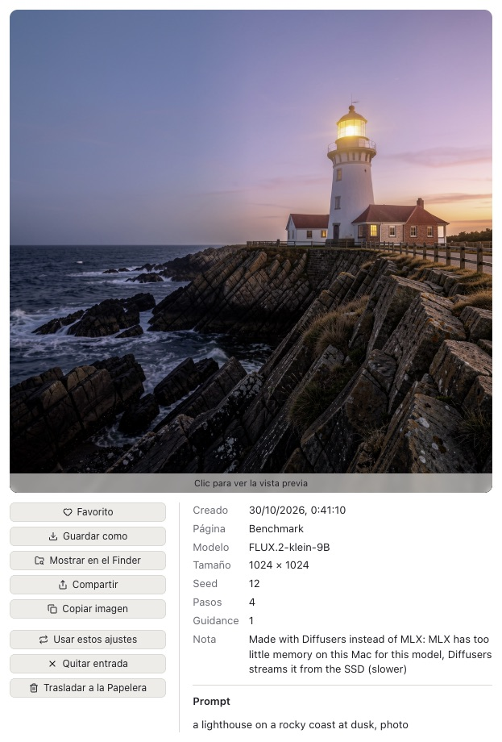
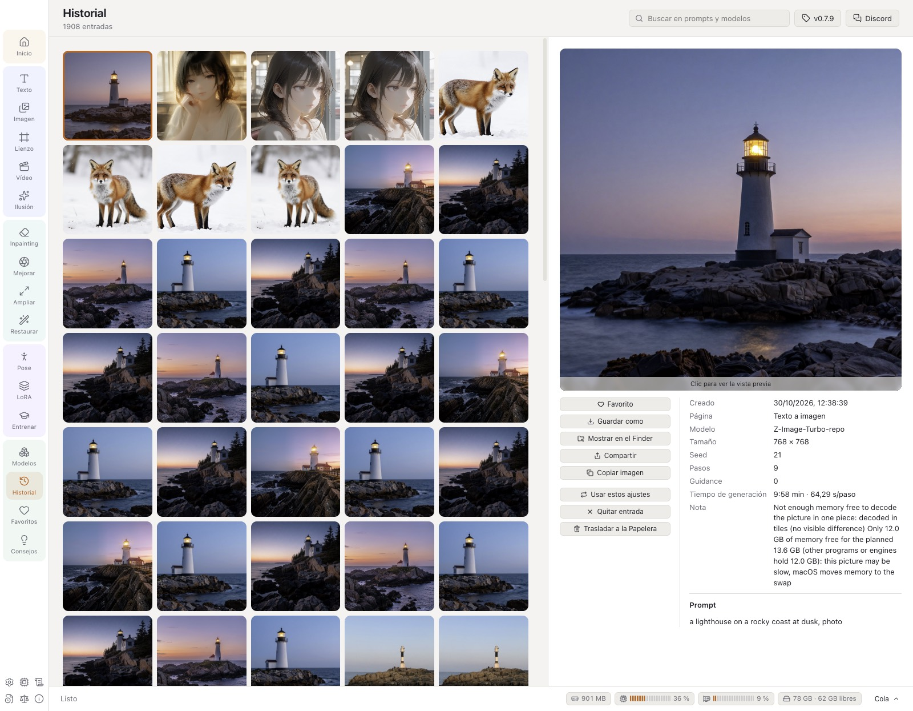
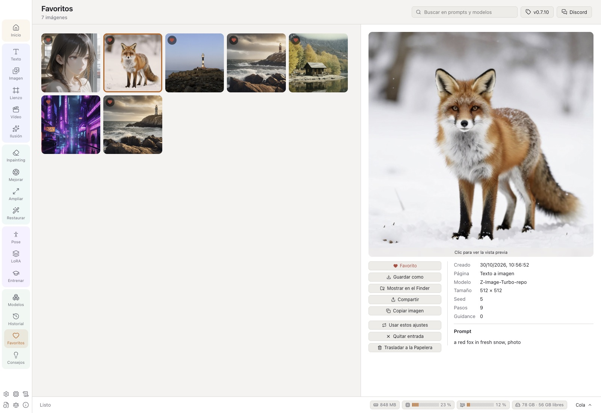
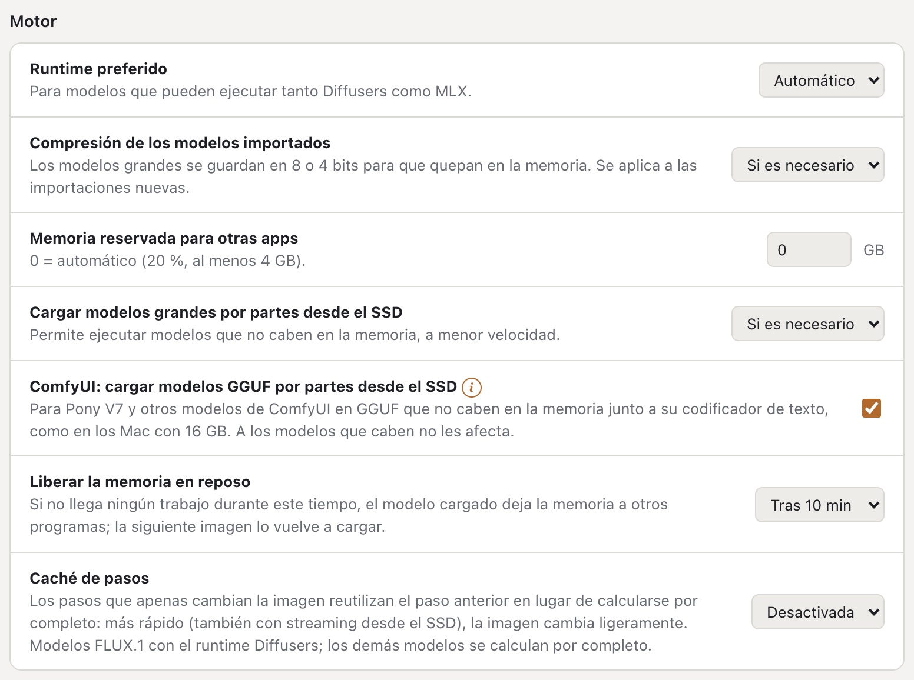

# Guía de usuario de VulKara

[English](../USER_GUIDE.md) · [Deutsch](../de/USER_GUIDE.md) · **Español** · [Português (Brasil)](../pt-BR/USER_GUIDE.md) · [Português (Portugal)](../pt-PT/USER_GUIDE.md)

VulKara, *tu generador local de imágenes con IA, con alta privacidad*, crea imágenes y vídeos cortos y restaura fotos
antiguas en un Mac con Apple silicon. Todo se calcula en el propio Mac; la red solo se usa para descargar runtimes,
modelos y las descripciones de las LoRAs, y para buscar actualizaciones. Esta guía describe cada página de la app, lo que hace cada ajuste y dónde
guarda la app sus datos.

## Contenido

1. [Primeros pasos](#1-primeros-pasos)
2. [La ventana](#2-la-ventana)
3. [Texto a imagen](#3-texto-a-imagen)
4. [Estilos](#4-estilos)
5. [Imagen a imagen](#5-imagen-a-imagen)
6. [Inpainting](#6-inpainting)
7. [Lienzo IA](#7-lienzo-ia)
8. [Imagen a vídeo](#8-imagen-a-vídeo)
9. [Ampliar](#9-ampliar), [Mejorar: herramientas de fotos](#mejorar-herramientas-de-fotos)
10. [Restaurar](#10-restaurar)
11. [Editor de poses](#11-editor-de-poses)
12. [Ilusión](#12-ilusión)
13. [LoRAs](#13-loras)
14. [Entrenamiento](#14-entrenamiento)
15. [Modelos](#15-modelos)
16. [Historial](#16-historial)
17. [Consejos y trucos](#17-consejos-y-trucos)
18. [La vista grande](#18-la-vista-grande)
19. [Ajustes](#19-ajustes)
20. [Hardware, Registros, Cambios, Licencias, Acerca de](#20-hardware-registros-cambios-licencias-acerca-de), [Informar de un problema](#informar-de-un-problema)
21. [Reglas de contenido](#21-normas-de-contenido)
22. [Dónde están los datos](#22-dónde-están-los-datos)
23. [Solución de problemas](#23-solución-de-problemas)

---

## 1. Primeros pasos

### Instalación

VulKara se distribuye como DMG. Ábrelo y arrastra VulKara a *Aplicaciones*. La app y el DMG están firmados con un
Developer ID y notarizados por Apple, así que macOS solo pregunta una vez si quieres abrir una app descargada de
internet. Una compilación firmada pero no notarizada la detiene Gatekeeper en el primer arranque en otro Mac: abre
**Ajustes del Sistema → Privacidad y seguridad**, desplázate hasta el mensaje sobre VulKara y haz clic en **Abrir
igualmente** (o haz Control-clic en la app en el Finder y elige **Abrir**). Solo hace falta una vez.

Con [Homebrew](https://brew.sh) también puedes instalar VulKara desde el terminal: `brew install --cask revil-O/tap/vulkara`. Las versiones nuevas
llegan luego con `brew upgrade --cask vulkara`.

### La pantalla de bienvenida

Al arrancar aparece una ventana con la imagen de la forja: el martillo rúnico golpea el yunque, las chispas se
convierten en píxeles incandescentes y de ellos se forja la valquiria. El nombre une a los dos: Vulcano, el dios romano
de la forja, y Kára, una valquiria de la leyenda nórdica. Debajo del nombre están el lema, la versión y el copyright;
la imagen lleva el icono de la UE *AI GENERATED* en su esquina inferior derecha. Mientras tanto, la app se carga
detrás de la imagen (*Preparando …*); cuando está lista y la pantalla de bienvenida lleva cinco segundos a la vista,
se cierra sola y se abre la app. Un clic (o ↩ o Espacio) la cierra antes, en cuanto la app está lista. La pantalla de
bienvenida es una ventana pequeña propia: aunque en los ajustes de macOS esté activado *Preferir pestañas: Siempre*,
no se abre como pestaña de la ventana principal.

### La página Inicio

La página Inicio muestra tres pasos. Cada paso recibe una marca de verificación cuando está hecho:

1. **Instala un runtime** (Ajustes → Runtimes). Un runtime es el software que ejecuta los modelos. Empieza con
   **Diffusers (Apple GPU)**: ejecuta la mayoría de los modelos y también el importador, la detección de poses y el
   filtro de contenido. **MLX** es más rápido para los modelos FLUX y Z-Image y es el único runtime para Krea 2,
   Ideogram 4 y FLUX 3 Image Klein. **ComfyUI** es opcional y hace falta para vídeo, ampliación y modelos Anima, Lumina 2 y Pony V7.
2. **Consigue un modelo** (Modelos → Recomendados). Para una primera prueba, usa *SDXL 1.0* o *DreamShaper XL v2
   Turbo* en un Mac con 16 GB de memoria, o *Stable Diffusion 1.5* en uno con 8 GB.
3. **Crea tu primera imagen** (Texto). Describe la imagen y pulsa **Generar** o ⌘↩. El paso se marca cuando la
   primera imagen está terminada (o cuando el historial ya contiene una), y sigue marcado aunque se vacíe el
   historial.

Debajo de los pasos, la página cuenta los runtimes, modelos y LoRAs instalados.

El menú de arriba a la derecha elige el idioma de la app (*Sistema*, English, Deutsch, Español, Português (Brasil),
Português (Portugal)), lo mismo
que **Ajustes → Apariencia → Idioma**.

**Requisitos del sistema:** macOS 14 (Sonoma) o posterior en Apple silicon (M1 o posterior), al menos 8 GB de memoria (16 GB o más para SDXL,
32 GB o más para los modelos FLUX grandes) y espacio libre en el SSD para los runtimes (unos 1–1,5 GB cada uno) y para
los modelos (2–35 GB cada uno).

## 2. La ventana

| Parte | Qué hace |
| --- | --- |
| **Barra de navegación** (izquierda) | Agrupa las páginas, cada grupo con un tono propio: *Inicio*; *Crear* (imágenes nuevas): Texto, Imagen, Lienzo, Vídeo, Ilusión; *Editar* (una imagen que ya tienes): Inpainting, Mejorar, Ampliar, Restaurar; *Herramientas*: Pose, LoRA, Entrenar; *Biblioteca*: Modelos, Historial, Favoritos, Consejos. En una ventana demasiado baja para todos, la barra se ensancha y muestra los grupos en dos columnas. Los iconos de abajo abren Ajustes, Registros, Cambios, Licencias y Acerca de. |
| **Área de trabajo** (centro) | La entrada de la página (prompt, imagen, lienzo) y, debajo, los resultados de esta página. Un resultado cuyo archivo se eliminó o se movió aparece como *Falta el archivo*;  lo quita de la lista. |
| **Panel de ajustes** (derecha) | Modelo, estilo, tamaño y todo lo demás que da forma al resultado. |
| **ⓘ** y **!** | Pequeñas insignias naranjas cuyo texto se abre al pasar el puntero por encima: **ⓘ** (un anillo) es información sin más, **!** (relleno) indica que la app hace algo distinto de lo estándar, p. ej. valores que difieren de la sugerencia del modelo o un modelo que se ejecuta con streaming desde el SSD. |
| **Barra de tareas** (abajo) | La tarea en curso: progreso, tiempo restante, segundos por paso y **Cancelar**. Cuatro indicadores muestran lo que está haciendo el Mac: la memoria que ocupan VulKara y sus motores, la CPU y la GPU como medidores de nivel, y las cachés del streaming desde el SSD con el espacio que queda en su disco (naranja por debajo de 20 GB). Un clic en ellos abre **Hardware**. **Cola** abre la lista de todas las tareas. |

Las páginas siguen vivas al cambiar entre ellas. Un prompt a medio escribir sigue ahí cuando vuelves, igual que un
lienzo o una pose. Cada página de generación recuerda además sus ajustes tras reiniciar.

### La cola

- Las tareas se ejecutan **de una en una**, en el orden en que se añadieron. Puedes añadir más tareas mientras una
  está en curso.
- **Imágenes** > 1 añade una tarea por imagen. Las seeds cuentan hacia arriba desde la seed elegida, o desde una
  aleatoria, de modo que cada imagen de una serie se puede volver a crear.
- En el panel de la cola, **Cancelar** detiene la tarea en curso y **Eliminar** saca de la lista una tarea en espera o
  terminada. **Quitar terminadas** vacía la lista de tareas terminadas.
- Cuando termina la última tarea en espera, el Mac reproduce un sonido corto. Puedes desactivarlo en Ajustes →
  Contenido → *Reproducir un sonido cuando la cola esté terminada*.
- Ninguna tarea empieza mientras se entrena una LoRA.

## 3. Texto a imagen

Describe la imagen en el campo del prompt y pulsa **Generar** (o ⌘↩). Los resultados aparecen debajo del prompt como
miniaturas. Una tarea en curso muestra su progreso en su miniatura, y una tarea en espera, su puesto en la cola. Haz
clic en una miniatura para abrirla en la [vista grande](#18-la-vista-grande).

- **×** en la esquina de una miniatura la quita de la lista (la imagen se queda en el historial); en una tarea en
  curso, la cancela. Las tareas canceladas y fallidas se quitan del mismo modo.
- Una miniatura de tarea muestra lo esencial. El puntero sobre su **ⓘ** abre todos los detalles: el prompt completo,
  tamaño, pasos y seed, una nota sobre cómo se hizo y el error completo de una tarea fallida.
- Una **ⓘ** en una imagen abre su nota del mismo modo, por ejemplo cuando se hizo con Diffusers en lugar de MLX.
- **Ampliador de prompts** (FLUX 3 Image Klein, Texto a imagen, junto a Generar): FLUX 3 está entrenado con
  descripciones completas de escenas; el ampliador de Black Forest Labs (4 bits, MLX) escribe primero una a partir de
  tu prompt – motivo, entorno, luz, cámara, colores. Un prompt que ya es una descripción completa se usa tal cual,
  igual que el de una edición con imagen. Se descarga una vez (5,7 GB) con el botón junto a la opción o en la página
  Modelos (modelos auxiliares); ocupa la memoria solo para el prompt (unos 30 s) y luego se libera, y la descripción
  que escribió pasa a ser la nota de la imagen.

  

- **Etiqueta IA de la UE** (junto a Generar): coloca de forma visible el icono de la Comisión Europea para contenido
  de IA en la esquina inferior derecha de cada imagen. *AI GENERATED* para imágenes creadas a partir de un prompt
  (Texto, Ilusión), *AI MODIFIED* cuando se modifica una imagen tuya (Imagen, Inpainting), o el *AI* redondo. **Tono
  automático** usa el icono negro en una esquina clara y el blanco en una esquina oscura; *Oscuro* y *Claro* lo fijan.
  Tamaños pequeño, mediano y grande; **Discreto** es el icono con un 50 % de transparencia. Una vista previa muestra el
  icono elegido. Se coloca en cuanto el filtro de contenido ha dado por buena la imagen; de todos modos, cada imagen
  lleva la nota en su archivo. No para vídeos.
- Una imagen etiquetada conserva una copia sin la etiqueta (en la carpeta oculta `.unlabelled` junto a ella). Si se
  usa como entrada de Imagen, Inpainting, Mejorar, Ampliar o Restaurar, se toma esa copia, de modo que la imagen nueva
  recibe una sola etiqueta en lugar de que se transparente la antigua. Trasladar a la Papelera una entrada del
  historial con sus archivos traslada también la copia.

  

  

| Ajuste | Rango | Qué hace |
| --- | --- | --- |
| **Modelo** | modelos de imagen instalados | El modelo decide la mayor parte del aspecto. Consulta [Cambiar de modelo](#cambiar-de-modelo) para ver qué cambia con él. |
| **Estilo** | 20 estilos en 4 grupos | Envuelve el prompt en una plantilla de estilo, consulta [Estilos](#4-estilos). |
| **Tamaño** | 1:1, 4:3, 3:2, 16:9, 3:4, 2:3, 9:16 | Cada botón muestra sus proporciones. El tamaño se elige para que coincida con el número de píxeles para el que se entrenó el modelo. El ancho y el alto también se pueden elegir directamente. |
| **Pasos** | 1–80 | Más pasos dan más detalle, hasta cierto punto. 20–30 va bien para la mayoría de los modelos; los modelos turbo necesitan 4–8, y más solo tardan más. |
| **Guidance** | 0–20, en pasos de 0,1 | Con qué fidelidad sigue la imagen al prompt. La regla sobre el control deslizante marca 0, 5, 10, 15 y 20. SDXL funciona mejor con 5–7, SD 1.5 con 7–9, FLUX con 3–4. |
| **Control** | Ninguno, Pose, Profundidad, Bordes, Dibujo lineal, Garabato, Tile | Guía la composición con una imagen de control, ver más abajo. Solo aparece si el modelo lo admite. |
| **Sampler** | depende de la familia | El método que elimina el ruido paso a paso. *Predeterminado* es el del propio modelo. La segunda lista ajusta el programa de ruido (Karras, Exponential, Beta); está desactivada mientras el sampler sea *Predeterminado*. |
| **Seed** | número o vacío | La misma seed con los mismos ajustes da la misma imagen. Vacío significa aleatorio; el botón del dado la vuelve a poner en aleatorio. |
| **Imágenes** | 1–20 | Cuántas imágenes se crean, cada una con su propia seed. |
| **LoRAs** | hasta 3 | Complementos que enseñan al modelo un estilo, una persona o un objeto, cada uno con su propio peso (−2 a 2; los botones − y + de al lado la cambian en décimas, también en el móvil). Solo se ofrecen LoRAs de la familia del modelo. |
| **No en la imagen** | texto | El prompt negativo: lo que no debe aparecer. Solo aparece si el modelo admite uno. |

### Cambiar de modelo

El primer modelo de una página trae sus propios pasos, guidance y tamaño. A partir de ahí, elegir otro modelo conserva
los ajustes, para poder comparar modelos con los mismos:

- **Pasos, guidance, seed y tamaño** se quedan como están. Si difieren de lo que sugiere el modelo nuevo, aparece una
  **!** naranja sobre los controles deslizantes junto a **Valores del modelo**: el puntero sobre ella muestra la
  sugerencia (*Este modelo sugiere 4 pasos y guidance 0, 1024×1024*), y el botón la aplica.
- **De dónde viene la sugerencia**: si la ficha del modelo los nombra, los pasos, la guidance, el sampler, el
  recorrido de sigmas y el prompt negativo de su creador se leen al importarlo y pasan a ser los valores propios del
  modelo; el aviso nombra entonces también el sampler (*Su creador recomienda el sampler DPM++ SDE Karras.*), y
  **Valores del modelo** lo aplica con el resto. Un modelo cuya ficha no dice nada conserva los valores que VulKara
  tiene para su familia.
- **Los valores para los que el modelo no está hecho** reciben una **!** naranja junto a *Pasos* o *Guidance*, con un
  botón que aplica el valor propio del modelo: más del doble de los pasos para los que está hecho un modelo destilado
  (*Hecho para 4 pasos: más pasos tardan más sin dar una imagen mejor.*), guidance en un modelo que no tiene
  (FLUX.1 [schnell], un FLUX.2 [klein] destilado) y guidance por encima de 1 en un modelo hecho sin ella (SDXL Turbo,
  Z-Image-Turbo, Chroma1-Flash), donde cada paso se calcula dos veces. En el Lienzo, la **!** aparece junto a *Pasos*.
- Solo cambia un **tamaño** que el modelo nuevo no puede calcular, al más cercano que sí puede con las mismas
  proporciones (SD 1.5 llega hasta 768 px). De vuelta en un modelo que sí puede, regresa el tamaño elegido antes, salvo
  que lo hayas cambiado entretanto.
- **Sampler**: el sampler elegido sigue elegido. Un modelo que no lo tiene se ejecuta con su predeterminado; una **!**
  naranja junto a *Sampler* lo indica al pasar el puntero. Al volver, regresa.
- **Solo los samplers del creador**: si la ficha del modelo nombra los samplers con los que su creador lo usa, la lista
  muestra solo esos, con *Estándar* (el recomendado) primero; un (i) junto a *Sampler* lo indica. Si la ficha no nombra
  ninguno, se mantiene la lista completa.
- Lo que el modelo nuevo no admite se quita: LoRAs de otra familia y un tipo de control que no tiene. El prompt
  negativo propio de un modelo solo se rellena si el campo está vacío.
- Un modelo que la app ha reconocido pero aún no puede ejecutar lo indica en la página antes de enviar nada.

### Imágenes de control (ControlNet)

**Control** mantiene la composición de una imagen de control:

| Tipo | Imagen de control | SD 1.5 | SDXL | SD 3.5 M | SD 3.5 L | FLUX.1 |
| --- | --- | :-: | :-: | :-: | :-: | :-: |
| Pose | un esqueleto del [Editor de poses](#11-editor-de-poses), o una foto cuya pose se detecta |  |  | | |  |
| Profundidad | un mapa de profundidad, o una foto cuya profundidad se estima |  |  |  |  |  |
| Bordes (Canny) | bordes blancos sobre negro, o una foto cuyos bordes se trazan |  |  |  |  |  |
| Dibujo lineal | un dibujo de líneas, o una foto convertida en uno |  |  | | |  |
| Garabato | un boceto aproximado, o una foto reducida a uno |  |  | | |  |
| Tile | una imagen cuyo contenido se conserva mientras se repintan los detalles | |  | |  | |

- Deja activado **Es una foto: prepararla primero** cuando la imagen de control sea una foto normal. Desactívalo
  cuando la imagen de control ya sea un esqueleto, un mapa de profundidad o una imagen de bordes.
- **Peso** (0–2) ajusta con qué rigor sigue el resultado a la imagen de control.
- El modelo de control se descarga la primera vez que se usa.

## 4. Estilos

Un estilo rodea el prompt con palabras que definen el aspecto. En algunos estilos también añade palabras a *No en la
imagen*. El selector muestra una imagen de muestra para cada estilo. Los encabezados con marco naranja agrupan los
estilos:

| Grupo | Estilos |
| --- | --- |
| **Foto** | Mejorar, Fotográfico, Cinematográfico, Película analógica, Blanco y negro, Romántico |
| **Ilustración** | Anime, Arte digital, Cómic, Arte fantástico, Ciencia ficción, Dibujo lineal |
| **Estilizado** | Neon Punk, Isométrico, Pixel art, Textura continua |
| **3D y manualidades** | Modelo 3D, Low Poly, Origami, Plastilina |

*Sin estilo* usa el prompt tal como está escrito. El estilo se guarda con cada tarea, así que *Usar estos ajustes* lo
recupera más tarde.

<table>
<tr>
<td> <b>Cinematográfico</b>: un faro en una costa rocosa a la hora dorada</td>
<td> <b>Película analógica</b>: una pequeña cabaña de madera junto a un lago de montaña</td>
</tr>
<tr>
<td> <b>Arte digital</b>: un zorro rojo sentado en un bosque nevado</td>
<td> <b>Arte fantástico</b>: un astronauta cuidando un invernadero en la luna</td>
</tr>
</table>

Todas creadas con Juggernaut XL v7, 25 pasos, guidance 6.

## 5. Imagen a imagen

Convierte una imagen existente en una nueva: otra estación, otro estilo, un boceto convertido en pintura.

- **Elige una imagen**: haz clic en el campo o suelta en él un archivo de imagen (PNG, JPEG, WebP o BMP). El clic abre
  el selector de imágenes: tus resultados del historial, los más recientes primero, con búsqueda (prompt, modelo,
  página) y un filtro *Favoritos*; un clic toma una imagen. **Desde el disco …** abre en su lugar el diálogo de
  archivos.
- **Hacer zoom en la imagen** (aquí y en Inpainting, Mejorar, Ampliar y Restaurar, también al pintar una máscara o
  seleccionar objetos): ⌘-desplazamiento o pellizcar acerca hacia el puntero, hasta el 800 %; después, el
  desplazamiento mueve la imagen, igual que arrastrar con Espacio o el botón central del ratón. Los pequeños controles
  de la esquina inferior derecha (aparecen cuando el puntero está sobre la imagen) alejan, acercan y la vuelven a
  ajustar. Pintar y hacer clic siguen funcionando con el zoom.
- **Cambio** (0,05–1): cuánto se aleja el resultado de la imagen. Con 0,3 cambian los colores y los detalles; con 0,6
  cambia el motivo y se mantiene la composición; por encima de 0,8 queda poco de la imagen. Los modelos FLUX.2 y
  Qwen-Image 2.1 no usan este control deslizante; toman la imagen como referencia.
- El resultado tiene las proporciones de la imagen. Para otro tamaño, marca **Tamaño propio en lugar de las
  proporciones de la imagen**.
- Todos los demás ajustes funcionan como en [Texto a imagen](#3-texto-a-imagen).

<table>
<tr>
<td> Texto a imagen</td>
<td> Imagen a imagen, cambio 0,6: <i>the same lighthouse in a snow storm</i></td>
</tr>
</table>

## 6. Inpainting

Vuelve a pintar una parte de una imagen y conserva el resto.

1. Elige la imagen.
2. **Pintar**: pinta sobre la parte que debe cambiar. **Borrar** quita pintura. **Tamaño** ajusta el pincel (1–30 % del lado
   más corto de la imagen). El botón de flecha deshace el último trazo y la papelera quita toda la pintura.
3. Describe lo que debe aparecer en la parte pintada, o deja el prompt vacío para simplemente quitar algo.
4. **Cambio** (por defecto 100 %): los valores más bajos conservan más de lo que hay.

Los modelos que pueden hacer inpainting son SD 1.x, SD 2.x, SDXL, SD 3.5, FLUX.1, Chroma, Qwen-Image y Z-Image. Los
modelos especiales de inpainting, como *SD 1.5 Inpainting*, dan los bordes más limpios.

## 7. Lienzo IA

Una superficie infinita sobre la que se pintan, amplían y repintan imágenes. El **marco** naranja indica dónde aparece
la siguiente imagen. Lo que hace **Generar** depende de lo que hay dentro del marco:

| En el marco | Resultado |
| --- | --- |
| nada | una imagen nueva |
| en parte una imagen | la parte vacía se rellena de modo que continúe la imagen (outpainting) |
| una imagen con trazos de máscara | se repinta la parte enmascarada |
| una imagen sin trazos de máscara | una variación (con **Cambio** 0,1–0,9) |

El panel siempre explica cuál de estas cosas ocurrirá.

**Herramientas y teclas:**

| | |
| --- | --- |
| **Mover** (V) | Arrastra una imagen para moverla. Arrastra una esquina de la imagen seleccionada para cambiar su tamaño: la esquina opuesta se queda fija y se mantienen las proporciones (mantén ⇧ para proporciones libres); su tamaño aparece debajo. Arrastra el borde del marco, o una parte vacía de él, para mover el marco (se ajusta a 8 px). Arrastra un espacio vacío para mover la vista. |
| **Ajustar al marco** | Hace la imagen seleccionada tan grande como quepa en el marco, centrada y con sus proporciones. |
| **Esquinas del marco** | Los tiradores redondos de las esquinas del marco cambian su tamaño libremente: la esquina opuesta se queda fija, los lados se ajustan a 64 px, de 256 a 2048 px y como máximo el doble de los píxeles del modelo (SDXL: unos 2 megapíxeles), para que un Mac de 16 GB pueda seguir el ritmo. El marco indica entonces *libre*; un botón de proporción le da un tamaño nuevo. |
| **Pincel de máscara** (B) | Pinta dentro del marco la parte que se va a repintar. El tamaño del pincel es 8–200. |
| Desplazamiento / pellizcar, ⌘-desplazamiento | El desplazamiento mueve la vista; pellizcar o ⌘-desplazamiento hace zoom (5 %–400 %). |
| ⌫ | Elimina la imagen seleccionada. |
| ⌘Z | Deshacer (hasta 50 pasos). |
| **Mostrar todo** | Ajusta la vista a todas las imágenes. |

- **Añadir una imagen** coloca una imagen en el marco, elegida en el selector de imágenes (del historial o del disco).
- Debajo de la superficie, una fila muestra la cola y los resultados recientes de esta página, como en las demás
  páginas: una tarea en espera o en curso con su progreso, una imagen terminada para abrir en la vista grande. Una
  imagen terminada también aparece en la superficie, donde estaba el marco.
- **Exportar PNG** guarda todas las imágenes como un solo archivo PNG.
- **Marco** ajusta las proporciones: 1:1, 3:4, 4:3, 16:9 o 9:16, o arrastra las esquinas del marco para cualquier
  tamaño.
- Para ampliar hace falta un modelo SDXL, SD 3.5, FLUX.1, Chroma o Z-Image, o un modelo de inpainting. Los demás
  modelos aparecen marcados con *(solo imágenes nuevas)*.
- El lienzo, con sus imágenes, la vista, el prompt y el modelo, se conserva tras reiniciar.

## 8. Imagen a vídeo

Convierte una imagen en un vídeo corto. Necesita el runtime ComfyUI y un modelo Wan 2.2 (Modelos → Recomendados).

- **Imagen inicial**: el primer fotograma. El vídeo adopta sus proporciones.
- **Prompt**: lo que ocurre, como movimiento, cámara y ambiente: *the astronaut slowly waters the plants, gentle
  camera push in*.
- **Duración**: 1–5 segundos.
- **Resolución**: 480p o 720p.

El vídeo tarda mucho más que las imágenes. Un clip de un segundo a 480p tardó unos 8 minutos en un M2 con 24 GB, y los
clips más largos necesitan mucha más memoria.

## 9. Ampliar

Amplía una imagen 2× o 4× y añade detalle, con Real-ESRGAN x4plus (64 MB, BSD-3, se descarga la primera vez que se
usa) a través del runtime ComfyUI.

- **Ampliar**: botones predefinidos ×1,5, ×2, ×2,2, ×2,5, ×3, ×3,5 y ×4, y un control deslizante en pasos de 0,1
  para cualquier valor intermedio. El modelo siempre trabaja a 4×; un factor menor reduce su resultado después (más
  limpio que ampliar de forma normal).
- Una imagen de más de 2048 px en el lado más largo se reduce primero a 2048; el resultado sigue siendo el factor
  elegido por tu imagen, hasta cuatro veces la reducida (la nota del resultado lo indica).
- La vista grande de cualquier imagen tiene un botón **Ampliar** que envía la imagen aquí.

### Mejorar: herramientas de fotos

**Mejorar** (en Editar) trabaja sobre una foto con modelos pequeños en este Mac: sin prompt, sin modelo de
difusión, y cada resultado pasa por la cola, el filtro de contenido y el historial como cualquier otro. La lista de la
derecha muestra cada herramienta con unas pocas palabras y dónde se ejecuta: **GPU** (los pesos originales de PyTorch
a través de spandrel) o **CPU** (un modelo ONNX), en una etiqueta violeta o turquesa. Su insignia (i) tiene el resto:
el modelo, lo que hace en detalle, los límites de tamaño y el tamaño de descarga, y, bajo una línea, la licencia, su
nota y el origen.

| Herramienta | Qué hace | Se ejecuta en | Tamaño · licencia |
| --- | --- | --- | --- |
| **Enfocar (NAFNet)** | elimina el desenfoque de fotos movidas o ligeramente desenfocadas | CPU | 92 MB · MIT |
| **Reducir ruido (SCUNet)** | elimina el ruido de fotos reales (ISO alto, poca luz) | GPU | 72 MB · Apache-2.0 |
| **Ampliar ×4 (SwinIR)** | amplía fotos reales cuatro veces y recrea el detalle fino; una imagen de más de 2048 px en el lado más largo se reduce primero a 2048 (la nota del resultado lo indica), así que los resultados llegan como máximo a 8192 px | GPU | 67 MB · Apache-2.0 |
| **Limpiar JPEG (FBCNN)** | elimina los bloques y halos de una compresión JPEG fuerte; detecta la calidad por sí misma | GPU | 288 MB · Apache-2.0 |
| **Quitar fondo (BiRefNet)** | el sujeto principal sobre un fondo transparente, o su máscara | CPU | 115 MB · MIT |
| **Seleccionar objetos (SAM 2.1)** | haz clic en lo que quieres seleccionar (⌥-clic en lo que no forma parte de ello) | CPU | 155 MB · Apache-2.0 |

- **Descargar** obtiene una herramienta una sola vez de su editor en una versión fija y comprobada (un commit de
  Hugging Face o un archivo de una release de GitHub con su suma de verificación); las seis son de uso libre, también
  comercial. El icono de la papelera traslada una herramienta instalada a la Papelera. Las herramientas de GPU
  necesitan el runtime Diffusers con spandrel: un runtime más antiguo ofrece la actualización en Ajustes → Runtimes.
- **Intensidad** mezcla el resultado de Enfocar, Reducir ruido o Ampliar con el original (100 % = solo el resultado de
  la herramienta).
- **Calidad JPEG** (Limpiar JPEG): *Auto* deja que la herramienta estime cuánto se comprimió la imagen. Los botones
  10–90 y un control deslizante la ajustan a mano: una calidad más baja limpia con más fuerza (bloques, halos, pero
  también detalle fino), una más alta, con más suavidad.
- **Carácter** (Reducir ruido): *Natural* mantiene la foto fiel; *Nítido* usa los pesos GAN de SCUNet, más nítido, con
  textura fina inventada donde había ruido. Nítido se descarga una vez (72 MB) la primera vez que se usa.
- **Ampliar** (herramientas que amplían, como Ampliar ×4): los mismos botones predefinidos y el mismo control
  deslizante que en la página Ampliar; el resultado tiene ese múltiplo del tamaño de tu imagen.
- **Quitar fondo**: *Transparente* da un PNG con fondo transparente; *Máscara*, la máscara en blanco y negro.
- **Seleccionar objetos**: cada clic afina la selección, que se muestra sobre la imagen (todo lo demás atenuado).
  **Recortar** y **Guardar máscara** crean una imagen de ella; **Pintar en Inpainting** abre la página Inpainting con
  la imagen y la selección ya pintada como máscara, lista para volver a pintarse.
- **Importar un archivo de modelo**: otros modelos de fotos, si su licencia lo permite. Los pesos de PyTorch (.pth,
  .safetensors) se ejecutan en la GPU cuando spandrel conoce la arquitectura (ESRGAN, SwinIR, HAT, DAT, NAFNet, SCUNet,
  FBCNN, SPAN, OmniSR y otras; imagen en color de entrada y de salida, ampliando 1, 2, 3, 4 u 8 veces); los archivos
  .pth se leen sin ejecutar el código que pudieran contener. Los modelos ONNX se ejecutan en la CPU y se comprueban
  primero: una imagen de entrada (1 × 3 × alto × ancho), una imagen de salida (del mismo tamaño o 2, 3, 4 u 8 veces
  mayor) o una máscara, valores 0–1 o 0–255; se rechazan los modelos con operadores propios. Las imágenes grandes se
  procesan por partes.
- Tiempos aproximados en un M2 para una foto de 768 × 768: Limpiar JPEG 2 s, Reducir ruido 4 s, Quitar fondo 8 s,
  Enfocar 15 s, Ampliar ×4 35 s; un clic al seleccionar, unas centésimas de segundo.
## 10. Restaurar

Restaura fotos antiguas: dominantes de color, colores desvaídos, imágenes y caras suaves o borrosas, arañazos, pliegues,
manchas, agujeros, y blanco y negro. Elige la foto (o suéltala sobre el campo) y pulsa **Restaurar** o ⌘↩. Una foto en
blanco y negro o virada se reconoce y se le activa *Colorear una foto en blanco y negro*.

Una foto con perfil de color (Display P3, Adobe RGB o HDR como *Rec. 2020 PQ*, que escriben algunas apps de ampliación
y los iPhone) se convierte primero a sRGB; leída sin su perfil saldría plana y gris. Esto vale para todas las páginas que
admiten una imagen.

**Pasos** (cualquier combinación):

| Paso | Cómo |
| --- | --- |
| **Corregir dominante de color y contraste** | Sin modelo: balance de blancos (una dominante roja o amarilla se neutraliza; una foto en blanco y negro virada pasa a gris neutro), niveles y contraste local solo sobre la luminosidad. Los tonos claros se comprimen en lugar de recortarse, así que un vestido blanco conserva sus pliegues. **Intensidad** 20–100 % (por defecto 80 %). |
| **Reparar daños (IA)** | Un modelo FLUX.2 edita la foto (Modelos → Recomendados: FLUX.2 [klein]). **Pasos del modelo** 2–12. Sin pintura, repinta toda la foto: la ropa suave, las hojas y los fondos reciben detalle real, pero las caras pueden convertirse en las de otras personas; por eso, cuando *Restaurar caras (IA)* está activado, las caras se toman de la foto antes de la reparación. |
| **Quitar polvo y arañazos** | Sin ningún modelo tuyo: las motas pequeñas y los arañazos finos que destacan sobre un entorno uniforme se detectan y se rellenan con lo que los rodea (LaMa). Las hojas y la tela no se tocan, ni tampoco los ojos y la boca. **Sensibilidad** 0–100 % (por defecto 50 %); una mayor detecta motas más tenues y, de vez en cuando, también algún detalle pequeño de la foto (la vista previa lo muestra). |
| **Reconstruir detalles suaves (IA)** | Real-ESRGAN (el modelo auxiliar de Ampliar, 64 MB) reconstruye los bordes y las texturas de toda la foto: la reduce en la medida en que está borrosa (**Suavidad de la foto** × 1,25–3, por defecto × 2) y la vuelve a ampliar cuatro veces. **Intensidad** 20–100 %. Afina lo que la foto aún muestra; la textura que se ha perdido por completo (tela, hojas) solo la inventa *Reparar daños (IA)*. |
| **Restaurar caras (IA)** | CodeFormer (0,4 GB, se descarga una vez) restaura caras borrosas, tomadas de la foto antes de los pasos con IA. **Fiel a la foto** 50–100 % (por defecto 90 %): los valores más bajos inventan más detalle. **Intensidad** 20–100 % (por defecto 60 %). Las caras de menos de unos 14 píxeles no se tocan. La licencia de CodeFormer solo permite el uso no comercial. |
| **Colorear una foto en blanco y negro** | DDColor (0,9 GB, se descarga una vez) añade color a la luminosidad de la foto, así que ninguna forma ni detalle puede cambiar. **Intensidad del color** 50–150 %. |
| **Menos grano, detalles más nítidos** | Sin modelo: se reduce el ruido de la luminosidad y se enfocan sus bordes; el color solo se suaviza un poco. **Intensidad** 10–100 %. |

**Las caras** que CodeFormer va a restaurar se muestran sobre la foto como marcos redondeados y numerados. Arrastra un
marco sobre la cara cuando la detección no acierte, u omite una cara con su **×**; **Buscar de nuevo** vuelve a poner los
marcos. Las caras las encuentra YuNet (un pequeño detector de caras que se descarga una vez).

**Tamaño del resultado**: *Como la foto* o *El doble de tamaño*.

**Vista previa** restaura solo una parte de la foto, rápidamente: lo que hayas ampliado (⌘ + desplazamiento) o, si no,
la cara más grande (o el centro), como máximo 768 píxeles. No se guarda en el historial. Encima del campo de nota, el
**control de comparación** muestra la vista previa o el resultado más reciente de la foto sobre el original: a la
izquierda de la línea, el cambio; a la derecha, el original. Arrastra la línea (o muévela con ← → cuando tenga el foco);
⌘ + desplazamiento amplía ambos.

**En un Mac con 16 GB** la reparación con IA también funciona: pinta a aproximadamente un megapíxel con las proporciones
de la foto y su resultado se devuelve al tamaño de la foto, así que un escaneo grande no necesita más memoria que una
imagen normal de FLUX.2 [klein] (una foto de 768 × 1024 con 12 GB reservados: 5 minutos en un M2).

**Pinta los daños**: con el pincel (como en Inpainting) pinta sobre arañazos, pliegues, manchas y agujeros. Ahí repara la
IA; en el resto, la foto se queda como está. Antes de que la IA vea la foto, los lugares pintados se rellenan con su
entorno mediante LaMa (un pequeño modelo de relleno, Apache 2.0, se descarga una vez; sin él se usa un relleno más
sencillo), así que el modelo solo tiene que refinarlos. Sin pintura, la IA puede tocar toda la foto, dentro del cambio
permitido.

**Límites de seguridad** para el paso con IA:

- **Conservar el original fuera de los daños pintados**: el resultado se compone del original y de los lugares
  reparados.
- **Rechazar resultados con caras cambiadas**: las caras del resultado se comparan con las de la foto.
- **Cambio permitido** (1–30 %, por defecto 6 %): cuánto puede cambiar la estructura de la foto.
- **Reglas para la IA**: reglas fijas que se envían siempre (solo quitar daños; conservar la composición, cada persona,
  cara, expresión, pose y peinado, la ropa, los objetos y los textos; no añadir, quitar ni inventar nada), y tus
  **reglas propias**, p. ej. *Conservar el número de la casa*. Las reglas propias se conservan para todas las restauraciones.

Una reparación que incumple un límite de seguridad se rechaza indicando el motivo.

Las **plantillas** fijan los pasos, los límites de seguridad y la nota para los tipos habituales de fotos antiguas:
*Blanco y negro, dañada*, *De blanco y negro a color*, *Dominante de color (roja o amarilla)*, *Foto en color desvaída*,
*Solo colorear* y *Daños graves (pliegues, agujeros)*. Debajo del campo de nota, **Guardar como plantilla** guarda los
pasos, los límites de seguridad y la nota actuales con un nombre propio; las plantillas propias aparecen después de las
incluidas y se eliminan con su **×**.

La **nota** es un campo de texto de tres líneas (se puede agrandar desde su esquina inferior derecha) para lo que muestra
la foto, p. ej. *una foto de boda de los años 50*; ayuda a la IA.

## 11. Editor de poses

Crea esqueletos de pose (OpenPose: cuerpo, manos y cara) para el control *Pose* de Texto a imagen.

- **Arrastra** un punto para moverlo. **Arrastrar con ⇧** mueve a toda la persona, o solo la mano o la cara que se ha
  agarrado. Mover una muñeca mueve su mano; mover la nariz mueve la cara.
- **Doble clic** en un punto lo oculta, por ejemplo para una mano detrás de la espalda. Los puntos ocultos se muestran
  discontinuos, y otro doble clic los vuelve a mostrar.
- **Personas**: Persona 1…n. La **plantilla** ofrece poses de cuerpo entero (De pie, Pose en T, Brazos arriba, Caminando,
  Corriendo, Sentado, Modelo, Pasarela, Girando, Inclinado, Pensativo, De rodillas, A cuatro patas, Tumbado, Recostado) y
  retratos (sonriendo, mano en la barbilla, manos en la cara, saludando, signo de la paz …). **Añadir** añade una persona
  con la plantilla, **Aplicar** da la plantilla a la persona seleccionada, **Reflejar** la voltea y **Eliminar** la borra.
- **Manos**: Abierta, Relajada, Puño, Señalando, Paz, Pulgar arriba, OK, Plana, cerrada, Índice en la mejilla,
  Ligeramente doblada.
- **Cara**: Neutral, Sonrisa, Boca abierta, Sorpresa, Tristeza, Ojos cerrados.
- **Giro y tamaño**: ±15° y ×1,1 / ÷1,1, para la persona o la parte seleccionada.
- **Desde una foto**: detecta a las personas de una foto. Necesita el runtime Diffusers. *Mostrar la foto* coloca la
  foto debajo de los esqueletos.
- **Usar en Texto a imagen** envía el esqueleto como imagen de control de pose, junto con su tamaño. **Guardar PNG** lo
  guarda como archivo.

Las poses funcionan con SD 1.5 (solo el cuerpo), SDXL y FLUX.1. Elimina la cara de una persona cuya cara vaya a quedar
cubierta.

## 12. Ilusión

Esconde un patrón o una palabra en una imagen, que aparece cuando entrecierras los ojos o miras desde lejos.

- **Patrón oculto**: Espiral, Anillos, Tablero de ajedrez, Rayas, Texto (hasta 24 letras) o Imagen propia (una imagen en
  blanco y negro, un código QR o un logotipo). Las partes claras del patrón se vuelven luminosas en la imagen, y las
  oscuras, oscuras. **Densidad** (2–24), **Desenfoque** (0–12) e **Invertir** dan forma al patrón.
- **Intensidad del patrón** (0,5–2): aprox. 0,8 es discreto, 1,2 claro y 1,6 dominante.
- Necesita un modelo SDXL o SD 1.5. El modelo de patrones (5 GB para SDXL) se descarga la primera vez que se usa.

## 13. LoRAs

Una LoRA es un pequeño complemento (normalmente de 20–400 MB) que enseña a un modelo un estilo, un personaje o un objeto.
La página LoRA muestra todas las LoRAs instaladas, ordenadas por familia (SD 1.x, SDXL, SD 3.5, FLUX.1, Chroma, FLUX.2,
FLUX 3, Krea 2 …). Puedes filtrarlas por familia y buscar en sus nombres, palabras clave y categorías.

**El panel de una LoRA:**

- **Nombre**: el lápiz le da a la LoRA un nombre propio dentro de la app; consulta [Nombres en la app](#nombres-en-la-app).
- **Palabras clave**: palabras que activan la LoRA en el prompt. El panel muestra de dónde vienen (*de Civitai*, *de los
  datos de entrenamiento*, *editadas por ti*). Haz clic en una palabra para copiarla; **×** la elimina y **+ añadir**
  añade una.
- **Categoría**: tu propia agrupación, que usa la búsqueda.
- **De su página**: lo que los autores de la LoRA escribieron en Civitai o Hugging Face: descripción, etiquetas, notas
  de la versión, licencia y uso comercial. Se lee una vez, se guarda en caché y se puede actualizar con el botón de la
  flecha.
- **Ajustes recomendados**: intensidad, pasos, guidance, sampler y clip skip, tal como los indican los autores o
  deducidos de sus imágenes de ejemplo.
- **Prompts de sus autores**: prompts de ejemplo. **Probar** los abre en la comparación de intensidades.
- **Cómo usarla**: una breve guía para obtener buenos resultados con esta LoRA.
- **Datos de entrenamiento**: con qué se entrenó la LoRA (resolución, imágenes, épocas, pasos, tasa de aprendizaje) y
  las etiquetas más usadas. Haz clic en una etiqueta para añadirla como palabra clave.

### Comparar intensidades

**Comparar intensidades** (la pestaña de arriba, o el botón del panel de una LoRA) crea la misma imagen con la misma
seed a varias intensidades de la LoRA, por ejemplo `0, 0.5, 1` (0 = sin la LoRA, hasta 8 valores entre −2 y 3). Se
puede comparar al mismo tiempo una **Segunda LoRA** de la misma familia. **Modelo** ofrece los modelos instalados con
los que encaja la LoRA; los pasos, la guidance y el tamaño son los propios del modelo. **Ponerlas en el prompt** añade
las palabras clave, y una seed vacía significa una seed aleatoria para toda la comparación. Así se ve rápidamente qué
intensidad debe tener una LoRA.

Para usar una LoRA, añádela en la sección **LoRAs** de una página de generación y pon su palabra clave en el prompt.

### A qué modelo pertenece una LoRA

Una LoRA solo funciona con el tipo de modelo para el que se entrenó. VulKara lo determina al importar una LoRA:

1. por su **estructura**, los nombres y tamaños de sus capas;
2. donde las capas dejan varias opciones, o no dicen nada, por sus **metadatos** (lo que la herramienta de
   entrenamiento escribió en el archivo);
3. después, por su **origen**: el modelo base que indica Civitai, o el `base_model` de un repositorio de Hugging Face.

Una LoRA que ninguno de estos datos identifica se rechaza con un mensaje; nunca se archiva como SDXL por si acaso. Cuando
una familia tiene modelos de distintos tamaños, también se guarda la subbase: las LoRAs de FLUX.2 [klein] 4B, [klein] 9B
y FLUX.2 [dev] se mantienen separadas (sus capas tienen otros tamaños), igual que las de Wan 5B y 14B. Las páginas de
generación solo ofrecen LoRAs que encajan con el modelo elegido.

Al cargar una LoRA, el motor también cuenta cuántas de sus capas encontraron su sitio en el modelo. Por debajo del 90 %,
la tarea se detiene con un mensaje claro (*The LoRA … does not fit this … model: only 62 % of its layers (…) found their
place*) en lugar de crear una imagen con una LoRA aplicada a medias.

**Qué archivos de LoRA se cargan**: archivos LoRA, LoCon y DoRA en los formatos de los entrenadores habituales: kohya /
OneTrainer, ai-toolkit, diffusers / SimpleTuner y archivos guardados por ComfyUI. Los archivos con nombres que el runtime
no lee por sí mismo se convierten al cargarlos: LoRAs de FLUX.1 y Chroma con los nombres de bloque originales de ComfyUI,
volcados de peft, LoRAs de SDXL de ai-toolkit (`lora_transformer_`), archivos con estilos de nombre mezclados, LoRAs de
Qwen-Image 2.1 de ai-toolkit (su capa MLP fusionada se divide en dos) y LoRAs de Z-Image con los nombres de ComfyUI o de
kohya (su capa de atención fusionada se divide en tres; también con el runtime MLX, que además rechaza una LoRA de Z-Image
por debajo del 90 %). Los archivos LyCORIS **LoKr** y **LoHa** aún no son compatibles con el runtime Diffusers: una LoRA
así detiene la tarea con *LoKr/LoHa LoRAs are not supported yet*.

Las LoRAs de familias que la app aún no puede ejecutar (por ejemplo HiDream, Lumina 2, HunyuanVideo) se muestran en esta
página y en la página Modelos bajo su familia, pero ninguna página de generación las ofrece.

Una vez, en el primer inicio de una versión con mejor detección, VulKara vuelve a comprobar todas las LoRAs y modelos
instalados (necesita el runtime Diffusers y, si no está, lo espera). Se corrige una LoRA archivada en la familia
equivocada o sin su subbase, un checkpoint de Chroma que se había archivado como FLUX.1, o una LoRA de Z-Image cuya
etiqueta todavía dice que ningún modelo puede usarla; cada manifiesto modificado se guarda a su lado como
`lora.json.bak` o `model.json.bak`. Los cambios se enumeran en el registro.

### Integrar LoRAs en un modelo nuevo

**Integrar en un modelo nuevo …** (en la página LoRA, en el resumen de una LoRA y junto a *Comparar intensidades*, y en
la página Entrenamiento cuando una LoRA está lista) crea un modelo propio a partir de un modelo base y una o varias LoRAs
con su intensidad. El modelo nuevo ya no necesita ninguna LoRA, funciona como cualquier otro modelo y aparece en Modelos
con las palabras clave de las LoRAs; al usarlo, estas palabras se ponen en el prompt como lo habrían hecho las LoRAs. Su
tarjeta indica la base y las LoRAs con las que se creó. La base se queda como está.

- El modelo nuevo es tan grande como su base (SD 1.5, unos 2 GB; SDXL, unos 7 GB). Las partes sin cambios de una base
  de diffusers (los codificadores de texto, cuando ninguna LoRA los modifica) se enlazan en lugar de copiarse cuando el
  disco lo permite.
- La integración necesita aproximadamente el tamaño de la base en memoria libre; el modelo cargado se descarga para ello
  y la cola tiene que estar vacía. En un Mac con 16 GB caben SD 1.5 y SDXL; FLUX.2 [klein] 4B (unos 10 GB), solo con
  poco más abierto. Un modelo que no cabe se rechaza antes de cargar nada, indicando la memoria que necesita.
- Los modelos comprimidos (archivos GGUF, FP8, NF4, Q4/Q8) no admiten integrar una LoRA, ni tampoco los modelos de
  ComfyUI: la lista los muestra en gris con el motivo. Importa primero la base sin cuantizar.
- En un M2, integrar una LoRA en SD 1.5 tardó 12 s; el modelo integrado da las mismas imágenes que la base con la LoRA
  (diferencia media de 3,5 sobre 255, redondeo a 16 bits).

**Exportar como un único archivo**: el icono de archivo en la tarjeta de un modelo integrado (y de cualquier modelo
SD 1.x o SDXL con estructura de carpeta) lo escribe como un único checkpoint `.safetensors` con la estructura original,
donde tú elijas. Otras apps (ComfyUI, Automatic1111, Forge) lo cargan como cualquier checkpoint descargado. La cola tiene
que estar vacía; un modelo SDXL necesita para ello unos 7 GB de memoria y de disco.

## 14. Entrenamiento

Enseña a un modelo una persona, un objeto o un estilo a partir de tus propias imágenes, y produce una LoRA nueva.

1. Ponle **Nombre** a la LoRA. A partir del nombre se crea una **Palabra clave** (por ejemplo `paper_cranes_zqx`);
   puedes cambiarla.
2. **Modelo para entrenar**: SDXL (runtime Diffusers), FLUX.2 [klein] o Krea 2 (runtime MLX).
3. **Imágenes**: bastan 10–30 imágenes buenas. Usa **Añadir imágenes** o **Añadir una carpeta**. Con una carpeta, los
   archivos `.txt` con el mismo nombre que una imagen se usan como su descripción. Cada descripción empieza con la
   palabra clave. Describe en las descripciones lo que *no* debe aprenderse, como el fondo o la ropa.
4. **Preajuste**: *Prueba rápida* (100 pasos), *Estándar* (500), *A fondo* (1200). También puedes fijar los pasos
   (10–5000), la resolución (512/768/1024), el rango (8/16/32) y la tasa de aprendizaje.
5. **Iniciar el entrenamiento**. Primero cada imagen pasa el filtro de contenido, igual que los resultados (*Comprobando
   las imágenes*; con Permitir desnudos desactivado, ningún desnudo); tus imágenes solo se miran, nunca se modifican ni se
   eliminan. Si alguna no pasa, el entrenamiento no empieza y el panel indica qué imágenes hay que quitar. Las
   descripciones y la palabra clave se comprueban como un prompt. Después, el panel muestra la fase, el paso, la curva
   de pérdida y el tiempo restante. El Mac se mantiene despierto y la generación se pausa durante el entrenamiento.

Al terminar, **Comparar intensidades** abre la LoRA nueva en la comparación. Tiempos aproximados en un M2: SDXL unos
2,5 s por paso a 768 px, FLUX.2 [klein] 4B unos 15 s, 9B unos 30 s, Krea 2 unos 45 s.

## 15. Modelos

**Recomendados** empieza con el Mac en el que se ejecuta (por ejemplo *MacBook Pro (13-inch, M2, 2022) · 24 GB*); un
modelo que solo cabe mediante streaming desde el SSD muestra *streaming desde el SSD* con un **!**.

La página Modelos tiene tres pestañas: **Instalados**, **Recomendados** y **Añadir**. Las descargas e importaciones se
ejecutan una tras otra y se muestran arriba de la página con su progreso. Los modelos y LoRAs solo se instalan mientras
el disco de modelos tenga al menos 50 GB libres; con menos, la importación se rechaza e indica cuánto queda libre (los
buscadores marcan esas tarjetas y no las instalan).

### Instalados

#### Modelos auxiliares

**Auxiliares** (o *Todo*, debajo de los modelos y las LoRAs) muestra los modelos pequeños que usan las herramientas de
la app, con un tono propio, cada uno con una imagen de lo que hace: el **filtro de contenido** (desnudos y estimación de
edad), **Restaurar** (LaMa rellena daños, DDColor colorea), la **detección de poses y profundidad** (DWPose, Depth
Anything), los **ControlNets** de cada familia de modelos, **Real-ESRGAN** para Ampliar y las **herramientas de fotos**
de Mejorar. El recuento indica cuántos de ellos hay en este Mac.

- Cada uno se descarga de todos modos cuando se necesita por primera vez; **Descargar** lo obtiene por adelantado (útil
  antes de quedarte sin conexión).
- **Trasladar a la Papelera** libera su espacio; vuelve la próxima vez que se necesite. El filtro de contenido es
  *Necesario*: comprueba cada resultado y no se puede eliminar.
- Cada modelo auxiliar se obtiene en una versión fija y verificada (commit y SHA-256), nunca en una más reciente sin
  revisar; uno que ya se había descargado antes se comprueba una vez.

**Instalados** enumera todo lo que hay en este Mac, agrupado por tipo: **Modelos de imagen**, **Modelos de vídeo** y
**LoRAs**, cada grupo con su propio tono y su recuento. *Todo / Modelos / LoRAs* y la búsqueda acotan la lista. La
tarjeta de un modelo muestra su arquitectura y la memoria que necesita; la de una LoRA, la familia (y la subbase) para la
que es y sus palabras clave, y una etiqueta *ComfyUI* o *Vídeo* cuando corresponde. Los botones de una tarjeta:

- **LoRAs** (solo modelos): LoRAs para este modelo en Civitai o Hugging Face; consulta [LoRAs para un modelo](#loras-para-un-modelo).
- la flecha abre su página de origen en Hugging Face o Civitai;
- el lápiz le da un nombre propio dentro de la app; consulta [Nombres en la app](#nombres-en-la-app);
- **Mostrar en el Finder** muestra su carpeta, y **Trasladar a la Papelera** lo elimina (se puede recuperar desde la
  Papelera). Un modelo que se añadió como carpeta usada donde está solo se desvincula; sus archivos se quedan donde están.

### Modelos copiados de otro Mac

Una importación se decide para el Mac en el que se hace: el plan de memoria, si un archivo FP8 se guarda como GGUF de
8 bits, las copias comprimidas que se conservan para más adelante. Una carpeta de modelo copiada de otro Mac (por ejemplo,
importada en un Mac con 24 GB y copiada a uno con 16 GB) no se importó aquí, así que aquí no funciona: su tarjeta dice
*Importado en otro Mac* con un **!** que indica qué Mac (por su memoria), y una tarea, una integración o un entrenamiento
con él se rechaza con el mismo consejo. Dos botones en su tarjeta:

- **Importar de nuevo** traslada la copia a la Papelera y vuelve a importar el modelo en este Mac desde su origen, con el
  mismo nombre: el archivo de este Mac (si sigue en el mismo sitio), el repositorio de Hugging Face o la página de
  Civitai. Primero se comprueba; un modelo que no se puede importar aquí (demasiado grande para este Mac) se deja como
  está.
- **Eliminar** lo traslada a la Papelera.

Sin su archivo original (un archivo que no está en este Mac, un modelo integrado) solo queda **Eliminar**: elimínalo e
importa el modelo desde su archivo en **Añadir**. Cada importación anota en `model.json` el Mac en el que se hizo
(`imported_on`: un id derivado del Mac, no su número de serie ni su UUID, y su memoria); las importaciones más antiguas
se identifican por la memoria para la que se hizo su plan.

### Familias de modelos

| Familia | Runtime | Notas | Modelo / imágenes uso comercial |
| --- | --- | --- | --- |
| Stable Diffusion 1.5, 2.x | Diffusers | también checkpoints de inpainting | sí / sí (Open RAIL, restricciones de uso) |
| SDXL, incl. Turbo, Pony, Illustrious, NoobAI | Diffusers | las LoRAs de Pony, Illustrious y NoobAI se distinguen de las de SDXL normal | sí / sí (Open RAIL++) |
| Stable Diffusion 3.5 Medium / Large | Diffusers | | con condiciones (menos de 1 millón de USD de ingresos) |
| FLUX.1 [schnell] / [dev] | Diffusers o MLX | también archivos GGUF | schnell sí / sí; dev no / sí |
| Chroma (Chroma1-HD, -Base, -Flash, fine-tunes) | Diffusers | guidance real con prompt negativo (dos pasadas por paso, así que más lento que FLUX.1; Chroma1-Flash necesita 12 pasos y nada de guidance: unos 7 minutos por imagen a 1024 px en un M2 con 24 GB en lugar de unos 52); se calcula en float16 en M1/M2, aprox. un 40 % más rápido que bfloat16; safetensors y GGUF; los archivos únicos toman el T5 y el VAE de FLUX.1 | sí / sí (Apache 2.0) |
| FLUX.2 [klein] 4B / 9B, FLUX.2 [dev] | Diffusers; [klein] también MLX | imagen a imagen toma la imagen como referencia; LoRAs separadas por tamaño | 4B sí / sí; 9B y [dev] no / sí |
| Qwen-Image (y su actualización 2512) | Diffusers | archivos GGUF o el repositorio; guidance real | sí / sí (Apache 2.0) |
| Qwen-Image 2.1 | Diffusers (diffusers 0.41, Ajustes → Runtimes → Actualizar) | archivos GGUF o el repositorio; genera y edita | no / no (Qwen Research License) |
| Z-Image (Z-Image-Turbo, Z-Image Base, fine-tunes) | Diffusers; el repositorio también MLX (texto a imagen) | Turbo: 9 pasos sin guidance; Base: unos 30 pasos con guidance 3–5 y un prompt negativo (lo indica el nombre o el modelo base de Civitai; una guidance de hasta 1 equivale a desactivada); safetensors (también FP8) y GGUF, los archivos únicos reciben el codificador de texto Qwen3 y el VAE del repositorio Turbo o Base; imagen a imagen e inpainting con Diffusers. Probado en un M2 con 24 GB: Turbo unos 5½ minutos por imagen a 1024 px con MLX (8 bits), 6½ con Diffusers; Base unos 33 minutos con 30 pasos y guidance (MLX); LoRAs con nombres de kohya y ComfyUI en ambos runtimes | sí / sí (Apache 2.0) |
| Krea 2 | MLX | | con condiciones (menos de 1 millón de USD de ingresos, filtro de contenido obligatorio) |
| FLUX 3 Image Klein (destilado, Base) | MLX (flux3-mlx) | el repositorio de Black Forest Labs (18,9 GB de descarga, unos 19 GB de RAM) o los repositorios MLX de VisualInference en 6 bits (8,4 GB, funciona en Macs de 16 GB) y 8 bits (9,6 GB); destilado: 16 pasos sin guía, Base: 50 pasos con guía 3,5; imagen a imagen toma la imagen como referencia; LoRAs con los nombres de Black Forest Labs, diffusers y kohya; unos 6 minutos por imagen a 1024 px en un M2 con 24 GB | no / con condiciones (menos de 5 millones de USD de ingresos, filtro de contenido e indicación de IA) |
| Ideogram 4 | MLX | rechaza los desnudos por sí mismo | no / no |
| Anima | ComfyUI | | no / sí |
| Lumina 2 (NetaYume, Neta Lumina) | ComfyUI | el prompt de sistema que espera el modelo se añade solo delante del prompt (los fine-tunes de anime usan el suyo); unos 30 s por paso a 1024 px en un M2 con 24 GB | sí / sí (Apache 2.0) |
| ERNIE-Image (Turbo, SFT) | MLX | fuerte con texto en imágenes, pósteres y cómics; Turbo 8 pasos sin guidance, unos 6 minutos por imagen a 1024 px (4 bits) en un M2 con 24 GB; el prompt enhancer del repositorio (7 GB) no se descarga; texto a imagen | sí / sí (Apache 2.0) |
| AuraFlow, Pony V7 | ComfyUI; el repositorio Diffusers | en ComfyUI el transformer como GGUF (Q8_0 / Q4_0 de Pony); los prompts se rellenan hasta 768 tokens como en el workflow de Pony; unos 50 s por paso a 1024 px en un M2 con 24 GB; los repositorios (fal/AuraFlow-v0.3, purplesmartai/pony-v7-base) en Diffusers, allí en 8 bits con 16 GB; los LoRA para ComfyUI funcionan en ambos | con condiciones (Pony License) |
| Wan 2.2 5B / 14B (vídeo) | ComfyUI | Imagen a vídeo | sí / sí (Apache 2.0) |

La página Licencias contiene las condiciones completas. *Runtime preferido* en Ajustes decide entre Diffusers y MLX
cuando ambos pueden ejecutar un modelo.

### Nombres en la app

El lápiz de una tarjeta (y del panel de LoRA) le da a un modelo o a una LoRA un nombre propio, por ejemplo
*Juggernaut XL – photos* para `JuggernautXL_v7_f8_SDXL`. Solo la app usa este nombre: en las listas de modelos, la barra
de tareas, el historial y la vista grande. La carpeta y sus archivos conservan sus nombres, así que las tareas, el
historial y *Usar estos ajustes* siguen encontrando el modelo. La tarjeta muestra el nombre de la carpeta debajo del
nuevo, y la búsqueda encuentra ambos nombres. Deja el campo vacío y guarda para recuperar el nombre de la carpeta. El
nombre se guarda como `display_name` en el `model.json` del modelo (`lora.json` para las LoRAs), así que no se pierde al
volver a instalar la app.

### LoRAs para un modelo

**LoRAs** en la tarjeta de un modelo enumera las LoRAs hechas para ese modelo en Civitai o Hugging Face, las más
descargadas primero. **Buscar LoRAs**, encima de las tarjetas, hace lo mismo sin elegir antes un modelo. La lista sigue
la base del modelo: un checkpoint Pony o Illustrious recibe LoRAs de Pony o Illustrious (según lo que Civitai dice del
checkpoint, o según su nombre), un modelo FLUX.1 [dev] recibe LoRAs de FLUX.1 [dev], un modelo FLUX.2 [klein] 9B recibe
LoRAs de [klein] 9B. El menú junto al selector de origen elige otra base, y el campo de búsqueda (Retorno) acota la
lista.

Cada tarjeta muestra una vista previa, los autores, la base, las descargas, los me gusta, las palabras clave, el tamaño y
una línea sobre la licencia. **Instalar** pone la LoRA en las descargas de arriba de la página; después aparece en LoRAs
y en la página LoRA. Para un repositorio de Hugging Face con varios archivos, el menú de la tarjeta elige el archivo.
Algunas LoRAs necesitan un token de acceso o una licencia aceptada en su página; la tarjeta lo indica. La flecha abre la
página de la LoRA en el navegador.

Mientras no se permitan desnudos (Ajustes → Contenido), se omiten las LoRAs e imágenes para adultos: las que Civitai
marca como para adultos o etiqueta o nombra así, y los repositorios de Hugging Face etiquetados *not-for-all-audiences*.
Con los desnudos permitidos, las vistas previas marcadas como para adultos se difuminan hasta que se hace clic en ellas.
Las listas se leen de las páginas públicas de ambos sitios sin token y se conservan diez minutos; una búsqueda no envía
nada más que la base y las palabras buscadas.

### Buscar modelos

**Buscar modelos** sobre las tarjetas busca en Civitai o Hugging Face modelos completos hechos a partir de un modelo
base: checkpoints en Civitai, fine-tunes en Hugging Face (un repositorio con la estructura de diffusers se toma
entero; si no, el archivo de checkpoint de su nivel superior; el menú de la tarjeta elige otro archivo). El menú
junto al selector de fuente elige la base, ordenada en los grupos de modelos principales (Stable Diffusion, SDXL,
FLUX, Qwen-Image, Z-Image, Krea · Ideogram · ERNIE, Anima · Lumina · Pony V7, Wan); la lista de LoRAs usa los mismos grupos. *Todos los modelos base*, la primera entrada y donde empieza *Buscar modelos*, busca en todo Civitai o Hugging Face sin base; las palabras de búsqueda acotan. Se omiten los
ControlNets, IP-Adapters, upscalers y LoRAs que Hugging Face también lista como fine-tunes. *Formatos de archivo* sobre las tarjetas explica qué significan en un Mac bf16, fp8, GGUF, fp32, NF4 y
similares, y cómo los trata la importación.

Las tarjetas son las mismas que para las LoRAs: vista previa, autores, base, descargas, me gusta, tamaño y licencia.
La comprobación de la importación se ejecuta
para cada tarjeta y añade la memoria que necesita el modelo; un modelo demasiado grande para la memoria de este Mac
va marcado con *streaming desde el SSD* (la **!** naranja lo explica): se ejecuta en streaming desde el SSD, más
lento, con calidad completa. **Instalar** pone el modelo en las descargas de arriba. El contenido para adultos se trata como en las
LoRAs.

### Recomendados

**Recomendados** enumera modelos probados, con la memoria que necesitan comparada con la memoria de este Mac y su tamaño
de descarga. Un modelo que necesita más memoria de la que tiene el Mac se marca así:

| Grupo | Modelos |
| --- | --- |
| **Modelos base** | Stable Diffusion 1.5 (+ Inpainting), SD 2.1, SDXL 1.0, SDXL Turbo, SD 3.5 Medium / Large, FLUX.1 schnell (4/8 bits), FLUX.1 dev (16/4 bits), Chroma1-HD, Chroma1-Flash (rápido), Z-Image-Turbo, ERNIE-Image-Turbo, FLUX.2 [klein] 4B / 9B, Wan 2.2 TI2V 5B / I2V 14B (vídeo) |
| **Modelos de la comunidad** | GonzaLomo Chroma, DreamShaper 8, Realistic Vision 5.1, Counterfeit, DreamShaper XL Turbo, Juggernaut XL v7, epiCRealism XL, JANKU Illustrious XL, Anima Turbo, NetaYume Lumina v4 … |
| **Modelos explícitos** | solo aparecen cuando los desnudos están permitidos en Ajustes |

Algunos modelos necesitan un token de acceso (Ajustes → Tokens de acceso) o una licencia aceptada en su página de Hugging
Face. La fila lo indica y enlaza a la página. Aceptar la licencia depende de ti; la app nunca lo hace por ti.

### Añadir

**Añadir** importa un modelo o una LoRA que no está en la lista:

| Origen | Entrada |
| --- | --- |
| **Hugging Face** | repositorio, p. ej. `stabilityai/sdxl-turbo`, opcionalmente uno de sus archivos (`.safetensors`, `.gguf`) |
| **Civitai** | la URL de la página del modelo (con `modelVersionId` para una versión concreta); archivos `.safetensors` y `.gguf` |
| **Archivo** | un archivo `.safetensors`, `.gguf` o `.ckpt` del Mac |
| **Carpeta** | una carpeta de modelo con estructura de Diffusers, o una carpeta de modelo de esta app. Se usa donde está y no se copia. |

**Comprobar** muestra, antes de descargar nada, qué es el modelo (modelo o LoRA, arquitectura), el tamaño de descarga,
cuánta memoria necesita, si se comprimirá, si primero hay que aceptar su licencia, y las palabras clave de una LoRA. Un
repositorio de Hugging Face sin un modelo completo (sin estructura de Diffusers, solo archivos únicos como
cuantizaciones GGUF) responde con la lista de sus archivos de modelo y sus tamaños; un clic en un archivo comprueba ese.
**Descargar** (Hugging Face, Civitai) o **Importar** (archivo, carpeta) lo inicia después; el campo de nombre y el menú
de compresión de al lado son opcionales.

Qué ocurre al importar:

- **Nombres**: sin un nombre propio, una importación de archivo recibe el nombre del archivo, que a menudo indica la
  variante (`flux1-schnell-Q4_K_S`). Un archivo con un nombre genérico (`model.safetensors`,
  `pytorch_lora_weights.safetensors`, `adapter_model.safetensors` …) recibe en su lugar el nombre de su repositorio de
  Hugging Face.
- **Archivos que ya están**: los codificadores de texto, los VAE y otras partes que ya tiene otro modelo instalado (el
  mismo archivo, el mismo tamaño) se enlazan o se copian desde allí en lugar de volver a descargarse. Un checkpoint de
  Chroma de un solo archivo, por ejemplo, toma el codificador de texto T5 y el VAE de FLUX.1.
- **Planificación de memoria**: el importador calcula cuánta memoria necesita el modelo como máximo (*GB de RAM* en su
  tarjeta) y la compara con la memoria de este Mac menos la reserva (Ajustes → *Memoria reservada para otras apps*).
  Cuando no cabe, la **compresión** guarda las partes grandes en 8 o 4 bits; cuando ni siquiera eso basta y el modelo lo
  permite, el modelo se marca para streaming desde el SSD (ver abajo). Un modelo que sigue sin caber se marca con
  *Necesita más memoria de la que tiene este Mac*, e **Importar de todos modos** lo importa igualmente.
- **Por etapas**: antes del streaming, un modelo que no cabe junto a su codificador de texto se ejecuta por etapas:
  un prompt nuevo se codifica solo con el codificador de texto (el modelo no está en memoria mientras tanto) y después
  se carga el modelo en 8 bits y hace la imagen. Un prompt de la caché de prompts no necesita ninguno de los dos pasos.
  Así se ejecuta Qwen-Image 2.1 en un Mac de 16 GB: más o menos igual de rápido que en streaming de 16 bits (1830 s en
  lugar de 1700–1860 s a 1024 px y 40 pasos), con menos memoria y sin leer unos 380 GB del SSD por imagen. *Siempre* en
  Ajustes → Motor → *Cargar modelos grandes por partes desde el SSD* hace streaming en 16 bits en su lugar.
- **Streaming desde el SSD**: un modelo de 16 bits que no cabe en la memoria puede ejecutarse de todos modos: su
  denoiser se escribe una vez, bloque a bloque, en la *Caché del streaming desde el SSD* (aprox. el doble del tamaño del
  modelo, en la carpeta del modelo o en la carpeta fijada en Ajustes), y mientras se crea una imagen cada bloque se carga
  justo antes de ejecutarse. Es lento, porque cada paso lee todo el denoiser desde el SSD, pero funciona donde no cabe
  nada más. Un SSD interno rápido es mucho más rápido que un disco externo. Cuando el codificador de texto por sí solo no
  deja sitio (Qwen-Image 2.1 en un Mac con 16 GB), se comprime una vez a 4 bits y se guarda en caché; por eso la primera
  imagen tarda varios minutos más. Lo que el codificador de texto saca de un prompt se guarda en el disco (`prompt_cache` en la carpeta de datos de VulKara, hasta 2 GB, los menos usados se borran primero): el mismo prompt, también tras reiniciar, ya no necesita el codificador de texto. Los archivos GGUF (y los FP8, que se convierten en GGUF al importarlos) también se
  transmiten: la primera vez, el archivo se desempaqueta en la caché de streaming, lo que tarda unos minutos y ocupa
  tanto espacio en disco como el modelo de 16 bits.
- **MLX cede el paso a Diffusers**: el runtime MLX no puede hacer streaming. Cuando tiene muy poca memoria para un modelo
  FLUX.1, FLUX.2 [klein] o Z-Image (p. ej. FLUX.1 [dev] en un Mac con 16 GB), la tarea continúa con Diffusers, que lo
  transmite desde el SSD; las tareas posteriores con ese modelo van allí directamente. El mosaico de la tarea lo indica
  mientras se ejecuta, sus imágenes llevan un **ⓘ** que lo muestra al pasar el puntero por encima, y la vista grande y el
  historial lo muestran como *Nota*. Krea 2, que solo ejecuta MLX, libera su codificador de texto tras leer el prompt en
  un Mac pequeño: cabe en 16 GB, y un prompt nuevo vuelve a cargar el modelo. Eso tarda unos 12 segundos, ya que el
  modelo de 4 bits se guarda una vez a su lado (`mlx_q4` en la carpeta del modelo, unos 9 GB) en el primer inicio, si hay
  espacio en el disco.

  
## 16. Historial

Todas las tareas terminadas, de la más reciente a la más antigua, con todos sus ajustes.

- **Buscar** encuentra palabras en los prompts, los nombres de modelo y las etiquetas.
- **Seleccionar**: un clic selecciona una entrada, ⌘-clic añade o quita una, ⇧-clic selecciona un intervalo, ⌘A
  selecciona todo y Esc anula la selección.
- **Abrir**: doble clic, ↩ o Espacio abre la vista grande.
- **⌫** traslada las entradas seleccionadas **a la Papelera**, con sus archivos, tras una confirmación.

El panel de una entrada muestra la imagen en grande (hasta la mitad del ancho de la ventana; una imagen vertical solo tan alta como una cuadrada) y, debajo, en el tercio izquierdo,
todos sus botones, uno bajo otro: **Favorito**, **Guardar como**, **Mostrar en el Finder**, **Compartir** y **Copiar imagen** para
cada imagen, y luego los tres botones de la entrada. Al lado, tras una línea, están los ajustes y luego el prompt y el prompt negativo, cada uno con su título.
Siguen ahí mientras la vista grande está abierta. **Tiempo de generación** indica cuánto duró la tarea (con la carga) y
sus segundos por paso (entradas desde 0.7.10): una imagen mucho más lenta que las anteriores salta a la vista.

- **Usar estos ajustes** devuelve el prompt, el modelo, el estilo, el tamaño, la seed, las LoRAs y todos los demás
  ajustes a la página de la que vino la tarea. El modelo se vuelve a encontrar aunque su carpeta se haya movido.
- **Quitar entrada** saca la entrada del historial; los archivos se quedan.
- **Trasladar a la Papelera** quita la entrada y traslada sus archivos a la Papelera de macOS.

**Compartir** abre el menú de compartir de macOS: Mail, Mensajes, AirDrop y cada app que se ofrece ahí, como WhatsApp
o Telegram. **Copiar imagen** pone la imagen en el portapapeles para pegarla en cualquier app, también en Signal o
Threema.

El historial se guarda en su propia carpeta, que puede cambiarse en Ajustes.

### Favoritos

Cada imagen tiene un pequeño **corazón** en su esquina superior izquierda, en los resultados de las páginas y en el
historial. Aparece cuando el puntero está sobre la imagen; un clic marca la imagen como favorita y el corazón se queda,
relleno. Otro clic quita la marca. Cuando una tarea generó varias imágenes, cada una se marca por separado; en el panel
del historial cada imagen tiene su propio botón **Favorito**.

La página **Favoritos**, una entrada propia de la *Biblioteca* de la barra de navegación, muestra solo las imágenes marcadas, de la más reciente a la más antigua, y funciona como el historial:
la búsqueda, la selección, la vista grande y el panel son iguales. Una imagen cuyo corazón se desmarca sale de la página.
Las marcas se guardan con el historial, así que una entrada quitada se lleva consigo sus favoritos.

## 17. Consejos y trucos

**Consejos** en la navegación reúne ayuda con los prompts y pautas: cómo se construye un prompt, anatomía creíble
(manos, caras, ojos, poses), detalles y materiales, iluminación, cómo trabajar con LoRAs, complementos populares y lo
que pide cada tipo de modelo (estilo de prompt, pasos, guidance, prompt negativo sí o no, tamaños), desde SD 1.5 hasta
el vídeo de Wan 2.2.

- **Para tu modelo** va primero: los consejos para el modelo elegido en la página Texto.
- **Buscar** encuentra los consejos que contienen todas las palabras escritas.
- Los prompts de ejemplo tienen un botón de **copiar**. Unas imágenes pequeñas muestran lo que hace un consejo, cada
  fila con un mismo prompt y seed: un prompt corto frente a uno detallado (manos, ojo, pelo, una tetera, una calle de
  noche, piel), una LoRA con los pesos 0, 0,5, 1 y 1,5 (desde ningún efecto hasta una imagen que se desmorona) y una
  imagen de pose con el resultado sin la pose y con ella a los pesos 0,5 y 1. En *General*, un prompt en cinco tipos de
  modelo, y un modelo con cinco valores de guidance, cuatro seeds y cuatro números de pasos. La **ⓘ** junto a una imagen
  muestra su prompt; el botón de al lado lo copia.
- Las imágenes de ejemplo llevan el icono de la UE *AI GENERATED*, pequeño, en su esquina inferior derecha.
- Un clic en una imagen la abre en grande; ← y → recorren las imágenes del mismo consejo, y Esc o un clic fuera de ella
  la cierra.
- **Fuentes**, al final de la lista, reúne las fuentes públicas de internet de las que proceden los consejos (redactados
  con nuestras propias palabras, sin pretensión de exhaustividad); los consejos en sí no las nombran.

## 18. La vista grande

Al hacer clic en un resultado, se abre en una **ventana propia**; una franja translúcida en la parte inferior de cada
imagen así lo indica («Clic para ver la vista previa»; en la interfaz web remota «Haz clic
para ver la vista grande»). Puede haber varias vistas grandes abiertas a la vez;
al volver a la ventana principal se cierran todas. Cuando la app está en pantalla completa, la vista grande se abre como ventana sobre ella en el mismo espacio (en
lugar de en un espacio de pantalla completa propio sin barra de título), así que nunca deja la app fuera de alcance.

- **←/→** (o las flechas de los lados) van a la imagen anterior o siguiente de la misma página.
- La **×** de la esquina superior derecha, o **Esc**, cierra la ventana; tiene su propio botón de cierre porque una
  ventana sobre una app en pantalla completa no tiene barra de título.
- El panel lateral solo tiene botones; el prompt y los ajustes están en el historial.
- **Guardar como**, **Mostrar en el Finder**, **Compartir** (el menú de compartir de macOS) y **Copiar imagen** (al
  portapapeles).
- **Usar estos ajustes**: devuelve el prompt, los ajustes y la seed al formulario.
- **Imagen a imagen**, **Inpainting**, **Imagen a vídeo** y **Ampliar** envían la imagen a esa página de la ventana
  principal.

## 19. Ajustes

### Runtimes

| Runtime | Tamaño | Ejecuta |
| --- | --- | --- |
| **Diffusers (Apple GPU)** | ~0,9 GB | SD 1.x/2.x, SDXL, SD 3.5, FLUX.1, Chroma, FLUX.2, Qwen-Image y Qwen-Image 2.1, Z-Image, archivos GGUF y FP8, LoRAs, ControlNet; además el importador, la detección de poses, la restauración de fotos y el filtro de contenido. Qwen-Image 2.1 necesita diffusers 0.41: un runtime instalado antes lo indica y lo obtiene con **Actualizar** |
| **MLX** | ~1 GB | Modelos FLUX y Z-Image (como repositorio, texto a imagen), normalmente más rápido y ligero; Krea 2, Ideogram 4 y FLUX 3 Image Klein |
| **ComfyUI** | ~1,5 GB | opcional: Anima, Lumina 2, Pony V7, vídeo Wan, ampliación |

Cada runtime es un entorno de Python independiente en la carpeta de los runtimes. **Actualizar** lo vuelve a instalar
con los paquetes con los que se probó esta versión de VulKara: cada paquete en una versión fija, así que una nueva
versión de alguno no puede romperlo; también repara un runtime que recibió un paquete defectuoso. Tras una
actualización de la app, VulKara lo hace por sí sola en el primer inicio si la nueva versión trae otro conjunto.
**Eliminar** borra el runtime; los modelos se quedan donde están.

#### Búsqueda de actualizaciones

Una vez al día (Ajustes → Privacidad, activada por defecto), unos segundos después del inicio y nunca mientras se genera o se instala algo, VulKara pregunta
a pypi.org y GitHub si hay versiones más recientes de la pieza clave de cada runtime instalado: diffusers para
Diffusers, mflux para MLX y el propio ComfyUI para ComfyUI. **Comprobar ahora** pregunta en el acto; el último
resultado se guarda y se muestra al abrir la página.

- *Actualización disponible: diffusers 0.41.0 → 0.42.1*: **Actualizar** instala esa versión. Un pequeño punto en el
  icono de Ajustes indica que hay una.
- *Actualizado (…)*: no hay nada que hacer.
- Una actualización solo llega hasta las versiones con las que se probó esta versión de VulKara. Una versión más
  reciente se menciona (*Ya se ha publicado …; esta versión de VulKara usa …*) y llega con una actualización de la
  app, una vez probada.
- *no se pudo comprobar*: no hay conexión o el servidor no respondió; al runtime no le pasa nada.

No se envía ningún token ni nada sobre tus archivos; solo se leen las listas públicas de versiones.

#### Actualizaciones de la app

Con la misma búsqueda diaria (y **Comprobar actualización** en la página Cambios) VulKara pregunta a GitHub por su versión
más reciente. Si hay una más nueva, una tarjeta en la esquina lo indica: **Actualizar y reiniciar** la descarga, la
comprueba (la suma SHA-256 que GitHub indica para el archivo, la versión que contiene, la firma Developer ID de las
versiones de VulKara y Gatekeeper) y la pone en lugar de la app cuando VulKara se cierra; luego se inicia la nueva
versión. **Novedades** abre las notas de la versión, **Más tarde** oculta la tarjeta hasta la siguiente versión.
La barra de título de cada página muestra la versión (*v0.7.9*, un clic abre Cambios) o, si hay una más nueva,
*¡Actualización a la versión … disponible!*: un clic vuelve a mostrar la tarjeta. Solo
actualiza mientras no se genera ni se instala nada, y solo una app en una carpeta en la que puede escribir (en
Aplicaciones, no iniciada desde la imagen de disco). ¿Instalada con Homebrew? Funciona igual; `brew upgrade --cask
vulkara` también.

### Carpetas

| Carpeta | Predeterminada | Nota |
| --- | --- | --- |
| Modelos | `~/VulKara/models` | |
| LoRAs | `~/VulKara/loras` | |
| Imágenes y vídeos | `~/VulKara/images` | Los resultados nuevos van aquí; los anteriores se quedan donde están. |
| Historial | carpeta de datos de la app | Una carpeta nueva recibe una copia del historial actual. |
| Modelos auxiliares | `~/VulKara` | ControlNets, detección de poses y de profundidad, filtro de contenido; se descargan la primera vez que hacen falta. |
| Runtimes | carpeta de datos de la app | Tras un cambio, los runtimes se vuelven a instalar en la nueva carpeta. |
| Caché del streaming desde el SSD | en la carpeta de cada modelo | Los bloques de los modelos cargados por partes desde el SSD (aproximadamente el doble del tamaño del modelo). Aquí se crea una carpeta por modelo. En un SSD interno rápido, el streaming es más rápido que en un disco externo. |

Todas las carpetas pueden estar en una unidad externa. **Elegir** abre el diálogo de carpetas de macOS, la única forma
de establecer una carpeta; **Predeterminada** vuelve a la carpeta estándar.

### Motor

- **Runtime preferido**: para modelos que pueden ejecutar tanto Diffusers como MLX. Las opciones son Automático,
  Diffusers y MLX.
- **Compresión de los modelos importados**: Si es necesario, Nunca, 8 bits o 4 bits. Se aplica a las importaciones
  nuevas.
- **Memoria reservada para otras apps**: 0 significa automático (20 %, al menos 4 GB).
- **Cargar modelos grandes por partes desde el SSD**: *Si es necesario* (predeterminado), *Siempre* o *Nunca*. Permite
  ejecutar modelos que no caben en la memoria, a menor velocidad; consulta [streaming desde el SSD](#añadir). Dónde van los
  bloques se establece en Carpetas → *Caché del streaming desde el SSD*.
- **ComfyUI: cargar modelos GGUF por partes desde el SSD**: activado (predeterminado). Un modelo de ComfyUI en GGUF
  (Pony V7, Wan 2.2 14B) que no cabe en la memoria junto a su codificador de texto, como en los Mac con 16 GB, guarda
  solo una parte en la memoria y lee el resto de su archivo en cada paso. Medido con Pony V7 (Q8_0, 1024 px): en 16 GB
  unos 88 s por paso en lugar de 225 s con el modelo entero en memoria (macOS usa el intercambio); en 24 GB el modelo
  cabe y se carga entero (44 s; por partes tardaría 50 s). A los modelos que caben no les afecta; los safetensors se
  leen siempre enteros.
- **Liberar la memoria en reposo**: *Tras 10 min* (predeterminado), 5, 30 o 60 min, o *Nunca*. Si no llega ningún
  trabajo durante ese tiempo, los motores liberan el modelo cargado y la memoria vuelve a los demás programas; la
  siguiente imagen lo carga de nuevo. Medido con Z-Image Turbo (MLX): tras una imagen los motores ocupaban 7,5 GB y,
  liberados, 1,1 GB.
- **Caché de pasos**: *Desactivada* (predeterminado), *Ligera* o *Fuerte*. Los pasos que apenas cambian la imagen
  reutilizan el paso anterior en lugar de calcularse por completo; un modelo en streaming ni siquiera lee esos bloques
  del SSD. FLUX.1 [dev] con 28 pasos: *Ligera* reutiliza unos 5 pasos (aproximadamente 1,2× más rápido, la imagen
  prácticamente igual), *Fuerte* unos 15 (aproximadamente 2× más rápido, la misma imagen con algo menos de detalle fino).
  Funciona con los modelos FLUX.1 en el runtime Diffusers; la caché de diffusers no conoce los bloques de FLUX.2,
  Qwen-Image 2.1 y Z-Image, y SD 1.x, SDXL
  y Chroma se calculan por completo de todos modos, así que para ellos el ajuste no cambia nada (el registro lo indica). Un resultado hecho con pasos
  reutilizados lo indica en su nota (cuántos de cuántos).

Las carpetas y los ajustes del motor cambiados llegan a los motores antes de la siguiente tarea: entonces se reinician,
así que el siguiente modelo se carga de nuevo.

### Apariencia

**Claro u oscuro**: *Sistema* (el predeterminado) sigue el ajuste de macOS y cambia con él; *Claro* y *Oscuro*
mantienen la app en ese modo. Las ventanas de la vista grande cambian a la vez. La pantalla de inicio sigue oscura en
ambos casos. Las capturas de pantalla de esta guía muestran el modo claro.

**Idioma**: *Sistema* (el predeterminado) toma el primero de inglés, alemán, español y portugués (Brasil, Portugal) en la lista de
idiomas de macOS (Ajustes del Sistema → General → Idioma y región); si no hay ninguno, inglés. También puedes elegir
uno de ellos. La app cambia al instante, en todas las ventanas, sin reiniciar. Los nombres de modelos, LoRAs y
samplers, los prompts, los registros, el informe de problema y los mensajes de error de los motores siguen en inglés.
Los números usan el separador decimal del idioma; con *Sistema*, las fechas siguen la región de macOS.

### Contenido

- **Permitir desnudos en los resultados**: desactivado por defecto. Desactivado, los resultados que muestran desnudos
  no se muestran, y las LoRAs y las imágenes de vista previa para adultos se omiten de las listas. Con independencia de
  este interruptor, el contenido sexual con menores se rechaza siempre. Consulta [Normas de contenido](#21-normas-de-contenido).
- **Reproducir un sonido cuando la cola esté terminada**: activado por defecto. Suena cuando toda la cola ha
  terminado, no después de cada tarea.

### Acceso remoto

Abre VulKara en un navegador de otro dispositivo de tu red doméstica o conectado por VPN —un móvil, una tableta, otro
ordenador— para ver el estado actual de tus imágenes, introducir e iniciar nuevas ideas cuando estás fuera o ver y
descargar imágenes terminadas en el historial. Solo este Mac hace el cálculo; nada sale a internet.

- **Permitir acceso remoto**: desactivado por defecto. Activado, el Mac sirve las páginas y la línea de debajo indica
  *Activo*.
- **Puerto**: 8787 por defecto. Si está ocupado, se usa el siguiente libre; la dirección muestra el puerto que
  realmente obtuvo.
- **Cifrado (HTTPS)**: activado por defecto. VulKara crea una pequeña autoridad de certificación propia de este Mac y
  con ella el certificado con el que funciona la interfaz web; los enlaces empiezan entonces por https://. Necesario
  para **Compartir** y **Copiar imagen** en el navegador, y el token ya no cruza la red sin cifrar. Desactivado: HTTP
  sin cifrar.
- **Accesible en**: un enlace por cada red en la que está el Mac, con el token de acceso ya incluido. Ábrelo en el
  otro dispositivo; el token se guarda ahí, así que se introduce una sola vez. El icono de copiar a la derecha de un
  enlace lo copia (*Copiar enlace* mientras el puntero está encima), y el **código QR** abre el mismo enlace al
  escanearlo con la cámara de un móvil o una tableta.
- **Certificado para tus dispositivos**: abre este enlace una vez en cada dispositivo e instala el certificado; a
  partir de entonces el navegador abre la interfaz web sin aviso. En un iPhone o iPad actívalo después en Ajustes →
  General → Información → Ajustes de confianza de certificados; en Android instálalo en Ajustes → Seguridad → Cifrado
  y credenciales → Instalar un certificado → Certificado de CA. Hasta entonces el navegador avisa una vez de que la
  página no es de confianza. Si el Mac recibe otra dirección, VulKara crea un certificado nuevo de la misma
  autoridad, así que no hay que instalar nada de nuevo. El certificado solo vale para direcciones de tu red local,
  nunca para otros sitios web.
- **Token de acceso**: una clave aleatoria creada la primera vez que se activa el acceso remoto. **Renovar token**
  crea una nueva al instante: los enlaces antiguos dejan de funcionar y los demás dispositivos necesitan el nuevo
  enlace.

Un navegador muestra solo las páginas para generar y observar: Texto, Imagen, Vídeo, Ilusión, Inpainting, Pose, LoRA,
Modelos, Historial (ver, marcar como favorito, eliminar), Favoritos, Consejos, Cambios. En **Modelos** elige, busca
(*Buscar modelos*, *Buscar LoRAs*) e instala modelos y LoRAs de *Recomendados*, Hugging Face y Civitai; añadir archivos
del Mac, renombrar, exportar y quitar se queda en el Mac, igual que los modelos auxiliares. Las demás páginas que
pertenecen al Mac se quedan ahí (Ajustes, Entrenamiento, Mejorar, Ampliar, Restaurar, Lienzo, Hardware, Registros,
Licencias, Acerca de): un navegador no puede cambiar ajustes, instalar runtimes ni acceder a ningún archivo del Mac
aparte de las imágenes que se le muestran. Cada dispositivo conserva su propio idioma, elegido en el navegador; el
idioma del Mac no se toca. En el navegador, **Compartir** abre el menú de compartir del móvil (WhatsApp, Signal,
Telegram, Threema, Mail …) y **Copiar imagen** también está disponible, ambos solo por HTTPS; con HTTPS desactivado
los botones no se muestran.

Con HTTPS desactivado la conexión es HTTP sin cifrar; úsala entonces solo en una red de confianza. Si la URL no se
puede abrir en el dispositivo remoto, permite conexiones entrantes para VulKara en macOS (Ajustes del Sistema → Red →
Cortafuegos).

### Privacidad

Los prompts, las imágenes y las rutas nunca salen del Mac, y los informes de uso de las bibliotecas (Hugging Face,
diffusers, transformers) están desactivados.

Las páginas de la app solo ven las imágenes de las propias carpetas de VulKara (imágenes, modelos, LoRAs), las imágenes
del historial y las que tú mismo le has dado, elegidas en un diálogo o soltadas sobre un campo. Las demás imágenes del
Mac quedan fuera de su alcance, también para el código que pudiera colarse en una página. Una imagen usada antes sigue
disponible; una que nunca se eligió muestra el mensaje *no se entregó a la app: elígela de nuevo*.

- **Buscar archivos en Civitai por su suma de verificación**: desactivado por defecto. Activado, los modelos y las
  LoRAs sin origen conocido (importados desde el disco) se buscan en Civitai por su SHA-256: sus palabras clave, una
  imagen de vista previa y la licencia en la página Licencias. Solo se envía la suma de verificación, pero le dice a
  Civitai qué archivos hay en este Mac. Desactivado, indica tú mismo la página de ese archivo en la página Licencias.
- **Buscar actualizaciones de la app y de los runtimes una vez al día**: activado por defecto; consulta
  [Búsqueda de actualizaciones](#búsqueda-de-actualizaciones). Desactivado, **Comprobar ahora** sigue preguntando cuando quieras.
- **Caché de prompts**: los prompts ya codificados se guardan en este Mac (como máximo 2 GB, primero se van los que
  llevan más tiempo sin usarse), así un prompt usado de nuevo no necesita el codificador de texto, también tras un
  reinicio (Diffusers y los modelos MLX que en Macs pequeños cargan su codificador de texto solo para prompts nuevos).
  La fila muestra su tamaño; **Vaciar** la elimina.

### Tokens de acceso

Tokens para **Hugging Face** (modelos con una licencia que aceptar, como FLUX.1 dev y SD 3.5) y **Civitai**
(descargas que requieren una cuenta). Se guardan cifrados con el llavero de macOS. Un token guardado no se vuelve a
mostrar nunca; solo puede sustituirse o eliminarse. Puedes pegar sin problema un enlace de descarga de Civitai copiado
con `?token=…`: VulKara quita el token antes de usar, mostrar o guardar el enlace.

Todos los ajustes se conservan entre reinicios.

## 20. Hardware, Registros, Cambios, Licencias, Acerca de

- **Hardware**: este Mac tal como lo ven los motores. El chip con sus núcleos de rendimiento y de eficiencia, la memoria
  unificada y la parte de ella que Metal permite usar a un proceso (el presupuesto de GPU, unas tres cuartas partes),
  los núcleos de GPU, un
  **monitor de recursos** (la memoria que ocupan VulKara y sus motores, la que usa el sistema, la CPU y la GPU según informa su controlador, el swap en el SSD, cada dos segundos),
  las cachés del streaming desde el SSD con el espacio libre en su disco y los **límites de seguridad** de Ajustes →
  Motor: memoria reservada, streaming desde el SSD, caché de pasos, runtime preferido. **Copiar información** lo pone
  todo en el portapapeles, para un informe de error.
  **Benchmark** mide un modelo en este Mac: elige el modelo, un tamaño (el suyo, 512, 768 o 1024 px) y de una a tres
  imágenes, y pulsa **Medir**. Las imágenes pasan por la cola con los pasos, la guía y el sampler del modelo y el mismo
  prompt y la misma semilla para todos los modelos; la primera también carga el modelo. La tabla muestra los segundos por
  paso, la imagen entera (la primera con la carga), la memoria máxima de VulKara con sus motores (como la cuenta macOS,
  con lo que ocupa la GPU) y del sistema y el swap que
  añadió la imagen (resaltado desde 0,5 GB: faltó memoria y cada paso es más lento), y en una columna propia las
  fases por las que pasó el motor (paso a Diffusers, preparación del streaming desde el SSD, cuantización, carga,
  generación), cada una con su tiempo; un porcentaje que sube queda en una sola línea. *Bits* muestra en qué tamaño
  corrió cada parte del modelo (transformer 8 bits, codificador de texto 4 bits, un tipo GGUF como Q8_0, en streaming
  desde el SSD). Las insignias (i) indican los límites: MLX cuenta la mayor parte de su carga en *Generando*, Diffusers
  solo nombra las partes de su plan de memoria. También aparece lo que hubo que volver a leer mientras se hacía la
  imagen: en *Memoria*, cuánto leyó el Mac de sus discos y de vuelta del swap, y entre las fases el tiempo que los pasos
  esperaron bloques de un modelo en streaming desde el SSD. *Motor como máximo* es el pico propio del motor para la imagen (tal como macOS lo cuenta para sus procesos) junto a lo que esperaba su plan de memoria (*previsto*); más de 0,5 GB por encima del plan se marca. Antes de cada imagen los motores comparan su plan con la memoria libre en ese momento: MLX decodifica la imagen en mosaicos cuando no cabría de una pieza (sin diferencia visible), y una imagen a la que aun así le falta memoria indica en su trabajo cuánta había libre.
  Cada medición es un bloque propio con tamaño y bits, tiempo,
  memoria y fases uno al lado del otro. **Detener** (o Cancelar en la barra de trabajos) detiene todas las imágenes del
  benchmark; las mediciones detenidas salen de la lista, porque no midieron nada completo. **Copiar como tabla** pone las mediciones en el portapapeles como tabla Markdown con el chip
  y su memoria. Cada medición indica la versión de la app y el estado del código con que se compiló (commit, + con
  cambios sin confirmar, hora de compilación), así se distinguen las mediciones de versiones distintas. Las imágenes se
  guardan en el historial.

- **Registros**: lo que informan los motores y los instaladores, cada línea con fecha y hora. Las descargas terminadas
  muestran su tamaño y su velocidad. **Copiar todo** copia las líneas de esta sesión tal como están. Cada inicio de
  VulKara escribe un archivo de registro propio
  (`~/Library/Application Support/VulKara/logs/session-2026-10-11_14-02-37.log`, con la fecha y la hora del inicio); se
  conservan los 10 últimos y los más antiguos se borran en el siguiente inicio. El archivo de una sesión se detiene en
  5 MB con una nota; la página sigue mostrando todas las líneas. El único `vulkara.log` de versiones anteriores se
  divide una vez en archivos de sesión.
- **Cambios**: qué cambió de una versión a otra, de la más reciente a la más antigua; la versión instalada está marcada.
  Los iconos pequeños de la parte inferior de la navegación son, en dos filas, Ajustes, Registros, Cambios, Licencias y
  Acerca de.

  

<table>
<tr>
<td></td>
<td></td>
</tr>
</table>

- **Licencias**: para cada modelo conocido, su licencia y si el modelo y sus imágenes pueden usarse comercialmente
  (*Sí*, *Con condiciones*, *No*), el software de la app y de los runtimes, y la licencia de VulKara.
  **Instalados** lista los modelos y las LoRAs de este Mac. Los modelos de la lista reciben su entrada. Para todos los
  demás, la app lee la licencia de donde proceden: los permisos de los autores en Civitai o la licencia de la model card
  de Hugging Face. Un archivo sin origen conocido se busca en Civitai por su suma de verificación, o por una carpeta con
  el nombre de su repositorio de Hugging Face (`owner_repo_SD1`). Si así no se encuentra nada, **Indicar su página**
  acepta un enlace de Civitai o de Hugging Face. Se añade la licencia del modelo base (por ejemplo, CreativeML Open
  RAIL-M para SD 1.5), y *Modelo* e *Imágenes* muestran la más estricta de las dos. Lo leído se guarda como
  `licence.json` en la carpeta del modelo: va a la Papelera con el modelo y vuelve con él. **Comprobar de nuevo** las
  vuelve a leer todas.
- **Acerca de**: la versión, este Mac por su nombre (por ejemplo, *Mac mini (2024) · Apple M4 · 16 GB*) y macOS, qué se ejecuta dónde, los requisitos de licencia de los modelos y las medidas de contenido descritas
  más abajo.

### Informar de un problema

**Informar de un problema** en la página Registros (también enlazado en *Licencia y soporte* de la página Acerca de)
prepara un registro para un issue de GitHub. Nada sale del Mac a menos que lo publiques tú.

<table>
<tr>
<td width="50%"></td>
<td width="50%"></td>
</tr>
</table>

1. **Elige la sesión** en la que ocurrió el problema. La lista muestra las 10 últimas con el día, la hora del inicio a
   la última línea, el número de líneas, cuántas líneas hablan de un error (*error*, *failed*, *Traceback*) y cuál es
   *Esta sesión*. De entrada se elige la sesión anterior más reciente con errores.
2. **Lee el registro.** **Mostrar registro** lo muestra con los datos personales sustituidos por `****` y un resumen de
   lo ocultado (por ejemplo, *Hidden: 41 paths, 2 tokens, 3 prompts and texts*). Se ocultan: tu nombre de usuario y tu
   carpeta de inicio (que se muestra como `~`), el nombre del Mac, los nombres de tus discos y de tus propias carpetas,
   los nombres de archivo de imágenes y vídeos, los prompts, los prompts negativos, los pies de imagen, las notas, los
   títulos y las descripciones, los tokens de acceso y las claves, las consultas de los enlaces, las direcciones de
   correo electrónico, IP y MAC, y los identificadores. Los nombres de modelos y LoRAs, las propias carpetas de la app
   (`models`, `loras`, `runtimes`, …), las sumas de verificación y los mensajes de error se quedan, porque muestran qué
   falló. Léelo de todos modos antes de publicarlo: un issue es público.
3. **Copiar** pone el registro en el portapapeles con una cabecera breve (versión de VulKara, versión de macOS, el
   modelo de Mac con chip y memoria). **Abrir issue en GitHub** copia lo mismo y abre un issue nuevo de VulKara en el
   navegador, con un título y un texto breve que completar; pega el registro debajo (⌘V). Un issue de GitHub admite
   unos 65.000 caracteres: para un registro más largo, se copian las líneas más recientes para el issue y el diálogo
   indica cuántas líneas anteriores se omitieron. **Otra sesión** vuelve a la lista y **Cerrar** termina.

## 21. Normas de contenido

Las licencias de los modelos prohíben, entre otras cosas, el contenido sexual con menores y las imágenes íntimas de
personas reales sin su consentimiento. VulKara lo hace cumplir:

1. **Comprobación del prompt**: un prompt que combina términos sexuales con términos referidos a menores (en inglés y
   en alemán, incluidas edades por debajo de 18) se rechaza antes de calcular nada.
2. **Pregunta de consentimiento**: un prompt sexual combinado con una imagen de entrada pregunta si las personas que
   aparecen han dado su consentimiento: **Sí, continuar** envía la tarea, **No, cancelar** la descarta.
3. **Comprobación del resultado**: cada resultado se comprueba antes de mostrarse, y la comprobación bloquea ante
   fallos: un resultado que no puede comprobarse no se muestra. Los desnudos junto con un probable menor se bloquean
   siempre. Mientras *Permitir desnudos* está desactivado, se bloquea cualquier desnudo. Un resultado bloqueado se borra,
   y la tarea indica por qué. En los vídeos se comprueban fotogramas de muestra.
4. **Marcado de IA**: las imágenes llevan metadatos XMP (`trainedAlgorithmicMedia`, herramienta de creación *VulKara*,
   modelo), y los vídeos llevan un comentario.

Los modelos de filtro (unos 330 MB cada uno) se descargan la primera vez que hacen falta.

## 22. Dónde están los datos

| Qué | Dónde |
| --- | --- |
| Ajustes (incluidas las reglas y plantillas propias de Restaurar), posición de la ventana, entradas, carpetas de trabajo del entrenamiento | `~/Library/Application Support/VulKara` |
| Tokens de acceso (cifrados) | `…/VulKara/tokens.json` |
| Registros | `…/VulKara/logs/session-<date>_<time>.log`, uno por inicio, se conservan los 10 últimos (5 MB cada uno como máximo) |
| Historial | `…/VulKara/history/entries.jsonl`, o la carpeta establecida en Ajustes |
| Runtimes | `…/VulKara/runtimes`, o la carpeta establecida en Ajustes |
| Modelos, LoRAs, modelos auxiliares, resultados | `~/VulKara/…`, o las carpetas establecidas en Ajustes |
| Manifiesto de un modelo o una LoRA, nombre en la app, licencia, texto de la página de origen | `model.json` / `lora.json`, `licence.json`, `info.json` en su carpeta; `*.json.bak` si la comprobación única al inicio lo modificó |
| Caché del streaming desde el SSD | `stream_cache` en la carpeta del modelo, o una carpeta por modelo en la carpeta establecida en Ajustes |

El historial es un archivo de texto con una línea por tarea; los favoritos se guardan en él. Las imágenes son archivos
PNG normales y los vídeos archivos MP4, marcados como generados por IA en sus metadatos.

## 23. Solución de problemas

| Problema | Qué ayuda |
| --- | --- |
| *Aún no hay ningún runtime instalado* | Ajustes → Runtimes → instala Diffusers. |
| Falla la instalación de un runtime | Mira en Registros. Comprueba la red y luego usa **Actualizar** para volver a instalarlo. Las instalaciones se ejecutan una tras otra; espera a que termine la que está en curso. |
| Algo más va mal | Registros → **Informar de un problema**: elige la sesión, lee el registro (datos personales sustituidos por `****`) y abre con él un issue en GitHub. |
| *Aún no hay ningún modelo instalado para esta página* | Cada página necesita un modelo adecuado: Imagen a imagen necesita uno con img2img, Vídeo un modelo Wan, Ilusión SDXL o SD 1.5. |
| Una descarga necesita un token / licencia | Ajustes → Tokens de acceso; acepta la licencia en la página de Hugging Face del modelo. |
| Muy lento, o el Mac usa memoria de intercambio | Usa un modelo más pequeño o comprimido (4 bits), cierra otras apps, ajusta *Memoria reservada para otras apps* o activa el streaming desde el SSD. |
| Un resultado no se muestra | La comprobación de contenido lo bloqueó; la tarea indica por qué. Sin *Permitir desnudos*, se bloquea cualquier desnudo. |
| La primera tarea de un tipo tarda mucho | El modelo se carga en la memoria, y los modelos auxiliares (ControlNet, filtro, pose) se descargan la primera vez. |
| Faltan Vídeo o Ampliar | Necesitan el runtime ComfyUI. |
| Falta la descripción de la LoRA | La LoRA no tiene página de origen conocida, o Civitai necesita un token para ella. |
| *The LoRA … does not fit this … model* | Se hizo para otro modelo o sub-base (p. ej., FLUX.2 [klein] 9B en lugar de 4B). Elige un modelo de su familia; la página Modelos muestra para cuál es. |
| *Could not tell which model this LoRA was trained for* | Su archivo no nombra ningún tipo de modelo conocido. Impórtala desde su página de Civitai o de Hugging Face, donde el origen indica el modelo base. |
| *… needs diffusers 0.41 or newer* (Qwen-Image 2.1) | Ajustes → Runtimes → **Actualizar** en el runtime Diffusers. |
| *… does not fit into this Mac's memory; streaming it from the SSD needs … GB free disk space* | Libera espacio en ese disco o elige otra carpeta de *Caché del streaming desde el SSD* en Ajustes. |
| Se rechaza el paso de IA de Restaurar | Lo detuvo un límite de seguridad (la tarea indica cuál): pinta los daños con más precisión, sube un poco *Cambio permitido* o desactiva la comprobación de caras en una foto sin caras. |
| macOS no abre la app la primera vez | Ajustes del Sistema → Privacidad y seguridad → **Abrir igualmente** (solo para compilaciones que no se notarizaron). |
