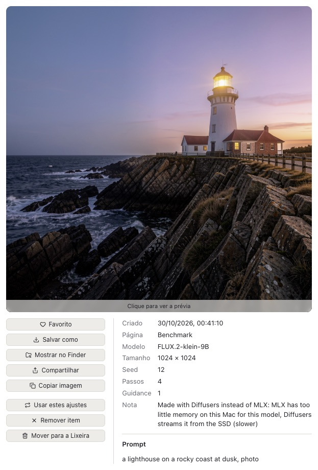
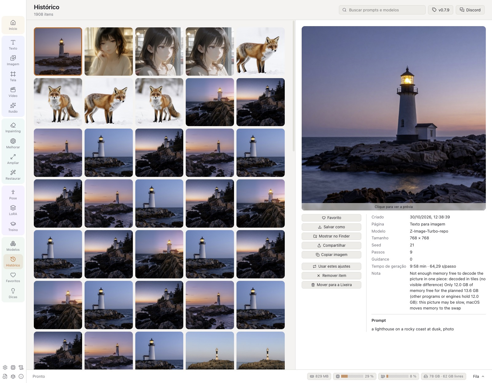
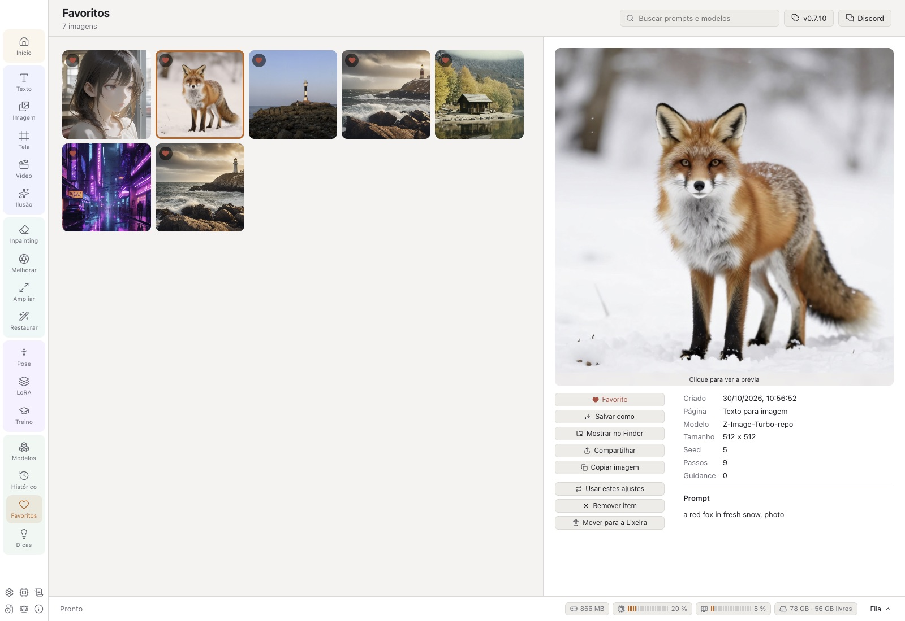
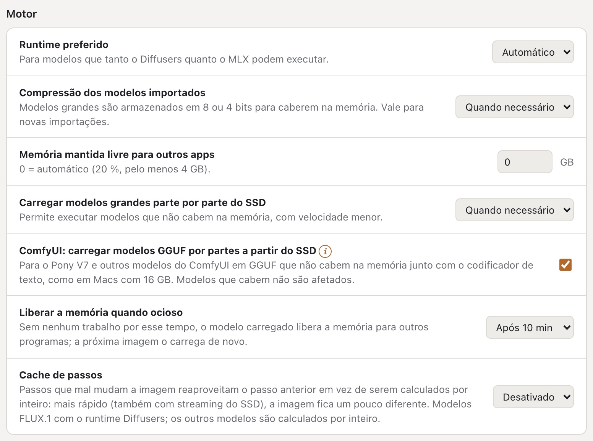

# Guia do usuário do VulKara

[English](../USER_GUIDE.md) · [Deutsch](../de/USER_GUIDE.md) · [Español](../es/USER_GUIDE.md) · **Português (Brasil)** · [Português (Portugal)](../pt-PT/USER_GUIDE.md)

O VulKara, *seu gerador local de imagens com IA, com alta privacidade*, cria imagens e vídeos curtos e restaura fotos
antigas num Mac com Apple silicon. Tudo é calculado no próprio Mac; a rede só é usada para baixar runtimes, modelos e
as descrições de LoRAs, e para procurar atualizações. Este guia descreve cada página do app, o que cada ajuste faz e onde o app guarda seus dados.

## Sumário

1. [Primeiros passos](#1-primeiros-passos)
2. [A janela](#2-a-janela)
3. [Texto para imagem](#3-texto-para-imagem)
4. [Estilos](#4-estilos)
5. [Imagem para imagem](#5-imagem-para-imagem)
6. [Inpainting](#6-inpainting)
7. [Tela de IA](#7-tela-de-ia)
8. [Imagem para vídeo](#8-imagem-para-vídeo)
9. [Ampliar](#9-ampliar), [Melhorar: ferramentas de foto](#melhorar-ferramentas-de-foto)
10. [Restaurar](#10-restaurar)
11. [Editor de pose](#11-editor-de-pose)
12. [Ilusão](#12-ilusão)
13. [LoRAs](#13-loras)
14. [Treinamento](#14-treinamento)
15. [Modelos](#15-modelos)
16. [Histórico](#16-histórico)
17. [Dicas e truques](#17-dicas-e-truques)
18. [A visualização grande](#18-a-visualização-grande)
19. [Ajustes](#19-ajustes)
20. [Hardware, Registros, Novidades, Licenças, Sobre](#20-hardware-registros-novidades-licenças-sobre), [Relatar um problema](#relatar-um-problema)
21. [Regras de conteúdo](#21-regras-de-conteúdo)
22. [Onde ficam os dados](#22-onde-ficam-os-dados)
23. [Solução de problemas](#23-solução-de-problemas)

---

## 1. Primeiros passos

### Instalação

O VulKara vem como DMG. Abra-o e arraste o VulKara para *Aplicativos*. O app e o DMG são assinados com um Developer ID
e notarizados pela Apple, então o macOS pergunta só uma vez se deve abrir um app baixado da internet. Uma versão
assinada, mas não notarizada, é bloqueada pelo Gatekeeper na primeira abertura em outro Mac: abra **Ajustes do Sistema →
Privacidade e Segurança**, role até a mensagem sobre o VulKara e clique em **Abrir Mesmo Assim** (ou clique com a tecla
Control pressionada no app no Finder e escolha **Abrir**). Isso só é necessário uma vez.

Com o [Homebrew](https://brew.sh) também dá para instalar o VulKara pelo Terminal: `brew install --cask revil-O/tap/vulkara`. As versões novas vêm
depois com `brew upgrade --cask vulkara`.

### A tela de abertura

Ao iniciar, aparece uma janela com a imagem da forja: o martelo rúnico golpeia a bigorna, as faíscas viram pixels
incandescentes e deles é forjada a valquíria. O nome une os dois: Vulcano, o deus romano da forja, e Kára, uma
valquíria da lenda nórdica. Abaixo do nome ficam o slogan, a versão e o copyright; a imagem leva o ícone da UE
*AI GENERATED* no canto inferior direito. Enquanto isso, o app carrega por trás da imagem (*Preparando …*); assim que
ele está pronto e a tela de abertura já foi exibida por cinco segundos, ela se fecha sozinha e o app abre. Um clique
(ou ↩ ou Espaço) a fecha antes, assim que o app estiver pronto. A tela de abertura é uma pequena janela própria: mesmo
com *Preferir abas: Sempre* nos ajustes do macOS, ela não abre como aba da janela principal.

### A página Início

A página Início mostra três passos. Cada passo recebe uma marca de verificação quando é concluído:

1. **Instalar um runtime** (Ajustes → Runtimes). Um runtime é o software que executa os modelos. Comece com
   **Diffusers (Apple GPU)**: ele executa a maioria dos modelos e também o importador, a detecção de pose e o filtro de
   conteúdo. O **MLX** é mais rápido para modelos FLUX e Z-Image e é o único runtime para Krea 2, Ideogram 4 e FLUX 3 Image Klein. O **ComfyUI** é opcional
   e necessário para vídeo, ampliação e modelos Anima, Lumina 2 e Pony V7.
2. **Obter um modelo** (Modelos → Recomendados). Para uma primeira tentativa, use *SDXL 1.0* ou *DreamShaper XL v2 Turbo*
   num Mac com 16 GB de memória, ou *Stable Diffusion 1.5* num com 8 GB.
3. **Criar sua primeira imagem** (Texto). Descreva a imagem e pressione **Gerar** ou ⌘↩. O passo é marcado quando a
   primeira imagem fica pronta (ou quando o histórico já tem uma) e continua marcado mesmo depois de o histórico ser
   esvaziado.

Abaixo dos passos, a página conta os runtimes, modelos e LoRAs instalados.

O menu no canto superior direito escolhe o idioma do app (*Sistema*, English, Deutsch, Español, Português (Brasil),
Português (Portugal)), a mesma
opção de **Ajustes → Aparência → Idioma**.

**Requisitos do sistema:** macOS 14 (Sonoma) ou mais novo em Apple silicon (M1 ou mais novo), pelo menos 8 GB de memória (16 GB ou mais para
SDXL, 32 GB ou mais para os modelos FLUX grandes) e espaço livre no SSD para os runtimes (cerca de 1–1,5 GB cada) e para
os modelos (2–35 GB cada).

## 2. A janela

| Parte | O que faz |
| --- | --- |
| **Barra de navegação** (esquerda) | Agrupa as páginas, cada grupo com um tom próprio: *Início*; *Criar* (imagens novas): Texto, Imagem, Tela, Vídeo, Ilusão; *Editar* (uma imagem que você já tem): Inpainting, Melhorar, Ampliar, Restaurar; *Ferramentas*: Pose, LoRA, Treino; *Biblioteca*: Modelos, Histórico, Favoritos, Dicas. Numa janela baixa demais para eles, a barra fica mais larga e mostra os grupos em duas colunas. Os ícones na parte de baixo abrem Ajustes, Registros, Novidades, Licenças e Sobre. |
| **Área de trabalho** (centro) | A entrada da página (prompt, imagem, tela) e, abaixo dela, os resultados desta página. Um resultado cujo arquivo foi apagado ou movido aparece como *Arquivo ausente*;  o remove da lista. |
| **Painel de ajustes** (direita) | Modelo, estilo, tamanho e tudo o mais que molda o resultado. |
| **ⓘ** e **!** | Pequenos selos laranja cujo texto abre quando o ponteiro está sobre eles: **ⓘ** (um anel) é informação simples; **!** (preenchido) avisa que o app faz algo diferente do padrão, por ex. valores que diferem da sugestão do modelo ou um modelo que roda com streaming do SSD. |
| **Barra de tarefas** (embaixo) | A tarefa em andamento: progresso, tempo restante, segundos por passo e **Cancelar**. Quatro chips mostram o que o Mac está fazendo: a memória ocupada pelo VulKara e seus motores, a CPU e a GPU como medidores de nível, e os caches de streaming do SSD com o espaço restante no disco deles (laranja abaixo de 20 GB). Um clique neles abre **Hardware**. **Fila** abre a lista de todas as tarefas. |

As páginas continuam ativas quando você alterna entre elas. Um prompt escrito pela metade continua lá quando você
volta, assim como uma tela ou uma pose. Cada página de geração também lembra seus ajustes depois de reiniciar.

### A fila

- As tarefas rodam **uma de cada vez**, na ordem em que foram adicionadas. Você pode adicionar mais tarefas enquanto
  uma está rodando.
- **Imagens** > 1 adiciona uma tarefa por imagem. As seeds contam a partir da seed escolhida, ou de uma aleatória, então
  cada imagem de uma série pode ser feita de novo.
- No painel da fila, **Cancelar** para a tarefa em andamento e **Remover** tira da lista uma tarefa em espera ou
  concluída. **Limpar concluídas** esvazia a lista de tarefas concluídas.
- Quando a última tarefa em espera termina, o Mac toca um som curto. Você pode desativar isso em Ajustes → Conteúdo →
  *Tocar um som quando a fila terminar*.
- Nenhuma tarefa começa enquanto uma LoRA está em treinamento.

## 3. Texto para imagem

Descreva a imagem no campo de prompt e pressione **Gerar** (ou ⌘↩). Os resultados aparecem abaixo do prompt como
miniaturas. Uma tarefa em andamento mostra o progresso na sua miniatura, e uma tarefa em espera mostra sua posição na
fila. Clique numa miniatura para abri-la na [visualização grande](#18-a-visualização-grande).

- O **×** no canto de uma miniatura a tira da lista (a imagem continua no histórico); numa tarefa em andamento, ele a
  cancela. Tarefas canceladas e com falha são removidas da mesma forma.
- Uma miniatura de tarefa mostra o essencial. O ponteiro sobre o seu **ⓘ** abre todos os detalhes: o prompt completo,
  tamanho, passos e seed, uma nota sobre como foi feita e o erro completo de uma tarefa que falhou.
- Um **ⓘ** numa imagem abre a nota dela da mesma forma, por exemplo quando foi feita com Diffusers em vez de MLX.
- **Ampliador de prompt** (FLUX 3 Image Klein, Texto para imagem, ao lado de Gerar): o FLUX 3 foi treinado com
  descrições completas de cenas; o ampliador da Black Forest Labs (4 bits, MLX) escreve primeiro uma a partir do seu
  prompt – tema, ambiente, luz, câmera, cores. Um prompt que já é uma descrição completa vai como está, assim como o
  de uma edição com imagem. Ele é baixado uma vez (5,7 GB) com o botão ao lado da opção ou na página Modelos (modelos
  auxiliares); ocupa a memória só para o prompt (cerca de 30 s) e depois é liberado, e a descrição que ele escreveu
  vira a nota da imagem.

  

- **Selo de IA da UE** (ao lado de Gerar): coloca, de forma visível, o ícone da Comissão Europeia para conteúdo de IA no
  canto inferior direito de cada imagem. *AI GENERATED* para imagens feitas a partir de um prompt (Texto, Ilusão),
  *AI MODIFIED* quando uma imagem sua é alterada (Imagem, Inpainting), ou o *AI* redondo. **Tom automático** usa o
  ícone preto num canto claro e o branco num canto escuro; *Escuro* e *Claro* o fixam. Tamanhos pequeno, médio e
  grande; **Discreto** é o ícone com 50 % de transparência. Uma prévia mostra o ícone escolhido. Ele é colocado depois
  que o filtro de conteúdo aprova a imagem; de qualquer forma, toda imagem leva a nota no próprio arquivo. Não vale
  para vídeos.
- Uma imagem com selo guarda uma cópia sem o selo (na pasta oculta `.unlabelled` ao lado dela). Quando usada como
  entrada de Imagem, Inpainting, Melhorar, Ampliar ou Restaurar, é essa cópia que é usada, então a nova imagem recebe
  um só selo, sem o antigo aparecendo por baixo. Mover um item do histórico com seus arquivos para a Lixeira move a
  cópia também.

  

  

| Ajuste | Faixa | O que faz |
| --- | --- | --- |
| **Modelo** | modelos de imagem instalados | O modelo define a maior parte do visual. Veja [Trocar de modelo](#trocar-de-modelo) para saber o que muda com ele. |
| **Estilo** | 20 estilos em 4 grupos | Envolve o prompt num modelo de estilo, veja [Estilos](#4-estilos). |
| **Tamanho** | 1:1, 4:3, 3:2, 16:9, 3:4, 2:3, 9:16 | Cada miniatura mostra suas proporções. O tamanho é escolhido para corresponder ao número de pixels para o qual o modelo foi treinado. Largura e altura também podem ser escolhidas diretamente. |
| **Passos** | 1–80 | Mais passos dão mais detalhes, até certo ponto. 20–30 serve para a maioria dos modelos; modelos turbo precisam de 4–8, e mais passos só demoram mais. |
| **Guidance** | 0–20, em passos de 0,1 | O quanto a imagem segue o prompt. A régua acima do controle deslizante marca 0, 5, 10, 15 e 20. SDXL funciona melhor com 5–7, SD 1.5 com 7–9, FLUX com 3–4. |
| **Controle** | Nenhum, Pose, Profundidade, Bordas, Line art, Rabisco, Tile | Guia a composição com uma imagem de controle, veja abaixo. Só aparece quando o modelo tem suporte. |
| **Sampler** | depende da família | O método que remove o ruído passo a passo. *Padrão* é o do próprio modelo. A segunda lista define o agendamento de ruído (Karras, Exponential, Beta); ela fica desativada enquanto o sampler é *Padrão*. |
| **Seed** | número ou vazio | A mesma seed com os mesmos ajustes dá a mesma imagem. Vazio significa aleatório; o botão do dado volta para aleatório. |
| **Imagens** | 1–20 | Quantas imagens são feitas, cada uma com sua própria seed. |
| **LoRAs** | até 3 | Complementos que ensinam ao modelo um estilo, uma pessoa ou um objeto, cada um com seu próprio peso (−2 a 2; os botões − e + ao lado mudam em décimos, também no celular). Só são oferecidas LoRAs da família do modelo. |
| **Fora da imagem** | texto | O prompt negativo: o que não deve aparecer. Só aparece quando o modelo tem suporte. |

### Trocar de modelo

O primeiro modelo de uma página traz seus próprios passos, guidance e tamanho. Depois disso, escolher outro modelo
mantém os ajustes, para que os modelos possam ser comparados com os mesmos valores:

- **Passos, guidance, seed e tamanho** ficam como estão. Quando diferem do que o novo modelo sugere, um **!** laranja
  aparece acima dos controles deslizantes ao lado de **Padrões do modelo**: o ponteiro sobre ele mostra a sugestão
  (*Este modelo sugere 4 passos e guidance 0, 1024×1024*), e o botão a aplica.
- **De onde vem a sugestão**: se o cartão do modelo os nomeia, os passos, a guidance, o sampler, o percurso de sigmas
  e o prompt negativo de quem o fez são lidos na importação e passam a ser os valores próprios do modelo; o aviso
  nomeia então também o sampler (*Quem o fez recomenda o sampler DPM++ SDE Karras.*), e **Padrões do modelo** o aplica
  junto com o resto. Um modelo cujo cartão nada diz mantém os valores que o VulKara tem para a sua família.
- **Valores para os quais o modelo não foi feito** recebem um **!** laranja ao lado de *Passos* ou *Guidance*, com um
  botão que aplica o valor próprio do modelo: passos acima do dobro do que um modelo destilado espera (*Feito para 4
  passos: mais passos demoram mais sem dar uma imagem melhor.*), guidance num modelo que não tem guidance (FLUX.1
  [schnell], um FLUX.2 [klein] destilado) e guidance acima de 1 num modelo feito sem ela (SDXL Turbo, Z-Image-Turbo,
  Chroma1-Flash), em que cada passo roda duas vezes. Na Tela, o **!** aparece ao lado de *Passos*.
- Só muda um **tamanho** que o novo modelo não consegue calcular, para o mais próximo que ele consegue nas mesmas
  proporções (SD 1.5 vai até 768 px). De volta a um modelo que consegue, o tamanho escolhido antes retorna, a menos que
  você o tenha mudado nesse meio-tempo.
- **Sampler**: o sampler escolhido continua escolhido. Um modelo que não o tem roda com o seu padrão; um **!** laranja
  ao lado de *Sampler* avisa isso quando o ponteiro está sobre ele. Voltar ao modelo anterior o traz de volta.
- **Só os samplers do criador**: quando o cartão do modelo nomeia os samplers com que o criador o usa, a lista mostra
  só esses, com *Padrão* (o recomendado) primeiro; um (i) ao lado de *Sampler* avisa isso. Um cartão que não nomeia
  nenhum mantém a lista completa.
- O que o novo modelo não aceita é retirado: LoRAs de outra família e um tipo de controle que ele não tem. O prompt
  negativo próprio de um modelo só é preenchido quando o campo está vazio.
- Um modelo que o app reconheceu, mas ainda não consegue executar, avisa isso na página antes que qualquer coisa seja
  enviada.

### Imagens de controle (ControlNet)

**Controle** mantém a composição de uma imagem de controle:

| Tipo | Imagem de controle | SD 1.5 | SDXL | SD 3.5 M | SD 3.5 L | FLUX.1 |
| --- | --- | :-: | :-: | :-: | :-: | :-: |
| Pose | um esqueleto do [Editor de pose](#11-editor-de-pose) ou uma foto cuja pose é detectada |  |  | | |  |
| Profundidade | um mapa de profundidade ou uma foto cuja profundidade é estimada |  |  |  |  |  |
| Bordas (Canny) | bordas brancas sobre preto ou uma foto cujas bordas são traçadas |  |  |  |  |  |
| Line art | um desenho de linhas ou uma foto transformada em um |  |  | | |  |
| Rabisco | um esboço rápido ou uma foto reduzida a um |  |  | | |  |
| Tile | uma imagem cujo conteúdo é mantido enquanto os detalhes são repintados | |  | |  | |

- Deixe **É uma foto: prepará-la antes** ativado quando a imagem de controle for uma foto normal. Desative quando a
  imagem de controle já for um esqueleto, um mapa de profundidade ou uma imagem de bordas.
- **Peso** (0–2) define o quanto o resultado segue rigorosamente a imagem de controle.
- O modelo de controle é baixado na primeira vez que é usado.

## 4. Estilos

Um estilo envolve o prompt com palavras que definem o visual. Para alguns estilos, ele também adiciona palavras a
*Fora da imagem*. O seletor mostra uma imagem de prévia para cada estilo. Os cabeçalhos com moldura laranja agrupam os
estilos:

| Grupo | Estilos |
| --- | --- |
| **Foto** | Realçar, Fotográfico, Cinematográfico, Filme analógico, Preto e branco, Romântico |
| **Ilustração** | Anime, Arte digital, Quadrinhos, Arte de fantasia, Ficção científica, Line art |
| **Estilizado** | Neon punk, Isométrico, Pixel art, Textura contínua |
| **3D e artesanato** | Modelo 3D, Low poly, Origami, Massinha |

*Sem estilo* usa o prompt como foi escrito. O estilo é salvo com cada tarefa, então *Usar estes ajustes* o traz de volta
depois.

<table>
<tr>
<td> <b>Cinematográfico</b>: um farol numa costa rochosa na hora dourada</td>
<td> <b>Filme analógico</b>: uma pequena cabana de madeira à beira de um lago na montanha</td>
</tr>
<tr>
<td> <b>Arte digital</b>: uma raposa vermelha sentada numa floresta com neve</td>
<td> <b>Arte de fantasia</b>: um astronauta cuidando de uma estufa na Lua</td>
</tr>
</table>

Todas feitas com Juggernaut XL v7, 25 passos, guidance 6.

## 5. Imagem para imagem

Transforma uma imagem existente numa nova: outra estação do ano, outro estilo, um esboço transformado em pintura.

- **Escolher uma imagem**: clique no campo ou solte um arquivo de imagem nele (PNG, JPEG, WebP ou BMP). O clique abre o
  seletor de imagens: seus resultados do histórico, os mais novos primeiro, com uma busca (prompt, modelo, página) e um
  filtro *Favoritos*; um clique escolhe uma imagem. **Do disco …** abre a caixa de diálogo de arquivos em vez disso.
- **Ampliar a visualização da imagem** (aqui e em Inpainting, Melhorar, Ampliar e Restaurar, também ao pintar uma
  máscara ou selecionar objetos): ⌘ + rolagem ou pinça aproxima em direção ao ponteiro, até 800 %; a rolagem então move
  a imagem, assim como arrastar com Espaço pressionado ou o botão do meio do mouse. Os pequenos controles no canto
  inferior direito (aparecem quando o ponteiro está sobre a imagem) afastam, aproximam e ajustam de novo. Pintar e
  clicar continuam funcionando com a imagem aproximada.
- **Alteração** (0,05–1): o quanto o resultado se afasta da imagem. Com 0,3 as cores e os detalhes mudam; com 0,6 o
  motivo muda enquanto a composição se mantém; acima de 0,8 resta pouco da imagem. Os modelos FLUX.2 e Qwen-Image 2.1
  não usam este controle deslizante; eles usam a imagem como referência.
- O resultado tem as proporções da imagem. Para um tamanho diferente, marque **Tamanho próprio em vez das proporções da
  imagem**.
- Todos os outros ajustes funcionam como em [Texto para imagem](#3-texto-para-imagem).

<table>
<tr>
<td> Texto para imagem</td>
<td> Imagem para imagem, alteração 0,6: <i>the same lighthouse in a snow storm</i></td>
</tr>
</table>

## 6. Inpainting

Repinta uma parte de uma imagem e mantém o resto.

1. Escolha a imagem.
2. **Pintar** sobre a parte que deve mudar. **Apagar** retira a pintura. **Tamanho** define o pincel (1–30 % do lado
   menor da imagem). O botão de seta desfaz o último traço, e a lixeira remove toda a pintura.
3. Descreva o que deve aparecer na parte pintada, ou deixe o prompt vazio para apenas remover algo.
4. **Alteração** (padrão 100 %): valores menores mantêm mais do que já existe.

Os modelos que fazem inpainting são SD 1.x, SD 2.x, SDXL, SD 3.5, FLUX.1, Chroma, Qwen-Image e Z-Image. Modelos especiais de inpainting como o *SD 1.5
Inpainting* dão as bordas mais limpas.

## 7. Tela de IA

Uma superfície infinita na qual imagens são pintadas, estendidas e repintadas. O **quadro** laranja marca onde a
próxima imagem aparece. O que **Gerar** faz depende do que está dentro do quadro:

| No quadro | Resultado |
| --- | --- |
| nada | uma imagem nova |
| parte de uma imagem | a parte vazia é preenchida de modo a continuar a imagem (outpainting) |
| uma imagem com traços de máscara | a parte com máscara é repintada |
| uma imagem sem traços de máscara | uma variação (com **Alteração** 0,1–0,9) |

O painel sempre explica qual dessas opções vai acontecer.

**Ferramentas e teclas:**

| | |
| --- | --- |
| **Mover** (V) | Arraste uma imagem para movê-la. Arraste um canto da imagem selecionada para redimensioná-la: o canto oposto fica no lugar e as proporções são mantidas (segure ⇧ para proporções livres); o tamanho aparece abaixo dela. Arraste a borda do quadro, ou uma parte vazia dele, para mover o quadro (ele se alinha a 8 px). Arraste um espaço vazio para mover a visualização. |
| **Ajustar ao quadro** | Deixa a imagem selecionada tão grande quanto cabe no quadro, centralizada, com as proporções mantidas. |
| **Cantos do quadro** | As alças redondas nos cantos do quadro o redimensionam livremente: o canto oposto fica no lugar, os lados se alinham a 64 px, de 256 a 2048 px e no máximo o dobro dos pixels do modelo (SDXL: cerca de 2 megapixels), para que um Mac de 16 GB dê conta. O quadro passa a mostrar *livre*; um botão de proporção o redimensiona de novo. |
| **Pincel de máscara** (B) | Pinte a parte a ser repintada dentro do quadro. O tamanho do pincel vai de 8 a 200. |
| Rolagem / pinça, ⌘ + rolagem | A rolagem move a visualização; a pinça ou ⌘ + rolagem aplica zoom (5 %–400 %). |
| ⌫ | Remove a imagem selecionada. |
| ⌘Z | Desfazer (até 50 passos). |
| **Mostrar tudo** | Ajusta a visualização a todas as imagens. |

- **Adicionar imagem** coloca uma imagem no quadro, escolhida no seletor de imagens (do histórico ou do disco).
- Abaixo da superfície, uma faixa mostra a fila e os resultados recentes desta página, como nas outras páginas: uma
  tarefa em espera ou em andamento com seu progresso, uma imagem pronta para abrir na visualização grande. Uma imagem
  pronta também aparece na superfície, onde estava o quadro.
- **Exportar PNG** salva todas as imagens como um único arquivo PNG.
- **Quadro** define as proporções: 1:1, 3:4, 4:3, 16:9 ou 9:16, ou arraste os cantos do quadro para qualquer tamanho.
- Estender precisa de um modelo SDXL, SD 3.5, FLUX.1, Chroma ou Z-Image, ou de um modelo de inpainting. Os outros modelos são marcados com *(só imagens
  novas)*.
- A tela, incluindo suas imagens, visualização, prompt e modelo, é mantida depois de reiniciar.

## 8. Imagem para vídeo

Transforma uma imagem num vídeo curto. Precisa do runtime ComfyUI e de um modelo Wan 2.2 (Modelos → Recomendados).

- **Imagem inicial**: o primeiro quadro. O vídeo recebe as proporções dela.
- **Prompt**: o que acontece, como movimento, câmera e clima: *the astronaut slowly waters the plants, gentle
  camera push in*.
- **Duração**: 1–5 segundos.
- **Resolução**: 480p ou 720p.

Vídeo demora muito mais do que imagens. Um clipe de um segundo em 480p levou cerca de 8 minutos num M2 com 24 GB, e
clipes mais longos precisam de muito mais memória.

## 9. Ampliar

Amplia uma imagem 2× ou 4× e acrescenta detalhes, usando o Real-ESRGAN x4plus (64 MB, BSD-3, baixado no primeiro uso)
através do runtime ComfyUI.

- **Ampliar**: botões predefinidos ×1,5, ×2, ×2,2, ×2,5, ×3, ×3,5 e ×4, e um controle deslizante em passos de 0,1 para
  qualquer valor intermediário. O modelo sempre trabalha em 4×; um fator menor reduz o resultado depois (mais limpo do
  que ampliar normalmente).
- Uma imagem com mais de 2048 px no lado maior é primeiro reduzida a 2048; o resultado continua sendo o fator escolhido
  vezes a sua imagem, até quatro vezes a imagem reduzida (a nota do resultado avisa isso).
- A visualização grande de qualquer imagem tem um botão **Ampliar** que envia a imagem para cá.

### Melhorar: ferramentas de foto

**Melhorar** (em Editar) trabalha numa foto com modelos pequenos neste Mac: sem prompt, sem modelo de difusão, e
cada resultado passa pela fila, pelo filtro de conteúdo e pelo histórico como qualquer outro. A lista à direita mostra
cada ferramenta com algumas palavras e onde ela roda: **GPU** (os pesos PyTorch originais via spandrel) ou **CPU** (um
modelo ONNX), numa etiqueta violeta ou verde-azulada. O selo (i) dela traz o resto: o modelo, o que ela faz em
detalhes, limites de tamanho e tamanho do download e, abaixo de uma linha, a licença, a nota dela e a fonte.

| Ferramenta | O que faz | Roda em | Tamanho · licença |
| --- | --- | --- | --- |
| **Nitidez (NAFNet)** | remove o desfoque de fotos tremidas ou levemente fora de foco | CPU | 92 MB · MIT |
| **Reduzir ruído (SCUNet)** | remove o ruído de fotos reais (ISO alto, pouca luz) | GPU | 72 MB · Apache-2.0 |
| **Ampliar ×4 (SwinIR)** | amplia fotos reais quatro vezes e recria detalhes finos; uma imagem com mais de 2048 px no lado maior é primeiro reduzida a 2048 (a nota do resultado avisa isso), então os resultados chegam a no máximo 8192 px | GPU | 67 MB · Apache-2.0 |
| **Limpeza de JPEG (FBCNN)** | remove os blocos e halos de compressão JPEG forte; detecta a qualidade sozinha | GPU | 288 MB · Apache-2.0 |
| **Remover fundo (BiRefNet)** | o motivo principal sobre um fundo transparente, ou a máscara dele | CPU | 115 MB · MIT |
| **Selecionar objetos (SAM 2.1)** | clique no que deve ser selecionado (⌥ + clique no que não faz parte) | CPU | 155 MB · Apache-2.0 |

- **Baixar** busca uma ferramenta uma única vez de quem a publica, numa versão fixa e verificada (um commit do Hugging
  Face ou um arquivo de release do GitHub com seu checksum); as seis são de uso livre, também comercial. O ícone da
  lixeira move uma ferramenta instalada para a Lixeira. As ferramentas de GPU precisam do runtime Diffusers com
  spandrel: um runtime mais antigo oferece a atualização em Ajustes → Runtimes.
- **Intensidade** mistura o resultado de Nitidez, Reduzir ruído ou Ampliar com o original (100 % = só o resultado da
  ferramenta).
- **Qualidade JPEG** (Limpeza de JPEG): *Auto* deixa a ferramenta estimar o quanto a imagem foi comprimida. Botões de
  10–90 e um controle deslizante a definem manualmente: uma qualidade menor limpa com mais força (blocos, halos, mas
  também detalhes finos), uma maior com mais suavidade.
- **Caráter** (Reduzir ruído): *Natural* mantém a foto fiel; *Nítido* usa os pesos GAN do SCUNet, mais nítido, com
  textura fina inventada onde havia ruído. Nítido é baixado uma vez (72 MB) no primeiro uso.
- **Ampliar** (ferramentas que ampliam, como Ampliar ×4): os mesmos botões predefinidos e o mesmo controle deslizante da
  página Ampliar; o resultado tem essa quantidade de vezes o tamanho da sua imagem.
- **Remover fundo**: *Transparente* gera um PNG com fundo transparente, *Máscara* a máscara em preto e branco.
- **Selecionar objetos**: cada clique refina a seleção, que aparece sobre a imagem (todo o resto escurecido).
  **Recortar** e **Salvar máscara** criam uma imagem dela; **Pintar no Inpainting** abre a página Inpainting com a
  imagem e a seleção já pintada como máscara, pronta para ser pintada de novo.
- **Importar um arquivo de modelo**: outros modelos de foto, se a licença deles permitir. Pesos PyTorch (.pth,
  .safetensors) rodam na GPU quando o spandrel conhece a arquitetura (ESRGAN, SwinIR, HAT, DAT, NAFNet, SCUNet, FBCNN,
  SPAN, OmniSR e outras; imagem colorida na entrada e na saída, ampliando 1, 2, 3, 4 ou 8 vezes); arquivos .pth são lidos
  sem executar nenhum código que possam conter. Modelos ONNX rodam na CPU e são verificados antes: uma imagem na entrada
  (1 × 3 × altura × largura), uma imagem na saída (do mesmo tamanho ou 2, 3, 4 ou 8 vezes maior) ou uma máscara, valores
  0–1 ou 0–255; modelos com operadores próprios são recusados. Imagens grandes são processadas em blocos.
- Tempos aproximados num M2 para uma foto de 768 × 768: Limpeza de JPEG 2 s, Reduzir ruído 4 s, Remover fundo 8 s,
  Nitidez 15 s, Ampliar ×4 35 s; um clique ao selecionar, alguns centésimos de segundo.
## 10. Restaurar

Restaura fotos antigas: dominantes de cor, cores desbotadas, imagens e rostos suaves e borrados, arranhões, vincos,
manchas, furos e preto e branco. Escolha a foto (ou solte-a sobre o campo) e pressione **Restaurar** ou ⌘↩. Uma foto em
preto e branco ou tonalizada é reconhecida e recebe *Colorir uma foto em preto e branco* ativado.

Uma foto com perfil de cor (Display P3, Adobe RGB ou HDR, como *Rec. 2020 PQ*, que alguns apps de ampliação e
iPhones gravam) é convertida primeiro para sRGB; lida sem o perfil, ela sairia sem vida e acinzentada. Isso vale para
todas as páginas que recebem uma imagem.

**Etapas** (qualquer combinação):

| Etapa | Como |
| --- | --- |
| **Corrigir dominante de cor e contraste** | Sem modelo: balanço de branco (uma dominante vermelha ou amarela é neutralizada; uma foto em preto e branco tonalizada fica cinza neutro), níveis e contraste local só no brilho. Os tons claros são comprimidos em vez de cortados, então um vestido branco mantém as dobras. **Intensidade** 20–100 % (padrão 80 %). |
| **Reparar danos (IA)** | Um modelo FLUX.2 edita a foto (Modelos → Recomendados: FLUX.2 [klein]). **Passos do modelo** 2–12. Sem pintura, ele repinta a foto inteira: roupas, folhas e fundos suaves ganham detalhes reais, mas os rostos podem virar os de outras pessoas; por isso, os rostos são tirados da foto antes do reparo quando *Restaurar rostos* está ativado. |
| **Remover poeira e arranhões** | Sem nenhum modelo seu: pontinhos e arranhões finos que se destacam de áreas calmas são encontrados e preenchidos a partir do que está em volta (LaMa). Folhas e tecidos não são tocados, nem os olhos e a boca. **Sensibilidade** 0–100 % (padrão 50 %); uma maior encontra pontinhos mais fracos e, de vez em quando, também um pequeno detalhe da foto (a prévia mostra isso). |
| **Reconstruir detalhes suaves (IA)** | O Real-ESRGAN (o auxiliar de Ampliar, 64 MB) reconstrói bordas e texturas da foto inteira: ela é reduzida na medida em que está suave (**Suavidade da foto** × 1,25–3, padrão × 2) e depois ampliada quatro vezes. **Intensidade** 20–100 %. Ele torna nítido o que a foto ainda mostra; a textura perdida por completo (tecido, folhas) só *Reparar danos (IA)* recria. |
| **Restaurar rostos (IA)** | O CodeFormer (0,4 GB, baixado uma vez) restaura rostos borrados, tirados da foto antes das etapas de IA. **Fiel à foto** 50–100 % (padrão 90 %): valores menores inventam mais detalhes. **Intensidade** 20–100 % (padrão 60 %). Rostos menores que cerca de 14 pixels não são tocados. A licença do CodeFormer só permite uso não comercial. |
| **Colorir uma foto em preto e branco** | O DDColor (0,9 GB, baixado uma vez) adiciona cor ao brilho da foto, então nenhuma forma ou detalhe pode mudar. **Intensidade da cor** 50–150 %. |
| **Menos granulação, detalhes mais nítidos** | Sem modelo: o ruído do brilho é reduzido e as bordas ficam mais nítidas; a cor só é suavizada um pouco. **Intensidade** 10–100 %. |

**Os rostos** que o CodeFormer vai restaurar aparecem como quadros arredondados e numerados sobre a foto. Arraste um
quadro até o rosto quando a detecção errar, ou deixe um rosto de fora com o **×** dele; **Procurar de novo** traz os
quadros de volta. Os rostos são encontrados pelo YuNet (um pequeno detector de rostos, baixado uma vez).

**Tamanho do resultado**: *Igual à foto* ou *O dobro do tamanho*.

**Prévia** restaura só uma parte da foto, rapidamente: o que você ampliou (⌘ + rolar), senão o maior rosto (ou o
centro), no máximo 768 pixels. Ela não fica no histórico. Acima do campo da nota, o **controle de comparação** mostra a
prévia ou o resultado mais recente da foto sobre o original: à esquerda da linha a alteração, à direita o original;
arraste a linha (ou mova-a com ← → quando ela estiver em foco); ⌘ + rolar aplica zoom nos dois.

**Num Mac com 16 GB** o reparo por IA também funciona: ele pinta com cerca de um megapixel nas proporções da foto, e o
resultado é levado de volta ao tamanho da foto; assim, um escaneamento grande não precisa de mais memória do que uma
imagem comum do FLUX.2 [klein] (uma foto de 768 × 1024 com 12 GB mantidos livres: 5 minutos num M2).

**Pintar os danos**: com o pincel (como no Inpainting), pinte sobre arranhões, vincos, manchas e furos. Ali a IA
repara; no resto, a foto fica como está. Antes de a IA ver a foto, os pontos pintados são preenchidos a partir do
entorno pelo LaMa (um pequeno modelo de preenchimento, Apache 2.0, baixado uma vez; sem ele, é usado um preenchimento
mais simples), então o modelo só precisa refiná-los. Sem pintura, a IA pode mexer na foto inteira, dentro da alteração
permitida.

**Limites de segurança** para a etapa de IA:

- **Manter o original fora dos danos pintados**: o resultado é montado a partir do original e dos pontos
  reparados.
- **Recusar resultados cujos rostos mudaram**: os rostos do resultado são comparados com os da foto.
- **Alteração permitida** (1–30 %, padrão 6 %): o quanto a estrutura da foto pode mudar.
- **Regras para a IA**: regras fixas que são sempre enviadas (só remover danos; manter composição, cada pessoa, rosto,
  expressão, pose e cabelo, roupas, objetos e escritos; não adicionar, remover nem inventar nada) e as suas **regras
  próprias**, por ex. *Manter o número da casa*. As regras próprias valem para todas as restaurações.

Um reparo que viola um limite de segurança é recusado, com o motivo.

**Predefinições** ajustam etapas, limites de segurança e a nota para os tipos comuns de fotos antigas: *Preto e branco,
danificada*, *Preto e branco para cores*, *Dominante de cor (vermelha ou amarela)*, *Foto colorida desbotada*, *Só
colorir* e *Danos graves (vincos, furos)*. Abaixo do campo da nota, **Salvar como predefinição** guarda as etapas, os
limites de segurança e a nota atuais com um nome escolhido por você; as predefinições próprias aparecem depois das
embutidas e são apagadas com o **×** delas.

A **nota** é um campo de texto de três linhas (pode ser aumentado pelo canto inferior direito) para o que a foto
mostra, por ex. *uma foto de casamento dos anos 1950*; ela ajuda a IA.

## 11. Editor de pose

Monta esqueletos de pose (OpenPose: corpo, mãos e rosto) para o controle *Pose* em Texto para imagem.

- **Arraste** um ponto para movê-lo. **⇧ + arrastar** move a pessoa inteira, ou só a mão ou o rosto que foi pego. Mover
  um pulso move a mão dele; mover o nariz move o rosto.
- **Clique duas vezes** num ponto para ocultá-lo, por exemplo para uma mão atrás das costas. Pontos ocultos aparecem
  tracejados, e outro clique duplo os mostra de novo.
- **Pessoas**: Pessoa 1…n. **Predefinição** oferece poses de corpo inteiro (Em pé, Pose em T, Braços para cima,
  Andando, Correndo, Sentado, Modelo, Passarela, Virando, Inclinado, Pensativo, Ajoelhado, De quatro, Deitado,
  Reclinado) e retratos (sorrindo, mão no queixo, mãos no rosto, acenando, sinal de paz …). **Adicionar** adiciona uma
  pessoa com a predefinição, **Aplicar** dá a predefinição à pessoa selecionada, **Espelhar** a espelha, **Remover** a
  apaga.
- **Mãos**: Aberta, Relaxada, Punho, Apontando, Paz, Polegar para cima, OK, Plana, fechada, Indicador na bochecha,
  Levemente dobrada.
- **Rosto**: Neutro, Sorriso, Boca aberta, Surpreso, Triste, Olhos fechados.
- **Girar e tamanho**: ±15° e ×1,1 / ÷1,1, para a pessoa ou a parte selecionada.
- **De uma foto**: detecta as pessoas numa foto. Isso precisa do runtime Diffusers. *Mostrar a foto* coloca a foto
  sob os esqueletos.
- **Usar em Texto para imagem** envia o esqueleto como imagem de controle de pose, junto com o tamanho. **Salvar PNG**
  o salva como arquivo.

As poses funcionam com SD 1.5 (só o corpo), SDXL e FLUX.1. Remova o rosto de uma pessoa cujo rosto ficará coberto.

## 12. Ilusão

Esconde um padrão ou uma palavra numa imagem, que aparece quando você aperta os olhos ou olha de longe.

- **Padrão oculto**: Espiral, Anéis, Xadrez, Listras, Texto (até 24 letras) ou Imagem própria (uma imagem em preto e
  branco, código QR ou logotipo). Partes claras do padrão ficam claras na imagem, e partes escuras, escuras.
  **Densidade** (2–24), **Desfoque** (0–12) e **Inverter** dão forma ao padrão.
- **Intensidade do padrão** (0,5–2): cerca de 0,8 é discreto, 1,2 nítido e 1,6 dominante.
- Precisa de um modelo SDXL ou SD 1.5. O modelo de padrão (5 GB para SDXL) é baixado no primeiro uso.

## 13. LoRAs

Uma LoRA é um pequeno complemento (geralmente 20–400 MB) que ensina a um modelo um estilo, um personagem ou um objeto.
A página LoRA mostra todas as LoRAs instaladas, ordenadas por família (SD 1.x, SDXL, SD 3.5, FLUX.1, Chroma, FLUX.2, FLUX 3, Krea 2 …).
Você pode filtrá-las por família e buscar nos nomes, palavras-gatilho e categorias.

**O painel de uma LoRA:**

- **Nome**: o lápis dá à LoRA um nome próprio no app, veja [Nomes no app](#nomes-no-app).
- **Palavras-gatilho**: palavras que ativam a LoRA no prompt. O painel mostra de onde elas vêm (*do Civitai*, *dos
  dados de treinamento*, *editada por você*). Clique numa palavra para copiá-la; **×** a remove e **+ adicionar**
  adiciona uma.
- **Categoria**: seu próprio agrupamento, usado pela busca.
- **Da página dela**: o que os criadores da LoRA escreveram no Civitai ou no Hugging Face: descrição, tags, notas da
  versão, licença e uso comercial. É lido uma vez, guardado em cache e pode ser atualizado com o botão de seta.
- **Ajustes recomendados**: intensidade, passos, guidance, sampler e clip skip, conforme informados pelos criadores ou
  deduzidos das imagens de exemplo deles.
- **Prompts dos criadores**: prompts de exemplo. **Experimentar** os abre na comparação de intensidades.
- **Como usar**: um guia curto para obter bons resultados com esta LoRA.
- **Dados de treinamento**: com o que a LoRA foi treinada (resolução, imagens, épocas, passos, taxa de aprendizado) e
  as tags usadas com mais frequência. Clique numa tag para adicioná-la como palavra-gatilho.

### Comparar intensidades

**Comparar intensidades** (a aba no topo, ou o botão no painel de uma LoRA) gera a mesma imagem com a mesma seed em
várias intensidades da LoRA, por exemplo `0, 0.5, 1` (0 = sem a LoRA, até 8 valores entre −2 e 3). Uma **segunda
LoRA** da mesma família pode ser comparada ao mesmo tempo. **Modelo** oferece os modelos instalados compatíveis com a
LoRA; passos, guidance e tamanho são os do próprio modelo. **Inserir no prompt** adiciona as palavras-gatilho, e uma
seed vazia significa uma seed aleatória para toda a comparação. Assim se vê rapidamente qual deve ser a intensidade de
uma LoRA.

Para usar uma LoRA, adicione-a na seção **LoRAs** de uma página de geração e coloque a palavra-gatilho dela no prompt.

### A que modelo uma LoRA pertence

Uma LoRA só funciona com o tipo de modelo para o qual foi treinada. O VulKara descobre isso quando uma LoRA é
importada:

1. pela **estrutura**, os nomes e tamanhos das camadas;
2. quando as camadas deixam mais de uma opção, ou não dizem nada, pelos **metadados** (o que a ferramenta de
   treinamento gravou no arquivo);
3. depois pela **origem**: o modelo base que o Civitai indica, ou o `base_model` de um repositório do Hugging Face.

Uma LoRA sobre a qual nada disso informa é recusada com uma mensagem; ela nunca é classificada como SDXL por via das
dúvidas. Quando uma família tem modelos de tamanhos diferentes, a sub-base também é registrada: LoRAs de FLUX.2 [klein]
4B, [klein] 9B e FLUX.2 [dev] são mantidas separadas (as camadas têm outros tamanhos), assim como Wan 5B e 14B. As
páginas de geração só oferecem LoRAs compatíveis com o modelo escolhido.

Quando uma LoRA é carregada, o motor também conta quantas das camadas dela encontraram seu lugar no modelo. Abaixo de
90 %, a tarefa para com uma mensagem clara (*The LoRA … does not fit this … model: only 62 % of its layers (…) found
their place*) em vez de gerar uma imagem com a LoRA aplicada pela metade.

**Quais arquivos de LoRA carregam**: arquivos LoRA, LoCon e DoRA nos formatos dos treinadores comuns: kohya /
OneTrainer, ai-toolkit, diffusers / SimpleTuner e arquivos salvos pelo ComfyUI. Arquivos com nomes que o runtime não lê
por conta própria são convertidos ao carregar: LoRAs de FLUX.1 e Chroma com os nomes de bloco originais do ComfyUI,
dumps do peft, LoRAs de SDXL do ai-toolkit (`lora_transformer_`), arquivos com estilos de nome misturados, LoRAs de
Qwen-Image 2.1 do ai-toolkit (a camada MLP fundida é dividida em duas) e LoRAs de Z-Image com os nomes do ComfyUI ou do
kohya (a camada de atenção fundida é dividida em três; também com o runtime MLX, que igualmente recusa uma LoRA de Z-Image abaixo de 90 %). Arquivos LyCORIS **LoKr** e **LoHa** ainda não são suportados com o runtime Diffusers: uma LoRA
assim para a tarefa com *LoKr/LoHa LoRAs are not supported yet*.

LoRAs de famílias que o app ainda não consegue executar (por exemplo HiDream, Lumina 2, HunyuanVideo) aparecem nesta
página e na página Modelos sob a família delas, mas nenhuma página de geração as oferece.

Uma vez, na primeira inicialização de uma versão com detecção melhor, o VulKara verifica de novo todas as LoRAs e
modelos instalados (isso precisa do runtime Diffusers e, sem ele, espera por ele). Uma LoRA classificada na família
errada ou sem a sub-base, um checkpoint Chroma classificado como FLUX.1, ou uma LoRA de Z-Image cujo rótulo ainda diz
que nenhum modelo pode usá-la, é corrigida; cada manifesto alterado é guardado ao lado dele como
`lora.json.bak` ou `model.json.bak`. As alterações são listadas no registro.

### Incorporar LoRAs num novo modelo

**Incorporar num novo modelo …** (na página LoRA, na visão geral de uma LoRA e ao lado de *Comparar intensidades*, e
na página Treinamento quando uma LoRA está pronta) cria um modelo próprio a partir de um modelo base e uma ou mais
LoRAs com sua intensidade. O novo modelo não precisa mais de LoRA, funciona como qualquer outro modelo e aparece em
Modelos com as palavras-gatilho das LoRAs; quando é usado, essas palavras são colocadas no prompt como as LoRAs teriam
feito. O cartão dele mostra a base e as LoRAs com que foi feito. A base fica como está.

- O novo modelo é tão grande quanto a base (SD 1.5 cerca de 2 GB, SDXL cerca de 7 GB). Partes não alteradas de uma
  base diffusers (os codificadores de texto, quando nenhuma LoRA os altera) são vinculadas em vez de copiadas, onde o
  disco permite.
- A incorporação precisa de cerca do tamanho da base em memória livre; o modelo carregado é descarregado para isso, e a
  fila precisa estar vazia. Num Mac com 16 GB, SD 1.5 e SDXL cabem; FLUX.2 [klein] 4B (cerca de 10 GB) só com pouca
  coisa aberta. Um modelo que não cabe é recusado antes de qualquer carregamento, com a memória de que precisa.
- Modelos comprimidos (arquivos GGUF, FP8, NF4, Q4/Q8) não aceitam uma LoRA incorporada, nem os modelos do ComfyUI: a
  lista os mostra esmaecidos, com o motivo. Importe antes a base sem quantizar.
- Num M2, incorporar uma LoRA num SD 1.5 levou 12 s; o modelo resultante gera as mesmas imagens que a base com a LoRA
  (diferença média de 3,5 em 255, arredondamento em 16 bits).

**Exportar como um único arquivo**: o ícone de arquivo no cartão de um modelo incorporado (e de qualquer modelo SD 1.x
ou SDXL no formato de pasta) o grava como um único checkpoint `.safetensors` no formato original, onde você escolher.
Outros apps (ComfyUI, Automatic1111, Forge) o carregam como qualquer checkpoint baixado. A fila precisa estar vazia; um
modelo SDXL precisa de cerca de 7 GB de memória e de disco para isso.

## 14. Treinamento

Ensina a um modelo uma pessoa, um objeto ou um estilo a partir das suas imagens e produz uma nova LoRA.

1. Dê um **Nome** à LoRA. Uma **palavra-gatilho** é criada a partir do nome (por exemplo `paper_cranes_zqx`); você pode
   alterá-la.
2. **Modelo base do treinamento**: SDXL (runtime Diffusers), FLUX.2 [klein] ou Krea 2 (runtime MLX).
3. **Imagens**: 10–30 boas imagens bastam. Use **Adicionar imagens** ou **Adicionar uma pasta**. Com uma pasta,
   arquivos `.txt` com o mesmo nome de uma imagem são usados como legenda dela. Toda legenda começa com a
   palavra-gatilho. Descreva nas legendas o que *não* deve ser aprendido, como fundo ou roupas.
4. **Predefinição**: *Teste rápido* (100 passos), *Padrão* (500), *Completo* (1200). Você também pode definir passos
   (10–5000), resolução (512/768/1024), rank (8/16/32) e taxa de aprendizado.
5. **Iniciar o treinamento**. Primeiro, cada imagem passa pelo filtro de conteúdo, como os resultados (*Verificando as
   imagens*; com Permitir nudez desativado, nenhuma nudez); suas imagens são só examinadas, nunca alteradas ou
   removidas. Se uma não passar, o treinamento não começa e o painel indica as imagens a retirar. As legendas e a
   palavra-gatilho são verificadas como um prompt. Depois, o painel mostra a fase, o passo, a curva de perda e o tempo
   restante. O Mac fica acordado, e a geração é pausada durante o treinamento.

Quando termina, **Comparar intensidades** abre a nova LoRA na comparação. Tempos aproximados num M2: SDXL cerca de
2,5 s por passo a 768 px, FLUX.2 [klein] 4B cerca de 15 s, 9B cerca de 30 s, Krea 2 cerca de 45 s.

## 15. Modelos

**Recomendados** começa pelo Mac em que roda (por exemplo *MacBook Pro (13-inch, M2, 2022) · 24 GB*); um modelo que
só cabe com streaming do SSD mostra *streaming do SSD* com um **!**.

A página Modelos tem três abas: **Instalados**, **Recomendados** e **Adicionar**. Downloads e importações rodam um
após o outro e aparecem no topo da página com o progresso. Modelos e LoRAs só são instalados enquanto o disco dos
modelos tiver pelo menos 50 GB livres; com menos, a importação é recusada e informa quanto está livre (os buscadores
marcam esses cartões e não os instalam).

### Instalados

#### Modelos auxiliares

**Auxiliares** (ou *Todos*, abaixo dos modelos e LoRAs) mostra os modelos pequenos que as ferramentas do app usam, numa
cor própria, cada um com uma imagem do que faz: o **filtro de conteúdo** (nudez e estimativa de idade), **Restaurar**
(o LaMa preenche danos, o DDColor colore), **detecção de pose e profundidade** (DWPose, Depth Anything), os
**ControlNets** de cada família de modelos, o **Real-ESRGAN** para Ampliar e as **ferramentas de foto** de Melhorar. A
contagem diz quantos deles estão neste Mac.

- Cada um é baixado de qualquer forma quando for necessário pela primeira vez; **Baixar** o busca antes (útil antes de
  ficar offline).
- **Mover para a Lixeira** libera o espaço dele; ele volta na próxima vez que for necessário. O filtro de conteúdo é
  *Obrigatório*: ele verifica cada resultado e não pode ser removido.
- Cada auxiliar é baixado numa versão fixa e verificada (commit e SHA-256), nunca numa mais nova sem verificação; um
  que já tinha sido baixado antes é verificado uma vez.

**Instalados** lista tudo o que está neste Mac, agrupado por tipo: **Modelos de imagem**, **Modelos de vídeo** e
**LoRAs**, cada grupo com sua cor e sua contagem. *Todos / Modelos / LoRAs* e a busca restringem a lista. O cartão de
um modelo mostra a arquitetura e a memória de que ele precisa; o de uma LoRA, a família (e a sub-base) a que ela se
destina e as palavras-gatilho; e uma tag *ComfyUI* ou *Vídeo* quando se aplica. Os botões de um cartão:

- **LoRAs** (só modelos): LoRAs para este modelo no Civitai ou no Hugging Face, veja [LoRAs para um modelo](#loras-para-um-modelo).
- a seta abre a página de origem no Hugging Face ou no Civitai;
- o lápis dá a ele um nome próprio no app, veja [Nomes no app](#nomes-no-app);
- **Mostrar no Finder** mostra a pasta dele, e **Mover para a Lixeira** o remove (ele pode ser recuperado da Lixeira).
  Um modelo adicionado como pasta no local só é desvinculado; os arquivos ficam onde estão.

### Modelos copiados de outro Mac

Uma importação decide pelo Mac em que roda: o plano de memória, se um arquivo FP8 é armazenado como GGUF de 8 bits, as
cópias comprimidas guardadas para depois. Uma pasta de modelo copiada de outro Mac (por exemplo, importada num Mac com
24 GB e copiada para um com 16 GB) não foi importada aqui, então não roda aqui: o cartão dela diz *Importado em outro
Mac* com um **!** que informa qual Mac (pela memória), e uma tarefa, uma incorporação ou um treinamento com ele é
recusado com o mesmo conselho. Dois botões no cartão:

- **Importar de novo** move a cópia para a Lixeira e importa o modelo de novo neste Mac a partir de onde veio, com o
  mesmo nome: o arquivo neste Mac (se ainda estiver no mesmo lugar), o repositório do Hugging Face ou a página do
  Civitai. Ele é verificado primeiro; um modelo que não pode ser importado aqui (grande demais para este Mac) fica como
  está.
- **Remover** o move para a Lixeira.

Sem o arquivo original (um arquivo que não está neste Mac, um modelo incorporado), só existe **Remover**: remova-o e
importe o modelo a partir do arquivo em **Adicionar**. Cada importação registra em `model.json` o Mac em que foi feita
(`imported_on`: um ID derivado do Mac, não o número de série nem o UUID, e a memória dele); importações mais antigas
são identificadas pela memória para a qual o plano foi feito.

### Famílias de modelos

| Família | Runtime | Observações | Modelo / imagens para uso comercial |
| --- | --- | --- | --- |
| Stable Diffusion 1.5, 2.x | Diffusers | também checkpoints de inpainting | sim / sim (Open RAIL, restrições de uso) |
| SDXL, incl. Turbo, Pony, Illustrious, NoobAI | Diffusers | LoRAs de Pony, Illustrious e NoobAI são diferenciadas das de SDXL comum | sim / sim (Open RAIL++) |
| Stable Diffusion 3.5 Medium / Large | Diffusers | | com condições (receita abaixo de USD 1 milhão) |
| FLUX.1 [schnell] / [dev] | Diffusers ou MLX | também arquivos GGUF | schnell sim / sim; dev não / sim |
| Chroma (Chroma1-HD, -Base, -Flash, fine-tunes) | Diffusers | guidance real com prompt negativo (duas passagens por passo, por isso mais lento que o FLUX.1; o Chroma1-Flash precisa de 12 passos e nenhuma guidance – cerca de 7 minutos por imagem a 1024 px num M2 com 24 GB, em vez de cerca de 52); calculado em float16 no M1/M2, cerca de 40 % mais rápido que bfloat16; safetensors e GGUF; arquivos únicos usam o T5 e o VAE do FLUX.1 | sim / sim (Apache 2.0) |
| FLUX.2 [klein] 4B / 9B, FLUX.2 [dev] | Diffusers; [klein] também MLX | imagem para imagem usa a imagem como referência; LoRAs separadas por tamanho | 4B sim / sim; 9B e [dev] não / sim |
| Qwen-Image (e a atualização 2512) | Diffusers | arquivos GGUF ou o repositório; guidance real | sim / sim (Apache 2.0) |
| Qwen-Image 2.1 | Diffusers (diffusers 0.41, Ajustes → Runtimes → Atualizar) | arquivos GGUF ou o repositório; gera e edita | não / não (Qwen Research License) |
| Z-Image (Z-Image-Turbo, Z-Image Base, fine-tunes) | Diffusers; o repositório também MLX (texto para imagem) | Turbo: 9 passos sem guidance; Base: cerca de 30 passos com guidance 3–5 e prompt negativo (o nome ou o modelo base do Civitai indica qual; guidance até 1 fica desativada); safetensors (também FP8) e GGUF, arquivos únicos recebem o codificador de texto Qwen3 e o VAE do repositório Turbo ou Base; imagem para imagem e inpainting com Diffusers. Testado num M2 com 24 GB: Turbo cerca de 5½ minutos por imagem a 1024 px com MLX (8 bits), 6½ com Diffusers; Base cerca de 33 minutos com 30 passos e guidance (MLX); LoRAs com nomes do kohya e do ComfyUI nos dois runtimes | sim / sim (Apache 2.0) |
| Krea 2 | MLX | | com condições (receita abaixo de USD 1 milhão, filtro de conteúdo obrigatório) |
| FLUX 3 Image Klein (destilado, Base) | MLX (flux3-mlx) | o repositório da Black Forest Labs (18,9 GB de download, cerca de 19 GB de RAM) ou os repositórios MLX da VisualInference em 6 bits (8,4 GB, roda em Macs de 16 GB) e 8 bits (9,6 GB); destilado: 16 passos sem guidance, Base: 50 passos com guidance 3,5; imagem para imagem usa a imagem como referência; LoRAs nos nomes da Black Forest Labs, diffusers e kohya; cerca de 6 minutos por imagem em 1024 px num M2 com 24 GB | não / com condições (receita abaixo de USD 5 milhões, filtro de conteúdo e indicação de IA) |
| Ideogram 4 | MLX | recusa nudez por conta própria | não / não |
| Anima | ComfyUI | | não / sim |
| Lumina 2 (NetaYume, Neta Lumina) | ComfyUI | o prompt de sistema que o modelo espera é colocado sozinho antes do prompt (os fine-tunes de anime usam o seu próprio); cerca de 30 s por passo a 1024 px num M2 com 24 GB | sim / sim (Apache 2.0) |
| ERNIE-Image (Turbo, SFT) | MLX | forte em texto nas imagens, pôsteres e quadrinhos; Turbo 8 passos sem guidance, cerca de 6 minutos por imagem a 1024 px (4 bits) num M2 com 24 GB; o prompt enhancer do repositório (7 GB) não é baixado; texto para imagem | sim / sim (Apache 2.0) |
| AuraFlow, Pony V7 | ComfyUI; o repositório Diffusers | no ComfyUI o transformer como GGUF (Q8_0 / Q4_0 do Pony); os prompts são completados até 768 tokens como no workflow do Pony; cerca de 50 s por passo a 1024 px num M2 com 24 GB; os repositórios (fal/AuraFlow-v0.3, purplesmartai/pony-v7-base) no Diffusers, lá em 8 bits com 16 GB; os LoRAs para ComfyUI funcionam nos dois | com condições (Pony License) |
| Wan 2.2 5B / 14B (vídeo) | ComfyUI | Imagem para vídeo | sim / sim (Apache 2.0) |

A página Licenças tem os termos completos. *Runtime preferido* em Ajustes decide entre Diffusers e MLX quando os dois
podem executar um modelo.

### Nomes no app

O lápis num cartão (e no painel da LoRA) dá a um modelo ou LoRA um nome próprio, por exemplo
*Juggernaut XL – fotos* para `JuggernautXL_v7_f8_SDXL`. Só o app usa esse nome: nas listas de modelos, na barra de
tarefas, no histórico e na visualização grande. A pasta e os arquivos mantêm os nomes, então tarefas, o histórico e
*Usar estes ajustes* continuam encontrando o modelo. O cartão mostra o nome da pasta abaixo do novo, e a busca encontra
os dois nomes. Deixe o campo vazio e salve para voltar ao nome da pasta. O nome é guardado como `display_name` no
`model.json` do modelo (`lora.json` para LoRAs), então não se perde quando o app é instalado de novo.

### LoRAs para um modelo

**LoRAs** no cartão de um modelo lista LoRAs feitas para esse modelo no Civitai ou no Hugging Face, as mais baixadas
primeiro. **Encontrar LoRAs** acima dos cartões faz o mesmo sem escolher um modelo antes. A lista segue a base do
modelo: um checkpoint Pony ou Illustrious recebe LoRAs de Pony ou Illustrious (com base no que o Civitai diz sobre o
checkpoint, ou no nome dele), um modelo FLUX.1 [dev] recebe LoRAs de FLUX.1 [dev], um modelo FLUX.2 [klein] 9B recebe
LoRAs de [klein] 9B. O menu ao lado da escolha de origem seleciona outra base, e o campo de busca (Return) restringe a
lista.

Cada cartão mostra uma prévia, os criadores, a base, downloads, curtidas, palavras-gatilho, o tamanho e uma linha sobre
a licença. **Instalar** coloca a LoRA nos downloads no topo da página; depois ela aparece em LoRAs e na página LoRA.
Para um repositório do Hugging Face com vários arquivos, o menu no cartão escolhe o arquivo. Algumas LoRAs precisam de
um token de acesso ou de uma licença aceita na página delas; o cartão informa isso. A seta abre a página da LoRA no
navegador.

Enquanto a nudez não é permitida (Ajustes → Conteúdo), LoRAs e imagens para adultos ficam de fora: as que o Civitai
marca como adultas ou que têm tags ou nomes assim, e repositórios do Hugging Face com a tag *not-for-all-audiences*.
Com a nudez permitida, prévias marcadas como adultas ficam desfocadas até receberem um clique. As listas são lidas das
páginas públicas dos dois sites sem token e guardadas por dez minutos; uma busca não envia nada além da base e das
palavras buscadas.

### Encontrar modelos

**Encontrar modelos** acima dos cartões procura no Civitai ou no Hugging Face modelos completos feitos a partir de um
modelo base: checkpoints no Civitai, fine-tunes no Hugging Face (um repositório na estrutura do diffusers é baixado
inteiro; senão, o arquivo de checkpoint do nível superior; o menu do cartão escolhe outro arquivo). O menu ao lado
do seletor de fonte escolhe a base, organizada nos principais grupos de modelos (Stable Diffusion, SDXL, FLUX,
Qwen-Image, Z-Image, Krea · Ideogram · ERNIE, Anima · Lumina · Pony V7, Wan); a lista de LoRAs usa os mesmos grupos. *Todos os modelos base*, a primeira opção e onde *Encontrar modelos* começa, busca em todo o Civitai ou Hugging Face sem base; as palavras de busca restringem. ControlNets, IP-Adapters,
upscalers e LoRAs que o Hugging Face também lista como fine-tunes ficam de fora. *Formatos de arquivo* acima dos cartões explica o que bf16, fp8, GGUF, fp32, NF4 e semelhantes
significam num Mac e como a importação lida com cada um.

Os cartões são os mesmos das LoRAs: prévia, autores, base, downloads, curtidas, tamanho e licença. A verificação da
importação roda para cada cartão e mostra a memória que o modelo precisa; um modelo grande demais para a memória
deste Mac fica marcado com *streaming do SSD* (o **!** laranja explica): ele roda em streaming a partir do SSD, mais
devagar, com qualidade total. **Instalar** coloca o modelo nos downloads acima. Conteúdo adulto é tratado como nas LoRAs.

### Recomendados

**Recomendados** lista modelos testados, com a memória de que precisam comparada à memória deste Mac e o tamanho do
download. Um modelo que precisa de mais memória do que o Mac tem é marcado assim:

| Grupo | Modelos |
| --- | --- |
| **Modelos base** | Stable Diffusion 1.5 (+ Inpainting), SD 2.1, SDXL 1.0, SDXL Turbo, SD 3.5 Medium / Large, FLUX.1 schnell (4/8 bits), FLUX.1 dev (16/4 bits), Chroma1-HD, Chroma1-Flash (rápido), Z-Image-Turbo, ERNIE-Image-Turbo, FLUX.2 [klein] 4B / 9B, Wan 2.2 TI2V 5B / I2V 14B (vídeo) |
| **Modelos da comunidade** | GonzaLomo Chroma, DreamShaper 8, Realistic Vision 5.1, Counterfeit, DreamShaper XL Turbo, Juggernaut XL v7, epiCRealism XL, JANKU Illustrious XL, Anima Turbo, NetaYume Lumina v4 … |
| **Modelos explícitos** | só listados quando a nudez é permitida em Ajustes |

Alguns modelos precisam de um token de acesso (Ajustes → Tokens de acesso) ou de uma licença aceita na página deles no
Hugging Face. A linha informa isso e tem um link para a página. Aceitar a licença cabe a você; o app nunca faz isso por
você.

### Adicionar

**Adicionar** importa um modelo ou LoRA que não está na lista:

| Origem | Entrada |
| --- | --- |
| **Hugging Face** | repositório, por ex. `stabilityai/sdxl-turbo`, opcionalmente um arquivo dele (`.safetensors`, `.gguf`) |
| **Civitai** | a URL da página do modelo (com `modelVersionId` para uma versão específica); arquivos `.safetensors` e `.gguf` |
| **Arquivo** | um arquivo `.safetensors`, `.gguf` ou `.ckpt` no Mac |
| **Pasta** | uma pasta de modelo no formato diffusers ou uma pasta de modelo deste app. Ela é usada no local e não é copiada. |

**Verificar** mostra, antes de qualquer download, o que é o modelo (modelo ou LoRA, arquitetura), o tamanho do
download, quanta memória ele precisa, se será comprimido, se a licença precisa ser aceita antes, e as palavras-gatilho
de uma LoRA. Um repositório do Hugging Face sem um modelo completo (sem formato diffusers, só arquivos únicos, como
quantizações GGUF) responde com a lista dos arquivos de modelo e seus tamanhos; um clique num arquivo verifica esse
arquivo. **Baixar** (Hugging Face, Civitai) ou **Importar** (arquivo, pasta) então o inicia; o campo de nome e o menu de
compressão ao lado são opcionais.

O que acontece na importação:

- **Nomes**: sem um nome escolhido por você, a importação de um arquivo recebe o nome do arquivo, que muitas vezes
  indica a variante (`flux1-schnell-Q4_K_S`). Um arquivo com nome genérico (`model.safetensors`,
  `pytorch_lora_weights.safetensors`, `adapter_model.safetensors` …) recebe em vez disso o nome do repositório do
  Hugging Face.
- **Arquivos já existentes**: codificadores de texto, VAEs e outras partes que outro modelo instalado já tem (o mesmo
  arquivo, o mesmo tamanho) são vinculados ou copiados de lá em vez de serem baixados de novo. Um checkpoint Chroma de
  arquivo único, por exemplo, usa o codificador de texto T5 e o VAE do FLUX.1.
- **Planejamento de memória**: o importador calcula de quanta memória o modelo precisa no máximo (*GB de RAM* no
  cartão) e compara com a memória deste Mac menos a reserva (Ajustes → *Memória mantida livre para outros apps*).
  Quando não cabe, a **Compressão** armazena partes grandes em 8 ou 4 bits; quando nem isso basta e o modelo permite, ele
  é marcado para streaming do SSD (veja abaixo). Um modelo que ainda assim não cabe é marcado com *Precisa de mais
  memória do que este Mac tem*, e **Importar mesmo assim** o importa de qualquer forma.
- **Em etapas**: antes do streaming, um modelo que não cabe junto com o codificador de texto roda em etapas: um prompt
  novo é codificado só com o codificador de texto (o modelo não fica na memória enquanto isso) e depois o modelo é
  carregado em 8 bits e faz a imagem. Um prompt do cache de prompts não precisa de nenhum dos dois passos. É assim que
  o Qwen-Image 2.1 roda num Mac de 16 GB: mais ou menos tão rápido quanto em streaming de 16 bits (1830 s em vez de
  1700–1860 s a 1024 px e 40 passos), com menos memória e sem ler cerca de 380 GB do SSD por imagem. *Sempre* em
  Ajustes → Motor → *Carregar modelos grandes parte por parte do SSD* faz streaming em 16 bits no lugar disso.
- **Streaming do SSD**: um modelo de 16 bits que não cabe na memória pode rodar mesmo assim: o denoiser dele é gravado
  uma vez, bloco por bloco, no *Cache do streaming do SSD* (cerca do dobro do tamanho do modelo, na pasta do modelo ou
  na pasta definida em Ajustes), e enquanto uma imagem é gerada cada bloco é carregado logo antes de rodar. É lento,
  pois cada passo lê o denoiser inteiro do SSD, mas roda onde nada mais cabe. Um SSD interno rápido é bem mais rápido
  que um disco externo. Quando o codificador de texto sozinho não deixa espaço (Qwen-Image 2.1 num Mac com 16 GB), ele
  é comprimido para 4 bits uma vez e guardado em cache; a primeira imagem leva vários minutos a mais por isso. O que o codificador de texto tira de um prompt fica guardado no disco (`prompt_cache` na pasta de dados do VulKara, até 2 GB, os menos usados saem primeiro): o mesmo prompt, também depois de reiniciar, não precisa mais do codificador de texto. Arquivos
  GGUF (e arquivos FP8, que viram GGUF na importação) também fazem streaming: na primeira vez, o arquivo é
  descompactado no cache de streaming, o que leva alguns minutos e ocupa tanto espaço em disco quanto o modelo de 16
  bits.
- **O MLX passa para o Diffusers**: o runtime MLX não faz streaming. Quando ele tem memória de menos para um modelo
  FLUX.1, FLUX.2 [klein] ou Z-Image (por ex. FLUX.1 [dev] num Mac com 16 GB), a tarefa continua com o Diffusers, que
  faz o streaming do SSD; as tarefas seguintes com esse modelo vão direto para lá. O bloco da tarefa informa isso
  enquanto ela roda, as imagens dela levam um **ⓘ** que mostra isso quando o ponteiro está sobre ele, e a visualização
  grande e o histórico mostram isso como *Nota*. O Krea 2, que só o MLX executa, libera o codificador de texto
  depois de ler o prompt num Mac pequeno: ele cabe em 16 GB, e um prompt novo carrega o modelo de novo. Isso leva cerca
  de 12 segundos, pois o modelo de 4 bits é salvo uma vez ao lado dele (`mlx_q4` na pasta do modelo, cerca de 9 GB) na
  primeira inicialização, quando o disco tem espaço.

  
## 16. Histórico

Todas as tarefas concluídas, as mais recentes primeiro, com todos os ajustes.

- **Buscar** encontra palavras em prompts, nomes de modelos e rótulos.
- **Selecionar**: um clique seleciona um item, ⌘ + clique adiciona ou remove um, ⇧ + clique seleciona um intervalo, ⌘A
  seleciona tudo e Esc limpa a seleção.
- **Abrir**: clique duplo, ↩ ou Espaço abre a visualização grande.
- **⌫** move os itens selecionados **para a Lixeira**, junto com os arquivos, depois de uma confirmação.

O painel de um item mostra a imagem grande (até metade da largura da janela; uma imagem em retrato só tão alta quanto uma quadrada) e, abaixo dela, no terço esquerdo,
todos os seus botões, um embaixo do outro: **Favorito**, **Salvar como**, **Mostrar no Finder**, **Compartilhar** e **Copiar imagem** para cada
imagem, depois os três botões do item. Ao lado, separados por uma linha, ficam os ajustes e depois o prompt e o prompt negativo, cada um com seu título. Eles continuam
ali enquanto a visualização grande está aberta. **Tempo de geração** mostra quanto a tarefa levou (com o carregamento) e
seus segundos por passo (itens a partir da 0.7.10): uma imagem muito mais lenta que as anteriores chama a atenção.

- **Usar estes ajustes** devolve prompt, modelo, estilo, tamanho, seed, LoRAs e todos os outros ajustes à página de
  onde a tarefa veio. O modelo é encontrado mesmo quando a pasta dele foi movida.
- **Remover item** tira o item do histórico; os arquivos ficam.
- **Mover para a Lixeira** remove o item e move os arquivos dele para a Lixeira do macOS.

**Compartilhar** abre o menu de compartilhamento do macOS: Mail, Mensagens, AirDrop e todo app que se oferece ali,
como WhatsApp ou Telegram. **Copiar imagem** coloca a imagem na área de transferência para colá-la em qualquer app,
também no Signal ou no Threema.

O histórico fica em uma pasta própria, que pode ser alterada em Ajustes.

### Favoritos

Toda imagem tem um pequeno **coração** no canto superior esquerdo, nos resultados das páginas e no histórico. Ele
aparece quando o ponteiro está sobre a imagem; um clique marca a imagem como favorita e o coração fica, preenchido.
Outro clique tira a marca. Quando uma tarefa gerou várias imagens, cada uma é marcada separadamente; no painel do
histórico, cada imagem tem seu próprio botão **Favorito**.

A página **Favoritos**, um item próprio na *Biblioteca* da barra de navegação, mostra só as imagens marcadas, as mais recentes primeiro, e funciona como o histórico:
busca, seleção, visualização grande e painel são iguais. Uma imagem cujo coração é desmarcado sai da página.
As marcas ficam guardadas com o histórico, então um item removido leva seus favoritos junto.

## 17. Dicas e truques

**Dicas** na navegação reúne ajuda com prompts e orientações: como um prompt é construído, anatomia convincente (mãos,
rostos, olhos, poses), detalhes e materiais, iluminação, como trabalhar com LoRAs, auxiliares populares e o que cada
tipo de modelo pede (estilo de prompt, passos, guidance, prompt negativo sim ou não, tamanhos), do SD 1.5 ao vídeo com
Wan 2.2.

- **Para o seu modelo** vem primeiro: as dicas para o modelo escolhido na página Texto.
- **Buscar** encontra as dicas que contêm todas as palavras digitadas.
- Os prompts de exemplo têm um botão de **copiar**. Imagens pequenas mostram o efeito de uma dica, cada linha com um
  prompt e uma seed: um prompt curto contra um detalhado (mãos, olho, cabelo, um bule, uma rua à noite, pele), uma LoRA
  com os pesos 0, 0,5, 1 e 1,5 (de nenhum efeito até uma imagem que se desfaz) e uma imagem de pose com o resultado
  sem a pose e com ela nos pesos 0,5 e 1. Em *Geral*, um prompt em cinco tipos de modelo, e um modelo com cinco valores
  de guidance, quatro seeds e quatro quantidades de passos. O **ⓘ** ao lado de uma imagem mostra o prompt dela, e o
  botão ao lado o copia.
- As imagens de exemplo levam o ícone da UE *AI GENERATED*, pequeno, no canto inferior direito.
- Um clique em uma imagem a abre em tamanho grande; ← e → percorrem as imagens da mesma dica, e Esc ou um clique fora
  dela a fecha.
- **Fontes**, no fim da lista, reúne as fontes públicas na internet de onde as dicas vêm (escritas com nossas próprias
  palavras, sem pretensão de completude); as dicas em si não as citam.

## 18. A visualização grande

Clicar em um resultado o abre em uma **janela própria**; uma faixa translúcida na parte de baixo de cada uma dessas imagens
avisa isso ("Clique para ver a prévia"; na interface web remota "Clique para ver a
visualização grande"). Várias visualizações grandes podem ficar abertas ao
mesmo tempo; voltar para a janela principal fecha todas. Quando o app está em tela cheia, a visualização grande abre como uma janela sobre ele, no mesmo espaço (em vez
de um espaço de tela cheia próprio sem barra de título), assim ela nunca deixa o app fora de alcance.

- **←/→** (ou as setas nas laterais) vão para a imagem anterior ou seguinte da mesma página.
- O **×** no canto superior direito, ou **Esc**, fecha a janela; ela tem um botão de fechar próprio porque uma janela
  sobre um app em tela cheia não tem barra de título.
- O painel lateral tem só botões; o prompt e os ajustes ficam no histórico.
- **Salvar como**, **Mostrar no Finder**, **Compartilhar** (o menu de compartilhamento do macOS) e **Copiar imagem**
  (na área de transferência).
- **Usar estes ajustes**: prompt, ajustes e seed de volta ao formulário.
- **Imagem para imagem**, **Inpainting**, **Imagem para vídeo**, **Ampliar** enviam a imagem para essa página da
  janela principal.

## 19. Ajustes

### Runtimes

| Runtime | Tamanho | Executa |
| --- | --- | --- |
| **Diffusers (Apple GPU)** | ~0,9 GB | SD 1.x/2.x, SDXL, SD 3.5, FLUX.1, Chroma, FLUX.2, Qwen-Image e Qwen-Image 2.1, Z-Image, arquivos GGUF e FP8, LoRAs, ControlNet; também o importador, a detecção de pose, a restauração de fotos e o filtro de conteúdo. O Qwen-Image 2.1 precisa do diffusers 0.41: um runtime instalado antes disso avisa e o recebe com **Atualizar** |
| **MLX** | ~1 GB | modelos FLUX e Z-Image (como repositório, texto para imagem), em geral mais rápidos e mais leves; Krea 2, Ideogram 4 e FLUX 3 Image Klein |
| **ComfyUI** | ~1,5 GB | opcional: Anima, Lumina 2, Pony V7, vídeo com Wan, ampliação |

Cada runtime é um ambiente Python separado na pasta de runtimes. **Atualizar** o instala de novo com os pacotes com
que esta versão do VulKara foi testada: cada pacote numa versão fixa, então uma nova versão de algum deles não
consegue quebrá-lo; isso também conserta um runtime que recebeu um pacote com defeito. Depois de uma atualização do
app, o VulKara faz isso sozinho no primeiro início, quando a nova versão traz outro conjunto. **Remover** apaga o
runtime; os modelos ficam onde estão.

#### Verificação de atualizações

Uma vez por dia (Ajustes → Privacidade, ativado por padrão), alguns segundos depois do início e nunca enquanto algo está sendo gerado ou instalado, o VulKara consulta
o pypi.org e o GitHub por versões mais novas da peça principal de cada runtime instalado: diffusers para o Diffusers,
mflux para o MLX, o próprio ComfyUI para o ComfyUI. **Verificar agora** consulta na hora; o último resultado fica
guardado e é mostrado quando a página abre.

- *Atualização disponível: diffusers 0.41.0 → 0.42.1*: **Atualizar** instala essa versão. Um pequeno ponto no ícone de
  Ajustes indica que há uma.
- *Atualizado (…)*: nada a fazer.
- Uma atualização só vai até as versões com que esta versão do VulKara foi testada. Uma versão mais nova é mencionada
  (*… foi lançado; esta versão do VulKara usa …*) e chega com uma atualização do app, depois de testada.
- *não foi possível verificar*: sem conexão, ou o servidor não respondeu; não há nada de errado com o runtime.

Nenhum token é enviado, nem nada sobre seus arquivos; só as listas públicas de versões são lidas.

#### Atualizações do app

Com a mesma verificação diária (e **Verificar atualização** na página Novidades) o VulKara pergunta ao GitHub pela sua
versão mais recente. Se houver uma mais nova, um cartão no canto avisa: **Atualizar e reiniciar** baixa a versão,
verifica (o checksum SHA-256 que o GitHub informa para o arquivo, a versão dentro dele, a assinatura Developer ID das
versões do VulKara e o Gatekeeper) e a coloca no lugar do app quando o VulKara é encerrado; depois a nova versão
inicia. **Notas da versão** abre as notas da versão, **Mais tarde** esconde o cartão até a próxima versão.
A barra de título de cada página mostra a versão (*v0.7.9*, um clique abre Novidades) ou, com uma mais nova,
*Atualização para a versão … disponível!*: um clique traz o cartão de volta. Só atualiza
enquanto nada está sendo gerado ou instalado, e só um app numa pasta onde ele pode escrever (em Aplicativos, não aberto
pela imagem de disco). Instalado com o Homebrew? Funciona igual; `brew upgrade --cask vulkara` também.

### Pastas

| Pasta | Padrão | Observação |
| --- | --- | --- |
| Modelos | `~/VulKara/models` | |
| LoRAs | `~/VulKara/loras` | |
| Imagens e vídeos | `~/VulKara/images` | Os novos resultados vão para cá; os anteriores ficam onde estão. |
| Histórico | pasta de dados do app | Uma pasta nova recebe uma cópia do histórico atual. |
| Modelos auxiliares | `~/VulKara` | ControlNets, detecção de pose e profundidade, filtro de conteúdo; baixados quando necessários pela primeira vez. |
| Runtimes | pasta de dados do app | Depois de uma mudança, os runtimes são instalados de novo na pasta nova. |
| Cache do streaming do SSD | na pasta de cada modelo | Os blocos dos modelos carregados parte por parte do SSD (cerca de duas vezes o tamanho do modelo). Aqui é criada uma pasta por modelo. Em um SSD interno rápido, o streaming é mais rápido do que em um disco externo. |

Todas as pastas podem ficar em um disco externo. **Escolher** abre o diálogo de pastas do macOS, a única forma de
definir uma pasta; **Padrão** volta à pasta padrão.

### Motor

- **Runtime preferido**: para modelos que tanto o Diffusers quanto o MLX podem executar. As opções são Automático,
  Diffusers e MLX.
- **Compressão dos modelos importados**: Quando necessário, Nunca, 8 bits ou 4 bits. Vale para novas importações.
- **Memória mantida livre para outros apps**: 0 significa automático (20 %, no mínimo 4 GB).
- **Carregar modelos grandes parte por parte do SSD**: *Quando necessário* (padrão), *Sempre* ou *Nunca*. Permite
  executar modelos que não cabem na memória, com velocidade menor; veja [streaming do SSD](#adicionar). O lugar dos blocos é
  definido em Pastas → *Cache do streaming do SSD*.
- **ComfyUI: carregar modelos GGUF por partes a partir do SSD**: ligado (padrão). Um modelo do ComfyUI em GGUF
  (Pony V7, Wan 2.2 14B) que não cabe na memória junto com o codificador de texto, como em Macs com 16 GB, mantém só
  uma parte na memória e lê o resto do arquivo a cada passo. Medido com o Pony V7 (Q8_0, 1024 px): em 16 GB cerca de
  88 s por passo em vez de 225 s com o modelo inteiro na memória (o macOS usa a troca); em 24 GB o modelo cabe e é
  carregado inteiro (44 s; por partes levaria 50 s). Modelos que cabem não são afetados; os safetensors são sempre
  lidos inteiros.
- **Liberar a memória quando ocioso**: *Após 10 min* (padrão), 5, 30 ou 60 min, ou *Nunca*. Sem nenhum trabalho por
  esse tempo, os motores liberam o modelo carregado e a memória volta para os outros programas; a próxima imagem o
  carrega de novo. Medido com Z-Image Turbo (MLX): depois de uma imagem os motores ocupavam 7,5 GB e, liberados, 1,1 GB.
- **Cache de passos**: *Desativado* (padrão), *Leve* ou *Forte*. Passos que mal mudam a imagem reaproveitam o passo
  anterior em vez de serem calculados por completo; um modelo em streaming nem lê esses blocos do SSD. FLUX.1 [dev]
  com 28 passos: *Leve* reaproveita cerca de 5 passos (cerca de 1,2× mais rápido, a imagem praticamente igual), *Forte*
  cerca de 15 (cerca de 2× mais rápido, a mesma imagem com um pouco menos de detalhes finos). Funciona para modelos
  FLUX.1 com o runtime Diffusers; o cache do diffusers não conhece os blocos do FLUX.2, do Qwen-Image 2.1 e do Z-Image,
  e SD 1.x, SDXL e Chroma são calculados por completo de qualquer forma, então para eles o ajuste não muda nada (o
  registro informa isso). Um resultado feito com passos reaproveitados informa isso na nota (quantos de quantos).

Pastas e ajustes do motor alterados chegam aos motores antes da próxima tarefa: eles são reiniciados nesse momento,
então o próximo modelo é carregado de novo.

### Aparência

**Claro ou escuro**: *Sistema* (o padrão) segue o ajuste do macOS e muda junto com ele; *Claro* e *Escuro* mantêm o app
nesse modo. As janelas de visualização grande mudam junto. A tela de abertura fica escura nos dois. As capturas de tela
deste guia mostram o modo claro.

**Idioma**: *Sistema* (o padrão) usa o primeiro entre inglês, alemão, espanhol e português (Brasil, Portugal) na lista de idiomas do
macOS (Ajustes do Sistema → Geral → Idioma e Região); se não houver nenhum, inglês. Você também pode escolher um
deles. O app muda na hora, em todas as janelas, sem reiniciar. Nomes de modelos, LoRAs e samplers, prompts, os
registros, o relatório de problema e as mensagens de erro dos motores continuam em inglês. Os números usam o
separador decimal do idioma; com *Sistema*, as datas seguem a região do macOS.

### Conteúdo

- **Permitir nudez nos resultados**: desativado por padrão. Desativado, resultados com nudez não são exibidos, e LoRAs e
  imagens de prévia para adultos ficam fora das listas. Independentemente deste ajuste, conteúdo sexual envolvendo
  menores é sempre recusado. Veja [Regras de conteúdo](#21-regras-de-conteúdo).
- **Tocar um som quando a fila terminar**: ativado por padrão. Ele toca quando toda a fila termina, não após cada
  tarefa.

### Acesso remoto

Abra o VulKara em um navegador em outro dispositivo na sua rede doméstica ou conectado por VPN — um celular, um
tablet, outro computador — para ver o status atual das suas imagens, digitar e iniciar novas ideias quando estiver
fora ou ver e baixar imagens prontas no histórico. Só este Mac faz o cálculo; nada vai para a internet.

- **Permitir acesso remoto**: desativado por padrão. Ativado, o Mac serve as páginas e a linha abaixo mostra *Ativo*.
- **Porta**: 8787 por padrão. Se estiver ocupada, a próxima livre é usada; o endereço mostra a porta que realmente
  obteve.
- **Criptografado (HTTPS)**: ativado por padrão. O VulKara cria uma pequena autoridade de certificação própria deste
  Mac e com ela o certificado com que a interface web funciona; os links passam a começar com https://. Necessário
  para **Compartilhar** e **Copiar imagem** no navegador, e o token não passa mais pela rede em texto claro.
  Desativado: HTTP simples.
- **Acessível em**: um link para cada rede em que o Mac está, com o token de acesso já incluído. Abra-o no outro
  dispositivo; o token fica guardado lá, então é digitado só uma vez. O ícone de copiar à direita de um link o copia
  (*Copiar link* enquanto o ponteiro está sobre ele), e o **código QR** abre o mesmo link ao ser escaneado com a
  câmera de um celular ou tablet.
- **Certificado para seus dispositivos**: abra este link uma vez em cada dispositivo e instale o certificado; a
  partir daí o navegador abre a interface web sem aviso. No iPhone ou iPad, depois ative-o em Ajustes → Geral → Sobre
  → Ajustes de Confiança de Certificados; no Android, instale-o em Configurações → Segurança → Criptografia e
  credenciais → Instalar um certificado → Certificado de CA. Até lá o navegador avisa uma vez que a página não é
  confiável. Quando o Mac recebe outro endereço, o VulKara cria um certificado novo da mesma autoridade, então nada
  precisa ser instalado de novo. O certificado só vale para endereços da sua rede local, nunca para outros sites.
- **Token de acesso**: uma chave aleatória criada na primeira vez que o acesso remoto é ativado. **Renovar token**
  cria uma nova na hora — os links antigos param de funcionar e os outros dispositivos precisam do novo link.

Um navegador mostra apenas as páginas para gerar e acompanhar — Texto, Imagem, Vídeo, Ilusão, Inpainting, Pose, LoRA,
Modelos, Histórico (ver, favoritar, excluir), Favoritos, Dicas, Mudanças. Em **Modelos** ele escolhe, busca (*Encontrar
modelos*, *Encontrar LoRAs*) e instala modelos e LoRAs de *Recomendados*, do Hugging Face e do Civitai; adicionar arquivos
do Mac, renomear, exportar e remover fica no Mac, assim como os modelos auxiliares. As demais páginas que pertencem ao
Mac ficam lá (Ajustes, Treinamento, Melhorar, Ampliar, Restaurar, Tela, Hardware, Registros, Licenças, Sobre): um
navegador não pode mudar ajustes, instalar runtimes, nem acessar nenhum arquivo do Mac além das imagens que lhe são
mostradas. Cada dispositivo mantém o próprio idioma, escolhido no navegador; o idioma do Mac não é alterado. No
navegador, **Compartilhar** abre o menu de compartilhamento do celular (WhatsApp, Signal, Telegram, Threema, Mail …)
e **Copiar imagem** também fica disponível, ambos só por HTTPS; com o HTTPS desativado os botões não aparecem.

Com o HTTPS desativado a conexão é HTTP sem criptografia; use-a então só em uma rede confiável. Se a URL não puder
ser aberta no dispositivo remoto, permita conexões de entrada para o VulKara no macOS (Ajustes do Sistema → Rede →
Firewall).

### Privacidade

Prompts, imagens e caminhos nunca saem do Mac, e os relatórios de uso das bibliotecas (Hugging Face, diffusers,
transformers) ficam desativados.

As páginas do app só veem imagens nas pastas do próprio VulKara (imagens, modelos, LoRAs), as imagens do histórico e as
que você mesmo entregou a ele, escolhidas em um diálogo ou soltas em um campo. As outras imagens do Mac ficam fora de
alcance, inclusive para código que possa ser contrabandeado para uma página. Uma imagem já usada continua disponível;
uma que nunca foi escolhida mostra a mensagem *não foi entregue ao app: escolha-a de novo*.

- **Procurar arquivos no Civitai pelo checksum**: desativado por padrão. Ativado, modelos e LoRAs sem origem conhecida
  (importados do disco) são procurados no Civitai pelo SHA-256: as palavras-gatilho, uma imagem de prévia e a licença na
  página Licenças. Só o checksum é enviado, mas ele informa ao Civitai quais arquivos estão neste Mac. Desativado,
  indique você mesmo a página desse arquivo na página Licenças.
- **Procurar atualizações do app e dos runtimes uma vez por dia**: ativado por padrão; veja
  [Verificação de atualizações](#verificação-de-atualizações). Desativado, **Verificar agora** continua consultando quando você quiser.
- **Cache de prompts**: prompts já codificados ficam guardados neste Mac (no máximo 2 GB, os usados há mais tempo saem
  primeiro), então um prompt usado de novo não precisa do codificador de texto, também depois de reiniciar (Diffusers
  e os modelos MLX que em Macs pequenos carregam o codificador de texto só para prompts novos). A linha mostra o
  tamanho; **Esvaziar** apaga o cache.

### Tokens de acesso

Tokens para o **Hugging Face** (modelos com uma licença a aceitar, como FLUX.1 dev e SD 3.5) e o **Civitai**
(downloads que exigem uma conta). Eles são armazenados de forma criptografada nas Chaves do macOS. Um token armazenado
nunca é mostrado de novo; ele só pode ser substituído ou removido. Um link de download do Civitai copiado com
`?token=…` pode ser colado sem problema: o VulKara tira o token antes de o link ser usado, mostrado ou guardado.

Todos os ajustes são mantidos entre reinicializações.

## 20. Hardware, Registros, Novidades, Licenças, Sobre

- **Hardware**: este Mac como os motores o veem. O chip com seus núcleos de desempenho e de eficiência, a memória
  unificada e a parte dela que o Metal deixa um processo usar (o orçamento da GPU, cerca de três quartos), os núcleos
  da GPU, um **monitor de recursos** (a memória que o VulKara e seus motores ocupam, o que o sistema usa, a CPU e a GPU como o driver dela informa, o swap no SSD, a cada dois segundos),
  os caches do streaming do SSD com o espaço livre no disco deles e os **limites de segurança** de Ajustes → Motor:
  memória mantida livre, streaming do SSD, cache de passos, runtime preferido. **Copiar informações** coloca tudo isso na
  área de transferência, para um relatório de bug.
  **Benchmark** mede um modelo neste Mac: escolha o modelo, um tamanho (o dele, 512, 768 ou 1024 px) e de uma a três
  imagens, depois **Medir**. As imagens passam pela fila com os passos, a orientação e o sampler do modelo e o mesmo
  prompt e a mesma seed para todos os modelos; a primeira também carrega o modelo. A tabela mostra os segundos por
  passo, a imagem inteira (a primeira com o carregamento), a memória máxima do VulKara com seus motores (como o macOS a
  conta, com o que a GPU ocupa) e do sistema e o swap que a
  imagem adicionou (destacado a partir de 0,5 GB: a memória ficou curta e cada passo fica mais lento), e numa coluna própria as
  etapas pelas quais o motor passou (troca para Diffusers, preparação do streaming do SSD, quantização, carregamento,
  geração), cada uma com seu tempo; uma porcentagem que sobe fica numa só linha. *Bits* mostra em que tamanho cada parte
  do modelo rodou (transformer 8 bits, codificador de texto 4 bits, um tipo GGUF como Q8_0, em streaming do SSD). Os
  selos (i) dizem os limites: o MLX conta a maior parte do carregamento em *Gerando*, o Diffusers só cita as partes do
  plano de memória. Também aparece o que precisou ser lido de novo enquanto a imagem era feita: em *Memória*, quanto o
  Mac leu dos discos e de volta do swap, e entre as etapas o tempo em que os passos esperaram blocos de um modelo em
  streaming do SSD. *Motor no máximo* é o pico do próprio motor para a imagem (como o macOS o conta para os processos dele) ao lado do que o plano de memória esperava (*previsto*); mais de 0,5 GB acima do plano é marcado. Antes de cada imagem os motores comparam o plano com a memória livre naquele momento: o MLX decodifica a imagem em blocos menores quando ela não caberia de uma vez (sem diferença visível), e uma imagem que ainda assim fica sem memória informa na tarefa quanto estava livre.
  Cada medição é um bloco próprio com tamanho e bits, tempo, memória e etapas lado a lado. **Parar**
  (ou Cancelar na barra de tarefas) para todas as imagens do benchmark; medições paradas saem da lista, pois não mediram
  nada por inteiro. **Copiar como tabela** coloca as medições na área de transferência como tabela
  Markdown com o chip e a memória dele. Cada medição indica a versão do app e o estado do código com que foi compilado
  (commit, + com mudanças não confirmadas, hora da compilação), assim medições de versões diferentes não se misturam. As
  imagens ficam no histórico.

- **Registros**: o que os motores e instaladores informam, cada linha com data e hora. Downloads concluídos mostram
  tamanho e velocidade. **Copiar tudo** copia as linhas desta sessão como estão. Cada início do VulKara grava um arquivo
  de registro próprio (`~/Library/Application Support/VulKara/logs/session-2026-10-11_14-02-37.log`, com a data e a
  hora do início); os últimos 10 são mantidos, e os mais antigos são apagados no próximo início. O arquivo de uma sessão
  para em 5 MB com uma nota; a página continua mostrando todas as linhas. O `vulkara.log` único de versões anteriores é
  dividido em arquivos de sessão uma vez.
- **Novidades**: o que mudou de versão para versão, as mais recentes primeiro; a versão instalada fica marcada. Os
  ícones pequenos na parte de baixo da navegação são, em duas linhas, Ajustes, Registros, Novidades, Licenças e Sobre.

  

<table>
<tr>
<td></td>
<td></td>
</tr>
</table>

- **Licenças**: para cada modelo conhecido, a licença e se o modelo e suas imagens podem ser usados comercialmente
  (*Sim*, *Com condições*, *Não*), o software do app e dos runtimes, e a licença do VulKara.
  **Instalados** lista os modelos e LoRAs deste Mac. Os modelos da lista recebem a entrada correspondente. Para todos os
  outros, o app lê a licença de onde eles vieram: as permissões dos criadores no Civitai ou a licença no model card do
  Hugging Face. Um arquivo sem origem conhecida é procurado no Civitai pelo checksum, ou por uma pasta com o nome do
  repositório do Hugging Face (`owner_repo_SD1`). Se isso não encontrar nada, **Indicar a página** aceita um link do
  Civitai ou do Hugging Face. A licença do modelo base (por exemplo, CreativeML Open RAIL-M para o SD 1.5) é adicionada,
  e *Modelo* e *Imagens* mostram a mais restritiva das duas. O que foi lido fica guardado como `licence.json` na pasta
  do modelo: vai para a Lixeira com o modelo e volta com ele. **Verificar de novo** lê todas outra vez.
- **Sobre**: versão, este Mac pelo nome (por exemplo, *Mac mini (2024) · Apple M4 · 16 GB*) e o macOS, o que roda onde, as exigências de licença dos modelos e as medidas de conteúdo descritas
  abaixo.

### Relatar um problema

**Relatar um problema** na página Registros (também com link em *Licença e suporte* na página Sobre) prepara um registro
para uma issue no GitHub. Nada sai do Mac, a menos que você mesmo publique.

<table>
<tr>
<td width="50%"></td>
<td width="50%"></td>
</tr>
</table>

1. **Escolha a sessão** em que o problema aconteceu. A lista mostra as últimas 10 com o dia, o horário do início até a
   última linha, o número de linhas, quantas linhas falam de um erro (*error*, *failed*, *Traceback*) e qual é a
   *Esta sessão*. A sessão anterior mais recente com erros vem escolhida de início.
2. **Leia o registro.** **Mostrar registro** o mostra com os dados pessoais substituídos por `****`, e um resumo do que
   foi ocultado (por exemplo, *Hidden: 41 paths, 2 tokens, 3 prompts and texts*). São ocultados: seu nome de usuário e
   sua pasta pessoal (mostrada como `~`), o nome do Mac, os nomes dos seus discos e das suas próprias pastas, nomes de
   arquivos de imagem e vídeo, prompts, prompts negativos, legendas, notas, títulos e descrições, tokens de acesso e
   chaves, as queries de links, endereços de e-mail, IP e MAC, e IDs. Nomes de modelos e LoRAs, as pastas do próprio app
   (`models`, `loras`, `runtimes`, …), checksums e mensagens de erro ficam, porque mostram o que deu errado. Leia mesmo
   assim antes de publicar: uma issue é pública.
3. **Copiar** coloca o registro na área de transferência com um cabeçalho curto (versão do VulKara, versão do macOS, o
   modelo do Mac com chip e memória). **Abrir issue no GitHub** copia o mesmo e abre uma nova issue do VulKara no
   navegador, com um título e um texto curto a preencher; cole o registro abaixo dele (⌘V). Uma issue do GitHub aceita
   cerca de 65.000 caracteres: para um registro mais longo, as linhas mais recentes são copiadas para a issue e o
   diálogo diz quantas linhas anteriores ficaram de fora. **Outra sessão** volta à lista, **Fechar** encerra.

## 21. Regras de conteúdo

As licenças dos modelos proíbem, entre outras coisas, conteúdo sexual envolvendo menores e imagens íntimas de pessoas
reais sem o consentimento delas. O VulKara garante isso:

1. **Verificação do prompt**: um prompt que combina termos sexuais com termos para menores (em inglês e alemão,
   incluindo idades abaixo de 18) é recusado antes de qualquer cálculo.
2. **Pergunta de consentimento**: um prompt sexual combinado com uma imagem de entrada pergunta se as pessoas mostradas
   consentiram: **Sim, continuar** envia a tarefa, **Não, cancelar** a descarta.
3. **Verificação do resultado**: todo resultado é verificado antes de ser mostrado, e a verificação é fail-closed: um
   resultado que não pode ser verificado não é mostrado. Nudez junto com um provável menor é sempre bloqueada. Enquanto
   *Permitir nudez* estiver desativado, qualquer nudez é bloqueada. Um resultado bloqueado é apagado, e a tarefa diz
   por quê. Em vídeos, são verificados quadros por amostragem.
4. **Marcação de IA**: as imagens levam metadados XMP (`trainedAlgorithmicMedia`, ferramenta criadora *VulKara*,
   modelo), e os vídeos levam um comentário.

Os modelos de filtro (cerca de 330 MB cada) são baixados na primeira vez em que são necessários.

## 22. Onde ficam os dados

| O quê | Onde |
| --- | --- |
| Ajustes (incluindo as regras e predefinições próprias de Restaurar), posição da janela, entradas, pastas de trabalho do treinamento | `~/Library/Application Support/VulKara` |
| Tokens de acesso (criptografados) | `…/VulKara/tokens.json` |
| Registros | `…/VulKara/logs/session-<date>_<time>.log`, um por início, os últimos 10 mantidos (no máximo 5 MB cada) |
| Histórico | `…/VulKara/history/entries.jsonl`, ou a pasta definida em Ajustes |
| Runtimes | `…/VulKara/runtimes`, ou a pasta definida em Ajustes |
| Modelos, LoRAs, modelos auxiliares, resultados | `~/VulKara/…`, ou as pastas definidas em Ajustes |
| Manifesto de um modelo ou LoRA, nome no app, licença, texto da página de origem | `model.json` / `lora.json`, `licence.json`, `info.json` na pasta dele; `*.json.bak` depois que a verificação única no início o alterou |
| Cache do streaming do SSD | `stream_cache` na pasta do modelo, ou uma pasta por modelo na pasta definida em Ajustes |

O histórico é um arquivo de texto com uma linha por tarefa; os favoritos ficam guardados nele. As imagens são arquivos
PNG normais e os vídeos, arquivos MP4, marcados como gerados por IA nos metadados.

## 23. Solução de problemas

| Problema | O que ajuda |
| --- | --- |
| *Nenhum runtime instalado ainda* | Ajustes → Runtimes → instale o Diffusers. |
| A instalação de um runtime falha | Veja em Registros. Confira a rede e use **Atualizar** para instalar de novo. As instalações são feitas uma depois da outra; espere uma instalação em andamento terminar. |
| Outra coisa dá errado | Registros → **Relatar um problema**: escolha a sessão, leia o registro (dados pessoais substituídos por `****`) e abra uma issue no GitHub com ele. |
| *Ainda não há nenhum modelo instalado para esta página* | Cada página precisa de um modelo adequado: Imagem para imagem precisa de um com img2img, Vídeo de um modelo Wan, Ilusão de SDXL ou SD 1.5. |
| Um download exige um token / uma licença | Ajustes → Tokens de acesso; aceite a licença na página do modelo no Hugging Face. |
| Muito lento, ou o Mac está usando swap | Use um modelo menor ou comprimido (4 bits), feche outros apps, ajuste *Memória mantida livre* ou ative o streaming do SSD. |
| Um resultado não é mostrado | A verificação de conteúdo o bloqueou; a tarefa diz por quê. Sem *Permitir nudez*, qualquer nudez é bloqueada. |
| A primeira tarefa de um tipo demora | O modelo é carregado na memória, e os modelos auxiliares (ControlNet, filtro, pose) são baixados na primeira vez. |
| Vídeo ou Ampliar não aparecem | Eles precisam do runtime ComfyUI. |
| A descrição da LoRA não aparece | A LoRA não tem página de origem conhecida, ou o Civitai exige um token para ela. |
| *The LoRA … does not fit this … model* | Ela foi feita para outro modelo ou outra sub-base (por ex., FLUX.2 [klein] 9B em vez de 4B). Escolha um modelo da família dela; a página Modelos mostra para qual ela é. |
| *Could not tell which model this LoRA was trained for* | O arquivo dela não cita nenhum tipo de modelo conhecido. Importe-a pela página dela no Civitai ou no Hugging Face, onde a origem informa o modelo base. |
| *… needs diffusers 0.41 or newer* (Qwen-Image 2.1) | Ajustes → Runtimes → **Atualizar** no runtime Diffusers. |
| *… does not fit into this Mac's memory; streaming it from the SSD needs … GB free disk space* | Libere espaço nesse disco ou escolha outra pasta de *Cache do streaming do SSD* em Ajustes. |
| A etapa de IA de Restaurar é recusada | Um limite de segurança a parou (a tarefa diz qual): pinte o dano com mais precisão, aumente um pouco a *Alteração permitida* ou desative a verificação de rostos para uma foto sem rostos. |
| O macOS não abre o app na primeira vez | Ajustes do Sistema → Privacidade e Segurança → **Abrir Mesmo Assim** (só para builds que não foram notarizadas). |
