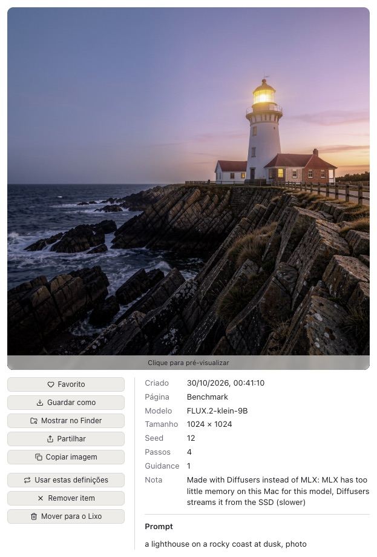
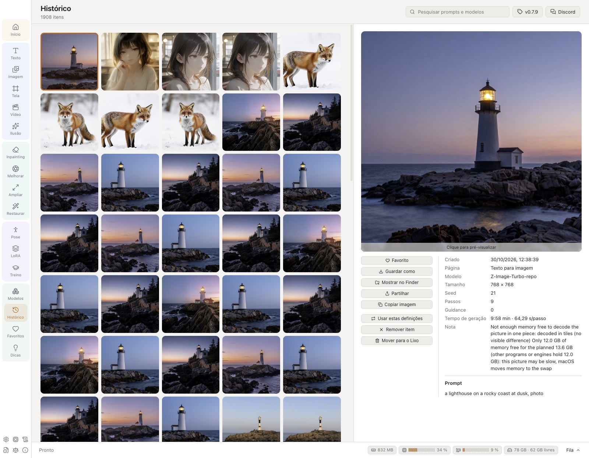
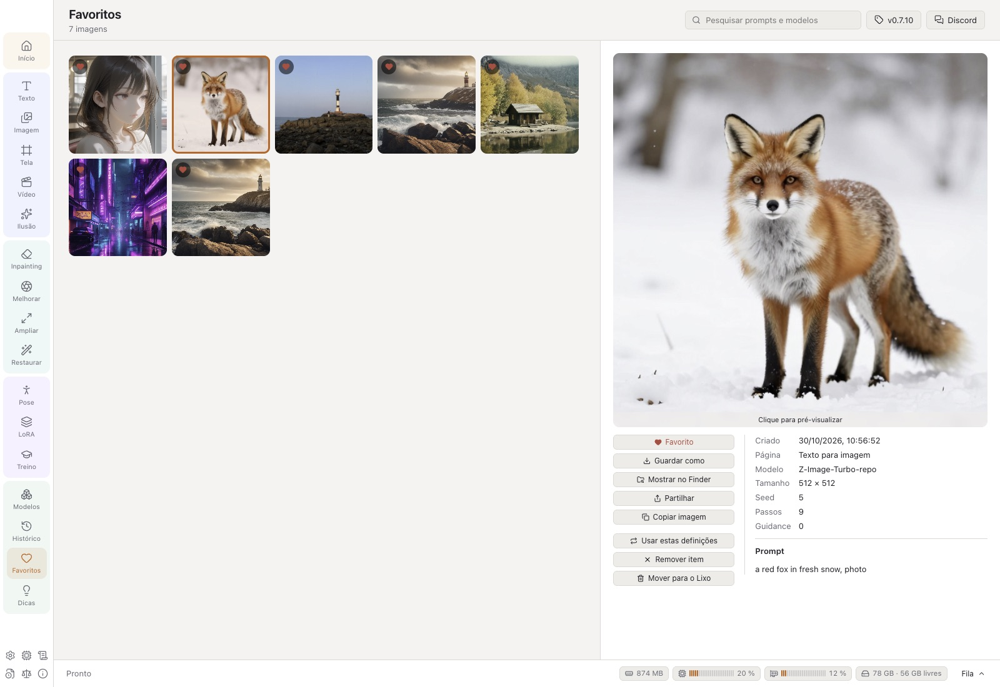
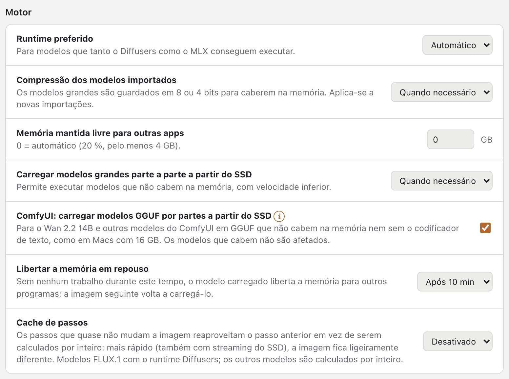

# Guia do utilizador do VulKara

[English](../USER_GUIDE.md) · [Deutsch](../de/USER_GUIDE.md) · [Español](../es/USER_GUIDE.md) · [Português (Brasil)](../pt-BR/USER_GUIDE.md) · **Português (Portugal)**

O VulKara, *o seu gerador local de imagens com IA, com elevada privacidade*, cria imagens e vídeos curtos e restaura
fotografias antigas num Mac com Apple silicon. Tudo é calculado no próprio Mac; a rede só é utilizada para transferir
runtimes, modelos e as descrições de LoRAs, e para procurar atualizações. Este guia descreve cada página da app, o que faz cada definição e onde a app
guarda os seus dados.

## Índice

1. [Primeiros passos](#1-primeiros-passos)
2. [A janela](#2-a-janela)
3. [Texto para imagem](#3-texto-para-imagem)
4. [Estilos](#4-estilos)
5. [Imagem para imagem](#5-imagem-para-imagem)
6. [Inpainting](#6-inpainting)
7. [Tela de IA](#7-tela-de-ia)
8. [Imagem para vídeo](#8-imagem-para-vídeo)
9. [Ampliar](#9-ampliar), [Melhorar: ferramentas de foto](#melhorar-ferramentas-de-foto)
10. [Restaurar](#10-restaurar)
11. [Editor de pose](#11-editor-de-pose)
12. [Ilusão](#12-ilusão)
13. [LoRAs](#13-loras)
14. [Treino](#14-treino)
15. [Modelos](#15-modelos)
16. [Histórico](#16-histórico)
17. [Dicas e truques](#17-dicas-e-truques)
18. [A vista grande](#18-a-vista-grande)
19. [Definições](#19-definições)
20. [Hardware, Registos, Novidades, Licenças, Acerca](#20-hardware-registos-novidades-licenças-acerca), [Comunicar um problema](#comunicar-um-problema)
21. [Regras de conteúdo](#21-regras-de-conteúdo)
22. [Onde ficam os dados](#22-onde-ficam-os-dados)
23. [Resolução de problemas](#23-resolução-de-problemas)

---

## 1. Primeiros passos

### Instalação

O VulKara é distribuído como DMG. Abra-o e arraste o VulKara para *Aplicações*. A app e o DMG estão assinados com um
Developer ID e notarizados pela Apple, pelo que o macOS pergunta só uma vez se deve abrir uma app transferida da
internet. Uma versão assinada, mas não notarizada, é bloqueada pelo Gatekeeper na primeira abertura noutro Mac: abra
**Definições do Sistema → Privacidade e segurança**, desloque até à mensagem sobre o VulKara e clique em **Abrir mesmo
assim** (ou clique na app no Finder com a tecla Control premida e escolha **Abrir**). Isto só é necessário uma vez.

Com o [Homebrew](https://brew.sh) também pode instalar o VulKara no Terminal: `brew install --cask revil-O/tap/vulkara`. As versões novas chegam
depois com `brew upgrade --cask vulkara`.

### O ecrã de abertura

Ao iniciar, surge uma janela com a imagem da forja: o martelo rúnico golpeia a bigorna, as faíscas transformam-se em
píxeis incandescentes e deles é forjada a valquíria. O nome junta os dois: Vulcano, o deus romano da forja, e Kára, uma
valquíria da lenda nórdica. Por baixo do nome ficam o slogan, a versão e o copyright; a imagem tem o ícone da UE
*AI GENERATED* no canto inferior direito. Entretanto, a app carrega por trás da imagem (*A preparar …*); assim que
estiver pronta e o ecrã de abertura tiver sido mostrado durante cinco segundos, este fecha-se sozinho e a app abre. Um
clique (ou ↩ ou Espaço) fecha-o mais cedo, assim que a app estiver pronta. O ecrã de abertura é uma pequena janela
própria: mesmo com *Preferir separadores: Sempre* nas definições do macOS, não abre como separador da janela principal.

### A página Início

A página Início mostra três passos. Cada passo recebe uma marca de verificação quando é concluído:

1. **Instalar um runtime** (Definições → Runtimes). Um runtime é o software que executa os modelos. Comece pelo
   **Diffusers (Apple GPU)**: executa a maioria dos modelos e também o importador, a deteção de pose e o filtro de
   conteúdo. O **MLX** é mais rápido para modelos FLUX e Z-Image e é o único runtime para Krea 2, Ideogram 4 e FLUX 3 Image Klein. O **ComfyUI** é opcional
   e necessário para vídeo, ampliação e modelos Anima, Lumina 2 e Pony V7.
2. **Obter um modelo** (Modelos → Recomendados). Para uma primeira experiência, utilize o *SDXL 1.0* ou o *DreamShaper XL v2 Turbo*
   num Mac com 16 GB de memória, ou o *Stable Diffusion 1.5* num com 8 GB.
3. **Criar a primeira imagem** (Texto). Descreva a imagem e prima **Gerar** ou ⌘↩. O passo é marcado quando a
   primeira imagem fica pronta (ou quando o histórico já tem uma) e continua marcado mesmo depois de o histórico ser
   esvaziado.

Por baixo dos passos, a página conta os runtimes, modelos e LoRAs instalados.

O menu no canto superior direito escolhe o idioma da app (*Sistema*, English, Deutsch, Español, Português (Brasil), Português (Portugal)), a mesma
opção de **Definições → Aspeto → Idioma**.

**Requisitos do sistema:** macOS 14 (Sonoma) ou posterior em Apple silicon (M1 ou posterior), pelo menos 8 GB de memória (16 GB ou mais para
SDXL, 32 GB ou mais para os modelos FLUX grandes) e espaço livre no SSD para os runtimes (cerca de 1–1,5 GB cada) e
para os modelos (2–35 GB cada).

## 2. A janela

| Parte | O que faz |
| --- | --- |
| **Barra de navegação** (esquerda) | Agrupa as páginas, cada grupo com um tom próprio: *Início*; *Criar* (imagens novas): Texto, Imagem, Tela, Vídeo, Ilusão; *Editar* (uma imagem que já tem): Inpainting, Melhorar, Ampliar, Restaurar; *Ferramentas*: Pose, LoRA, Treino; *Biblioteca*: Modelos, Histórico, Favoritos, Dicas. Numa janela demasiado baixa para todos, a barra alarga e mostra os grupos em duas colunas. Os ícones na parte de baixo abrem Definições, Registos, Novidades, Licenças e Acerca. |
| **Área de trabalho** (centro) | A entrada da página (prompt, imagem, tela) e, por baixo, os resultados desta página. Um resultado cujo ficheiro foi apagado ou movido aparece como *Ficheiro em falta*;  remove-o da lista. |
| **Painel de definições** (direita) | Modelo, estilo, tamanho e tudo o resto que dá forma ao resultado. |
| **ⓘ** e **!** | Pequenos selos laranja cujo texto abre quando o cursor está sobre eles: **ⓘ** (um anel) é informação simples; **!** (preenchido) avisa que a app faz algo diferente do habitual, por ex. valores que diferem da sugestão do modelo ou um modelo que é executado com streaming do SSD. |
| **Barra de tarefas** (em baixo) | A tarefa em curso: progresso, tempo restante, segundos por passo e **Cancelar**. Quatro chips mostram o que o Mac está a fazer: a memória ocupada pelo VulKara e pelos seus motores, a CPU e a GPU como medidores de nível, e as caches de streaming do SSD com o espaço restante no respetivo disco (laranja abaixo de 20 GB). Um clique neles abre **Hardware**. **Fila** abre a lista de todas as tarefas. |

As páginas continuam ativas quando alterna entre elas. Um prompt escrito a meio continua lá quando regressa, tal como
uma tela ou uma pose. Cada página de geração também se lembra das suas definições depois de reiniciar.

### A fila

- As tarefas são executadas **uma de cada vez**, pela ordem em que foram adicionadas. Pode adicionar mais tarefas
  enquanto uma está a ser executada.
- **Imagens** > 1 adiciona uma tarefa por imagem. As seeds contam a partir da seed escolhida, ou de uma aleatória, pelo
  que cada imagem de uma série pode ser refeita.
- No painel da fila, **Cancelar** para a tarefa em curso e **Remover** retira da lista uma tarefa em espera ou
  concluída. **Limpar concluídas** esvazia a lista de tarefas concluídas.
- Quando a última tarefa em espera termina, o Mac reproduz um som curto. Pode desativá-lo em Definições → Conteúdo →
  *Reproduzir um som quando a fila terminar*.
- Nenhuma tarefa começa enquanto uma LoRA está a ser treinada.

## 3. Texto para imagem

Descreva a imagem no campo do prompt e prima **Gerar** (ou ⌘↩). Os resultados aparecem por baixo do prompt como
miniaturas. Uma tarefa em curso mostra o progresso na sua miniatura, e uma tarefa em espera mostra a sua posição na
fila. Clique numa miniatura para a abrir na [vista grande](#18-a-vista-grande).

- O **×** no canto de uma miniatura retira-a da lista (a imagem continua no histórico); numa tarefa em curso,
  cancela-a. As tarefas canceladas e falhadas são removidas da mesma forma.
- Uma miniatura de tarefa mostra o essencial. O cursor sobre o seu **ⓘ** abre todos os detalhes: o prompt completo,
  tamanho, passos e seed, uma nota sobre como foi feita e o erro completo de uma tarefa que falhou.
- Um **ⓘ** numa imagem abre a respetiva nota da mesma forma, por exemplo quando foi feita com Diffusers em vez de MLX.
- **Ampliador de prompt** (FLUX 3 Image Klein, Texto para imagem, ao lado de Gerar): o FLUX 3 foi treinado com
  descrições completas de cenas; o ampliador da Black Forest Labs (4 bits, MLX) escreve primeiro uma a partir do seu
  prompt – tema, ambiente, luz, câmara, cores. Um prompt que já é uma descrição completa segue como está, tal como o
  de uma edição com imagem. É transferido uma vez (5,7 GB) com o botão ao lado da opção ou na página Modelos (modelos
  auxiliares); ocupa a memória só para o prompt (cerca de 30 s) e depois é libertado, e a descrição que escreveu
  passa a ser a nota da imagem.

  

- **Selo de IA da UE** (ao lado de Gerar): coloca, de forma visível, o ícone da Comissão Europeia para conteúdo de IA
  no canto inferior direito de cada imagem. *AI GENERATED* para imagens feitas a partir de um prompt (Texto, Ilusão),
  *AI MODIFIED* quando uma imagem sua é alterada (Imagem, Inpainting), ou o *AI* redondo. **Tom automático** utiliza o
  ícone preto num canto claro e o branco num canto escuro; *Escuro* e *Claro* fixam-no. Tamanhos pequeno, médio e
  grande; **Discreto** é o ícone com 50 % de transparência. Uma pré-visualização mostra o ícone escolhido. É colocado
  depois de o filtro de conteúdo aprovar a imagem; de qualquer forma, cada imagem leva a nota no próprio ficheiro. Não
  se aplica a vídeos.
- Uma imagem com selo guarda uma cópia sem o selo (na pasta oculta `.unlabelled` ao lado dela). Quando é utilizada
  como entrada de Imagem, Inpainting, Melhorar, Ampliar ou Restaurar, é essa cópia que é utilizada, pelo que a nova
  imagem recebe um só selo, sem o antigo a aparecer por baixo. Mover um item do histórico com os seus ficheiros para o
  Lixo move também a cópia.

  

  

| Definição | Intervalo | O que faz |
| --- | --- | --- |
| **Modelo** | modelos de imagem instalados | O modelo define a maior parte do aspeto. Consulte [Mudar de modelo](#mudar-de-modelo) para saber o que muda com ele. |
| **Estilo** | 20 estilos em 4 grupos | Envolve o prompt num modelo de estilo, consulte [Estilos](#4-estilos). |
| **Tamanho** | 1:1, 4:3, 3:2, 16:9, 3:4, 2:3, 9:16 | Cada miniatura mostra as suas proporções. O tamanho é escolhido de modo a corresponder ao número de píxeis para o qual o modelo foi treinado. A largura e a altura também podem ser escolhidas diretamente. |
| **Passos** | 1–80 | Mais passos dão mais detalhe, até certo ponto. 20–30 serve para a maioria dos modelos; os modelos turbo precisam de 4–8, e mais passos só demoram mais. |
| **Guidance** | 0–20, em passos de 0,1 | Quanto a imagem segue o prompt. A régua por cima do nivelador marca 0, 5, 10, 15 e 20. O SDXL funciona melhor com 5–7, o SD 1.5 com 7–9, o FLUX com 3–4. |
| **Controlo** | Nenhum, Pose, Profundidade, Contornos, Line art, Rabisco, Tile | Orienta a composição com uma imagem de controlo, consulte abaixo. Só aparece quando o modelo o suporta. |
| **Sampler** | depende da família | O método que remove o ruído passo a passo. *Predefinido* é o do próprio modelo. A segunda lista define o escalonamento do ruído (Karras, Exponential, Beta); fica desativada enquanto o sampler é *Predefinido*. |
| **Seed** | número ou vazio | A mesma seed com as mesmas definições dá a mesma imagem. Vazio significa aleatório; o botão do dado volta a aleatório. |
| **Imagens** | 1–20 | Quantas imagens são feitas, cada uma com a sua própria seed. |
| **LoRAs** | até 3 | Complementos que ensinam ao modelo um estilo, uma pessoa ou um objeto, cada um com o seu próprio peso (−2 a 2; os botões − e + ao lado mudam em décimas, também no telemóvel). Só são oferecidas LoRAs da família do modelo. |
| **Fora da imagem** | texto | O prompt negativo: o que não deve aparecer. Só aparece quando o modelo o suporta. |

### Mudar de modelo

O primeiro modelo de uma página traz os seus próprios passos, guidance e tamanho. A partir daí, escolher outro modelo
mantém as definições, para que os modelos possam ser comparados com os mesmos valores:

- **Passos, guidance, seed e tamanho** ficam como estão. Quando diferem do que o novo modelo sugere, surge um **!**
  laranja por cima dos niveladores, ao lado de **Valores do modelo**: o cursor sobre ele mostra a sugestão (*Este
  modelo sugere 4 passos e guidance 0, 1024×1024*), e o botão aplica-a.
- **De onde vem a sugestão**: se o cartão do modelo os nomear, os passos, a guidance, o sampler, o percurso de sigmas
  e o prompt negativo de quem o fez são lidos na importação e passam a ser os valores próprios do modelo; o aviso
  nomeia então também o sampler (*Quem o fez recomenda o sampler DPM++ SDE Karras.*), e **Valores do modelo**
  aplica-o com o resto. Um modelo cujo cartão nada diga mantém os valores que o VulKara tem para a sua família.
- **Valores para os quais o modelo não foi feito** recebem um **!** laranja ao lado de *Passos* ou *Guidance*, com um
  botão que aplica o valor próprio do modelo: passos acima do dobro do que um modelo destilado espera (*Feito para 4
  passos: mais passos demoram mais sem dar uma imagem melhor.*), guidance num modelo que não tem guidance (FLUX.1
  [schnell], um FLUX.2 [klein] destilado) e guidance acima de 1 num modelo feito sem ela (SDXL Turbo, Z-Image-Turbo,
  Chroma1-Flash), em que cada passo é executado duas vezes. Na Tela, o **!** aparece ao lado de *Passos*.
- Só muda um **tamanho** que o novo modelo não consegue calcular, para o mais próximo que consegue nas mesmas
  proporções (o SD 1.5 vai até 768 px). Ao voltar a um modelo que consegue, o tamanho escolhido antes regressa, a menos
  que o tenha alterado entretanto.
- **Sampler**: o sampler escolhido continua escolhido. Um modelo que não o tem é executado com o sampler predefinido; um
  **!** laranja ao lado de *Sampler* avisa disso quando o cursor está sobre ele. Voltar ao modelo anterior repõe-no.
- **Só os samplers do criador**: quando o cartão do modelo indica os samplers com que o criador o usa, a lista mostra
  só esses, com *Predefinido* (o recomendado) primeiro; um (i) ao lado de *Sampler* avisa disso. Um cartão que não
  indica nenhum mantém a lista completa.
- O que o novo modelo não aceita é retirado: LoRAs de outra família e um tipo de controlo que ele não tem. O prompt
  negativo próprio de um modelo só é preenchido quando o campo está vazio.
- Um modelo que a app reconheceu, mas ainda não consegue executar, avisa disso na página antes de qualquer coisa ser
  enviada.

### Imagens de controlo (ControlNet)

**Controlo** mantém a composição de uma imagem de controlo:

| Tipo | Imagem de controlo | SD 1.5 | SDXL | SD 3.5 M | SD 3.5 L | FLUX.1 |
| --- | --- | :-: | :-: | :-: | :-: | :-: |
| Pose | um esqueleto do [Editor de pose](#11-editor-de-pose) ou uma foto cuja pose é detetada |  |  | | |  |
| Profundidade | um mapa de profundidade ou uma foto cuja profundidade é estimada |  |  |  |  |  |
| Contornos (Canny) | contornos brancos sobre preto ou uma foto cujos contornos são traçados |  |  |  |  |  |
| Line art | um desenho de linhas ou uma foto transformada num |  |  | | |  |
| Rabisco | um esboço rápido ou uma foto reduzida a um |  |  | | |  |
| Tile | uma imagem cujo conteúdo é mantido enquanto os detalhes são repintados | |  | |  | |

- Deixe **É uma foto: prepará-la primeiro** ativado quando a imagem de controlo for uma foto normal. Desative-o quando a
  imagem de controlo já for um esqueleto, um mapa de profundidade ou uma imagem de contornos.
- **Peso** (0–2) define com que rigor o resultado segue a imagem de controlo.
- O modelo de controlo é transferido na primeira vez que é utilizado.

## 4. Estilos

Um estilo envolve o prompt com palavras que definem o aspeto. Em alguns estilos, também acrescenta palavras a *Fora da
imagem*. O seletor mostra uma imagem de pré-visualização para cada estilo. Os cabeçalhos com moldura laranja agrupam
os estilos:

| Grupo | Estilos |
| --- | --- |
| **Foto** | Realçar, Fotográfico, Cinematográfico, Filme analógico, Preto e branco, Romântico |
| **Ilustração** | Anime, Arte digital, Banda desenhada, Arte de fantasia, Ficção científica, Line art |
| **Estilizado** | Neon punk, Isométrico, Pixel art, Textura contínua |
| **3D e artesanato** | Modelo 3D, Low poly, Origami, Plasticina |

*Sem estilo* utiliza o prompt tal como foi escrito. O estilo é guardado com cada tarefa, pelo que *Usar estas
definições* o repõe mais tarde.

<table>
<tr>
<td> <b>Cinematográfico</b>: um farol numa costa rochosa à hora dourada</td>
<td> <b>Filme analógico</b>: uma pequena cabana de madeira à beira de um lago de montanha</td>
</tr>
<tr>
<td> <b>Arte digital</b>: uma raposa vermelha sentada numa floresta com neve</td>
<td> <b>Arte de fantasia</b>: um astronauta a cuidar de uma estufa na Lua</td>
</tr>
</table>

Todas feitas com Juggernaut XL v7, 25 passos, guidance 6.

## 5. Imagem para imagem

Transforma uma imagem existente numa nova: outra estação do ano, outro estilo, um esboço transformado em pintura.

- **Escolher uma imagem**: clique no campo ou largue nele um ficheiro de imagem (PNG, JPEG, WebP ou BMP). O clique abre
  o seletor de imagens: os seus resultados do histórico, os mais recentes primeiro, com uma pesquisa (prompt, modelo,
  página) e um filtro *Favoritos*; um clique escolhe uma imagem. **Do disco …** abre antes a caixa de diálogo de
  ficheiros.
- **Ampliar a vista da imagem** (aqui e em Inpainting, Melhorar, Ampliar e Restaurar, também ao pintar uma máscara ou
  ao selecionar objetos): ⌘ + deslocar ou juntar/afastar os dedos aproxima em direção ao cursor, até 800 %; deslocar
  passa então a mover a imagem, tal como arrastar com Espaço premido ou o botão do meio do rato. Os pequenos controlos
  no canto inferior direito (aparecem quando o cursor está sobre a imagem) afastam, aproximam e voltam a ajustar.
  Pintar e clicar continuam a funcionar com a imagem ampliada.
- **Alteração** (0,05–1): quanto o resultado se afasta da imagem. Com 0,3 mudam as cores e os detalhes; com 0,6 muda o
  motivo, mas a composição mantém-se; acima de 0,8 resta pouco da imagem. Os modelos FLUX.2 e Qwen-Image 2.1 não
  utilizam este nivelador; utilizam a imagem como referência.
- O resultado tem as proporções da imagem. Para um tamanho diferente, assinale **Tamanho personalizado em vez das
  proporções da imagem**.
- Todas as outras definições funcionam como em [Texto para imagem](#3-texto-para-imagem).

<table>
<tr>
<td> Texto para imagem</td>
<td> Imagem para imagem, alteração 0,6: <i>the same lighthouse in a snow storm</i></td>
</tr>
</table>

## 6. Inpainting

Repinta uma parte de uma imagem e mantém o resto.

1. Escolha a imagem.
2. **Pintar** sobre a parte que deve mudar. **Apagar** retira a pintura. **Tamanho** define o pincel (1–30 % do lado
   menor da imagem). O botão da seta desfaz o último traço, e o caixote do lixo remove toda a pintura.
3. Descreva o que deve aparecer na parte pintada, ou deixe o prompt vazio para apenas remover algo.
4. **Alteração** (predefinição 100 %): valores mais baixos mantêm mais do que já existe.

Os modelos que fazem inpainting são SD 1.x, SD 2.x, SDXL, SD 3.5, FLUX.1, Chroma, Qwen-Image e Z-Image. Modelos especiais de inpainting como o *SD 1.5
Inpainting* dão os contornos mais limpos.

## 7. Tela de IA

Uma superfície infinita na qual as imagens são pintadas, prolongadas e repintadas. O **quadro** laranja marca onde
aparece a próxima imagem. O que **Gerar** faz depende do que está dentro do quadro:

| No quadro | Resultado |
| --- | --- |
| nada | uma imagem nova |
| parte de uma imagem | a parte vazia é preenchida de modo a continuar a imagem (outpainting) |
| uma imagem com traços de máscara | a parte com máscara é repintada |
| uma imagem sem traços de máscara | uma variação (com **Alteração** 0,1–0,9) |

O painel explica sempre qual destas opções vai acontecer.

**Ferramentas e teclas:**

| | |
| --- | --- |
| **Mover** (V) | Arraste uma imagem para a mover. Arraste um canto da imagem selecionada para a redimensionar: o canto oposto fica no lugar e as proporções são mantidas (mantenha ⇧ premida para proporções livres); o tamanho aparece por baixo dela. Arraste o limite do quadro, ou uma parte vazia dele, para mover o quadro (alinha-se a 8 px). Arraste um espaço vazio para mover a vista. |
| **Ajustar ao quadro** | Torna a imagem selecionada tão grande quanto cabe no quadro, centrada, com as proporções mantidas. |
| **Cantos do quadro** | As pegas redondas nos cantos do quadro redimensionam-no livremente: o canto oposto fica no lugar, os lados alinham-se a 64 px, de 256 a 2048 px e no máximo o dobro dos píxeis do modelo (SDXL: cerca de 2 megapíxeis), para que um Mac de 16 GB consiga. O quadro passa a mostrar *livre*; um botão de proporção volta a redimensioná-lo. |
| **Pincel de máscara** (B) | Pinte a parte a repintar dentro do quadro. O tamanho do pincel vai de 8 a 200. |
| Deslocar / juntar ou afastar os dedos, ⌘ + deslocar | Deslocar move a vista; juntar ou afastar os dedos ou ⌘ + deslocar aplica zoom (5 %–400 %). |
| ⌫ | Remove a imagem selecionada. |
| ⌘Z | Desfazer (até 50 passos). |
| **Mostrar tudo** | Ajusta a vista a todas as imagens. |

- **Adicionar imagem** coloca uma imagem no quadro, escolhida no seletor de imagens (do histórico ou do disco).
- Por baixo da superfície, uma faixa mostra a fila e os resultados recentes desta página, como nas outras páginas: uma
  tarefa em espera ou em curso com o seu progresso, uma imagem pronta para abrir na vista grande. Uma imagem pronta
  aparece também na superfície, onde estava o quadro.
- **Exportar PNG** guarda todas as imagens num único ficheiro PNG.
- **Quadro** define as proporções: 1:1, 3:4, 4:3, 16:9 ou 9:16, ou arraste os cantos do quadro para qualquer tamanho.
- Prolongar precisa de um modelo SDXL, SD 3.5, FLUX.1, Chroma ou Z-Image, ou de um modelo de inpainting. Os outros modelos são marcados com *(só imagens
  novas)*.
- A tela, incluindo as suas imagens, vista, prompt e modelo, é mantida depois de reiniciar.

## 8. Imagem para vídeo

Transforma uma imagem num vídeo curto. Precisa do runtime ComfyUI e de um modelo Wan 2.2 (Modelos → Recomendados).

- **Imagem inicial**: o primeiro fotograma. O vídeo fica com as proporções dela.
- **Prompt**: o que acontece, como movimento, câmara e ambiente: *the astronaut slowly waters the plants, gentle
  camera push in*.
- **Duração**: 1–5 segundos.
- **Resolução**: 480p ou 720p.

O vídeo demora muito mais do que as imagens. Um clip de um segundo em 480p demorou cerca de 8 minutos num M2 com 24 GB,
e clips mais longos precisam de muito mais memória.

## 9. Ampliar

Amplia uma imagem 2× ou 4× e acrescenta detalhe, com o Real-ESRGAN x4plus (64 MB, BSD-3, transferido na primeira
utilização) através do runtime ComfyUI.

- **Ampliar**: botões predefinidos ×1,5, ×2, ×2,2, ×2,5, ×3, ×3,5 e ×4, e um nivelador em passos de 0,1 para qualquer
  valor intermédio. O modelo trabalha sempre a 4×; um fator menor reduz o resultado depois (mais limpo do que uma
  ampliação normal).
- Uma imagem com mais de 2048 px no lado maior é primeiro reduzida a 2048; o resultado continua a ser o fator escolhido
  vezes a sua imagem, até quatro vezes a imagem reduzida (a nota do resultado indica-o).
- A vista grande de qualquer imagem tem um botão **Ampliar** que envia a imagem para aqui.

### Melhorar: ferramentas de foto

**Melhorar** (em Editar) trabalha numa fotografia com modelos pequenos neste Mac: sem prompt, sem modelo de difusão, e
cada resultado passa pela fila, pelo filtro de conteúdo e pelo histórico como qualquer outro. A lista à direita mostra
cada ferramenta com algumas palavras e onde é executada: **GPU** (os pesos PyTorch originais via spandrel) ou **CPU**
(um modelo ONNX), numa etiqueta violeta ou azul-esverdeada. O respetivo selo (i) traz o resto: o modelo, o que faz em
pormenor, limites de tamanho e tamanho da transferência e, por baixo de uma linha, a licença, a respetiva nota e a
origem.

| Ferramenta | O que faz | Executada em | Tamanho · licença |
| --- | --- | --- | --- |
| **Nitidez (NAFNet)** | remove a desfocagem de fotos tremidas ou ligeiramente desfocadas | CPU | 92 MB · MIT |
| **Reduzir ruído (SCUNet)** | remove o ruído de fotos reais (ISO elevado, pouca luz) | GPU | 72 MB · Apache-2.0 |
| **Ampliar ×4 (SwinIR)** | amplia fotos reais quatro vezes e recria detalhes finos; uma imagem com mais de 2048 px no lado maior é primeiro reduzida a 2048 (a nota do resultado indica-o), pelo que os resultados chegam no máximo a 8192 px | GPU | 67 MB · Apache-2.0 |
| **Limpeza de JPEG (FBCNN)** | remove os blocos e halos de uma compressão JPEG forte; deteta a qualidade sozinha | GPU | 288 MB · Apache-2.0 |
| **Remover fundo (BiRefNet)** | o motivo principal sobre um fundo transparente, ou a respetiva máscara | CPU | 115 MB · MIT |
| **Selecionar objetos (SAM 2.1)** | clique no que deve ser selecionado (⌥ + clique no que não faz parte) | CPU | 155 MB · Apache-2.0 |

- **Transferir** obtém uma ferramenta uma única vez de quem a publica, numa versão fixa e verificada (um commit do
  Hugging Face ou um ficheiro de release do GitHub com o respetivo checksum); as seis são de utilização livre, também
  comercial. O ícone do caixote do lixo move uma ferramenta instalada para o Lixo. As ferramentas de GPU precisam do
  runtime Diffusers com spandrel: um runtime mais antigo oferece a atualização em Definições → Runtimes.
- **Intensidade** mistura o resultado de Nitidez, Reduzir ruído ou Ampliar com o original (100 % = só o resultado da
  ferramenta).
- **Qualidade JPEG** (Limpeza de JPEG): *Auto* deixa a ferramenta estimar quanto a imagem foi comprimida. Botões de
  10–90 e um nivelador definem-na manualmente: uma qualidade mais baixa limpa com mais força (blocos, halos, mas também
  detalhes finos), uma mais alta com mais suavidade.
- **Carácter** (Reduzir ruído): *Natural* mantém a foto fiel; *Nítido* utiliza os pesos GAN do SCUNet, mais nítido, com
  textura fina inventada onde havia ruído. Nítido é transferido uma vez (72 MB) na primeira utilização.
- **Ampliar** (ferramentas que ampliam, como Ampliar ×4): os mesmos botões predefinidos e o mesmo nivelador da página
  Ampliar; o resultado tem esse número de vezes o tamanho da sua imagem.
- **Remover fundo**: *Transparente* gera um PNG com fundo transparente, *Máscara* a máscara a preto e branco.
- **Selecionar objetos**: cada clique refina a seleção, que aparece sobre a imagem (todo o resto escurecido).
  **Recortar** e **Guardar máscara** criam uma imagem a partir dela; **Pintar no Inpainting** abre a página Inpainting
  com a imagem e a seleção já pintada como máscara, pronta a ser repintada.
- **Importar um ficheiro de modelo**: outros modelos de fotografia, se a respetiva licença o permitir. Os pesos PyTorch
  (.pth, .safetensors) são executados na GPU quando o spandrel conhece a arquitetura (ESRGAN, SwinIR, HAT, DAT, NAFNet,
  SCUNet, FBCNN, SPAN, OmniSR e outras; imagem a cores na entrada e na saída, com ampliação de 1, 2, 3, 4 ou 8 vezes);
  os ficheiros .pth são lidos sem executar nenhum código que possam conter. Os modelos ONNX são executados na CPU e
  verificados antes: uma imagem na entrada (1 × 3 × altura × largura), uma imagem na saída (do mesmo tamanho ou 2, 3, 4
  ou 8 vezes maior) ou uma máscara, valores 0–1 ou 0–255; os modelos com operadores próprios são recusados. As imagens
  grandes são processadas em blocos.
- Tempos aproximados num M2 para uma foto de 768 × 768: Limpeza de JPEG 2 s, Reduzir ruído 4 s, Remover fundo 8 s,
  Nitidez 15 s, Ampliar ×4 35 s; um clique ao selecionar, algumas centésimas de segundo.
## 10. Restaurar

Restaura fotografias antigas: dominantes de cor, cores desbotadas, imagens e rostos suaves e desfocados, riscos,
vincos, manchas, furos e preto e branco. Escolha a foto (ou largue-a sobre o campo) e prima **Restaurar** ou ⌘↩. Uma
foto a preto e branco ou virada é reconhecida e fica com *Colorir uma foto a preto e branco* ativado.

Uma foto com perfil de cor (Display P3, Adobe RGB ou HDR, como *Rec. 2020 PQ*, que algumas apps de ampliação e iPhones
gravam) é primeiro convertida para sRGB; lida sem o perfil, ficaria sem vida e acinzentada. Isto aplica-se a todas as
páginas que recebem uma imagem.

**Etapas** (qualquer combinação):

| Etapa | Como |
| --- | --- |
| **Corrigir dominante de cor e contraste** | Sem modelo: equilíbrio de brancos (uma dominante vermelha ou amarela é neutralizada; uma foto a preto e branco virada fica cinzento neutro), níveis e contraste local apenas no brilho. Os tons claros são comprimidos em vez de cortados, pelo que um vestido branco mantém as pregas. **Intensidade** 20–100 % (predefinição 80 %). |
| **Reparar danos (IA)** | Um modelo FLUX.2 edita a foto (Modelos → Recomendados: FLUX.2 [klein]). **Passos do modelo** 2–12. Sem pintura, repinta a foto inteira: roupas, folhas e fundos suaves ganham detalhes reais, mas os rostos podem transformar-se nos de outras pessoas; por isso, os rostos são retirados da foto antes do reparo quando *Restaurar rostos* está ativado. |
| **Remover pó e riscos** | Sem nenhum modelo seu: pontinhos e riscos finos que se destacam de zonas calmas são encontrados e preenchidos a partir do que os rodeia (LaMa). Folhas e tecidos não são tocados, nem os olhos e a boca. **Sensibilidade** 0–100 % (predefinição 50 %); uma mais alta encontra pontinhos mais ténues e, de vez em quando, também um pequeno detalhe da foto (a pré-visualização mostra-o). |
| **Reconstruir detalhes suaves (IA)** | O Real-ESRGAN (o auxiliar de Ampliar, 64 MB) reconstrói contornos e texturas da foto inteira: esta é reduzida na medida em que está suave (**Suavidade da foto** × 1,25–3, predefinição × 2) e depois ampliada quatro vezes. **Intensidade** 20–100 %. Torna nítido o que a foto ainda mostra; a textura totalmente perdida (tecido, folhas) só *Reparar danos (IA)* a recria. |
| **Restaurar rostos (IA)** | O CodeFormer (0,4 GB, transferido uma vez) restaura rostos desfocados, retirados da foto antes das etapas de IA. **Fiel à foto** 50–100 % (predefinição 90 %): valores mais baixos inventam mais detalhes. **Intensidade** 20–100 % (predefinição 60 %). Rostos com menos de cerca de 14 píxeis não são tocados. A licença do CodeFormer só permite utilização não comercial. |
| **Colorir uma foto a preto e branco** | O DDColor (0,9 GB, transferido uma vez) acrescenta cor ao brilho da foto, pelo que nenhuma forma ou detalhe pode mudar. **Intensidade da cor** 50–150 %. |
| **Menos grão, detalhes mais nítidos** | Sem modelo: o ruído do brilho é reduzido e os contornos ficam mais nítidos; a cor só é ligeiramente suavizada. **Intensidade** 10–100 %. |

**Os rostos** que o CodeFormer vai restaurar aparecem como quadros arredondados e numerados sobre a foto. Arraste um
quadro até ao rosto quando a deteção falhar, ou exclua um rosto com o respetivo **×**; **Procurar de novo** repõe os
quadros. Os rostos são encontrados pelo YuNet (um pequeno detetor de rostos, transferido uma vez).

**Tamanho do resultado**: *Igual à foto* ou *O dobro do tamanho*.

**Pré-visualizar** restaura apenas uma parte da foto, rapidamente: a que ampliou (⌘ + deslocar), caso contrário o
maior rosto (ou o centro), no máximo 768 píxeis. Não fica no histórico. Por cima do campo da nota, o **controlo de
comparação** mostra a pré-visualização ou o resultado mais recente da foto sobre o original: à esquerda da linha a
alteração, à direita o original; arraste a linha (ou mova-a com ← → quando estiver em foco); ⌘ + deslocar aplica zoom
aos dois.

**Num Mac com 16 GB** o reparo por IA também funciona: pinta com cerca de um megapíxel nas proporções da foto, e o
resultado é levado de volta ao tamanho da foto; assim, uma digitalização grande não precisa de mais memória do que uma
imagem normal do FLUX.2 [klein] (uma foto de 768 × 1024 com 12 GB mantidos livres: 5 minutos num M2).

**Pintar os danos**: com o pincel (como no Inpainting), pinte sobre riscos, vincos, manchas e furos. Aí a IA repara; no
resto, a foto fica como está. Antes de a IA ver a foto, os pontos pintados são preenchidos a partir da zona envolvente
pelo LaMa (um pequeno modelo de preenchimento, Apache 2.0, transferido uma vez; sem ele, é utilizado um preenchimento
mais simples), pelo que o modelo só precisa de os refinar. Sem pintura, a IA pode mexer na foto inteira, dentro da
alteração permitida.

**Limites de segurança** para a etapa de IA:

- **Manter o original fora dos danos pintados**: o resultado é montado a partir do original e dos pontos
  reparados.
- **Recusar resultados cujos rostos mudaram**: os rostos do resultado são comparados com os da foto.
- **Alteração permitida** (1–30 %, predefinição 6 %): quanto a estrutura da foto pode mudar.
- **Regras para a IA**: regras fixas que são sempre enviadas (apenas remover danos; manter a composição, cada pessoa,
  rosto, expressão, pose e cabelo, roupas, objetos e escritos; não acrescentar, remover nem inventar nada) e as suas
  **regras próprias**, por ex. *Manter o número da porta*. As regras próprias aplicam-se a todas as restaurações.

Um reparo que viole um limite de segurança é recusado, com o motivo.

**Predefinições** ajustam etapas, limites de segurança e a nota para os tipos comuns de fotografias antigas: *Preto e
branco, danificada*, *Preto e branco para cores*, *Dominante de cor (vermelha ou amarela)*, *Foto a cores desbotada*,
*Só colorir* e *Danos graves (vincos, buracos)*. Por baixo do campo da nota, **Guardar como predefinição** guarda as
etapas, os limites de segurança e a nota atuais com um nome à sua escolha; as predefinições próprias aparecem depois
das incorporadas e são apagadas com o respetivo **×**.

A **nota** é um campo de texto de três linhas (pode ser aumentado pelo canto inferior direito) para o que a foto
mostra, por ex. *uma fotografia de casamento dos anos 1950*; ajuda a IA.

## 11. Editor de pose

Monta esqueletos de pose (OpenPose: corpo, mãos e rosto) para o controlo *Pose* em Texto para imagem.

- **Arraste** um ponto para o mover. **⇧ + arrastar** move a pessoa inteira, ou só a mão ou o rosto que foi agarrado.
  Mover um pulso move a respetiva mão; mover o nariz move o rosto.
- **Clique duas vezes** num ponto para o ocultar, por exemplo para uma mão atrás das costas. Os pontos ocultos aparecem
  tracejados, e outro duplo clique volta a mostrá-los.
- **Pessoas**: Pessoa 1…n. **Predefinição** oferece poses de corpo inteiro (De pé, Pose em T, Braços para cima,
  A andar, A correr, Sentado, Modelo, Passerelle, A virar-se, Inclinado, Pensativo, Ajoelhado, De gatas, Deitado,
  Reclinado) e retratos (a sorrir, mão no queixo, mãos no rosto, a acenar, sinal de paz …). **Adicionar** acrescenta
  uma pessoa com a predefinição, **Aplicar** dá a predefinição à pessoa selecionada, **Espelhar** espelha-a,
  **Remover** apaga-a.
- **Mãos**: Aberta, Descontraída, Punho, A apontar, Paz, Polegar para cima, OK, Plana, fechada, Indicador na bochecha,
  Ligeiramente dobrada.
- **Rosto**: Neutro, Sorriso, Boca aberta, Surpreendido, Triste, Olhos fechados.
- **Rodar e tamanho**: ±15° e ×1,1 / ÷1,1, para a pessoa ou a parte selecionada.
- **De uma foto**: deteta as pessoas numa fotografia. Isto precisa do runtime Diffusers. *Mostrar a foto* coloca a
  foto por baixo dos esqueletos.
- **Usar em Texto para imagem** envia o esqueleto como imagem de controlo de pose, juntamente com o tamanho. **Guardar PNG**
  guarda-o como ficheiro.

As poses funcionam com SD 1.5 (só o corpo), SDXL e FLUX.1. Remova o rosto de uma pessoa cujo rosto vá ficar tapado.

## 12. Ilusão

Esconde um padrão ou uma palavra numa imagem, que aparece quando semicerra os olhos ou olha de longe.

- **Padrão oculto**: Espiral, Anéis, Xadrez, Riscas, Texto (até 24 letras) ou Imagem própria (uma imagem a preto e
  branco, código QR ou logótipo). As partes claras do padrão ficam claras na imagem, e as partes escuras, escuras.
  **Densidade** (2–24), **Desfocagem** (0–12) e **Inverter** dão forma ao padrão.
- **Intensidade do padrão** (0,5–2): cerca de 0,8 é discreto, 1,2 nítido e 1,6 dominante.
- Precisa de um modelo SDXL ou SD 1.5. O modelo de padrão (5 GB para SDXL) é transferido na primeira utilização.

## 13. LoRAs

Uma LoRA é um pequeno complemento (normalmente 20–400 MB) que ensina a um modelo um estilo, uma personagem ou um
objeto. A página LoRA mostra todas as LoRAs instaladas, ordenadas por família (SD 1.x, SDXL, SD 3.5, FLUX.1, Chroma, FLUX.2, FLUX 3, Krea 2 …).
Pode filtrá-las por família e pesquisar nos nomes, palavras-gatilho e categorias.

**O painel de uma LoRA:**

- **Nome**: o lápis dá à LoRA um nome próprio na app, consulte [Nomes na app](#nomes-na-app).
- **Palavras-gatilho**: palavras que ativam a LoRA no prompt. O painel mostra de onde vêm (*do Civitai*, *dos dados de
  treino*, *editada por si*). Clique numa palavra para a copiar; **×** remove-a e **+ adicionar** acrescenta uma.
- **Categoria**: o seu próprio agrupamento, utilizado pela pesquisa.
- **Da página dela**: o que os criadores da LoRA escreveram no Civitai ou no Hugging Face: descrição, etiquetas, notas
  da versão, licença e uso comercial. É lido uma vez, guardado em cache e pode ser atualizado com o botão da seta.
- **Definições recomendadas**: intensidade, passos, guidance, sampler e clip skip, conforme indicados pelos criadores
  ou deduzidos das respetivas imagens de exemplo.
- **Prompts dos criadores**: prompts de exemplo. **Experimentar** abre-os na comparação de intensidades.
- **Como usar**: um guia curto para obter bons resultados com esta LoRA.
- **Dados de treino**: com o que a LoRA foi treinada (resolução, imagens, épocas, passos, taxa de aprendizagem) e as
  etiquetas mais utilizadas. Clique numa etiqueta para a adicionar como palavra-gatilho.

### Comparar intensidades

**Comparar intensidades** (o separador no topo, ou o botão no painel de uma LoRA) gera a mesma imagem com a mesma seed
em várias intensidades da LoRA, por exemplo `0, 0.5, 1` (0 = sem a LoRA, até 8 valores entre −2 e 3). Uma **segunda
LoRA** da mesma família pode ser comparada ao mesmo tempo. **Modelo** oferece os modelos instalados compatíveis com a
LoRA; passos, guidance e tamanho são os do próprio modelo. **Inserir no prompt** acrescenta as palavras-gatilho, e uma
seed vazia significa uma seed aleatória para toda a comparação. Assim vê-se rapidamente qual deve ser a intensidade de
uma LoRA.

Para usar uma LoRA, adicione-a na secção **LoRAs** de uma página de geração e coloque a respetiva palavra-gatilho no
prompt.

### A que modelo pertence uma LoRA

Uma LoRA só funciona com o tipo de modelo para o qual foi treinada. O VulKara descobre-o quando uma LoRA é importada:

1. pela **estrutura**, os nomes e tamanhos das camadas;
2. quando as camadas deixam mais de uma opção, ou não dizem nada, pelos **metadados** (o que a ferramenta de
   treino gravou no ficheiro);
3. depois pela **origem**: o modelo base que o Civitai indica, ou o `base_model` de um repositório do Hugging Face.

Uma LoRA sobre a qual nada disto informa é recusada com uma mensagem; nunca é classificada como SDXL só por precaução.
Quando uma família tem modelos de tamanhos diferentes, a sub-base também é registada: as LoRAs de FLUX.2 [klein]
4B, [klein] 9B e FLUX.2 [dev] são mantidas separadas (as camadas têm outros tamanhos), tal como Wan 5B e 14B. As
páginas de geração só oferecem LoRAs compatíveis com o modelo escolhido.

Quando uma LoRA é carregada, o motor conta também quantas das suas camadas encontraram o seu lugar no modelo. Abaixo
de 90 %, a tarefa para com uma mensagem clara (*The LoRA … does not fit this … model: only 62 % of its layers (…) found
their place*) em vez de gerar uma imagem com a LoRA aplicada a meio.

**Que ficheiros de LoRA carregam**: ficheiros LoRA, LoCon e DoRA nos formatos dos treinadores comuns: kohya /
OneTrainer, ai-toolkit, diffusers / SimpleTuner e ficheiros guardados pelo ComfyUI. Os ficheiros com nomes que o
runtime não lê por si são convertidos ao carregar: LoRAs de FLUX.1 e Chroma com os nomes de bloco originais do ComfyUI,
dumps do peft, LoRAs de SDXL do ai-toolkit (`lora_transformer_`), ficheiros com estilos de nome misturados, LoRAs de
Qwen-Image 2.1 do ai-toolkit (a camada MLP fundida é dividida em duas) e LoRAs de Z-Image com os nomes do ComfyUI ou do
kohya (a camada de atenção fundida é dividida em três; também com o runtime MLX, que igualmente recusa uma LoRA de Z-Image abaixo de 90 %). Os ficheiros LyCORIS **LoKr** e **LoHa** ainda não são suportados com o runtime Diffusers: uma LoRA
destas para a tarefa com *LoKr/LoHa LoRAs are not supported yet*.

As LoRAs de famílias que a app ainda não consegue executar (por exemplo HiDream, Lumina 2, HunyuanVideo) aparecem
nesta página e na página Modelos sob a respetiva família, mas nenhuma página de geração as oferece.

Uma vez, no primeiro arranque de uma versão com melhor deteção, o VulKara volta a verificar todas as LoRAs e modelos
instalados (isto precisa do runtime Diffusers e, sem ele, fica à espera dele). Uma LoRA classificada na família errada
ou sem a sub-base, um checkpoint Chroma classificado como FLUX.1, ou uma LoRA de Z-Image cuja etiqueta ainda diz que
nenhum modelo a pode usar, é corrigida; cada manifesto alterado é guardado ao lado como
`lora.json.bak` ou `model.json.bak`. As alterações são listadas no registo.

### Incorporar LoRAs num novo modelo

**Incorporar num novo modelo …** (na página LoRA, na vista geral de uma LoRA e ao lado de *Comparar intensidades*, e
na página Treino quando uma LoRA está pronta) cria um modelo próprio a partir de um modelo base e de uma ou mais LoRAs
com a respetiva intensidade. O novo modelo já não precisa de LoRA, funciona como qualquer outro modelo e aparece em
Modelos com as palavras-gatilho das LoRAs; quando é utilizado, essas palavras são colocadas no prompt tal como as LoRAs
teriam feito. O respetivo cartão mostra a base e as LoRAs com que foi feito. A base fica como está.

- O novo modelo é tão grande como a base (SD 1.5 cerca de 2 GB, SDXL cerca de 7 GB). As partes não alteradas de uma
  base diffusers (os codificadores de texto, quando nenhuma LoRA os altera) são ligadas em vez de copiadas, onde o
  disco o permite.
- A incorporação precisa de cerca do tamanho da base em memória livre; o modelo carregado é descarregado para isso, e a
  fila tem de estar vazia. Num Mac com 16 GB, SD 1.5 e SDXL cabem; FLUX.2 [klein] 4B (cerca de 10 GB) só com pouca
  coisa aberta. Um modelo que não cabe é recusado antes de qualquer carregamento, com a memória de que precisa.
- Os modelos comprimidos (ficheiros GGUF, FP8, NF4, Q4/Q8) não aceitam uma LoRA incorporada, nem os modelos do
  ComfyUI: a lista mostra-os esbatidos, com o motivo. Importe antes a base sem quantizar.
- Num M2, incorporar uma LoRA num SD 1.5 demorou 12 s; o modelo resultante gera as mesmas imagens que a base com a LoRA
  (diferença média de 3,5 em 255, arredondamento em 16 bits).

**Exportar como um único ficheiro**: o ícone de ficheiro no cartão de um modelo incorporado (e de qualquer modelo SD
1.x ou SDXL no formato de pasta) grava-o como um único checkpoint `.safetensors` no formato original, onde escolher.
Outras apps (ComfyUI, Automatic1111, Forge) carregam-no como qualquer checkpoint transferido. A fila tem de estar
vazia; um modelo SDXL precisa de cerca de 7 GB de memória e de disco para isso.

## 14. Treino

Ensina a um modelo uma pessoa, um objeto ou um estilo a partir das suas imagens e produz uma nova LoRA.

1. Dê um **Nome** à LoRA. É criada uma **palavra-gatilho** a partir do nome (por exemplo `paper_cranes_zqx`); pode
   alterá-la.
2. **Modelo base do treino**: SDXL (runtime Diffusers), FLUX.2 [klein] ou Krea 2 (runtime MLX).
3. **Imagens**: 10–30 boas imagens bastam. Utilize **Adicionar imagens** ou **Adicionar uma pasta**. Com uma pasta, os
   ficheiros `.txt` com o mesmo nome de uma imagem são utilizados como a respetiva legenda. Cada legenda começa com a
   palavra-gatilho. Descreva nas legendas o que *não* deve ser aprendido, como o fundo ou a roupa.
4. **Predefinição**: *Teste rápido* (100 passos), *Padrão* (500), *Completo* (1200). Também pode definir os passos
   (10–5000), a resolução (512/768/1024), o rank (8/16/32) e a taxa de aprendizagem.
5. **Iniciar o treino**. Primeiro, cada imagem passa pelo filtro de conteúdo, tal como os resultados (*A verificar as
   imagens*; com Permitir nudez desativado, nenhuma nudez); as suas imagens são apenas examinadas, nunca alteradas nem
   removidas. Se alguma não passar, o treino não começa e o painel indica as imagens a retirar. As legendas e a
   palavra-gatilho são verificadas como um prompt. Depois, o painel mostra a fase, o passo, a curva de perda e o tempo
   restante. O Mac não entra em repouso, e a geração fica em pausa durante o treino.

Quando termina, **Comparar intensidades** abre a nova LoRA na comparação. Tempos aproximados num M2: SDXL cerca de
2,5 s por passo a 768 px, FLUX.2 [klein] 4B cerca de 15 s, 9B cerca de 30 s, Krea 2 cerca de 45 s.

## 15. Modelos

**Recomendados** começa pelo Mac em que está a ser executado (por exemplo *MacBook Pro (13-inch, M2, 2022) · 24 GB*);
um modelo que só cabe com streaming do SSD mostra *streaming do SSD* com um **!**.

A página Modelos tem três separadores: **Instalados**, **Recomendados** e **Adicionar**. As transferências e
importações são executadas uma após a outra e aparecem no topo da página com o progresso. Modelos e LoRAs só são
instalados enquanto o disco dos modelos tiver pelo menos 50 GB livres; com menos, a importação é recusada e indica
quanto está livre (os pesquisadores marcam esses cartões e não os instalam).

### Instalados

#### Modelos auxiliares

**Auxiliares** (ou *Todos*, por baixo dos modelos e LoRAs) mostra os modelos pequenos que as ferramentas da app
utilizam, numa cor própria, cada um com uma imagem do que faz: o **filtro de conteúdo** (nudez e estimativa de idade),
**Restaurar** (o LaMa preenche danos, o DDColor coloriza), **deteção de pose e profundidade** (DWPose, Depth Anything),
os **ControlNets** de cada família de modelos, o **Real-ESRGAN** para Ampliar e as **ferramentas de foto** de Melhorar.
A contagem indica quantos deles estão neste Mac.

- Cada um é transferido de qualquer forma quando for necessário pela primeira vez; **Transferir** obtém-no antes (útil
  antes de ficar sem ligação).
- **Mover para o Lixo** liberta o respetivo espaço; volta da próxima vez que for necessário. O filtro de conteúdo é
  *Obrigatório*: verifica cada resultado e não pode ser removido.
- Cada auxiliar é transferido numa versão fixa e verificada (commit e SHA-256), nunca numa mais recente sem
  verificação; um que já tivesse sido transferido antes é verificado uma vez.

**Instalados** lista tudo o que está neste Mac, agrupado por tipo: **Modelos de imagem**, **Modelos de vídeo** e
**LoRAs**, cada grupo com a sua cor e a sua contagem. *Todos / Modelos / LoRAs* e a pesquisa restringem a lista. O
cartão de um modelo mostra a arquitetura e a memória de que precisa; o de uma LoRA, a família (e a sub-base) a que se
destina e as palavras-gatilho; e uma etiqueta *ComfyUI* ou *Vídeo* quando se aplica. Os botões de um cartão:

- **LoRAs** (só modelos): LoRAs para este modelo no Civitai ou no Hugging Face, consulte [LoRAs para um modelo](#loras-para-um-modelo).
- a seta abre a página de origem no Hugging Face ou no Civitai;
- o lápis dá-lhe um nome próprio na app, consulte [Nomes na app](#nomes-na-app);
- **Mostrar no Finder** mostra a respetiva pasta, e **Mover para o Lixo** remove-o (pode ser recuperado do Lixo).
  Um modelo adicionado como pasta no local é apenas desligado; os ficheiros ficam onde estão.

### Modelos copiados de outro Mac

Uma importação decide em função do Mac em que é executada: o plano de memória, se um ficheiro FP8 é armazenado como
GGUF de 8 bits, as cópias comprimidas guardadas para mais tarde. Uma pasta de modelo copiada de outro Mac (por exemplo,
importada num Mac com 24 GB e copiada para um com 16 GB) não foi importada aqui, pelo que não é executada aqui: o
respetivo cartão diz *Importado noutro Mac* com um **!** que indica qual Mac (pela memória), e uma tarefa, uma
incorporação ou um treino com ele é recusado com o mesmo conselho. Dois botões no cartão:

- **Importar de novo** move a cópia para o Lixo e volta a importar o modelo neste Mac a partir da sua origem, com o
  mesmo nome: o ficheiro neste Mac (se ainda estiver no mesmo sítio), o repositório do Hugging Face ou a página do
  Civitai. É verificado primeiro; um modelo que não pode ser importado aqui (demasiado grande para este Mac) fica como
  está.
- **Remover** move-o para o Lixo.

Sem o ficheiro original (um ficheiro que não está neste Mac, um modelo incorporado), só existe **Remover**: remova-o e
importe o modelo a partir do ficheiro em **Adicionar**. Cada importação regista em `model.json` o Mac em que foi feita
(`imported_on`: um ID derivado do Mac, não o número de série nem o UUID, e a respetiva memória); as importações mais
antigas são identificadas pela memória para a qual o plano foi feito.

### Famílias de modelos

| Família | Runtime | Observações | Modelo / imagens para uso comercial |
| --- | --- | --- | --- |
| Stable Diffusion 1.5, 2.x | Diffusers | também checkpoints de inpainting | sim / sim (Open RAIL, restrições de utilização) |
| SDXL, incl. Turbo, Pony, Illustrious, NoobAI | Diffusers | as LoRAs de Pony, Illustrious e NoobAI são distinguidas das de SDXL comum | sim / sim (Open RAIL++) |
| Stable Diffusion 3.5 Medium / Large | Diffusers | | com condições (receitas abaixo de USD 1 milhão) |
| FLUX.1 [schnell] / [dev] | Diffusers ou MLX | também ficheiros GGUF | schnell sim / sim; dev não / sim |
| Chroma (Chroma1-HD, -Base, -Flash, fine-tunes) | Diffusers | guidance real com prompt negativo (duas passagens por passo, por isso mais lento do que o FLUX.1; o Chroma1-Flash precisa de 12 passos e nenhuma guidance – cerca de 7 minutos por imagem a 1024 px num M2 com 24 GB, em vez de cerca de 52); calculado em float16 no M1/M2, cerca de 40 % mais rápido do que bfloat16; safetensors e GGUF; os ficheiros únicos utilizam o T5 e o VAE do FLUX.1 | sim / sim (Apache 2.0) |
| FLUX.2 [klein] 4B / 9B, FLUX.2 [dev] | Diffusers; [klein] também MLX | imagem para imagem utiliza a imagem como referência; LoRAs separadas por tamanho | 4B sim / sim; 9B e [dev] não / sim |
| Qwen-Image (e a atualização 2512) | Diffusers | ficheiros GGUF ou o repositório; guidance real | sim / sim (Apache 2.0) |
| Qwen-Image 2.1 | Diffusers (diffusers 0.41, Definições → Runtimes → Atualizar) | ficheiros GGUF ou o repositório; gera e edita | não / não (Qwen Research License) |
| Z-Image (Z-Image-Turbo, Z-Image Base, fine-tunes) | Diffusers; o repositório também MLX (texto para imagem) | Turbo: 9 passos sem guidance; Base: cerca de 30 passos com guidance 3–5 e prompt negativo (o nome ou o modelo base do Civitai indica qual; guidance até 1 fica desativada); safetensors (também FP8) e GGUF, os ficheiros únicos recebem o codificador de texto Qwen3 e o VAE do repositório Turbo ou Base; imagem para imagem e inpainting com Diffusers. Testado num M2 com 24 GB: Turbo cerca de 5½ minutos por imagem a 1024 px com MLX (8 bits), 6½ com Diffusers; Base cerca de 33 minutos com 30 passos e guidance (MLX); LoRAs com nomes do kohya e do ComfyUI nos dois runtimes | sim / sim (Apache 2.0) |
| Krea 2 | MLX | | com condições (receitas abaixo de USD 1 milhão, filtro de conteúdo obrigatório) |
| FLUX 3 Image Klein (destilado, Base) | MLX (flux3-mlx) | o repositório da Black Forest Labs (18,9 GB de transferência, cerca de 19 GB de RAM) ou os repositórios MLX da VisualInference em 6 bits (8,4 GB, funciona em Macs de 16 GB) e 8 bits (9,6 GB); destilado: 16 passos sem guidance, Base: 50 passos com guidance 3,5; imagem para imagem usa a imagem como referência; LoRAs nos nomes da Black Forest Labs, diffusers e kohya; cerca de 6 minutos por imagem a 1024 px num M2 com 24 GB | não / com condições (receitas abaixo de USD 5 milhões, filtro de conteúdo e indicação de IA) |
| Ideogram 4 | MLX | recusa nudez por si próprio | não / não |
| Anima | ComfyUI | | não / sim |
| Lumina 2 (NetaYume, Neta Lumina) | ComfyUI | o prompt de sistema que o modelo espera é colocado automaticamente antes do prompt (os fine-tunes de anime usam o seu); cerca de 30 s por passo a 1024 px num M2 com 24 GB | sim / sim (Apache 2.0) |
| ERNIE-Image (Turbo, SFT) | MLX | forte em texto nas imagens, cartazes e banda desenhada; Turbo 8 passos sem guidance, cerca de 6 minutos por imagem a 1024 px (4 bits) num M2 com 24 GB; o prompt enhancer do repositório (7 GB) não é descarregado; texto para imagem | sim / sim (Apache 2.0) |
| AuraFlow, Pony V7 | ComfyUI; o repositório Diffusers | no ComfyUI o transformer como GGUF (Q8_0 / Q4_0 do Pony); os prompts são completados até 768 tokens como no workflow do Pony; cerca de 50 s por passo a 1024 px num M2 com 24 GB; os repositórios (fal/AuraFlow-v0.3, purplesmartai/pony-v7-base) no Diffusers, aí em 8 bits com 16 GB; os LoRAs para ComfyUI funcionam nos dois | com condições (Pony License) |
| Wan 2.2 5B / 14B (vídeo) | ComfyUI | Imagem para vídeo | sim / sim (Apache 2.0) |

A página Licenças tem os termos completos. *Runtime preferido* nas Definições decide entre Diffusers e MLX quando
ambos podem executar um modelo.

### Nomes na app

O lápis num cartão (e no painel da LoRA) dá a um modelo ou LoRA um nome próprio, por exemplo
*Juggernaut XL – fotos* para `JuggernautXL_v7_f8_SDXL`. Só a app utiliza esse nome: nas listas de modelos, na barra de
tarefas, no histórico e na vista grande. A pasta e os ficheiros mantêm os nomes, pelo que as tarefas, o histórico e
*Usar estas definições* continuam a encontrar o modelo. O cartão mostra o nome da pasta por baixo do novo, e a pesquisa
encontra os dois nomes. Deixe o campo vazio e guarde para voltar ao nome da pasta. O nome é guardado como
`display_name` no `model.json` do modelo (`lora.json` para LoRAs), pelo que não se perde quando a app é reinstalada.

### LoRAs para um modelo

**LoRAs** no cartão de um modelo lista LoRAs feitas para esse modelo no Civitai ou no Hugging Face, as mais
transferidas primeiro. **Encontrar LoRAs** por cima dos cartões faz o mesmo sem escolher primeiro um modelo. A lista
segue a base do modelo: um checkpoint Pony ou Illustrious recebe LoRAs de Pony ou Illustrious (com base no que o
Civitai diz sobre o checkpoint, ou no respetivo nome), um modelo FLUX.1 [dev] recebe LoRAs de FLUX.1 [dev], um modelo
FLUX.2 [klein] 9B recebe LoRAs de [klein] 9B. O menu ao lado da escolha da origem seleciona outra base, e o campo de
pesquisa (Return) restringe a lista.

Cada cartão mostra uma pré-visualização, os criadores, a base, transferências, gostos, palavras-gatilho, o tamanho e
uma linha sobre a licença. **Instalar** coloca a LoRA nas transferências no topo da página; depois aparece em LoRAs e
na página LoRA. Para um repositório do Hugging Face com vários ficheiros, o menu no cartão escolhe o ficheiro. Algumas
LoRAs precisam de um token de acesso ou de uma licença aceite na respetiva página; o cartão indica-o. A seta abre a
página da LoRA no navegador.

Enquanto a nudez não for permitida (Definições → Conteúdo), as LoRAs e imagens para adultos ficam de fora: as que o
Civitai marca como adultas ou que têm etiquetas ou nomes desse tipo, e os repositórios do Hugging Face com a etiqueta
*not-for-all-audiences*. Com a nudez permitida, as pré-visualizações marcadas como adultas ficam desfocadas até
receberem um clique. As listas são lidas das páginas públicas dos dois sites sem token e guardadas durante dez minutos;
uma pesquisa não envia nada além da base e das palavras pesquisadas.

### Encontrar modelos

**Encontrar modelos** acima dos cartões procura no Civitai ou no Hugging Face modelos completos feitos a partir de um
modelo base: checkpoints no Civitai, fine-tunes no Hugging Face (um repositório na estrutura do diffusers é
descarregado inteiro; caso contrário, o ficheiro de checkpoint do nível superior; o menu do cartão escolhe outro
ficheiro). O menu ao lado do seletor de origem escolhe a base, organizada nos principais grupos de modelos (Stable
Diffusion, SDXL, FLUX, Qwen-Image, Z-Image, Krea · Ideogram · ERNIE, Anima · Lumina · Pony V7, Wan); a lista de LoRAs usa os mesmos grupos. *Todos os modelos base*, a primeira opção e onde *Encontrar modelos* começa, pesquisa em todo o Civitai ou Hugging Face sem base; as palavras de pesquisa restringem.
ControlNets, IP-Adapters, upscalers e LoRAs que o Hugging Face também lista como fine-tunes ficam de fora. *Formatos de ficheiro* acima dos cartões explica o que bf16, fp8, GGUF, fp32, NF4 e semelhantes
significam num Mac e como a importação lida com cada um.

Os cartões são os mesmos das LoRAs: pré-visualização, autores, base, transferências, gostos, tamanho e licença.
A verificação da importação é executada para
cada cartão e indica a memória de que o modelo precisa; um modelo demasiado grande para a memória deste Mac fica
assinalado com *streaming do SSD* (o **!** laranja explica): é executado em streaming a partir do SSD, mais devagar,
com qualidade total. **Instalar** coloca o modelo nas transferências acima. Conteúdo para adultos é tratado como nas
LoRAs.

### Recomendados

**Recomendados** lista modelos testados, com a memória de que precisam comparada com a memória deste Mac e o tamanho da
transferência. Um modelo que precisa de mais memória do que o Mac tem é assinalado como tal:

| Grupo | Modelos |
| --- | --- |
| **Modelos base** | Stable Diffusion 1.5 (+ Inpainting), SD 2.1, SDXL 1.0, SDXL Turbo, SD 3.5 Medium / Large, FLUX.1 schnell (4/8 bits), FLUX.1 dev (16/4 bits), Chroma1-HD, Chroma1-Flash (rápido), Z-Image-Turbo, ERNIE-Image-Turbo, FLUX.2 [klein] 4B / 9B, Wan 2.2 TI2V 5B / I2V 14B (vídeo) |
| **Modelos da comunidade** | GonzaLomo Chroma, DreamShaper 8, Realistic Vision 5.1, Counterfeit, DreamShaper XL Turbo, Juggernaut XL v7, epiCRealism XL, JANKU Illustrious XL, Anima Turbo, NetaYume Lumina v4 … |
| **Modelos explícitos** | só listados quando a nudez é permitida nas Definições |

Alguns modelos precisam de um token de acesso (Definições → Tokens de acesso) ou de uma licença aceite na respetiva
página no Hugging Face. A linha indica-o e tem uma ligação para a página. Aceitar a licença cabe ao utilizador; a app
nunca o faz em seu nome.

### Adicionar

**Adicionar** importa um modelo ou LoRA que não está na lista:

| Origem | Entrada |
| --- | --- |
| **Hugging Face** | repositório, por ex. `stabilityai/sdxl-turbo`, opcionalmente um ficheiro dele (`.safetensors`, `.gguf`) |
| **Civitai** | o URL da página do modelo (com `modelVersionId` para uma versão específica); ficheiros `.safetensors` e `.gguf` |
| **Ficheiro** | um ficheiro `.safetensors`, `.gguf` ou `.ckpt` no Mac |
| **Pasta** | uma pasta de modelo no formato diffusers ou uma pasta de modelo desta app. É utilizada no local e não é copiada. |

**Verificar** mostra, antes de qualquer transferência, o que é o modelo (modelo ou LoRA, arquitetura), o tamanho da
transferência, quanta memória precisa, se vai ser comprimido, se a licença tem de ser aceite antes, e as
palavras-gatilho de uma LoRA. Um repositório do Hugging Face sem um modelo completo (sem formato diffusers, só
ficheiros únicos, como quantizações GGUF) responde com a lista dos ficheiros de modelo e respetivos tamanhos; um clique
num ficheiro verifica esse ficheiro. **Transferir** (Hugging Face, Civitai) ou **Importar** (ficheiro, pasta) inicia-o
então; o campo do nome e o menu de compressão ao lado são opcionais.

O que acontece na importação:

- **Nomes**: sem um nome escolhido por si, a importação de um ficheiro recebe o nome do ficheiro, que muitas vezes
  indica a variante (`flux1-schnell-Q4_K_S`). Um ficheiro com nome genérico (`model.safetensors`,
  `pytorch_lora_weights.safetensors`, `adapter_model.safetensors` …) recebe antes o nome do repositório do
  Hugging Face.
- **Ficheiros já existentes**: codificadores de texto, VAEs e outras partes que outro modelo instalado já tem (o mesmo
  ficheiro, o mesmo tamanho) são ligados ou copiados de lá em vez de serem transferidos novamente. Um checkpoint Chroma
  de ficheiro único, por exemplo, utiliza o codificador de texto T5 e o VAE do FLUX.1.
- **Planeamento de memória**: o importador calcula de quanta memória o modelo precisa no máximo (*GB de RAM* no
  cartão) e compara-a com a memória deste Mac menos a reserva (Definições → *Memória mantida livre para outras apps*).
  Quando não cabe, a **Compressão** armazena as partes grandes em 8 ou 4 bits; quando nem isso basta e o modelo o
  permite, é marcado para streaming do SSD (consulte abaixo). Um modelo que mesmo assim não cabe é marcado com *Precisa
  de mais memória do que este Mac tem*, e **Importar mesmo assim** importa-o de qualquer forma.
- **Por etapas**: antes do streaming, um modelo que não cabe ao lado do codificador de texto é executado por etapas:
  um prompt novo é codificado só com o codificador de texto (o modelo não está na memória entretanto) e depois o
  modelo é carregado em 8 bits e faz a imagem. Um prompt da cache de prompts não precisa de nenhum dos dois passos. É
  assim que o Qwen-Image 2.1 é executado num Mac de 16 GB: mais ou menos tão rápido como em streaming de 16 bits
  (1830 s em vez de 1700–1860 s a 1024 px e 40 passos), com menos memória e sem ler cerca de 380 GB do SSD por imagem.
  *Sempre* em Definições → Motor → *Carregar modelos grandes parte a parte a partir do SSD* faz streaming em 16 bits.
- **Streaming do SSD**: um modelo de 16 bits que não cabe na memória pode ser executado mesmo assim: o respetivo
  denoiser é gravado uma vez, bloco a bloco, na *Cache do streaming do SSD* (cerca do dobro do tamanho do modelo, na
  pasta do modelo ou na pasta definida nas Definições), e enquanto é gerada uma imagem cada bloco é carregado mesmo
  antes de ser executado. É lento, pois cada passo lê o denoiser inteiro do SSD, mas funciona onde nada mais cabe. Um
  SSD interno rápido é bem mais rápido do que um disco externo. Quando o codificador de texto sozinho não deixa espaço
  (Qwen-Image 2.1 num Mac com 16 GB), é comprimido para 4 bits uma vez e guardado em cache; a primeira imagem demora
  por isso vários minutos a mais. O que o codificador de texto tira de um prompt fica guardado no disco (`prompt_cache` na pasta de dados do VulKara, até 2 GB, os menos usados saem primeiro): o mesmo prompt, também depois de reiniciar, deixa de precisar do codificador de texto. Os ficheiros GGUF (e os ficheiros FP8, que passam a GGUF na importação) também fazem
  streaming: na primeira vez, o ficheiro é descomprimido na cache de streaming, o que demora alguns minutos e ocupa
  tanto espaço em disco como o modelo de 16 bits.
- **O MLX passa para o Diffusers**: o runtime MLX não faz streaming. Quando tem memória a menos para um modelo
  FLUX.1, FLUX.2 [klein] ou Z-Image (por ex. FLUX.1 [dev] num Mac com 16 GB), a tarefa continua com o Diffusers, que
  faz o streaming do SSD; as tarefas seguintes com esse modelo vão diretamente para lá. O bloco da tarefa indica-o
  enquanto está a ser executada, as respetivas imagens levam um **ⓘ** que o mostra quando o cursor está sobre ele, e a
  vista grande e o histórico mostram-no como *Nota*. O Krea 2, que só o MLX executa, liberta o codificador de texto
  depois de ler o prompt num Mac pequeno: cabe em 16 GB, e um prompt novo volta a carregar o modelo. Isso demora cerca
  de 12 segundos, pois o modelo de 4 bits é guardado uma vez ao lado dele (`mlx_q4` na pasta do modelo, cerca de 9 GB)
  no primeiro arranque, quando o disco tem espaço.

  
## 16. Histórico

Todas as tarefas concluídas, as mais recentes primeiro, com todas as definições.

- **Pesquisar** encontra palavras em prompts, nomes de modelos e etiquetas.
- **Selecionar**: um clique seleciona um item, ⌘ + clique adiciona ou remove um, ⇧ + clique seleciona um intervalo, ⌘A
  seleciona tudo e Esc limpa a seleção.
- **Abrir**: duplo clique, ↩ ou Espaço abre a vista grande.
- **⌫** move os itens selecionados **para o Lixo**, juntamente com os ficheiros, depois de uma confirmação.

O painel de um item mostra a imagem em grande (até metade da largura da janela; uma imagem ao alto só tão alta como uma quadrada) e, por baixo, no terço esquerdo,
todos os seus botões, uns por baixo dos outros: **Favorito**, **Guardar como**, **Mostrar no Finder**, **Partilhar** e **Copiar imagem** para
cada imagem, depois os três botões do item. Ao lado, separadas por uma linha, ficam as definições e depois o prompt e o prompt negativo, cada um com o seu título. Continuam
lá enquanto a vista grande está aberta. **Tempo de geração** mostra quanto tempo a tarefa demorou (com o carregamento) e
os seus segundos por passo (itens a partir da 0.7.10): uma imagem muito mais lenta do que as anteriores salta à vista.

- **Usar estas definições** devolve o prompt, o modelo, o estilo, o tamanho, a seed, as LoRAs e todas as outras
  definições à página de onde veio a tarefa. O modelo é encontrado mesmo quando a respetiva pasta foi movida.
- **Remover item** retira o item do histórico; os ficheiros ficam.
- **Mover para o Lixo** remove o item e move os respetivos ficheiros para o Lixo do macOS.

**Partilhar** abre o menu de partilha do macOS: Mail, Mensagens, AirDrop e todas as apps que aí se oferecem, como o
WhatsApp ou o Telegram. **Copiar imagem** coloca a imagem na área de transferência para a colar em qualquer app,
também no Signal ou no Threema.

O histórico fica numa pasta própria, que pode ser alterada nas Definições.

### Favoritos

Cada imagem tem um pequeno **coração** no canto superior esquerdo, nos resultados das páginas e no histórico. Aparece
quando o cursor está sobre a imagem; um clique marca a imagem como favorita e o coração fica, preenchido. Outro clique
retira a marca. Quando uma tarefa gerou várias imagens, cada uma é marcada separadamente; no painel do histórico, cada
imagem tem o seu próprio botão **Favorito**.

A página **Favoritos**, um item próprio na *Biblioteca* da barra de navegação, mostra só as imagens marcadas, as mais recentes primeiro, e funciona como o histórico:
pesquisa, seleção, vista grande e painel são iguais. Uma imagem cujo coração é desmarcado sai da página.
As marcas ficam guardadas com o histórico, pelo que um item removido leva consigo os seus favoritos.

## 17. Dicas e truques

**Dicas** na navegação reúne ajuda com prompts e orientações: como se constrói um prompt, anatomia convincente (mãos,
rostos, olhos, poses), detalhes e materiais, iluminação, como trabalhar com LoRAs, auxiliares populares e o que cada
tipo de modelo pede (estilo de prompt, passos, guidance, prompt negativo sim ou não, tamanhos), do SD 1.5 ao vídeo com
Wan 2.2.

- **Para o seu modelo** vem primeiro: as dicas para o modelo escolhido na página Texto.
- **Pesquisar** encontra as dicas que contêm todas as palavras escritas.
- Os prompts de exemplo têm um botão de **copiar**. Imagens pequenas mostram o efeito de uma dica, cada linha com um
  prompt e uma seed: um prompt curto contra um detalhado (mãos, olho, cabelo, um bule, uma rua à noite, pele), uma LoRA
  com os pesos 0, 0,5, 1 e 1,5 (de nenhum efeito até uma imagem que se desfaz) e uma imagem de pose com o resultado
  sem a pose e com ela nos pesos 0,5 e 1. Em *Geral*, um prompt em cinco tipos de modelo, e um modelo com cinco valores
  de guidance, quatro seeds e quatro quantidades de passos. O **ⓘ** ao lado de uma imagem mostra o respetivo prompt, e
  o botão ao lado copia-o.
- As imagens de exemplo levam o ícone da UE *AI GENERATED*, pequeno, no canto inferior direito.
- Um clique numa imagem abre-a em tamanho grande; ← e → percorrem as imagens da mesma dica, e Esc ou um clique fora
  dela fecha-a.
- **Fontes**, no fim da lista, reúne as fontes públicas na internet de onde vêm as dicas (escritas por palavras nossas,
  sem pretensão de exaustividade); as dicas em si não as citam.

## 18. A vista grande

Clicar num resultado abre-o numa **janela própria**; uma faixa translúcida na parte de baixo de cada uma dessas imagens
indica-o ("Clique para pré-visualizar"; na interface web remota "Clique para ver a
vista grande"). Podem estar abertas várias vistas grandes ao mesmo tempo; voltar à janela principal fecha-as todas. Quando a
app está em ecrã completo, a vista grande abre como uma janela sobre ela, no mesmo espaço (em vez de um espaço de ecrã
completo próprio sem barra de título), pelo que nunca deixa a app fora de alcance.

- **←/→** (ou as setas nos lados) passam para a imagem anterior ou seguinte da mesma página.
- O **×** no canto superior direito, ou **Esc**, fecha a janela; tem um botão de fechar próprio porque uma janela sobre
  uma app em ecrã completo não tem barra de título.
- O painel lateral tem apenas botões; o prompt e as definições estão no histórico.
- **Guardar como**, **Mostrar no Finder**, **Partilhar** (o menu de partilha do macOS) e **Copiar imagem** (na área
  de transferência).
- **Usar estas definições**: prompt, definições e seed de volta ao formulário.
- **Imagem para imagem**, **Inpainting**, **Imagem para vídeo**, **Ampliar** enviam a imagem para essa página da
  janela principal.

## 19. Definições

### Runtimes

| Runtime | Tamanho | Executa |
| --- | --- | --- |
| **Diffusers (Apple GPU)** | ~0,9 GB | SD 1.x/2.x, SDXL, SD 3.5, FLUX.1, Chroma, FLUX.2, Qwen-Image e Qwen-Image 2.1, Z-Image, ficheiros GGUF e FP8, LoRAs, ControlNet; também o importador, a deteção de pose, a restauração de fotografias e o filtro de conteúdo. O Qwen-Image 2.1 precisa do diffusers 0.41: um runtime instalado antes disso avisa e recebe-o com **Atualizar** |
| **MLX** | ~1 GB | modelos FLUX e Z-Image (como repositório, texto para imagem), em geral mais rápidos e mais leves; Krea 2, Ideogram 4 e FLUX 3 Image Klein |
| **ComfyUI** | ~1,5 GB | opcional: Anima, Lumina 2, Pony V7, vídeo com Wan, ampliação |

Cada runtime é um ambiente Python separado na pasta de runtimes. **Atualizar** volta a instalá-lo com os pacotes com
que esta versão do VulKara foi testada: cada pacote numa versão fixa, por isso uma nova versão de algum deles não o
pode avariar; isto também repara um runtime que recebeu um pacote com defeito. Depois de uma atualização da app, o
VulKara faz isto sozinho no primeiro arranque, quando a nova versão traz outro conjunto. **Remover** apaga o runtime;
os modelos ficam onde estão.

#### Verificação de atualizações

Uma vez por dia (Definições → Privacidade, ativado por predefinição), alguns segundos após o arranque e nunca enquanto algo está a ser gerado ou instalado, o VulKara consulta
o pypi.org e o GitHub à procura de versões mais recentes da peça principal de cada runtime instalado: diffusers para o
Diffusers, mflux para o MLX, o próprio ComfyUI para o ComfyUI. **Verificar agora** consulta de imediato; o último
resultado fica guardado e é mostrado quando a página abre.

- *Atualização disponível: diffusers 0.41.0 → 0.42.1*: **Atualizar** instala essa versão. Um pequeno ponto no ícone
  das Definições indica que há uma.
- *Atualizado (…)*: nada a fazer.
- Uma atualização só vai até às versões com que esta versão do VulKara foi testada. Uma versão mais recente é
  mencionada (*Foi lançado o …; esta versão do VulKara usa o …*) e chega com uma atualização da app, depois de
  testada.
- *não foi possível verificar*: sem ligação, ou o servidor não respondeu; não há nada de errado com o runtime.

Não é enviado nenhum token, nem nada sobre os seus ficheiros; só são lidas as listas públicas de versões.

#### Atualizações da app

Com a mesma verificação diária (e **Verificar atualização** na página Novidades) o VulKara pergunta ao GitHub pela sua
versão mais recente. Se houver uma mais recente, um cartão no canto indica-o: **Atualizar e reiniciar** transfere-a,
verifica-a (o checksum SHA-256 que o GitHub indica para o ficheiro, a versão que contém, a assinatura Developer ID das
versões do VulKara e o Gatekeeper) e coloca-a no lugar da app quando o VulKara é encerrado; depois a nova versão
arranca. **Notas da versão** abre as notas da versão, **Mais tarde** esconde o cartão até à próxima versão.
A barra de título de cada página mostra a versão (*v0.7.9*, um clique abre Novidades) ou, com uma mais recente,
*Atualização para a versão … disponível!*: um clique traz o cartão de volta. Só atualiza
enquanto nada está a ser gerado ou instalado, e só uma app numa pasta onde pode escrever (em Aplicações, não aberta a
partir da imagem de disco). Instalada com o Homebrew? Funciona da mesma forma; `brew upgrade --cask vulkara` também.

### Pastas

| Pasta | Predefinição | Observação |
| --- | --- | --- |
| Modelos | `~/VulKara/models` | |
| LoRAs | `~/VulKara/loras` | |
| Imagens e vídeos | `~/VulKara/images` | Os novos resultados vão para aqui; os anteriores ficam onde estão. |
| Histórico | pasta de dados da app | Uma pasta nova recebe uma cópia do histórico atual. |
| Modelos auxiliares | `~/VulKara` | ControlNets, deteção de pose e profundidade, filtro de conteúdo; transferidos quando são necessários pela primeira vez. |
| Runtimes | pasta de dados da app | Depois de uma alteração, os runtimes são reinstalados na pasta nova. |
| Cache do streaming do SSD | na pasta de cada modelo | Os blocos dos modelos carregados parte a parte do SSD (cerca do dobro do tamanho do modelo). Aqui é criada uma pasta por modelo. Num SSD interno rápido, o streaming é mais rápido do que num disco externo. |

Todas as pastas podem ficar num disco externo. **Escolher** abre a caixa de diálogo de pastas do macOS, a única forma
de definir uma pasta; **Predefinida** volta à pasta predefinida.

### Motor

- **Runtime preferido**: para modelos que tanto o Diffusers como o MLX podem executar. As opções são Automático,
  Diffusers e MLX.
- **Compressão dos modelos importados**: Quando necessário, Nunca, 8 bits ou 4 bits. Aplica-se a novas importações.
- **Memória mantida livre para outras apps**: 0 significa automático (20 %, no mínimo 4 GB).
- **Carregar modelos grandes parte a parte a partir do SSD**: *Quando necessário* (predefinição), *Sempre* ou *Nunca*. Permite
  executar modelos que não cabem na memória, a uma velocidade inferior; consulte [streaming do SSD](#adicionar). O local dos blocos é
  definido em Pastas → *Cache do streaming do SSD*.
- **ComfyUI: carregar modelos GGUF por partes a partir do SSD**: ligado (predefinição). O ComfyUI liberta o
  codificador de texto de um modelo depois de codificar o prompt quando sobra menos memória do que as definições
  mantêm livre. Um modelo do ComfyUI em GGUF (Wan 2.2 14B) que nem assim cabe na memória mantém só uma parte nela e lê
  o resto do ficheiro em cada passo. O Pony V7 (Q8_0, 1024 px) cabe agora em 16 GB sem o codificador de texto e é
  carregado inteiro: 47 s por passo em vez de 65 s por partes; em 24 GB 44 s (por partes demoraria 50 s). Os modelos
  que cabem não são afetados; os safetensors são sempre lidos inteiros.
- **Libertar a memória em repouso**: *Após 10 min* (predefinição), 5, 30 ou 60 min, ou *Nunca*. Sem nenhum trabalho
  durante esse tempo, os motores libertam o modelo carregado e a memória volta aos outros programas; a imagem seguinte
  volta a carregá-lo. Medido com Z-Image Turbo (MLX): depois de uma imagem os motores ocupavam 7,5 GB e, libertados,
  1,1 GB.
- **Cache de passos**: *Desativado* (predefinição), *Leve* ou *Forte*. Os passos que mal mudam a imagem reaproveitam o
  passo anterior em vez de serem calculados por completo; um modelo em streaming nem sequer lê esses blocos do SSD.
  FLUX.1 [dev] com 28 passos: *Leve* reaproveita cerca de 5 passos (cerca de 1,2× mais rápido, a imagem praticamente
  igual), *Forte* cerca de 15 (cerca de 2× mais rápido, a mesma imagem com um pouco menos de detalhes finos). Funciona
  para modelos FLUX.1 com o runtime Diffusers; a cache do diffusers não conhece os blocos do FLUX.2, do Qwen-Image 2.1
  e do Z-Image, e SD 1.x, SDXL e Chroma são calculados por completo de qualquer forma, pelo que para eles a definição
  não muda nada (o registo indica-o). Um resultado feito com passos reaproveitados indica-o na nota (quantos de
  quantos).

As pastas e definições do motor alteradas chegam aos motores antes da tarefa seguinte: estes são reiniciados nesse
momento, pelo que o modelo seguinte é carregado novamente.

### Aspeto

**Claro ou escuro**: *Sistema* (a predefinição) segue a definição do macOS e muda com ela; *Claro* e *Escuro* mantêm a
app nesse modo. As janelas da vista grande mudam também. O ecrã de abertura fica escuro em ambos. As capturas de ecrã
deste guia mostram o modo claro.

**Idioma**: *Sistema* (a predefinição) utiliza o primeiro entre inglês, alemão, espanhol e português (Brasil, Portugal) na lista de idiomas do
macOS (Definições do Sistema → Geral → Idioma e região); se não houver nenhum, inglês. Também pode escolher um deles.
A app muda de imediato, em todas as janelas, sem reiniciar. Os nomes de modelos, LoRAs e samplers, os prompts, os
registos, o relatório de problema e as mensagens de erro dos motores continuam em inglês. Os números utilizam o
separador decimal do idioma; com *Sistema*, as datas seguem a região do macOS.

### Conteúdo

- **Permitir nudez nos resultados**: desativado por predefinição. Desativado, os resultados com nudez não são
  mostrados, e as LoRAs e imagens de pré-visualização para adultos ficam fora das listas. Independentemente desta
  definição, o conteúdo sexual que envolva menores é sempre recusado. Consulte [Regras de conteúdo](#21-regras-de-conteúdo).
- **Reproduzir um som quando a fila terminar**: ativado por predefinição. Toca quando toda a fila termina, não após
  cada tarefa.

### Acesso remoto

Abra o VulKara num navegador noutro dispositivo na sua rede doméstica ou ligado por VPN — um telemóvel, um tablet,
outro computador — para ver o estado atual das suas imagens, introduzir e iniciar novas ideias quando estiver fora ou
ver e transferir imagens prontas no histórico. Só este Mac faz o cálculo; nada vai para a internet.

- **Permitir acesso remoto**: desativado por predefinição. Ativado, o Mac serve as páginas e a linha abaixo mostra
  *Ativo*.
- **Porta**: 8787 por predefinição. Se estiver ocupada, é usada a seguinte livre; o endereço mostra a porta que
  realmente obteve.
- **Encriptado (HTTPS)**: ativado por predefinição. O VulKara cria uma pequena autoridade de certificação própria
  deste Mac e com ela o certificado com que a interface web funciona; as ligações passam a começar por https://.
  Necessário para **Partilhar** e **Copiar imagem** no navegador, e o token deixa de atravessar a rede em texto
  simples. Desativado: HTTP simples.
- **Acessível em**: uma ligação por cada rede em que o Mac está, com o token de acesso já incluído. Abra-a no outro
  dispositivo; o token fica guardado aí, por isso é introduzido só uma vez. O ícone de copiar à direita de uma
  ligação copia-a (*Copiar ligação* enquanto o ponteiro está sobre ele), e o **código QR** abre a mesma ligação ao
  ser lido com a câmara de um telemóvel ou tablet.
- **Certificado para os seus dispositivos**: abra esta ligação uma vez em cada dispositivo e instale o certificado; a
  partir daí o navegador abre a interface web sem aviso. No iPhone ou iPad, ative-o depois em Definições → Geral →
  Informações → Definições de confiança de certificados; no Android, instale-o em Definições → Segurança →
  Encriptação e credenciais → Instalar um certificado → Certificado da AC. Até lá o navegador avisa uma vez que a
  página não é de confiança. Quando o Mac recebe outro endereço, o VulKara cria um certificado novo da mesma
  autoridade, por isso não é preciso instalar nada de novo. O certificado só é válido para endereços da sua rede
  local, nunca para outros sites.
- **Token de acesso**: uma chave aleatória criada na primeira vez que o acesso remoto é ativado. **Renovar token**
  cria uma nova de imediato — as ligações antigas deixam de funcionar e os outros dispositivos precisam da nova
  ligação.

Um navegador mostra apenas as páginas para gerar e acompanhar — Texto, Imagem, Vídeo, Ilusão, Inpainting, Pose, LoRA,
Modelos, Histórico (ver, marcar como favorito, eliminar), Favoritos, Dicas, Alterações. Em **Modelos** escolhe,
procura (*Encontrar modelos*, *Encontrar LoRAs*) e instala modelos e LoRAs de *Recomendados*, do Hugging Face e do
Civitai; adicionar ficheiros do Mac, mudar o nome, exportar e remover fica no Mac, tal como os modelos auxiliares. As
restantes páginas que pertencem ao Mac ficam lá (Definições, Treino, Melhorar, Ampliar, Restaurar, Tela, Hardware,
Registos, Licenças, Acerca de): um navegador não pode alterar definições, instalar runtimes, nem aceder a qualquer
ficheiro do Mac além das imagens que lhe são mostradas. Cada dispositivo mantém o seu próprio idioma, escolhido no navegador; o idioma do Mac
não é alterado. No navegador, **Partilhar** abre o menu de partilha do telemóvel (WhatsApp, Signal, Telegram,
Threema, Mail …) e **Copiar imagem** também fica disponível, ambos só por HTTPS; com o HTTPS desativado os botões não
aparecem.

Com o HTTPS desativado a ligação é HTTP sem cifra; use-a então só numa rede de confiança. Se o URL não puder ser
aberto no dispositivo remoto, permita ligações de entrada para o VulKara no macOS (Definições do Sistema → Rede →
Firewall).

### Privacidade

Os prompts, as imagens e os caminhos nunca saem do Mac, e os relatórios de utilização das bibliotecas (Hugging Face,
diffusers, transformers) ficam desativados.

As páginas da app só veem imagens nas pastas do próprio VulKara (imagens, modelos, LoRAs), as imagens do histórico e
as que o utilizador lhe entregou, escolhidas numa caixa de diálogo ou largadas num campo. As outras imagens do Mac
ficam fora de alcance, inclusive para código que possa ser introduzido às escondidas numa página. Uma imagem já
utilizada continua disponível; uma que nunca foi escolhida mostra a mensagem *não foi entregue à app: escolha-a
de novo*.

- **Procurar ficheiros no Civitai pelo checksum**: desativado por predefinição. Ativado, os modelos e LoRAs sem origem
  conhecida (importados do disco) são procurados no Civitai pelo SHA-256: as palavras-gatilho, uma imagem de
  pré-visualização e a licença na página Licenças. Só é enviado o checksum, mas este indica ao Civitai que ficheiros
  estão neste Mac. Desativado, indique o utilizador a página desse ficheiro na página Licenças.
- **Procurar atualizações da app e dos runtimes uma vez por dia**: ativado por predefinição; consulte
  [Verificação de atualizações](#verificação-de-atualizações). Desativado, **Verificar agora** continua a consultar quando quiser.
- **Cache de prompts**: os prompts já codificados ficam guardados neste Mac (no máximo 2 GB, os usados há mais tempo
  saem primeiro), por isso um prompt usado de novo não precisa do codificador de texto, também depois de reiniciar
  (Diffusers e os modelos MLX que em Macs pequenos carregam o codificador de texto só para prompts novos). A linha
  mostra o tamanho; **Esvaziar** apaga a cache.

### Tokens de acesso

Tokens para o **Hugging Face** (modelos com uma licença a aceitar, como FLUX.1 dev e SD 3.5) e para o **Civitai**
(transferências que exigem uma conta). São armazenados de forma encriptada no Porta-chaves do macOS. Um token
armazenado nunca volta a ser mostrado; só pode ser substituído ou removido. Uma ligação de transferência do Civitai
copiada com `?token=…` pode ser colada sem problema: o VulKara retira o token antes de a ligação ser utilizada,
mostrada ou guardada.

Todas as definições são mantidas entre reinícios.

## 20. Hardware, Registos, Novidades, Licenças, Acerca

- **Hardware**: este Mac tal como os motores o veem. O chip com os seus núcleos de desempenho e de eficiência, a
  memória unificada e a parte dela que o Metal deixa um processo utilizar (o orçamento da GPU, cerca de três quartos), os núcleos
  da GPU, um **monitor de recursos** (a memória que o VulKara e os seus motores ocupam, o que o sistema utiliza, a CPU e a GPU tal como o respetivo controlador as indica, o swap no SSD, a cada dois segundos),
  as caches do streaming do SSD com o espaço livre no respetivo disco e os **limites de segurança** de Definições → Motor:
  memória mantida livre, streaming do SSD, cache de passos, runtime preferido. **Copiar informações** coloca tudo isto na
  área de transferência, para um relatório de erro.
  **Benchmark** mede um modelo neste Mac: escolha o modelo, um tamanho (o dele, 512, 768 ou 1024 px) e de uma a três
  imagens, depois **Medir**. As imagens passam pela fila com os passos, a orientação e o sampler do modelo e o mesmo
  prompt e a mesma seed para todos os modelos; a primeira também carrega o modelo. A tabela mostra os segundos por
  passo, a imagem inteira (a primeira com o carregamento), a memória máxima do VulKara com os seus motores (como o macOS
  a conta, com o que a GPU ocupa) e do sistema e o swap que a
  imagem adicionou (destacado a partir de 0,5 GB: a memória ficou curta e cada passo fica mais lento), e numa coluna própria as
  etapas por que o motor passou (passagem para Diffusers, preparação do streaming do SSD, quantização, carregamento,
  geração), cada uma com o seu tempo; uma percentagem que sobe fica numa só linha. *Bits* mostra em que tamanho correu
  cada parte do modelo (transformer 8 bits, codificador de texto 4 bits, um tipo GGUF como Q8_0, em streaming do SSD).
  Os distintivos (i) indicam os limites: o MLX conta a maior parte do carregamento em *A gerar*, o Diffusers só indica
  as partes do plano de memória. Também aparece o que teve de ser lido de novo enquanto a imagem era feita: em
  *Memória*, quanto o Mac leu dos discos e de volta do swap, e entre as etapas o tempo em que os passos esperaram por
  blocos de um modelo em streaming do SSD. *Motor no máximo* é o pico do próprio motor para a imagem (tal como o macOS o conta para os processos do motor) ao lado do que o plano de memória esperava (*previsto*); mais de 0,5 GB acima do plano fica marcado. Antes de cada imagem os motores comparam o plano com a memória livre nesse momento: o MLX descodifica a imagem em mosaicos quando não caberia de uma só vez (sem diferença visível), e uma imagem a que ainda assim falta memória indica na tarefa quanta estava livre.
  Cada medição é um bloco próprio com tamanho e bits, tempo, memória e etapas
  lado a lado. **Parar** (ou Cancelar na barra de tarefas) para todas as imagens do benchmark; medições paradas saem da
  lista, pois não mediram nada por inteiro. **Copiar como tabela** coloca as medições na área de transferência como
  tabela Markdown com o chip e a respetiva memória. Cada medição indica a versão da app e o estado do código com que foi
  compilada (commit, + com alterações não confirmadas, hora da compilação), para que medições de versões diferentes não
  se misturem. As imagens ficam no histórico.

- **Registos**: o que os motores e instaladores comunicam, cada linha com data e hora. As transferências concluídas
  mostram tamanho e velocidade. **Copiar tudo** copia as linhas desta sessão tal como estão. Cada arranque do VulKara
  grava um ficheiro de registo próprio (`~/Library/Application Support/VulKara/logs/session-2026-10-11_14-02-37.log`,
  com a data e a hora do arranque); os últimos 10 são mantidos, e os mais antigos são apagados no arranque seguinte. O
  ficheiro de uma sessão para nos 5 MB com uma nota; a página continua a mostrar todas as linhas. O `vulkara.log` único
  de versões anteriores é dividido em ficheiros de sessão uma vez.
- **Novidades**: o que mudou de versão para versão, as mais recentes primeiro; a versão instalada fica assinalada. Os
  ícones pequenos na parte de baixo da navegação são, em duas linhas, Definições, Registos, Novidades, Licenças e Acerca.

  

<table>
<tr>
<td></td>
<td></td>
</tr>
</table>

- **Licenças**: para cada modelo conhecido, a licença e se o modelo e as suas imagens podem ser utilizados
  comercialmente (*Sim*, *Com condições*, *Não*), o software da app e dos runtimes, e a licença do VulKara.
  **Instalados** lista os modelos e LoRAs deste Mac. Os modelos da lista recebem a entrada correspondente. Para todos os
  outros, a app lê a licença na sua origem: as permissões dos criadores no Civitai ou a licença no model card do
  Hugging Face. Um ficheiro sem origem conhecida é procurado no Civitai pelo checksum, ou por uma pasta com o nome do
  repositório do Hugging Face (`owner_repo_SD1`). Se isso não encontrar nada, **Indicar a página** aceita uma ligação do
  Civitai ou do Hugging Face. A licença do modelo base (por exemplo, CreativeML Open RAIL-M para o SD 1.5) é acrescentada,
  e *Modelo* e *Imagens* mostram a mais restritiva das duas. O que foi lido fica guardado como `licence.json` na pasta
  do modelo: vai para o Lixo com o modelo e volta com ele. **Verificar de novo** volta a ler todas.
- **Acerca**: versão, este Mac pelo nome (por exemplo, *Mac mini (2024) · Apple M4 · 16 GB*) e o macOS, o que é executado onde, as exigências de licença dos modelos e as medidas de conteúdo descritas
  abaixo.

### Comunicar um problema

**Comunicar um problema** na página Registos (também com ligação em *Licença e suporte* na página Acerca) prepara um
registo para uma issue no GitHub. Nada sai do Mac, a menos que o publique.

<table>
<tr>
<td width="50%"></td>
<td width="50%"></td>
</tr>
</table>

1. **Escolha a sessão** em que o problema aconteceu. A lista mostra as últimas 10 com o dia, a hora desde o arranque
   até à última linha, o número de linhas, quantas linhas falam de um erro (*error*, *failed*, *Traceback*) e qual é a
   *Esta sessão*. A sessão anterior mais recente com erros vem escolhida de início.
2. **Leia o registo.** **Mostrar registo** mostra-o com os dados pessoais substituídos por `****`, e um resumo do que
   foi ocultado (por exemplo, *Hidden: 41 paths, 2 tokens, 3 prompts and texts*). São ocultados: o seu nome de
   utilizador e a sua pasta pessoal (mostrada como `~`), o nome do Mac, os nomes dos seus discos e das suas próprias
   pastas, nomes de ficheiros de imagem e vídeo, prompts, prompts negativos, legendas, notas, títulos e descrições,
   tokens de acesso e chaves, as queries de ligações, endereços de e-mail, IP e MAC, e IDs. Os nomes de modelos e LoRAs,
   as pastas da própria app (`models`, `loras`, `runtimes`, …), os checksums e as mensagens de erro ficam, porque
   mostram o que correu mal. Leia-o mesmo assim antes de publicar: uma issue é pública.
3. **Copiar** coloca o registo na área de transferência com um cabeçalho curto (versão do VulKara, versão do macOS, o
   modelo do Mac com chip e memória). **Abrir issue no GitHub** copia o mesmo e abre uma nova issue do VulKara no
   navegador, com um título e um texto curto a preencher; cole o registo por baixo dele (⌘V). Uma issue do GitHub aceita
   cerca de 65 000 carateres: para um registo mais longo, as linhas mais recentes são copiadas para a issue e a caixa de
   diálogo indica quantas linhas anteriores ficaram de fora. **Outra sessão** volta à lista, **Fechar** termina.

## 21. Regras de conteúdo

As licenças dos modelos proíbem, entre outras coisas, conteúdo sexual que envolva menores e imagens íntimas de pessoas
reais sem o respetivo consentimento. O VulKara garante-o:

1. **Verificação do prompt**: um prompt que combine termos sexuais com termos para menores (em inglês e alemão,
   incluindo idades abaixo dos 18) é recusado antes de qualquer cálculo.
2. **Pergunta de consentimento**: um prompt sexual combinado com uma imagem de entrada pergunta se as pessoas mostradas
   deram o seu consentimento: **Sim, continuar** envia a tarefa, **Não, cancelar** descarta-a.
3. **Verificação do resultado**: cada resultado é verificado antes de ser mostrado, e a verificação é fail-closed: um
   resultado que não pode ser verificado não é mostrado. A nudez juntamente com um provável menor é sempre bloqueada.
   Enquanto *Permitir nudez* estiver desativado, qualquer nudez é bloqueada. Um resultado bloqueado é apagado, e a
   tarefa indica o motivo. Nos vídeos, são verificados fotogramas por amostragem.
4. **Marcação de IA**: as imagens levam metadados XMP (`trainedAlgorithmicMedia`, ferramenta criadora *VulKara*,
   modelo), e os vídeos levam um comentário.

Os modelos de filtro (cerca de 330 MB cada) são transferidos na primeira vez em que são necessários.

## 22. Onde ficam os dados

| O quê | Onde |
| --- | --- |
| Definições (incluindo as regras e predefinições próprias de Restaurar), posição da janela, entradas, pastas de trabalho do treino | `~/Library/Application Support/VulKara` |
| Tokens de acesso (encriptados) | `…/VulKara/tokens.json` |
| Registos | `…/VulKara/logs/session-<date>_<time>.log`, um por arranque, os últimos 10 mantidos (no máximo 5 MB cada) |
| Histórico | `…/VulKara/history/entries.jsonl`, ou a pasta definida nas Definições |
| Runtimes | `…/VulKara/runtimes`, ou a pasta definida nas Definições |
| Modelos, LoRAs, modelos auxiliares, resultados | `~/VulKara/…`, ou as pastas definidas nas Definições |
| Manifesto de um modelo ou LoRA, nome na app, licença, texto da página de origem | `model.json` / `lora.json`, `licence.json`, `info.json` na respetiva pasta; `*.json.bak` depois de a verificação única no arranque o ter alterado |
| Cache do streaming do SSD | `stream_cache` na pasta do modelo, ou uma pasta por modelo na pasta definida nas Definições |

O histórico é um ficheiro de texto com uma linha por tarefa; os favoritos ficam guardados nele. As imagens são
ficheiros PNG normais e os vídeos, ficheiros MP4, marcados como gerados por IA nos metadados.

## 23. Resolução de problemas

| Problema | O que ajuda |
| --- | --- |
| *Ainda não há nenhum runtime instalado* | Definições → Runtimes → instale o Diffusers. |
| A instalação de um runtime falha | Consulte os Registos. Verifique a rede e utilize **Atualizar** para reinstalar. As instalações são feitas uma após a outra; aguarde que termine uma instalação em curso. |
| Outra coisa corre mal | Registos → **Comunicar um problema**: escolha a sessão, leia o registo (dados pessoais substituídos por `****`) e abra uma issue no GitHub com ele. |
| *Ainda não há nenhum modelo instalado para esta página* | Cada página precisa de um modelo adequado: Imagem para imagem precisa de um com img2img, Vídeo de um modelo Wan, Ilusão de SDXL ou SD 1.5. |
| Uma transferência exige um token / uma licença | Definições → Tokens de acesso; aceite a licença na página do modelo no Hugging Face. |
| Muito lento, ou o Mac está a usar swap | Utilize um modelo menor ou comprimido (4 bits), feche outras apps, ajuste *Memória mantida livre* ou ative o streaming do SSD. |
| Um resultado não é mostrado | A verificação de conteúdo bloqueou-o; a tarefa indica o motivo. Sem *Permitir nudez*, qualquer nudez é bloqueada. |
| A primeira tarefa de um tipo demora | O modelo é carregado na memória, e os modelos auxiliares (ControlNet, filtro, pose) são transferidos na primeira vez. |
| Vídeo ou Ampliar não aparecem | Precisam do runtime ComfyUI. |
| A descrição da LoRA não aparece | A LoRA não tem página de origem conhecida, ou o Civitai exige um token para ela. |
| *The LoRA … does not fit this … model* | Foi feita para outro modelo ou outra sub-base (por ex., FLUX.2 [klein] 9B em vez de 4B). Escolha um modelo da respetiva família; a página Modelos mostra a qual se destina. |
| *Could not tell which model this LoRA was trained for* | O respetivo ficheiro não refere nenhum tipo de modelo conhecido. Importe-a através da respetiva página no Civitai ou no Hugging Face, onde a origem indica o modelo base. |
| *… needs diffusers 0.41 or newer* (Qwen-Image 2.1) | Definições → Runtimes → **Atualizar** no runtime Diffusers. |
| *… does not fit into this Mac's memory; streaming it from the SSD needs … GB free disk space* | Liberte espaço nesse disco ou escolha outra pasta de *Cache do streaming do SSD* nas Definições. |
| A etapa de IA de Restaurar é recusada | Um limite de segurança parou-a (a tarefa indica qual): pinte o dano com mais precisão, aumente um pouco a *Alteração permitida* ou desative a verificação de rostos para uma foto sem rostos. |
| O macOS não abre a app na primeira vez | Definições do Sistema → Privacidade e segurança → **Abrir mesmo assim** (só para builds que não foram notarizadas). |
